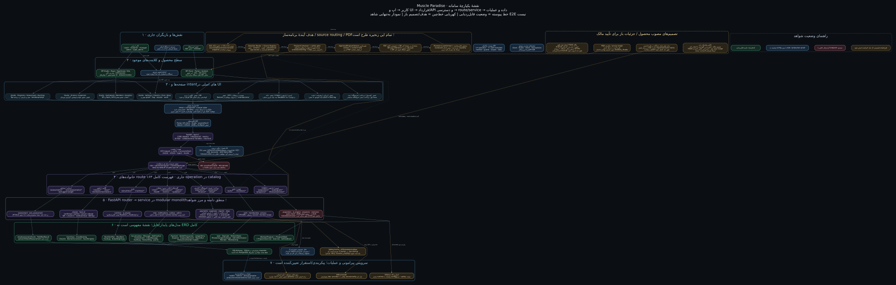

<div align="center">
  
  <h1>Muscle Paradise</h1>
  <p dir="rtl"><strong>سامانهٔ فارسی‌محور برای عملیات باشگاه؛ از تجربهٔ عضو تا کار روزانهٔ تیم</strong></p>
  <p>اپ عضو، پنل مربی و مدیر، و API دامنه در یک محصول واحد.</p>
  <p>
    <a href="https://github.com/yousefghorbanian98-create/MP/actions/workflows/ci.yml"></a>
    <a href="LICENSE"></a>
  </p>
  <p>
    
    
    
    
    
  </p>
</div>

<p align="center">
  <a href="#overview">چشم‌انداز</a> ·
  <a href="#components">اجزای محصول</a> ·
  <a href="#architecture">فلوچارت سامانه</a> ·
  <a href="#status">وضعیت و کیفیت</a> ·
  <a href="#quickstart">شروع توسعه</a> ·
  <a href="#docs">مستندات</a>
</p>

> 🚧 **وضعیت:** توسعه فعال است؛ این صفحه ادعای آمادگی انتشار یا استقرار production نمی‌کند. سبز بودن CI فقط به commit و گیت‌هایی مربوط است که همان اجرا پوشش داده است؛ جایگزین QA دستگاه، اتصال واقعی سرویس‌های بیرونی، آزمون بازیابی پشتیبان یا تأیید انتشار نیست.
>
> 🧭 **baseline انتشار:** طبق [ADR-007](docs/MuscleParadise/adr/007-pwa-primary-release.md)، PWA مشترک React بر پایهٔ `mp-app/studio/` رابط اصلی انتشار اول برای عضو و کادر است؛ اپ React دوم ساخته نمی‌شود. Flutter/Android، Flutter Web و Electron حفظ می‌شوند. این انتخاب محصول، پیاده‌سازی/parity PWA یا پذیرش انتشار را ثابت نمی‌کند؛ گیت‌های D-10/QA و Go/No-Go همچنان جدا و بازند. [ADR-006](docs/MuscleParadise/adr/006-shared-react-pwa.md) جهت shared React را ثبت می‌کند.
>
> 🔒 **مجوز:** مخزن عمومی است، اما نرم‌افزار اختصاصی است؛ مشاهدهٔ کد به‌تنهایی مجوز استفاده، کپی یا بازتوزیع نمی‌دهد. [LICENSE](LICENSE) را بخوانید.

<a id="overview"></a>
## 🎯 چشم‌انداز

**Muscle Paradise (MP)** نرم‌افزاری برای هماهنگ‌کردن تجربهٔ عضو و عملیات روزانهٔ باشگاه است. عضو از مسیر Client با تمرین و پیشرفت خود کار می‌کند؛ تیم باشگاه از Studio اعضا و عملیات را مدیریت می‌کند؛ API نسخه‌دار منطق دامنه و مرزهای دسترسی را فراهم می‌کند.

اصول محصول: رابط فارسی و RTL، دادهٔ واقعی به‌جای نمونهٔ گمراه‌کننده، کنترل دسترسی در سمت سرور، و روشن‌بودن تفاوت میان قابلیت موجود، هدف آینده و چیزی که هنوز آزموده نشده است.

<a id="components"></a>
## 🧭 اجزای محصول

| جزء | کاربران | پشته و نقش |
|---|---|---|
| **MP Client** | عضو باشگاه | Flutter؛ مسیرهای Android و Flutter Web در مخزن حفظ می‌شوند. وضعیت build یا وجود کد به‌تنهایی آزمون دستگاه و آمادگی انتشار را ثابت نمی‌کند. |
| **MP Studio** | مربی، پذیرش و مدیر | React، TypeScript و Vite برای پنل وب؛ بسته‌بندی Electron نیز حفظ شده است. |
| **MP API** | Client، Studio و اتصال‌های مجاز | FastAPI، REST نسخه‌دار و مونولیت ماژولار برای قواعد دامنه و داده. SQLite مقدار پیش‌فرض محلی است؛ پایگاه‌داده و سرویس‌های بیرونیِ استقرار باید جداگانه پیکربندی و آزموده شوند. |
| **Check-in و کیوسک** | عضو و پذیرش | مسیرهای حضور در اپ‌ها و API؛ دستگاه، دوربین و راه‌اندازی کیوسک نیازمند آزمون محیط واقعی‌اند. |

<a id="architecture"></a>
## 🏗️ فلوچارت یکپارچهٔ سامانه

این فلوچارت یک‌جا نشان می‌دهد نقش‌ها و کلاینت‌ها چگونه به صفحه‌ها، API و کنترل‌های دسترسی، route/service، داده و مسیرهای هدف می‌رسند. برای بزرگ‌نمایی روی تصویر بزنید؛ [منبع قابل‌ویرایش Graphviz](docs/MuscleParadise/architecture/system-integrated-flow-v1-2026-11-23.dot) نیز در مخزن است.

<div align="center">
  <a href="docs/MuscleParadise/architecture/system-integrated-flow-v1-2026-11-23.svg">
    
  </a>
</div>

<p align="center"><sub>پیش‌نویس جامع برای بازبینی؛ نه ADR یا تأیید رسمی همهٔ مسیرها. خط پیوسته یعنی اتصال قابل‌ردیابی در کد/قرارداد، نه اثبات E2E. خط‌چین کهربایی یعنی هدف یا تصمیم باز؛ گیت محصول و وضعیت انتشار را از کد، تست و اسناد جاری بررسی کنید.</sub></p>

در کنترل دسترسی، درخواست و تأیید OTP مسیرهای عمومیِ rate-limited هستند و از `authz_gate` عبور نمی‌کنند؛ مسیرهای محافظت‌شده همچنان به احراز نشست و مجوز سروری نیاز دارند.

**جهت‌های معماری که باید از هم تفکیک بمانند:**

- PWA مشترک React بر پایهٔ Studio طبق ADR-007 کلاینت اصلی انتشار اول برای عضو و کادر است؛ این تصمیم به‌تنهایی به معنی پیاده‌سازی، parity یا انتشار PWA نیست.
- Flutter/Android، مسیر Flutter Web و Electron حفظ می‌شوند؛ هیچ‌کدام با baseline PWA حذف یا خاموش نمی‌شوند.
- `D-01` از نظر baseline کلاینت با ADR-007 پاسخ داده شده است؛ `D-10` و تمام معیارهای acceptance/Go-No-Go همچنان گیت‌اند. PWA تصمیم‌های نقش/grant، پایگاه‌داده/tenant، پرداخت، نشست یا offline/cache را خودبه‌خود تعیین نمی‌کند.

برای مرزها و محدودیت‌های هر نقشه، [Architecture Atlas](docs/MuscleParadise/architecture/README.md) و [تحلیل شواهد جاری](docs/MuscleParadise/architecture/analysis-2026-11-23.md) را ببینید.

<a id="status"></a>
## ✅ وضعیت و کیفیت

گیت‌های CI شامل آزمون‌ها و بررسی‌های متناسب با شاخه و تغییر هستند؛ نتیجهٔ روز را در [GitHub Actions](https://github.com/yousefghorbanian98-create/MP/actions) و برای تصمیم release روی همان SHA بررسی کنید. عددها و نتیجه‌های مربوط به commitهای قدیمی در این صفحه نگهداری نمی‌شوند.

وجود صفحه، endpoint، دیاگرام یا تنظیمات به‌تنهایی تکمیل جریان عضو تا پایگاه‌داده یا فعال‌بودن سرویس بیرونی را ثابت نمی‌کند. پرداخت/پیامک واقعی، مجوزهای محیط استقرار، پایگاه‌داده و بازیابی backup، آزمون مرورگر و دستگاه و گیت‌های انتشار هرکدام شواهد جدا می‌خواهند. [چک‌لیست انتشار](docs/MuscleParadise/RELEASE-CHECKLIST.md) و [راهنمای deployment](docs/MuscleParadise/DEPLOYMENT.md) را مرجع کار اجرایی قرار دهید.

<a id="quickstart"></a>
## 🚀 شروع توسعه

### پیش‌نیازها

- Python **3.11+** برای API
- Node.js **22** و npm برای Studio
- Flutter SDK مطابق نسخهٔ pin‌شدهٔ CI برای Client

### ۱. اجرای Backend

```bash
cd mp-app/backend
python3.11 -m venv .venv
source .venv/bin/activate
pip install -e ".[dev]"
uvicorn app.main:app --reload --host 0.0.0.0 --port 8000
```

مستندات OpenAPI پس از اجرا در `/docs` در دسترس‌اند.

### ۲. اجرای Studio

در ترمینالی جدا:

```bash
cd mp-app/studio
npm ci
npm test
npm run build
MP_API_TARGET=http://127.0.0.1:8000 npm run dev -- --host 0.0.0.0
```

### ۳. اجرای Client

```bash
cd mp-app/client
flutter pub get
flutter test
flutter run --dart-define=MP_API=http://10.0.2.2:8000/api/v1
```

آدرس نمونه برای Android Emulator است. برای دستگاه فیزیکی، `MP_API` را به IP یا دامنه‌ای تغییر دهید که همان دستگاه به آن دسترسی دارد.

<a id="docs"></a>
## 📚 مستندات اصلی

| موضوع | مرجع |
|---|---|
| راهنمای مخزن و فهرست مستندات | [AGENTS.md](AGENTS.md) · [نقشهٔ مستندات](docs/README.md) · [هندآف نشست](docs/MuscleParadise/SESSION_HANDOFF.md) (خلاصهٔ نشست است؛ وضعیت را با TODO و کد جاری تطبیق دهید) |
| فلوچارت و نقشه‌های معماری | [فلوچارت یکپارچه](docs/MuscleParadise/architecture/system-integrated-flow-v1-2026-11-23.svg) · [منبع DOT](docs/MuscleParadise/architecture/system-integrated-flow-v1-2026-11-23.dot) · [Architecture Atlas](docs/MuscleParadise/architecture/README.md) |
| تصمیم‌ها و دامنهٔ PWA | [ADR index](docs/MuscleParadise/adr/README.md) · [ADR-007 (baseline انتشار)](docs/MuscleParadise/adr/007-pwa-primary-release.md) · [ADR-006 (جهت PWA مشترک)](docs/MuscleParadise/adr/006-shared-react-pwa.md) |
| API و ساختار محصول | [Backend](mp-app/backend/README.md) · [فهرست routeهای API](mp-app/backend/api/routes.json) · [Client](mp-app/client/README.md) · [Studio](mp-app/studio/README.md) |
| وضعیت کار و آمادگی انتشار | [TODO جاری](docs/MuscleParadise/TODO-CLOUD-FINANCE-ACCESS.md) · [چک‌لیست انتشار](docs/MuscleParadise/RELEASE-CHECKLIST.md) · [Deployment](docs/MuscleParadise/DEPLOYMENT.md) · [Ops runbook](docs/MuscleParadise/OPS-RUNBOOK.md) |
| حریم خصوصی و تاریخچه | [نگهداری داده](docs/MuscleParadise/DATA-RETENTION.md) · [CHANGELOG](docs/MuscleParadise/CHANGELOG.md) |

<a id="license"></a>
## 📄 مجوز

Muscle Paradise نرم‌افزار اختصاصی است. مشاهدهٔ عمومی مخزن مجوز کپی، استفاده، میزبانی یا بازتوزیع برای دیگران ایجاد نمی‌کند. جزئیات در [LICENSE](LICENSE) و حقوق وابستگی‌های ثالث در [NOTICE-THIRD-PARTY.md](NOTICE-THIRD-PARTY.md) آمده است.

<details>
  <summary><strong>English overview</strong></summary>
  <br />
  Muscle Paradise is a Persian-first gym operations platform with a Flutter member client, a React/TypeScript Studio (including an existing Electron package), and a versioned FastAPI modular backend. Per ADR-007, a shared React PWA based on Studio is the primary first-release client for members and staff; Flutter/Android, Flutter Web, and Electron are preserved. This product decision does not claim PWA implementation, parity, QA, or release readiness; acceptance and Go/No-Go gates remain open. This repository is actively developed and is not presented as production-ready. See <a href="docs/MuscleParadise/architecture/system-integrated-flow-v1-2026-11-23.svg">the integrated flowchart</a> and <a href="LICENSE">LICENSE</a>.
</details>
