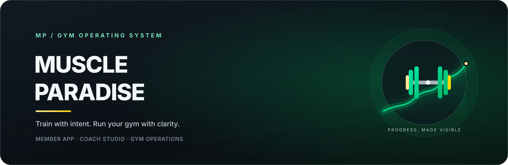
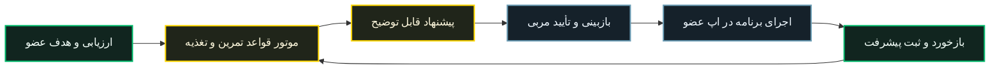
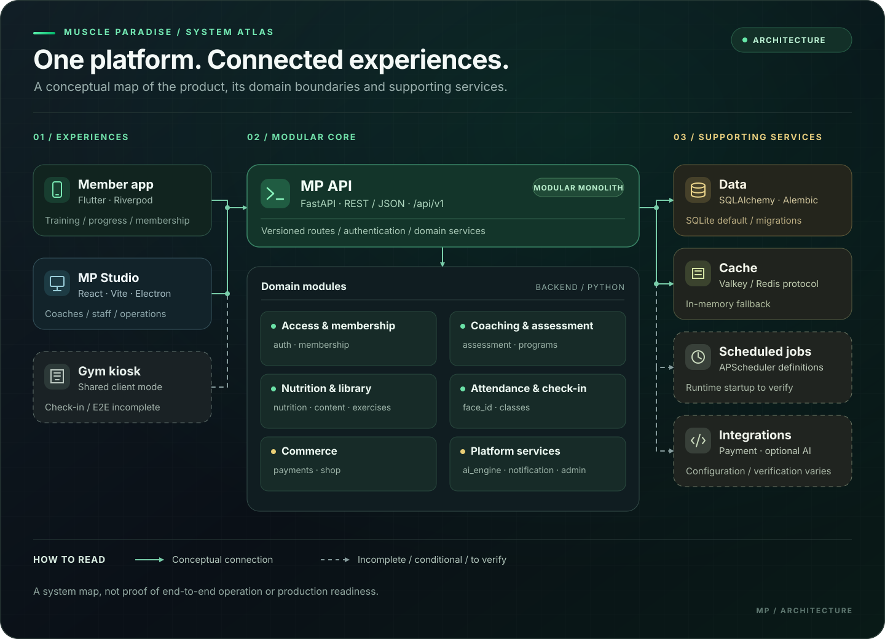
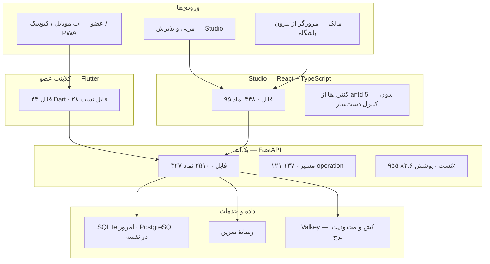
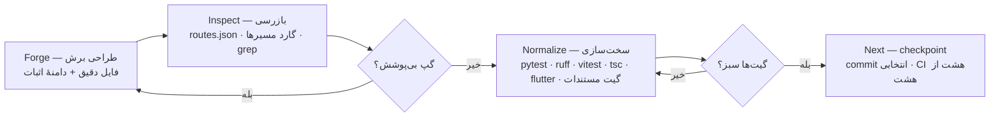
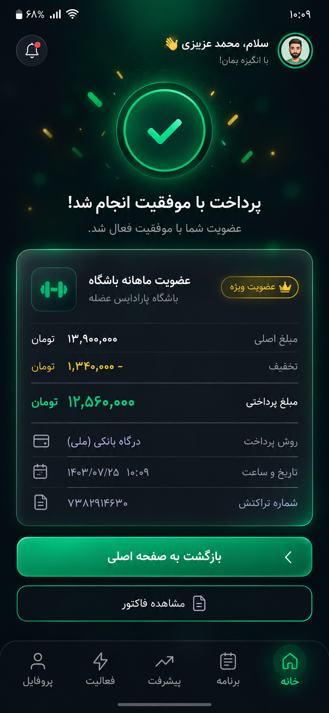
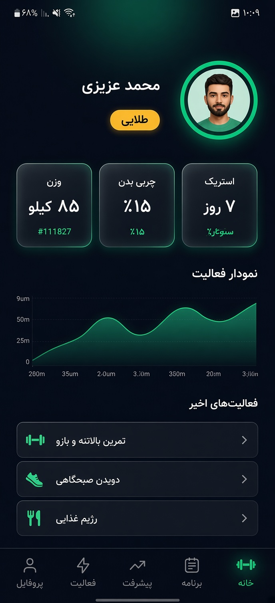

<div align="center">
  
  <h1>Muscle Paradise</h1>
  <p dir="rtl"><strong>سیستم مدیریت یکپارچهٔ باشگاه؛ از تجربهٔ عضو تا عملیات مربی و مدیر</strong></p>
  <p>یک هستهٔ مشترک برای برنامه‌ریزی، پیگیری پیشرفت و مدیریت روزمرهٔ باشگاه.</p>

  <p>
    <a href="https://img.shields.io/github/stars/yousefghorbanian98-create/MP?style=for-the-badge&color=00B86A"></a>
    <a href="https://img.shields.io/github/forks/yousefghorbanian98-create/MP?style=for-the-badge&color=FFD700"></a>
    <a href="https://img.shields.io/github/issues/yousefghorbanian98-create/MP?style=for-the-badge&color=8AA4B8"></a>
    <a href="LICENSE"></a>
  </p>
  <p>
    
    
    
    
    
    
  </p>
</div>

<p align="center">
  <a href="#vision">چشم‌انداز</a> ·
  <a href="#experiences">تجربه‌ها</a> ·
  <a href="#architecture">معماری</a> ·
  <a href="#build">لایه‌ها و مراحل</a> ·
  <a href="#previews">پیش‌نمایش‌ها</a> ·
  <a href="#quality">کیفیت و وضعیت</a> ·
  <a href="#quickstart">شروع توسعه</a> ·
  <a href="#docs">مستندات</a>
</p>

> 🚧 **وضعیت پروژه: توسعهٔ فعال، نه آمادهٔ انتشار.** کارکردهای اصلی، امنیت، گیت‌های CI و Android و آزمون دستگاه باید برای نسخهٔ انتشار اثبات شوند. [هدف و تصمیم‌ها](docs/MuscleParadise/TODO-CLOUD-FINANCE-ACCESS.md) · [برنامهٔ میکرولوپ و QA](docs/MuscleParadise/PLAN-FINN-ECC-MICROLOOPS-QA.md) · [هندآف کامل](docs/MuscleParadise/HANDOFF-PROJECT-2026-11-18.md)
>
> 🧭 **برای سازندهٔ بعدی:** ابتدا [پیش‌نیازها و راهنمای ادامه با RepoWise](docs/MuscleParadise/BUILDER-START-AND-REPOWISE.md) را بخوانید؛ index محلی ابزار و فایل‌های محرمانه در Git وجود ندارند و گراف جای کد و آزمون نیست.
>
> 🔒 **مجوز:** عمومی‌بودن کد به معنی متن‌بازبودن آن نیست. این پروژه تحت مجوز اختصاصی است؛ [LICENSE](LICENSE) را ببینید.
>
> 💳 **هدف پرداخت انتشار اول:** کارت‌به‌کارت با فیش خصوصی، تطبیق انسانی با بانک و فعال‌سازی خودکار اشتراک پس از تأیید. [طرح و گیت‌های M113](docs/MuscleParadise/PLAN-MANUAL-TRANSFER.md) و [شواهد REA](finn/reports/rea/m113-review.md) هدف را توضیح می‌دهند؛ policy مستقل و تست محلی نوشته شده، ولی اتصال کامل، آپلود خصوصی و تأیید بانکی هنوز اثبات نشده‌اند. `card` موجود همچنان کارت‌خوان حضوری است.

<a id="vision"></a>
## 🎯 چشم‌انداز

**Muscle Paradise (MP)** یک سامانهٔ فارسی‌محور برای ادارهٔ عملیات باشگاه است: عضو تجربهٔ تمرین و پیشرفت خود را از اپ می‌بیند؛ مربی و مدیر از Studio اعضا، برنامه‌ها و گزارش‌ها را مدیریت می‌کنند؛ بک‌اند نسخه‌دار، قواعد کسب‌وکار و داده‌ها را در یک نقطه نگه می‌دارد.

طراحی محصول بر چهار اصل تکیه دارد:

- **یک منبع حقیقت:** صفحه‌ها دادهٔ واقعی API را نشان دهند؛ دادهٔ نمونه نباید به‌جای اطلاعات عضو نمایش داده شود.
- **مربی در حلقه:** برنامه‌ریزی عددی از قواعد مشخص می‌آید و تصمیم‌های مهم قابل بازبینی‌اند.
- **دسترسی بر اساس نقش:** هر نقش فقط اقدام‌هایی را ببیند که واقعاً مجاز به انجام آن‌هاست.
- **فارسی از ابتدا:** رابط RTL، فونت Vazirmatn و نمایش مناسب واحدها و تاریخ‌های محلی.

<a id="experiences"></a>
## 🧭 سه تجربه، یک محصول

| بخش | برای چه کسی؟ | فناوری | مسئولیت اصلی |
|---|---|---|---|
| **MP Client** | عضو باشگاه | Flutter · Riverpod | برنامهٔ روزانه، پیشرفت، ارزیابی، عضویت و خرید |
| **MP Studio** | کادر و مالک | React · TypeScript · Vite؛ Electron موجود | پنل وب برای اعضا، حضور، برنامه‌ها، گزارش‌ها و عملیات؛ دسکتاپ نصبی الزام انتشار اول نیست |
| **Gym Kiosk** | مراجعهٔ حضوری | حالت مشترک Client | مسیرهای ورود و چک‌این؛ اتصال انتها‌به‌انتها هنوز در حال تکمیل است |
| **MP API** | کلاینت‌ها و یکپارچه‌سازی‌ها | FastAPI · SQLAlchemy · Alembic | قرارداد REST نسخه‌دار، احراز هویت، نقش‌ها و منطق دامنه |

### چرخهٔ ارزش محصول

این نمودار **مدل هدف محصول** را نشان می‌دهد؛ همهٔ پیکان‌ها هنوز به‌عنوان یک مسیر کامل E2E تأیید نشده‌اند.



<a id="architecture"></a>
## 🏗️ معماری در یک نگاه

بک‌اند به‌صورت **مونولیت ماژولار** سازمان‌دهی شده است؛ کلاینت‌ها با REST/JSON نسخه‌دار با آن صحبت می‌کنند. SQLite مسیر پیش‌فرض فعلی است؛ PostgreSQL، بکاپ قابل بازیابی و سرویس اعلان از اهداف بررسی‌نشدهٔ استقرارند. این نقشه نمای مفهومی ساختار و ارتباط‌هاست، نه اثبات عملکرد همهٔ مسیرها یا آمادگی انتشار؛ [نقشهٔ هدف و وضعیت جریان‌ها](docs/MuscleParadise/architecture/cloud-finance-access.md) جزئیات را تفکیک می‌کند.

<div align="center">
  <a href="docs/MuscleParadise/assets/system-architecture.svg"></a>
</div>

<p align="center"><sub>نمای مفهومی معماری · خطوط نقطه‌چین: ناقص، وابسته به تنظیمات یا نیازمند بررسی · برای تصویر با اندازهٔ اصلی روی آن بزنید</sub></p>

| لایه | نقش در سیستم |
|---|---|
| **تجربه‌ها** | اپ عضو، Studio برای کادر باشگاه و مسیر کیوسک که اتصال انتها‌به‌انتهای آن هنوز کامل نشده است. |
| **هسته** | API نسخه‌دار و ماژول‌های دسترسی، عضویت، برنامه، تغذیه، چک‌این، فروش و خدمات پلتفرم. |
| **داده و خدمات** | SQLite پیش‌فرض و لایهٔ کش؛ وضعیت راه‌اندازی jobها و اتصال‌های بیرونی باید جداگانه تأیید شود. |

**هدف پرداخت انتشار اول:** کارت‌به‌کارت با فیش و تطبیق مستقل انسانی با بانک است؛ مسیر کامل آن هنوز اثبات نشده و با مسیر پرداخت موجود یکسان نیست. [جزئیات جریان و وضعیت](docs/MuscleParadise/architecture/cloud-finance-access.md).

[گراف متنی، راهنمای نمودار و مسیرهای کد](docs/MuscleParadise/architecture/system-atlas.md) · [معماری C4](docs/MuscleParadise/architecture/c4.md) · [نقشهٔ ماژول‌ها](docs/MuscleParadise/architecture/module-map.md)

<a id="build"></a>
## 🧱 لایه‌های ساخت و مراحل تولید

دیاگرام‌های این بخش از مدل واقعی همین مخزن کشیده شده‌اند، نه از توصیف. نسخهٔ کامل با چهار دیاگرام،
منبع هر عدد و فرمان بازتولید: [لایه‌ها و مراحل تولید](docs/MuscleParadise/ARCHITECTURE-LAYERS-AND-STAGES.md).



مسیر تولید هر میکرو‌لوپ چهار ایستگاه دارد و هر ایستگاه گیت خودش را دارد:



| ایستگاه | خروجی | گیت |
|---|---|---|
| **Forge** | برش کوچک با فایل‌های دقیق | دامنهٔ اثبات نوشته شده باشد |
| **Inspect** | فهرست گپ‌ها | هر گپ به API و تست وصل شود |
| **Normalize** | کد و سند اصلاح‌شده | pytest · ruff · vitest · tsc · flutter analyze · گیت مستندات و دیاگرام |
| **Next** | commit و ثبت تصمیم | CI همان SHA هشت از هشت سبز |

<a id="previews"></a>
## ✨ پیش‌نمایش رابط کاربری

<div align="center">
  <a href="docs/MuscleParadise/ui-previews/01-studio-dashboard.png"></a>
</div>

<p align="center"><sub>داشبورد مربی و مدیر · پیش‌نمایش طراحی</sub></p>

<div align="center">
  <a href="docs/MuscleParadise/ui-previews/07-client-home-grid.png"></a>
  <a href="docs/MuscleParadise/ui-previews/02-client-today-workout.png"></a>
  <a href="docs/MuscleParadise/ui-previews/04-payment-receipt.png"></a>
  <a href="docs/MuscleParadise/ui-previews/05-member-profile.png"></a>
</div>

<p align="center"><sub>موکاپ‌ها و پیش‌نمایش‌های طراحی‌اند؛ نام‌ها و اعداد داخل تصویر نمونه هستند و شاهدی برای عملکرد زنده یا دادهٔ واقعی محسوب نمی‌شوند.</sub></p>

<a id="quality"></a>
## ✅ کیفیت، امنیت و وضعیت فعلی

| حوزه | رویکرد |
|---|---|
| **Backend** | pytest و پوشش، Ruff، اسکن امنیتی و گیت‌های قرارداد/دسترسی |
| **Studio** | Vitest، TypeScript build، تست‌های دسترس‌پذیری و قرارداد API |
| **Client** | Flutter tests و گیت‌های Android در GitHub Actions |
| **داده و حریم خصوصی** | رضایت برای دادهٔ زیستی، حداقل‌سازی داده و راهنمای نگهداری |
| **انتشار** | فقط پس از سبزشدن گیت‌های مرتبط و بازبینی امضای release |
| **سینتکس دیاگرام** | هر بلوک Mermaid با پارسر رسمی در CI پارس می‌شود؛ ۲۳ دیاگرام |
| **بهداشت مخزن** | گیت CI نمی‌گذارد ایندکس ابزار یا hook ایجنت وارد Git شود |

سنجه‌های همین حالا، از خروجی واقعی CI و گزارش پوشش:

| سنجه | مقدار |
|---|---|
| تست بک‌اند | ۹۵۵ قبول · ۲ رد‌شده |
| پوشش خطوط بک‌اند | ۸۲.۶٪ روی ۱۹۴ فایل |
| تست Studio | ۲۳۴ قبول · ۹ رد‌شده |
| قرارداد API | ۱۲۱ مسیر · ۱۳۷ operation |
| jobهای CI | ۸ |
| نقشهٔ تست‌به‌کد | ۱۵۲۳ تست · ۷۸۶۳ رکورد |
| بلوک دیاگرام | ۲۳ بلوک در ۱۱ سند |

برای وضعیت دقیق، [هندآف کامل](docs/MuscleParadise/HANDOFF-PROJECT-2026-11-18.md)، [TODO ابری و مالی](docs/MuscleParadise/TODO-CLOUD-FINANCE-ACCESS.md)، [صف قبلی و شواهد](docs/MuscleParadise/TODO-2026-11-16.md) و [سیاست نگهداری داده](docs/MuscleParadise/DATA-RETENTION.md) را ببینید. عکس پیشرفت بدن خارج از محدودهٔ محصول است؛ تصویر فیش و کالا موضوع جداگانه‌اند.

هر میکرولوپ یک واحد QA اختصاصی دارد: بررسی اتصال واقعی UI/API/DB، دکمه‌ها و خروجی‌های محدوده، امنیت، رگرسیون، خطا و بار؛ وضعیت اجرا‌نشده `UNKNOWN` است نه PASS. [جزئیات ۳۳ میکرولوپ](docs/MuscleParadise/PLAN-FINN-ECC-MICROLOOPS-QA.md).

CI روی commit `0392b00` در [run 44624443191](https://github.com/yousefghorbanian98-create/MP/actions/runs/44624443191) هر هشت job را موفق گزارش کرد؛ این نتیجه فقط برای همان commit است، نه الزاماً تغییرات بعدی یا نسخهٔ release امضاشده. برای هر نسخه، run همان commit بررسی شود.

<a id="stack"></a>
## 🧰 فناوری‌ها

<p>
  
  
  
  
  
  
  
  
  
</p>

### 🔎 آخرین اعتبارسنجی (۲۰۲۶-۱۱-۲۰)

| بخش | نتیجهٔ اندازه‌گیری‌شده | محدودیت |
|---|---|---|
| **بار** | ۲۰۰ کاربر همزمان، ۹۰ ثانیه، ۹٬۶۵۴ درخواست، **۰ خطا**، ~۱۶۹ درخواست بر ثانیه، p95 ≈ ۴۳۰ms | SQLite و یک worker روی sandbox؛ عدد production نیست |
| **استودیو (مرورگر)** | ورود با فرم واقعی و ۱۲ صفحه از منوی کناری؛ بدون خطای کنسول یا پاسخ ۴xx/۵xx | تست همهٔ دکمه‌ها و فرم‌ها هنوز کامل نشده |
| **معماری و بهداشت کد** | مدل C4 و ۶۷۰ یافتهٔ سلامت کد؛ گزارش در [docs/architecture/repowise](docs/architecture/repowise/README.md) | یافته‌ها شواهد بررسی‌اند، نه خطای اثبات‌شده |
| **اپ Flutter** | بیلد وب در CI موفق بود (`mp-web`) | اجرای دستی روی مرورگر و دستگاه ثبت نشده است |
| **APK امضاشده** | — | **BLOCKED**: secretهای `MP_ANDROID_*` تنظیم نشده‌اند |

<a id="quickstart"></a>
## 🚀 شروع توسعه

### پیش‌نیازها

- Python **3.11+** برای API
- Node.js **22** و npm برای Studio
- Flutter **stable** برای اپ عضو
- Docker و Docker Compose برای اجرای استک کامل

### MP Studio

```bash
cd mp-app/studio
npm ci
npm test
npm run build
```

برای اجرای محیط توسعه، ابتدا API را روی پورت `8000` بالا بیاورید و سپس:

```bash
MP_API_TARGET=http://127.0.0.1:8000 npm run dev -- --host 0.0.0.0
```

### Backend

```bash
cd mp-app/backend
python3.11 -m venv .venv
source .venv/bin/activate
pip install -e ".[dev]"
uvicorn app.main:app --reload --host 0.0.0.0 --port 8000
```

پس از اجرا، مستندات OpenAPI در `/docs` در دسترس است. برای تست و lint بک‌اند:

```bash
pytest --cov=. --cov-fail-under=70
ruff check .
ruff format --check .
```

### MP Client

```bash
cd mp-app/client
flutter pub get
flutter test
flutter run --dart-define=MP_API=http://10.0.2.2:8000/api/v1
```

نمونهٔ بالا برای Android Emulator است؛ برای دستگاه واقعی، آدرس API باید به IP یا دامنهٔ قابل‌دسترسی همان شبکه تغییر کند. برای استقرار کامل، [راهنمای Deployment](docs/MuscleParadise/DEPLOYMENT.md) را دنبال کنید.

<a id="docs"></a>
## 📚 نقشهٔ مستندات

| موضوع | سند |
|---|---|
| شروع ایجنت AI و انتقال نشست | [راهنمای ایجنت](AGENTS.md) · [نقشهٔ مستندات](docs/README.md) · [handoff جاری](docs/MuscleParadise/SESSION_HANDOFF.md) · [هندآف تفصیلی و راهنمای نشست تازه](docs/MuscleParadise/HANDOFF-PROJECT-2026-11-18.md) |
| نقشهٔ تاریخی محصول | [MASTER MAP](docs/MuscleParadise/MASTER_MAP.md) |
| لایه‌های ساخت و مراحل تولید | [لایه‌ها و مراحل](docs/MuscleParadise/ARCHITECTURE-LAYERS-AND-STAGES.md) · [نقشهٔ کارهای بعدی](docs/MuscleParadise/ROADMAP-NEXT-2026-11-19.md) |
| ابزارها و آنچه واقعاً اجرا شد | [بررسی ابزار ایجنت](docs/MuscleParadise/AGENT-TOOLING-REVIEWS.md) |
| معماری و هدف ابری/مالی | [C4](docs/MuscleParadise/architecture/c4.md) · [جریان‌های هدف](docs/MuscleParadise/architecture/cloud-finance-access.md) |
| نیازمندی‌ها و user storyها | [PRD](docs/MuscleParadise/PRD.md) · [تصمیم‌های اخیر مالک](docs/MuscleParadise/TODO-CLOUD-FINANCE-ACCESS.md) |
| برنامهٔ ساخت و کارهای باز | [QF-00 تا QF-32 و QA تکرارشونده](docs/MuscleParadise/PLAN-FINN-ECC-MICROLOOPS-QA.md) · [TODO قبلی](docs/MuscleParadise/TODO-2026-11-16.md) |
| ابزار و منشأ کد | [تحقیق OSS](docs/MuscleParadise/OSS-DEEP-RESEARCH-2026-11-18.md) · [بررسی REA/ECC](docs/MuscleParadise/REPORT-REA-ECC-SUBAGENTS.md) · [آزمایش زیراجنت](docs/MuscleParadise/REPORT-ECC-SUBAGENT-SMOKE.md) |
| صف و اولویت‌های محصول | [BUILD QUEUE](docs/MuscleParadise/BUILD-QUEUE.md) |
| سیستم طراحی | [Design System](docs/MuscleParadise/design/design-system.md) |
| استقرار و عملیات | [Deployment](docs/MuscleParadise/DEPLOYMENT.md) · [Ops Runbook](docs/MuscleParadise/OPS-RUNBOOK.md) |
| حریم خصوصی و دادهٔ زیستی | [Biometric Policy](docs/MuscleParadise/security/biometric-policy.md) · [Data Retention](docs/MuscleParadise/DATA-RETENTION.md) |
| تغییرات نسخه‌ها | [CHANGELOG](docs/MuscleParadise/CHANGELOG.md) |

<a id="license"></a>
## 📄 مجوز

Muscle Paradise نرم‌افزار اختصاصی است. مشاهدهٔ عمومی مخزن مجوز کپی، استفاده، بازتوزیع یا میزبانی سرویس برای دیگران ایجاد نمی‌کند. جزئیات و حقوق وابستگی‌های ثالث در [LICENSE](LICENSE) و [NOTICE-THIRD-PARTY.md](NOTICE-THIRD-PARTY.md) آمده‌اند.

<details>
  <summary><strong>English overview</strong></summary>
  <br />
  Muscle Paradise is a Persian-first gym operations platform with a Flutter member app, a React/Electron coach studio, and a versioned FastAPI modular backend. The repository is actively developed; some end-to-end workflows and release gates are still in progress. This is proprietary software—see <a href="LICENSE">LICENSE</a> before use.
</details>

<p align="center"><sub>Designed for stronger training, clearer coaching, and calmer gym operations. 🟢</sub></p>


## 🧩 ارزش‌های در حال بررسی برای عضویت و تمرین

[برنامهٔ برش‌های ارزش‌ها و نقش‌ها](docs/MuscleParadise/PLAN-OSS-VALUE-MICROLOOPS-2026-11-18.md) · [گزارش REA و RepoWise](docs/MuscleParadise/REPORT-OSS-VALUE-DEEP-DIVE-2026-11-18.md) · [نقشهٔ هدف جریان‌ها](docs/MuscleParadise/architecture/oss-value-flows.md). این موارد **برنامه‌ریزی‌شده و آزمایش‌نشده‌اند**؛ هیچ کد، داده یا دارایی تازه‌ای از نامزدها وارد محصول نشده است.
