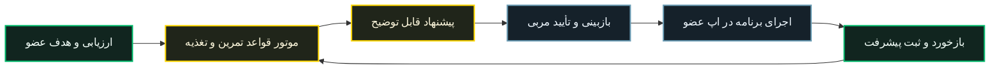
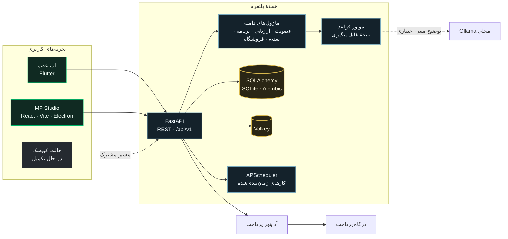
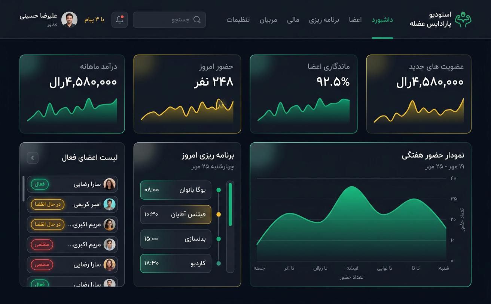
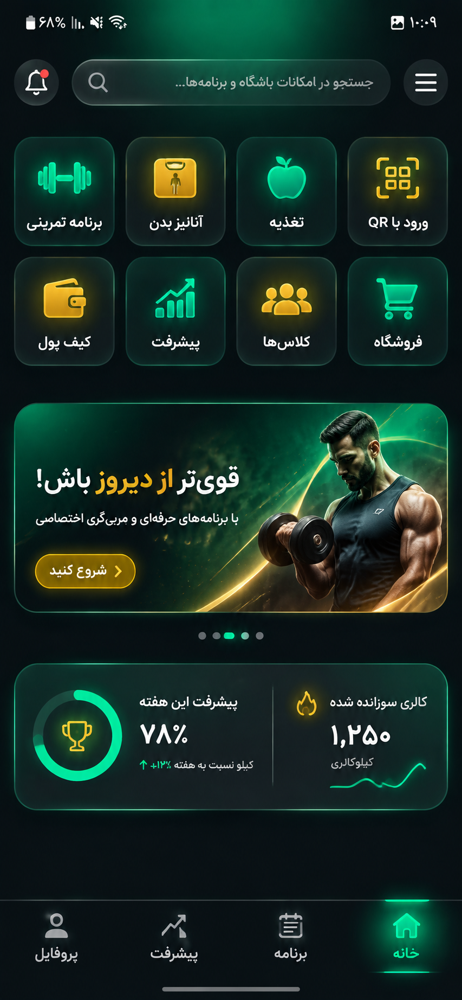
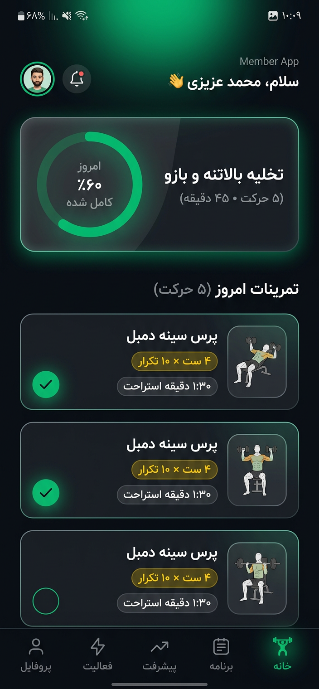

<div align="center">
  
  <h1>Muscle Paradise</h1>
  <p dir="rtl"><strong>سیستم مدیریت یکپارچهٔ باشگاه؛ از تجربهٔ عضو تا عملیات مربی و مدیر</strong></p>
  <p>یک هستهٔ مشترک برای برنامه‌ریزی، پیگیری پیشرفت و مدیریت روزمرهٔ باشگاه.</p>

  <p>
    <a href="https://img.shields.io/github/stars/yousefghorbanian98-create/MP?style=for-the-badge&color=00B86A"></a>
    <a href="https://img.shields.io/github/forks/yousefghorbanian98-create/MP?style=for-the-badge&color=FFD700"></a>
    <a href="https://img.shields.io/github/issues/yousefghorbanian98-create/MP?style=for-the-badge&color=8AA4B8"></a>
    <a href="LICENSE"></a>
  </p>
  <p>
    
    
    
    
    
    
  </p>
</div>

<p align="center">
  <a href="#vision">چشم‌انداز</a> ·
  <a href="#experiences">تجربه‌ها</a> ·
  <a href="#architecture">معماری</a> ·
  <a href="#previews">پیش‌نمایش‌ها</a> ·
  <a href="#quality">کیفیت و وضعیت</a> ·
  <a href="#quickstart">شروع توسعه</a> ·
  <a href="#docs">مستندات</a>
</p>

> 🚧 **وضعیت پروژه: توسعهٔ فعال.** این مخزن ادعای آماده‌بودن همهٔ مسیرها برای تولید ندارد. پیش از توزیع نسخهٔ Android، گیت‌های Flutter، امنیت و امضای release باید تأیید شوند؛ وضعیت و کارهای باز در [فهرست پیگیری](docs/MuscleParadise/TODO-2026-11-16.md) ثبت شده‌اند.
>
> 🔒 **مجوز:** عمومی‌بودن کد به معنی متن‌بازبودن آن نیست. این پروژه تحت مجوز اختصاصی است؛ لطفاً [LICENSE](LICENSE) را ببینید.

<a id="vision"></a>
## 🎯 چشم‌انداز

**Muscle Paradise (MP)** یک سامانهٔ فارسی‌محور برای ادارهٔ عملیات باشگاه است: عضو تجربهٔ تمرین و پیشرفت خود را از اپ می‌بیند؛ مربی و مدیر از Studio اعضا، برنامه‌ها و گزارش‌ها را مدیریت می‌کنند؛ بک‌اند نسخه‌دار، قواعد کسب‌وکار و داده‌ها را در یک نقطه نگه می‌دارد.

طراحی محصول بر چهار اصل تکیه دارد:

- **یک منبع حقیقت:** صفحه‌ها دادهٔ واقعی API را نشان دهند؛ دادهٔ نمونه نباید به‌جای اطلاعات عضو نمایش داده شود.
- **مربی در حلقه:** برنامه‌ریزی عددی از قواعد مشخص می‌آید و تصمیم‌های مهم قابل بازبینی‌اند.
- **دسترسی بر اساس نقش:** هر نقش فقط اقدام‌هایی را ببیند که واقعاً مجاز به انجام آن‌هاست.
- **فارسی از ابتدا:** رابط RTL، فونت Vazirmatn و نمایش مناسب واحدها و تاریخ‌های محلی.

<a id="experiences"></a>
## 🧭 سه تجربه، یک محصول

| بخش | برای چه کسی؟ | فناوری | مسئولیت اصلی |
|---|---|---|---|
| **MP Client** | عضو باشگاه | Flutter · Riverpod | برنامهٔ روزانه، پیشرفت، ارزیابی، عضویت و خرید |
| **MP Studio** | مربی، پذیرش و مدیر | React · TypeScript · Vite · Electron | اعضا، حضور، برنامه‌ها، گزارش‌ها و عملیات باشگاه |
| **Gym Kiosk** | مراجعهٔ حضوری | حالت مشترک Client | مسیرهای ورود و چک‌این؛ اتصال انتها‌به‌انتها هنوز در حال تکمیل است |
| **MP API** | کلاینت‌ها و یکپارچه‌سازی‌ها | FastAPI · SQLAlchemy · Alembic | قرارداد REST نسخه‌دار، احراز هویت، نقش‌ها و منطق دامنه |

### چرخهٔ ارزش محصول

این نمودار **مدل هدف محصول** را نشان می‌دهد؛ همهٔ پیکان‌ها هنوز به‌عنوان یک مسیر کامل E2E تأیید نشده‌اند.



<a id="architecture"></a>
## 🏗️ معماری در یک نگاه

بک‌اند به‌صورت **مونولیت ماژولار** سازمان‌دهی شده است؛ کلاینت‌ها با REST/JSON نسخه‌دار با آن صحبت می‌کنند. SQLite مسیر پیش‌فرض توسعه است و زیرساخت، مسیر مهاجرت به PostgreSQL را مستند می‌کند.



<a id="previews"></a>
## ✨ پیش‌نمایش رابط کاربری

<div align="center">
  <a href="docs/MuscleParadise/ui-previews/01-studio-dashboard.png"></a>
</div>

<p align="center"><sub>داشبورد مربی و مدیر · پیش‌نمایش طراحی</sub></p>

<div align="center">
  <a href="docs/MuscleParadise/ui-previews/07-client-home-grid.png"></a>
  <a href="docs/MuscleParadise/ui-previews/02-client-today-workout.png"></a>
  <a href="docs/MuscleParadise/ui-previews/04-payment-receipt.png"></a>
  <a href="docs/MuscleParadise/ui-previews/05-member-profile.png"></a>
</div>

<p align="center"><sub>موکاپ‌ها و پیش‌نمایش‌های طراحی‌اند؛ نام‌ها و اعداد داخل تصویر نمونه هستند و شاهدی برای عملکرد زنده یا دادهٔ واقعی محسوب نمی‌شوند.</sub></p>

<a id="quality"></a>
## ✅ کیفیت، امنیت و وضعیت فعلی

| حوزه | رویکرد |
|---|---|
| **Backend** | pytest و پوشش، Ruff، اسکن امنیتی و گیت‌های قرارداد/دسترسی |
| **Studio** | Vitest، TypeScript build، تست‌های دسترس‌پذیری و قرارداد API |
| **Client** | Flutter tests و گیت‌های Android در GitHub Actions |
| **داده و حریم خصوصی** | رضایت برای دادهٔ زیستی، حداقل‌سازی داده و راهنمای نگهداری |
| **انتشار** | فقط پس از سبزشدن گیت‌های مرتبط و بازبینی امضای release |

برای وضعیت دقیق موارد انجام‌شده، نیمه‌تمام و مسدود، به [TODO و شواهد جاری](docs/MuscleParadise/TODO-2026-11-16.md)، [سیاست بیومتریک](docs/MuscleParadise/security/biometric-policy.md) و [سیاست نگهداری داده](docs/MuscleParadise/DATA-RETENTION.md) مراجعه کنید.

<a id="stack"></a>
## 🧰 فناوری‌ها

<p>
  
  
  
  
  
  
  
  
  
</p>

<a id="quickstart"></a>
## 🚀 شروع توسعه

### پیش‌نیازها

- Python **3.11+** برای API
- Node.js **22** و npm برای Studio
- Flutter **stable** برای اپ عضو
- Docker و Docker Compose برای اجرای استک کامل

### MP Studio

```bash
cd mp-app/studio
npm ci
npm test
npm run build
```

برای اجرای محیط توسعه، ابتدا API را روی پورت `8000` بالا بیاورید و سپس:

```bash
MP_API_TARGET=http://127.0.0.1:8000 npm run dev -- --host 0.0.0.0
```

### Backend

```bash
cd mp-app/backend
python3.11 -m venv .venv
source .venv/bin/activate
pip install -e ".[dev]"
uvicorn app.main:app --reload --host 0.0.0.0 --port 8000
```

پس از اجرا، مستندات OpenAPI در `/docs` در دسترس است. برای تست و lint بک‌اند:

```bash
pytest --cov=. --cov-fail-under=70
ruff check .
ruff format --check .
```

### MP Client

```bash
cd mp-app/client
flutter pub get
flutter test
flutter run --dart-define=MP_API=http://10.0.2.2:8000/api/v1
```

نمونهٔ بالا برای Android Emulator است؛ برای دستگاه واقعی، آدرس API باید به IP یا دامنهٔ قابل‌دسترسی همان شبکه تغییر کند. برای استقرار کامل، [راهنمای Deployment](docs/MuscleParadise/DEPLOYMENT.md) را دنبال کنید.

<a id="docs"></a>
## 📚 نقشهٔ مستندات

| موضوع | سند |
|---|---|
| نقشهٔ کل محصول و مرز ماژول‌ها | [MASTER MAP](docs/MuscleParadise/MASTER_MAP.md) |
| معماری C4 و جریان‌های سامانه | [Architecture](docs/MuscleParadise/architecture/c4.md) |
| نیازمندی‌ها و user storyها | [PRD](docs/MuscleParadise/PRD.md) |
| برنامهٔ ساخت و کارهای باز | [TODO / وضعیت جاری](docs/MuscleParadise/TODO-2026-11-16.md) |
| صف و اولویت‌های محصول | [BUILD QUEUE](docs/MuscleParadise/BUILD-QUEUE.md) |
| سیستم طراحی | [Design System](docs/MuscleParadise/design/design-system.md) |
| استقرار و عملیات | [Deployment](docs/MuscleParadise/DEPLOYMENT.md) · [Ops Runbook](docs/MuscleParadise/OPS-RUNBOOK.md) |
| حریم خصوصی و دادهٔ زیستی | [Biometric Policy](docs/MuscleParadise/security/biometric-policy.md) · [Data Retention](docs/MuscleParadise/DATA-RETENTION.md) |
| تغییرات نسخه‌ها | [CHANGELOG](docs/MuscleParadise/CHANGELOG.md) |

<a id="license"></a>
## 📄 مجوز

Muscle Paradise نرم‌افزار اختصاصی است. مشاهدهٔ عمومی مخزن مجوز کپی، استفاده، بازتوزیع یا میزبانی سرویس برای دیگران ایجاد نمی‌کند. جزئیات و حقوق وابستگی‌های ثالث در [LICENSE](LICENSE) و [NOTICE-THIRD-PARTY.md](NOTICE-THIRD-PARTY.md) آمده‌اند.

<details>
  <summary><strong>English overview</strong></summary>
  <br />
  Muscle Paradise is a Persian-first gym operations platform with a Flutter member app, a React/Electron coach studio, and a versioned FastAPI modular backend. The repository is actively developed; some end-to-end workflows and release gates are still in progress. This is proprietary software—see <a href="LICENSE">LICENSE</a> before use.
</details>

<p align="center"><sub>Designed for stronger training, clearer coaching, and calmer gym operations. 🟢</sub></p>
