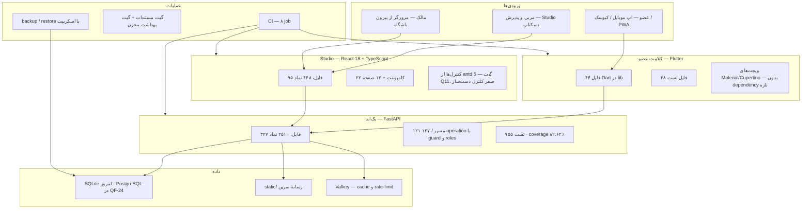
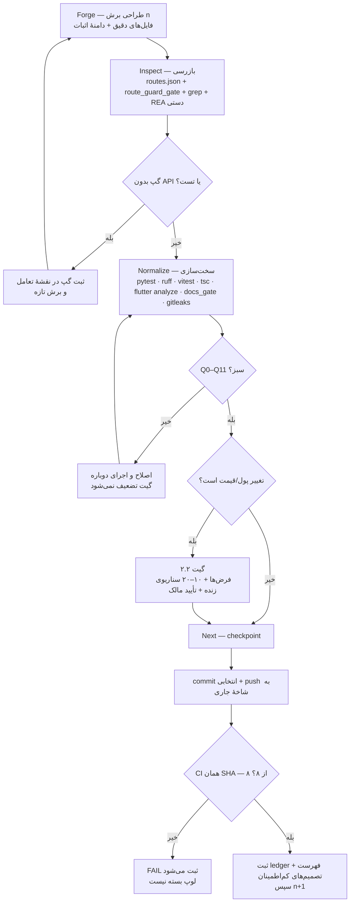
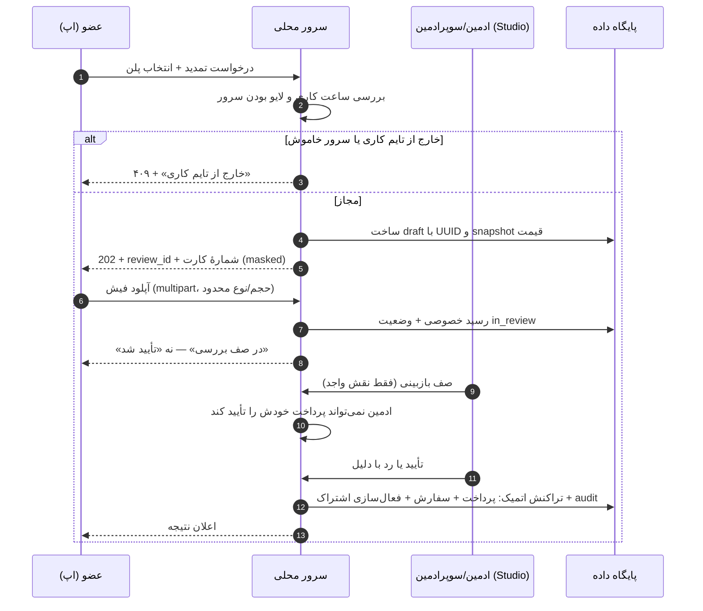
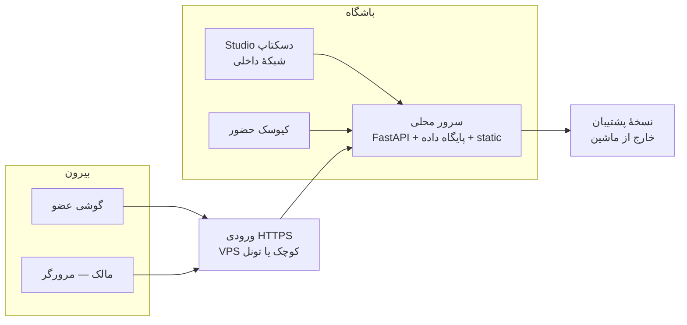

# لایه‌های ساخت و مراحل تولید — دیاگرام‌ها

> **منبع این دیاگرام‌ها:** مدل معماری تولیدشده با `repowise 0.61.0` روی commit `c3821b4`
> (فایل خام: `architecture/repowise-model-2026-11-19.dsl`). عددها از همان ایندکس و از
> گیت‌های پروژه می‌آیند، نه از حافظه.
>
> **مجوز و محدودیت:** repowise خودش AGPL-3.0 است؛ فقط ابزار توسعهٔ محلی است، در محصول
> لینک یا توزیع نمی‌شود، و با `DO_NOT_TRACK=1` و `REPOWISE_OFFLINE=1` اجرا شد. ایندکس
> ۵۷ مگابایتی در `.repowise/` است و gitignore شده؛ گیت `scripts/repo_hygiene_gate.py`
> نمی‌گذارد دوباره وارد Git شود یا hook خودکار بنویسد.
>
> **رندر:** دیاگرام‌ها Mermaid هستند و روی GitHub رندر می‌شوند. در این محیط ساخت
> Chrome و Structurizr نیست، پس PNG/SVG ساخته نشد — این محدودیت است، نه ادعا.

## ۱. لایه‌های ساخت (چه چیزی ساخته می‌شود، با چه حجمی)



## ۲. مسیر تولید یک میکرو‌لوپ (چهار ایستگاه و گیت‌هایش)



## ۳. جریان پول — کارت‌به‌کارت (فاز ۶ نقشه)



## ۴. توپولوژی اجرا (سطح ۲: سرور محلی + ورودی HTTPS ارزان)



## ۵. هر دیاگرام از چه داده‌ای ساخته شد

| دیاگرام | دادهٔ منبع | دستور/فایل |
|---|---|---|
| لایه‌های ساخت | container/component و شمارش فایل و نماد | `repowise export --format structurizr --components` |
| مراحل تولید | چرخهٔ چهارایستگاهی، گیت Q0–Q11 و بند ۲.۲ | `PLAN-FINN-ECC-MICROLOOPS-QA.md` |
| جریان پول | تصمیم ۲۰۲۶-۱۱-۱۹ و طرح QF-07/08/09 | `TODO-CLOUD-FINANCE-ACCESS.md` |
| توپولوژی اجرا | تصمیم سطح ۲ (سرور محلی + ورودی HTTPS) | `OWNER-DECISIONS.md` |

## ۶. بازتولید مدل

```sh
python3 -m venv .venv-repowise           # بیرون از ردیابی Git
.venv-repowise/bin/pip install repowise==0.61.0
DO_NOT_TRACK=1 REPOWISE_OFFLINE=1 .venv-repowise/bin/repowise init --no-prose -y .
DO_NOT_TRACK=1 REPOWISE_OFFLINE=1 \
  .venv-repowise/bin/repowise export --format structurizr --components -o /tmp/model.dsl .
python3 scripts/repo_hygiene_gate.py     # ایندکس gitignore، بدون .claude/ و بدون hook
```

اگر روزی خواستید PNG/SVG واقعی داشته باشید، روی ماشین خودتان یا در CI با Node 20 و
`@mermaid-js/mermaid-cli` (MIT) یا Structurizr CLI رندر کنید؛ در محیط ساخت فعلی
Chrome و Docker نیست، پس خروجی تصویری ساخته نشد.
