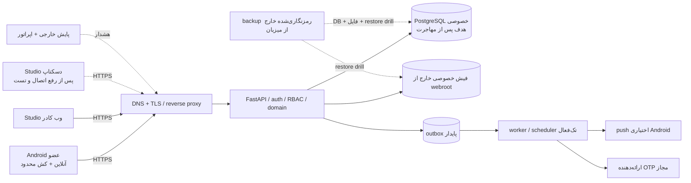

# طرح تولیدی انتقال Muscle Paradise به سرویس ابری

**تاریخ بررسی:** ۲۰۲۶-۱۱-۱۸ 
**وضعیت:** طرح پیشنهادی، نه تأیید امنیت/عملکرد یا مجوز استقرار. هیچ سرور، دامنه یا حسابی خریداری/ساخته نشده و هیچ داده‌ای منتقل نشده است. 
**محدوده:** کل مسیرهای قابل‌عرضهٔ عضو، Studio و API؛ ابری‌شدن را با کامل‌شدن همهٔ قابلیت‌های محصول یکی نگیریم. 
**مبنای کار:** شاخهٔ `arena/b0e55b62-mp`، HEAD محلی `5482930` و تغییرات محلی پیشین؛ در `ls-remote` شاخهٔ remote روی `8e72de9` بود. هیچ pull/reset/force-push یا بازنویسی فایل‌های موجود انجام نشده است.

## ۱. هدف و تغییر تجربه

در مدل پیشنهادی، عضو از خانه با اینترنت به یک سرور در دیتاسنتر متصل می‌شود؛ کادر از Studio و در صورت ساخت رابط کادر روی Android، از موبایل به همان منبع حقیقت وصل می‌شوند. فروشگاه، پکیج/اشتراک، فیش، سفارش و اعلان‌ها پس از توسعه و آزمون قابل استفاده‌اند. اگر سرور فقط روی یک VM ابری باشد، این دیگر «کاملاً آفلاین» نیست و با قطع ارتباط، نوشتن‌های تأییدنشده سرورمحور انجام نمی‌شوند. کش آفلاین فقط در مواردی که مجاز و آزموده شده حفظ می‌شود؛ تاریخ، وضعیت اتصال و محدودیت آن روشن است.

برنامهٔ مقصد فعلاً **یک باشگاه/نصب مستقل** است، نه SaaS مشترک چندباشگاهی. `branch_id` و RBAC موجود به‌خودی‌خود تضمین جداسازی tenant نیست. هرگونه فروش چندباشگاهی با DB مشترک منوط به طراحی tenant، مهاجرت، تفکیک داده/backup/key/عمليات و آزمون IDOR مجزا است.

## ۲. وضعیت مبنا — مشاهده در کد، نه ادعای کارکرد تولید

| حوزه | شاهد فعلی | شکاف و اقدام |
|---|---|---|
| زیرساخت | `mp-app/infra/docker-compose.yml` و `mp-app/deploy/docker-compose.yml`؛ Caddy یا reverse proxy، Studio، backend، SQLite، Valkey، backup و Prometheus | فقط تعریف‌اند؛ استقرار واقعی، TLS، دسترسی از ایران، sizing، failover و عملیات انجام/اثبات نشده‌اند. دو stack هم‌زمان روی یک DB اجرا نشوند. |
| تنظیم Android | `mp-app/client/lib/core/api_client.dart`: `MP_API` زمان build و پیش‌فرض emulator؛ HTTP عمومی رد می‌شود | آدرس HTTPS محیط مجزا، استراتژی انتقال آدرس/تنظیم، گیت release و device test؛ آدرس emulator برای گوشی واقعی نیست. |
| اعلان | `db/models/notification.py` به member متصل است، API عضو و `notifications_page.dart` وجود دارند | inbox و مخاطب نقش‌محور کادر، رویداد فیش، push سیستم/اندروید و تحویل پس‌زمینه ساخته/تأیید نشده‌اند؛ comment قدیمی TopBar به معنی زنگ کادر فعال نیست. |
| پرداخت | `PLAN-MANUAL-TRANSFER.md` و `finn/reports/rea/m113-review.md` | فقط policy مستقل M113-1؛ فیش/تأیید/تسویه واقعی و UI هنوز ساخته نشده. روش `card` کارت‌خوان است و نباید تغییر معنی دهد. commit داخلی `create_payment` خطر عدم اتمی‌بودن checkout دارد. |
| دیتابیس | Compose کنونی SQLite؛ `scripts/backup.py` snapshot مخصوص SQLite؛ dependencyهای فعلی driver PostgreSQL را شامل نمی‌شوند | مهاجرت PostgreSQL صرفاً با تغییر URL تمام نمی‌شود؛ driver، کد engine، migration، سازگاری SQL/locking، jobها، backup و CI باید جداگانه بازبینی و آزموده شوند. |
| عملیات | Dockerfile backend فعلی `alembic upgrade head` در startup اجرا و ۴ worker شروع می‌کند؛ Caddy دسترسی فایل `/media/` عمومی دارد | migration یک‌بار و کنترل‌شده از rollout جدا شود؛ proxy/trusted forwarded headers با توپولوژی واقعی بازبینی شوند؛ receipt و فایل حساس هرگز در مسیر عمومی `/media` نباشد. |
| job و backup | `jobs/scheduler.py` تابع ساخت scheduler دارد؛ در جست‌وجوی این بررسی فراخوانی start در runtime پیدا نشد؛ backup موجود فایل در volume همان host می‌نویسد | راه‌اندازی و تک‌اجرا بودن jobها باید جداگانه اثبات شود؛ backup همان ماشین برای خرابی host کافی نیست و backup SQLite برای PostgreSQL کافی نیست. |
| هویت و داده | OTP/refresh/RBAC و برخی تست‌ها وجود دارند؛ production validator در `app/config.py` پیامک واقعی و درگاه زرین‌پال را الزام می‌کند | نباید درگاه mock یا sandbox را در production فعال کرد. برای مدل بدون درگاه، حالت صریح «درگاه غیرفعال» با رد امن و تست تمام مسیرهای پرداخت لازم است. |
| کلاینت دسکتاپ | `studio/electron/main.cjs` نسخهٔ build را با `loadFile` بارگذاری و هنگام بسته‌شدن پنجره quit می‌کند؛ API فرانت `/api/v1` نسبی است | اتصال packaged Electron به سرور HTTPS، session، origin، update و اعلان پس‌زمینه به‌صورت مستقل طراحی و تأیید شود؛ جایگزین سادهٔ نخست Studio وب است. |
| امنیت و حریم خصوصی | `DATA-RETENTION.md` متن قدیمی انتقال داخلی/بدون egress دارد؛ سیاست عکس بدن سروری و چرخهٔ کامل آن قبلاً تکمیل نشده است | متن حقوقی/عملیاتی ابری جایگزینِ مصوب و اجرایی لازم دارد؛ دادهٔ بیومتریک/عکس بدن تا تکمیل رضایت، نگهداری، حذف و دسترسی امن خاموش بماند. اعداد retention فعلی حکم حقوقی نهایی محسوب نشوند. |

REA پیشین روی OpenAPI و SQLite ساختگی اجرا شد، ولی تحلیل bundle Studio ناقص بود؛ [گزارش قبلی](../../finn/reports/rea/m113-review.md). تست‌های محلی پیشین و CI تاریخی، شاهد پذیرش ابری این طرح نیستند. در این نوبت production و network روی سرویس میزبانی‌شده آزموده نشده است.

## ۳. معماری هدف مرحلهٔ اول

**گزینهٔ حداقلی:** یک VPS ایرانی با Linux، reverse proxy/TLS، API، Studio وب، PostgreSQL، Valkey، worker مستقل و ذخیرهٔ خصوصی روی همان میزبان + backup رمزنگاری‌شده در محل مستقل. برای فاز نخست قابل بررسی است، اما **single point of failure** دارد و HA یا تداوم در قطع شبکه را تضمین نمی‌کند. چهار گیگ RAM/دو vCPU و دیسک حدود ۴۰–۶۰ گیگ صرفاً فرض اولیهٔ تست سبک است؛ ظرفیت، overhead بکاپ و رشد تصاویر با load test سنجیده شود. Ollama یا مدل‌های سنگین پیش‌فرض خاموش/جداگانه و license-reviewed باشند. cloud object storage یا DB مدیریت‌شده فقط پس از بررسی هزینه/مجوز/انزوا انتخاب شود.

**الگوی resilience:** پس از اثبات نیاز واقعی، standby/DB مدیریت‌شده، پایش مستقل، بازیابی در ناحیه یا ارائه‌دهندهٔ مجزا و اجرای drill. دو نسخهٔ API بدون DB مشترک درست، worker هماهنگ و recovery صرفاً هزینه را افزایش می‌دهند، HA را تضمین نمی‌کنند.

**بدون n8n برای دادهٔ محصول:** [ADR-005](adr/005-n8n-boundary.md) هنوز n8n را برای فیش، دادهٔ عضو و اعلان محصول ممنوع می‌کند. گزارش پژوهشی قبلی اتصال n8n را به‌صورت گزینه مطرح کرد، اما اجرای آن در تصمیم جاری مجاز نیست؛ برای تغییر نیاز به ADR و تصمیم تازه است. اعلان داخلی MP اولویت دارد.

## ۴. چه تغییراتی در همهٔ محصول لازم است؟

1. **زیرساخت و شبکه:** دامنهٔ تحت کنترل مالک، DNS، TLS خودکار و مانیتور expiry، IP/فایروال، SSH محدود + MFA پنل ارائه‌دهنده، reverse proxy با مرز trusted-proxy دقیق، backup و staging جدا. DB/Valkey/storage/metrics و admin panels عمومی نشوند. HTTPS به‌تنهایی مجوز دسترسی نیست.
2. **هویت و نقش:** OTP واقعی، محدودیت مبتنی بر شماره/IP و هزینه پیامک، محافظت از account enumeration، نشست امن Android/Studio، rotation/revocation، MFA مقاوم‌تر برای admin/super_admin و بازیابی امن. هر query، فایل، عمل و job scope نقش/شعبه/مالک را در سرور تحمیل کند؛ audit تصمیم مالی و دسترسی حساس بدون PII غیرلازم. بررسی RBAC موجود به‌تنهایی اثبات پوشش همه مسیرها نیست.
3. **داده و مهاجرت:** PostgreSQL برای rollout مالی رقابتی هدف است، ولی به استقرار کنونی اضافه نشده. تاریخچهٔ Alembic از صفر روی PG، parity، driver، FK، زمان UTC، type/sequence، indexها، transaction و isolation آزموده شوند. منبع داده فقط پس از مشخص‌شدن اینکه دادهٔ واقعی اصلاً وجود دارد انتخاب شود؛ کاربر قبلاً گفته اپ نصب نشده. در صورت وجود داده، cutover: snapshot/backup تست‌شده → freeze writes → import در محیط جدا → row count و هش/قیود و تطبیق مالی → تأیید → انتقال یک‌طرفه → rollback plan. rollback بعد از ایجاد نوشتهٔ جدید نباید با بازگرداندن کورکورانهٔ snapshot باعث از دست‌رفتن آن نوشته‌ها شود؛ freeze و reconciliation جبرانی لازم است. هیچ حذف تاریخچه یا dual-write بی‌طرح.
4. **سفارش، عضویت و پول:** مبلغ/کالا/قیمت/مقصد در سرور؛ روش `card_to_card` جدا؛ کارت‌خوان/درگاه باقی ولی می‌توانند با feature flag خاموش باشند. تمدید و پکیج باید مدل و گردش فعال‌سازی واقعی و test داشته باشند، نه فقط نام در UI. تطبیق بانکی انسانی، ثبت دلیل/مرجع/actor، dedupe مرجع، idempotency، قفل رقابتی و ledger reconciliation الزام است. [طرح جزئی M113](PLAN-MANUAL-TRANSFER.md).
5. **فیش و فایل‌ها:** آپلود authenticated با محدودیت حجم/تعداد و نرخ و بررسی signature/decode/pixel/format، نام تصادفی، ذخیرهٔ خصوصی، دسترسی owner/role/branch، `no-store`/`nosniff`، audit و پاک‌سازی امن. هماهنگی DB/file در crash با outbox/reconciliation، فایل ناقص و orphan، backup شامل binary و restoration و retention. public URL یا قرار دادن روی `/media` ممنوع.
6. **اعلان:** ایجاد صندوق role/user-scoped در DB با read state، outbox و delivery idempotent؛ ثبت اعلان و رویداد کسب‌وکار در تراکنش واحد. Android/Studio در زمان بازبودن با polling یا SSE بعد از بررسی بار. Desktop وب با permission سیستم و Electron فقط پس از بسته‌بندی و tray test. Android push فقط اختیاری و پس از بررسی شبکه/دستگاه، مجوز اعلان، privacy و provider؛ FCM نمونه است، بدون تضمین کار در همهٔ شبکه‌ها و دستگاه‌ها. payload فقط متن عمومی و شناسهٔ غیرحساس؛ inbox مرجع و قابل بازیابی پس از اتصال است. delivery accepted ≠ مشاهدهٔ انسان؛ retries محدود و قابل رؤیت.
7. **آفلاین و شبکه:** خواندنِ کش صرفاً طبق سیاست داده و نمایش آخرین بروزرسانی. نوشتن مالی، بررسی فیش و موجودی در عدم اتصال قفل/نامطمئن و قابل پیگیری است؛ هرگز نمایش پرداخت موفق صرفاً به‌خاطر ذخیرهٔ محلی. صف فعلی بازخورد Android فقط دامنهٔ خودش را دارد و به تراکنش مالی قابل تعمیم نیست. زمان قطع/وصل، retry، تعارض، لغو خروج، تغییر حساب و حذف داده تست شوند.
8. **سایر دامنه‌ها:** عضویت/تاریخ انقضا، تمرین/برنامهٔ مربی، تغذیه/سلامت، چت، کتابخانه، check-in QR + بیومتریک محلی، گزارش‌ها و تنظیمات در ماتریس role/ownership و آنلاین/قطعی وارسی شوند. QR با احراز محلی لزوماً اثبات حضور یا هویت سمت سرور نیست؛ threat model و اسکن دستگاه واقعی لازم است. تشخیص چهرهٔ سروری ادعا یا فعال نمی‌شود. تمام UI نباید دادهٔ نمونه را به‌جای دادهٔ واقعی نمایش دهد.
9. **حریم خصوصی/رگولاتوری:** تعیین مالک و پردازشگر، اطلاع‌رسانی به عضو و مبنای مجاز، حداقل‌سازی، مقصد، اشخاص مجاز، retention، صادرات/حذف، استثنائات مالی قانونی و اثر حذف بر backup و درخواست حقوقی. این سند مشاورهٔ حقوقی نیست؛ متن `DATA-RETENTION.md` از حیث سیاست‌های داخلی/egress نیازمند بازنگری مصوب است، نه حذف بی‌بررسی. عکس بدن/کارت ملی و چهره خارج از rollout تا سیاست و اجرای امن.
10. **CI/CD و توزیع:** stage جدا از production؛ تست قابل بازتولید و scan وابستگی/secret، SBOM و artifact digest، build Android با کلید جدید کاربر از GitHub Secrets نه چت. secretهای واقعی قدیمی در refs باید revoke/rotate و با هماهنگی و طرح history رسیدگی شوند؛ هیچ allowlist سراسری. امضا و اثر بر نصب‌های موجود بررسی شود؛ user قبلاً گفته نصب فعلی وجود ندارد، اما ثبت مجدد گیت لازم است. manual approval برای rollout و migration، rollback و smoke بعد از deploy؛ هیچ production auto-deploy با صرف merge.

## ۵. سطح سرویس، عملیات و سنجه‌ها — پیشنهاد، نه وعده

- **در دسترس بودن:** هدف مقدماتی آزمایشی ۹۹٪ در ۳۰ روز (حدود ۷ ساعت و ۱۲ دقیقه قطعی)، قابل تغییر پس از pilot؛ probe مصنوعی بیرونی HTTPS برای مسیرهای عمومی + لاگ خطا/timeout و readiness. VM واحد SLA چندمنطقه‌ای نیست. owner on-call و راه تماس باید پیش از pilot مشخص باشد.
- **RPO:** هدف پیشنهادی حداکثر ۲۴ ساعت از دست‌رفتن داده پس از فاجعه، تنها در صورت موفقیت و مانیتور backup مستقل روزانه؛ برای تراکنش مالی اولویت کاهش به ۱ ساعت یا کمتر پس از طراحی و هزینهٔ PostgreSQL WAL/PITR. تا آزمون دستیابی، هر دو هدف **unverified**. backup فایل و DB از نظر سازگاری با هم آزمایش شوند.
- **RTO:** هدف پیشنهادی بازگرداندن سرویس طی ۴ ساعت بعد از اطلاع و در دسترس بودن اپراتور؛ فقط پس از مانور بازیابی روی محیط جدا اندازه‌گیری شود. برای ساعات بدون اپراتور تضمینی داده نمی‌شود.
- **مالی:** هدف صفر ثبت تکراری و صفر اختلاف حل‌نشدهٔ ledger پس از فرآیند تطبیق؛ شاهد تست رقابت/سوابق reconcile و اعلام مغایرت لازم است، نه یک درصد تقریبی.
- **نظارت:** latency p95 و error rate از بیرون و داخل، فضای دیسک، وضعیت backup/آخرین restore، OTP failure، صف فیش/اعلان، زمان بررسی، خاموشی worker، اعتبار TLS، مصرف و هزینه. هشدار به مقصد عملیاتی مستقل از همان سرور و تمرین اعلام/پاسخ. SLO و بودجهٔ خطا پس از دادهٔ pilot تنظیم شوند.

## ۶. FINN micro-loops و وابستگی‌ها

هر حلقه Forge → Inspect → Normalize → Next؛ هر ردیف تست و گزارش خودش را دارد. همهٔ موارد زیر **برنامه‌ریزی‌شده و بدون PASS** هستند مگر شاهد جدید ثبت شود؛ حلقه‌های مستقل با دادهٔ مصنوعی موازی‌اند، ولی انتشار تا گیت وابسته ممنوع.

| مرحله | تحویل | پیش‌نیاز و گیت خروج |
|---|---|---|
| C00 کشف و تصمیم | inventory کل routeها، کاربران، داده/دستگاه، پشتیبانی و اصلاح اسناد/ADR متعارض | scope تک‌باشگاه، شبکه، صاحب عملیات و محیط‌ها مشخص؛ دادهٔ موجود حدس زده نشود |
| C01 بازسازی مبنا | reconcile ایمن HEAD/remote/dirty، ثبت diff و نسخهٔ قابل‌بازتولید؛ secret inventory | بدون pull/reset/force؛ scan و CI روی همان شاخه؛ هیچ secret در لاگ |
| C02 لبهٔ امن | staging جدا، دامنه/TLS، proxy و firewall، secret manager، image digest | تست spoofed headers، TLS، penetration baseline و isolation؛ فقط دادهٔ ساختگی |
| C03 DB و job | PG driver و Alembic/CI، job تک‌فعال و idempotent، backup PG و restore | drift، upgrade، migration data، رقابت و crash روی PostgreSQL؛ پروتکل rollback/reconciliation |
| C04 identity | OTP واقعی provider-approved test، نشست، MFA کادر، مالکیت و نقش/شعبه | ماتریس RBAC/IDOR، rate limit و abuse/cost tests، عملیات revoke |
| C05 M113 هسته مالی | پکیج/سفارش/کیف پول، فیش خصوصی، بررسی انسان، ledger و تراکنش | M113-2…7؛ عدم نیاز به درگاه در production با configuration صریح و fail-closed؛ replay/concurrency و حسابداری |
| C06 کلاینت‌ها | Flutter برای انتخاب/فیش/وضعیت، Studio وب و بررسی مدیر، آدرس HTTPS و قطع شبکه | widget/CI/RTL، API E2E، نقش‌ها، دستگاه Android و رفتار reconnect؛ Electron جداگانه تا اتصال واقعی ثابت شود |
| C07 اعلان | صندوق نقش‌محور، outbox، badge و اعلان foreground؛ سپس push اختیاری | duplicate/قطعی، دسترسی نقش، ثبت خواندن، تست دستگاه و شبکه واقعی؛ بدون حساسیت در payload |
| C08 کل برنامه | مرور مسیرهای تمرین، سلامت، ثبت‌نام، حضور، چت، تنظیمات و reporting | جدول feature × actor × status × test؛ فقط قابلیت‌هایی که E2E ثابت شده‌اند وارد pilot |
| C09 پایداری و حریم | offsite encrypted backup، restore، alerts، حذف/retention، load test و runbook | مانور RPO/RTO، پر شدن disk، قطع DB/network، failure/retry، بررسی حقوقی و incident plan |
| C10 انتشار محدود | پایلوت، بازخورد، اصلاح و rollout مرحله‌ای با feature flag | CI کامل، امضای release، secret remediation، smoke امنیتی، رضایت/اطلاع، برنامه rollback و مالک عملیات؛ سپس approval صریح استقرار |

### مسیر بحرانی و زمان‌بندی مشروط

برای برنامه‌ریزی بودجه، نه تعهد تحویل: با یک توسعه‌دهندهٔ تمام‌وقت آشنا با هر دو کلاینت و backend، به‌علاوه دسترسی پاره‌وقت DevOps/امنیت و مالک برای تأیید، یک **بازهٔ بسیار اولیهٔ ۱۰ تا ۱۸ هفته** تا پایلوت محدود قابل بررسی است: C00–C02 حدود ۱–۳ هفته؛ C03–C04 حدود ۲–۴ هفته؛ C05–C08 حدود ۴–۷ هفته؛ C09–C10 حدود ۲–۴ هفته. هم‌پوشانی برخی حلقه‌ها ممکن است؛ جمع ردیف‌ها برآورد مستقل قطعی نیست. ابهام درباره حجم ویژگی‌های ناقص، ارائه‌دهندگان، سررسید تصمیم‌ها، رفع secret و گیت‌های دستگاه می‌تواند مدت را به‌طور چشمگیر افزایش دهد. بعد از C00 و اجرای آزمون ساختگی، scope و برآورد با شواهد بازبینی می‌شوند؛ برای یک تیم کوچک یا نیازهای بیشتر تاریخ نامعلوم است.

موانع موجود تا اثبات رفع باز می‌مانند: **L1** گردش/revoke رازهای واقعی و رسیدگی هماهنگ به history و refs؛ **L2** مرجع refund پیاده شده ولی مسیر مالی ابری و reconciliation همچنان باید آزموده شود؛ **L3** QR و قفل دستگاه به آزمون دستگاه فیزیکی نیاز دارند؛ **L4** عکس بدن سمت سرور و سیاست آن آماده نیست؛ **L5** تطبیق ledger در CI؛ **L6** CI موفق، APK امضاشده و فرآیند انتشار. رفع یکی به معنی رفع بقیه نیست.

## ۷. تست‌ها و دروازهٔ Go / No-Go

- **گیت فنی:** همهٔ تست‌های backend و Studio، schema/migration و PostgreSQL واقعی در CI، unit و integration در کنار E2E واقعی، coverage و security scanning؛ فقط تستی که اجرا شده PASS است. Flutter/Dart/Android build و widget در CI؛ شبکه، QR، notification، restart و accessibility روی دستگاه واقعی جداگانه. دادهٔ تست ساختگی.
- **گیت امنیت:** ASVS 5.0 به‌صورت requirements matrix با شواهد، بررسی auth/IDOR، OTP abuse، session theft، TLS/proxy، DAST، اسکن dependency و secret؛ redaction؛ بازبینی مستقل در صورت فراهم بودن. ASVS نام‌بردن به معنی دریافت گواهی نیست.
- **گیت مالی:** همزمانی approve/reject/retry، کاهش/افزایش مبلغ، reference تکراری، stock/ledger، قطعی حین upload/commit/notification، reconcile؛ receipt image هیچ‌وقت اثبات پرداخت بانکی نیست.
- **گیت عملیاتی:** مانور backup DB+فایل و بازگردانی به میزبان متفاوت با دادهٔ ساختگی، زمان RPO/RTO ثبت‌شده، سناریوی قطع اینترنت میزبان و پیامک، ظرفیت، آلارم واقعی و پاسخ اپراتور.
- **گیت حقوقی/تجاری:** رضایت/notice و retention مصوب برای پردازش ابری، قرارداد میزبان، هزینه و مالیات با متخصص ذی‌صلاح، backup location و مسئول incident روشن. قانون/معافیت با فرض کد تعیین نمی‌شود.
- **گیت rollout:** pilot محدود با قابلیت‌های آزموده؛ ثبت approval مالک، اجرای یک مهاجرت کنترل‌شده، کنترل دسترسی و توقف/بازگشت؛ بعد گسترش مرحله‌ای. هر گیت باز = **NO-GO** همان دامنه، نه PASS کلی.

## ۸. هزینه‌ها، فرض‌ها و تصمیم‌های باز

فرمول ماهانه: **VM + فضای اضافه/بکاپ خارج از میزبان + ترافیک + IP + پیامک OTP + دامنه/تمدید + نگهداری و پایش + مالیات/هزینه‌های احتمالی + push/سرویس اختیاری**. قیمت‌های قبلی فروشندگان ثابت یا معادل هزینهٔ کامل نیستند؛ قبل از انتخاب، استعلام همان روز و قیمت بعد از تمدید لازم است. VM واحد حتی اگر ارزان باشد نگهداری رایگان نیست. staging جدا و بکاپ مستقل ممکن است هزینهٔ اضافه داشته باشند.

سؤال‌های تصمیمی قبل از خرید/فعال‌سازی: (۱) محل مجاز داده و کشور کاربران؛ (۲) انتخاب ارائه‌دهنده/بودجه و مسئول فنی و دسترسی حساب؛ (۳) سقف کاربران و بار/حجم تصاویر و ساعات پشتیبانی؛ (۴) دامنه و شماره کارت مقصد و صاحب مجاز بررسی؛ (۵) بازهٔ نگهداری و رضایت و مقصد backup؛ (۶) اولویت و فراهمی push Android، PWA/وب یا Electron؛ (۷) آیا نصب/DB واقعی برای انتقال وجود دارد؛ (۸) سطح SLA و RPO/RTO قابل قبول. هیچ credential، شماره کارت، کد OTP یا کلید خصوصی در چت دریافت نشود.

## ۹. منابع و مدارک

- [OWASP ASVS 5.0](https://asvs.owasp.org/) و [راهنمای ایمن فایل](https://cheatsheetseries.owasp.org/cheatsheets/File_Upload_Cheat_Sheet.html) و [جداسازی tenant](https://cheatsheetseries.owasp.org/cheatsheets/Multi_Tenant_Security_Cheat_Sheet.html) برای طراحی و اثبات کنترل.
- [PostgreSQL backup و PITR](https://www.postgresql.org/docs/current/continuous-archiving.html): صرف داشتن WAL یا backup، بدون پیکربندی و تمرین restore، اثبات RPO نیست.
- [Firebase: انواع پیام و رفتار foreground/background](https://firebase.google.com/docs/cloud-messaging/customize-messages/set-message-type)؛ انتخاب provider و امکان استفاده در شبکهٔ هدف هنوز بررسی عملی نشده است.
- [Google SRE: SLI/SLO](https://sre.google/sre-book/service-level-objectives/) برای تعریف سنجه و بودجهٔ خطا؛ اعداد این سند هدف اولیه‌اند.
- منابع داخلی: [Deployment](DEPLOYMENT.md)، [Ops runbook](OPS-RUNBOOK.md)، [حریم داده](DATA-RETENTION.md)، [تصمیم‌های مالک](OWNER-DECISIONS.md)، [معماری کنونی](architecture/c4.md)، [M113](PLAN-MANUAL-TRANSFER.md).
