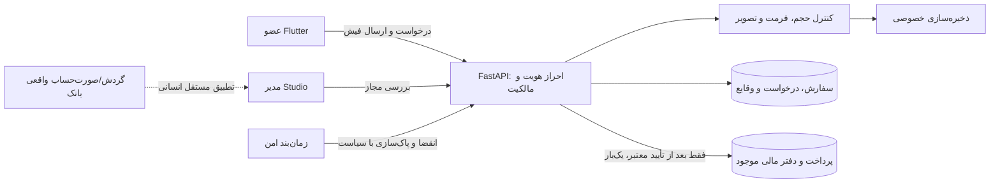

# طرح اجرایی پرداخت کارت‌به‌کارت و فیش — M113

**وضعیت:** در حال اجرا؛ هیچ ادعای آمادگی تولید یا برابری کامل با پیمنتینو نیست. 
**شاخه:** `arena/b0e55b62-mp` · **مبنا:** وضعیت workspace شامل تغییرات قبلی است؛ هیچ reset/pull مجاز نیست. 
**دامنه:** پرداخت دستی با واریز خارج از برنامه، ارسال مدرک و تصمیم انسان پس از تطبیق با بانک؛ نه انتقال بانکی درون اپ، نه اثبات پرداخت با تصویر یا OCR. سامانهٔ موجود مالی و تاریخچه حفظ می‌شود.

## ۱. شواهد و محدودیت ابزار

REA 6.9.0 با Node 24.22.3 واقعاً اجرا شد. شواهد خام `finn/reports/rea/m113/` فقط در workspace پیشین بودند و جزو انتقال عمومی نیستند؛ خلاصه و محدودیت‌ها در `finn/reports/rea/m113-review.md` هستند. نصب‌کنندهٔ مشترک در مرحلهٔ تطبیق skill به علت تفاوت محتوای skill محلی fail شد و هیچ skill موجودی را جایگزین نکرد. CLI کار می‌کند، ولی ثبت MCP پایان نیافت. ECC با کامیت `.finn/ecc-commit.txt` نصب و فایل agentها تطبیق داده شد؛ در Arena ابزار اجرای subagent مستقل وجود ندارد. بنابراین استفاده از دستورالعمل‌های agentها فقط **چک‌لیست عامل اصلی** است، نه بازبینی مستقل. FINN نام یک روش کاری است نه یک ابزار اجرایی مستقل.

## ۲. مشاهدهٔ مبنا و تهدیدها

- `shop.checkout` مبلغ را از سرور محاسبه می‌کند، سفارش و خطوط و موجودی را تغییر می‌دهد، سپس `payments.create_payment` را فراخوانی می‌کند. آن تابع خودش `commit` می‌کند؛ اتمی‌بودن کل checkout و خطاهای پس از آن نیاز به بازبینی و آزمون جداگانه دارد، نه تغییر حدسی.
- نوع فعلی `card` در payments برای **کارت‌خوان حضوری** است؛ `card_to_card` در تنظیم درگاه نام دیگری است و هیچ‌کدام اثبات جریان دریافت فیش نیست. روش جدید نباید مسیر موجود را تغییر معنایی دهد.
- تأیید دستی فعلی برای cash/card و تسویهٔ سفارش موجود است؛ نباید برای گردش فیش جدید به‌صورت دورزدنی استفاده شود. مجوز route، مالکیت، نقش، تطبیق بانک و ledger همه باید سرورمحور باشند.
- سطح حمله: جعل تصویر، ارسال فایل مخرب یا عظیم/متحرک، IDOR، خودتأییدی، تغییر شمارهٔ مقصد، تکرار/مسابقهٔ تصمیم، بازپخش، واریز کمتر/بیشتر، خطای timeout، تخلیهٔ موجودی انبار، پاک‌سازی اشتباه و افشای PII.
- در صورت خطای فایل، احراز هویت، پیکربندی، ذخیره‌سازی یا تأیید بانک: **fail closed**؛ فیش صرفاً مدرک است و آپلود آن پول ایجاد نمی‌کند.

## ۳. معماری هدف — نه وضعیت فعلی

## ۴. قراردادهای اجباری پیش از فعال‌سازی

1. روش جدید متمایز `card_to_card`؛ پیکربندی پیش‌فرض خاموش، تصمیم مجاز با نقش و scope سروری، حفظ `card` حضوری و درگاه‌های فعلی.
2. مبلغ ریالی صحیح و شناسهٔ مقصد/نام دارنده در زمان سفارش snapshot؛ نه مبلغ یا مقصد انتخاب‌شده از ورودی مشتری بدون اعتبارسنجی سرور. تغییر مقصد نباید تاریخچه را عوض کند.
3. گردش پیشنهادی: `awaiting_proof → pending_review → approved` یا `rejected → pending_review`؛ `expired/cancelled` ترمینال. تنها تصمیم معتبر بانکی اجازهٔ ثبت پرداخت را دارد. بسته‌شدن سفارش و انقضای دقیق در سرور سنجیده شود. ارسال فیش منتظر بررسی، پول یا موجودی کیف پول را تغییر نمی‌دهد.
4. قفل/به‌روزرسانی شرطی و قیود یکتایی در دیتابیس برای تصمیم و ثبت ledger، با آزمون رقابت واقعی PostgreSQL و retry یکسان؛ فقط چک وضعیت در حافظه کافی نیست. مرجع بانکی و تأیید مستقل ضروری؛ رد دلیل لازم دارد. وضعیت نامطمئن نیازمند رسیدگی است نه موفقیت خودکار.
5. فایل‌ها خصوصی، با شناسهٔ تصادفی؛ بدون public URL یا مسیر فایل ارسالی. سقف شمار و بایت در ingress و API، امضای محتوای واقعی و پسوند، decode کنترل‌شده، سقف pixel، رد فایل متحرک و فایل خراب، پاک‌سازی فایل ناقص، rate limit، دسترسی scopeشده، `nosniff` و عدم cache. امنیت تنها با MIME کلاینت اثبات نمی‌شود.
6. تصاویر کارت ملی فقط با ضرورت، موافقت و سیاست مجزای نگهداری/حذف؛ قبل از اجرا تصمیم عملیاتی و حقوقی لازم است. هیچ فایل مدرک در log، Git یا evidence نگهداری نشود.
7. لغو زمان‌دار تنها وقتی هیچ مدرک در بررسی یا واریز تأییدنشدهٔ شناخته‌شده‌ای وجود ندارد؛ موجودی انبار فقط یک‌بار در تراکنش برگردد. مسیرهای مراجعه به پشتیبانی، رد و ارسال مجدد روشن باشند.
8. پایش، audit بدون اطلاعات محرمانه، retention و پاک‌سازی، بکاپ، بازیابی، مانیتورینگ صف و runbook مغایرت بانک الزامی‌اند. هیچ OCR/AI یا پیامک به‌تنهایی تأیید بانک محسوب نمی‌شود.
9. تست بدون حساب یا دادهٔ واقعی، تست مالکیت و نقش، spoof، overflow، concurrency، migration upgrade/downgrade، انقضای مرزی، failure injection و ledger reconciliation. Flutter/Dart/Android فقط توسط CI؛ انتشار امضاشده و پاک‌سازی رازهای تاریخی گیت‌های مستقل باقی می‌مانند.

## ۵. منابع آزاد بررسی‌شده و سیاست استفاده

| منبع و نسخه | مجوز/نقش | تصمیم |
|---|---|---|
| [قنادی قند](https://github.com/Alvandcode/ghandoon/tree/ebbc4dd9c4a890be97ec940982a6373edaecaffe) | MIT؛ رابط Flutter و نمونه انتخاب فیش | الگو، با حفظ notice در صورت کپی. storage و RLS آن برای ما امن نیست و کپی نمی‌شود. |
| [ربات بررسی دستی](https://github.com/isArman/3x-ui-telgram-bot/tree/b9e66e048d0ffda54692746caa106ab416ab0be4) | MIT؛ مدل و workflow پایتون/تلگرام | الگوی دامنه، نه استفادهٔ مستقیم از Telegram یا تضمین concurrency. |
| [Medusa manual transfer](https://github.com/haustex/pg-medusa-manual-transfer/tree/1644560b53bf97df2e902fdfc14b502e717f16c9) | MIT؛ JS، مدرک خصوصی، تصمیم و تاریخچه | الگوی محصول/سناریوی تست؛ ادعاهای README مستقلاً آزمایش نشده‌اند. |
| [safeuploads](https://github.com/endurain-project/safeuploads/tree/2defe9302ce5e14a4ce580f4cd4a4c5526b989cd) | MIT؛ اعتبارسنجی آپلود؛ بستهٔ 4.0.1، Python ≥3.11 | کاندیدا، نه وابستگی پذیرفته‌شده: بررسی pin، audit، محدودیت‌ها و آزمون ادغام پیش از پذیرش. کتابخانه تصویر را کامل decode نمی‌کند و rate limit ارائه نمی‌دهد. |
| [image_picker](https://pub.dev/packages/image_picker/license) | Apache-2.0/BSD-3-Clause | کاندیدای انتخاب تصویر؛ نسخه و سازگاری باید در CI بررسی شود. |
| [افزونهٔ کارت‌به‌کارت ووکامرس](https://github.com/hoomanjamshidi/card-to-card-plugin/tree/ebdc540e710948d8c736dc804dfa09251698c095) | GPL-2.0-or-later؛ PHP | فقط مطالعهٔ رفتار؛ کپی پیش از بررسی سازگاری حقوقی با مجوز اختصاصی MP ممنوع. |
| [واریزت SDK](https://github.com/Varizet/varizet-python/tree/bcbc0deb1e34f2d05ef7ddc2bfb848ff7b428738) | MIT، وابسته به سرویس خارجی | کنار گذاشته‌شده برای مسیر کاملاً مستقل؛ هزینه و شرایط سرویس اثبات نشده‌اند. |

کد آزاد ≠ خدمت، میزبانی، پیامک یا منابع محاسباتی رایگان. MIT هم notice و شروط خود را دارد. اثبات سلامت کد یا تست اجراشده از نام مجوز نتیجه نمی‌شود.

## ۶. FINN micro-loops و گیت‌های توقف

هر ردیف: **Forge** تغییر محدود + تست؛ **Inspect** شواهد آزمون/REA در صورت مناسب؛ **Normalize** امنیت/مجوز/تطبیق API؛ **Next** ثبت نتیجه و گیت. PASS فقط پس از اجرای گیت مربوط.

| حلقه | خروجی / پذیرش | وضعیت |
|---|---|---|
| M113-0 | baseline، REA، تهدیدها، منابع، طرح و قرارداد | ثبت شد؛ تحلیل JS ناقص و MCP غایب |
| M113-1 | ماشین حالت بدون side-effect، جدول انتقال و تست مرز | سیاست مستقل و ۵۴ تست محلی؛ به هیچ API/ledger وصل نیست |
| M113-2 | مدل‌های افزایشی، migration و constraint؛ هیچ تغییر تاریخچهٔ قدیم | برنامه‌ریزی‌شده |
| M113-3 | تنظیم کارت‌های مقصد با مالکیت، snapshot و audit | برنامه‌ریزی‌شده |
| M113-4 | آپلود محدود/خصوصی، پاک‌سازی خطا و test امنیت محتوا | برنامه‌ریزی‌شده |
| M113-5 | API عضو، ردیابی، داده‌های تکمیلی و فیلدها؛ auth/IDOR/rate limit | برنامه‌ریزی‌شده |
| M113-6 | صف مدیر و تصمیم اتمی با تأیید بانکی و دفتر مالی؛ تست رقابت PostgreSQL | برنامه‌ریزی‌شده |
| M113-7 | deadline، استرداد موجودی و cleanup قابل‌تکرار با failure injection | برنامه‌ریزی‌شده |
| M113-8 | UI Flutter انتخاب چند تصویر/وضعیت/خطا؛ تست widget و دستگاه در CI | برنامه‌ریزی‌شده |
| M113-9 | Studio صف، نمایش خصوصی، تأیید/رد و گزارش؛ تست UI/API | برنامه‌ریزی‌شده |
| M113-10 | تنظیمات اختیاری، تخفیف، پیام‌رسان، retention، کد ملی پس از تصمیم | برنامه‌ریزی‌شده |
| M113-11 | تست E2E، reconciliation، امنیت، migrations، مستندات و CI | برنامه‌ریزی‌شده |
| M113-12 | rollout خاموش، runbook عملیاتی، مانیتورینگ، امضای انتشار و گیت رازهای تاریخی | مسدود تا شاهد مستقل |

وابستگی‌ها و مبهمات: policy دقیق نگهداری مدرک و اجازهٔ جمع‌آوری تصویر کارت ملی هنوز تعیین نشده؛ برای ساخت هسته نیازی به فعال‌سازی آن‌ها نیست. گزینه‌های deployment فقط پس از تصویب و گیت‌ها روشن شوند. هیچ تاریخی برای release تضمین نمی‌شود.

## ۷. عدم ادعای پوشش

فهرست ۲۶ ردیفی مقایسهٔ پیمنتینو یک benchmark قراردادی است؛ HPOS و نوار مدیریت وردپرس در MP مستقیماً کاربرد ندارند و باید جدا از معادل بومی گزارش شوند. ۱۴/۲۶ پوشش مستند مخزن PHP به معنای پوشش در MP، امکان کپی GPL، یا صرفه‌جویی مهندسی نیست. درصد قابلیت تکمیل‌شده فقط بعد از معیار سرتاسری و آزمون قابل گزارش است.
