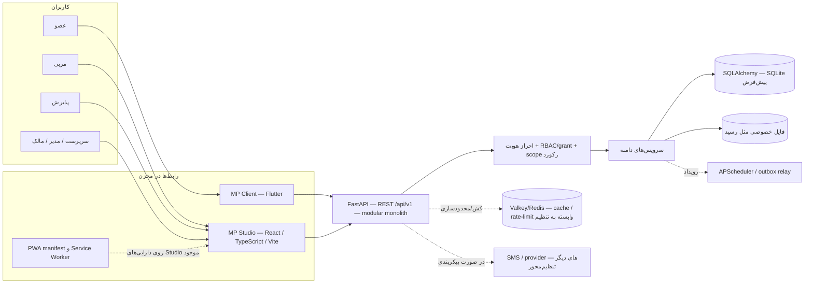

# راهنمای جامع Muscle Paradise

> **کاربرد:** یک سند یکپارچهٔ فارسی برای شناخت محصول و پیاده‌سازی همین مخزن؛ از نقش‌ها و معماری تا routeها، مدل داده، کلاینت‌ها، توسعه، CI، عملیات، امنیت و کارهای باز.
>
> **حد شواهد:** متن از پنج فصل ماژولار زیر ساخته می‌شود و snapshot working tree زمان تولید است؛ لزوماً معادل HEAD یا build منتشرشده نیست. هرجا تصمیم مالک، کد، آزمون تاریخی، آزمون اجراشده یا هدف آینده متفاوت‌اند، آن‌ها را جدا بخوانید؛ وجود route، صفحه، فایل deployment یا تست به‌تنهایی آمادگی end-to-end یا production را ثابت نمی‌کند. برای ادعای runtime، کد/تست همان checkout، تغییرات محلی و SHA دقیق را با هم بررسی کنید.
>
> فایل پایگاه‌دادهٔ ریشه و رسیدهای خصوصی برای تهیهٔ این راهنما بازبینی نشده‌اند؛ راز، credential یا دادهٔ شخصی در آن نقل نشده است. این سند مجوز اجرای migration، backup/restore، deploy یا release نیست.

## فهرست

1. [نقشهٔ پروژه و معماری](#chapter-01-project-map)
2. [Backend، API و داده](#chapter-02-backend-data)
3. [کلاینت‌ها، PWA و سفرهای کاربر](#chapter-03-clients-workflows)
4. [توسعه، آزمون، CI و عملیات](#chapter-04-development-operations)
5. [امنیت، وضعیت اثبات‌ها و واژه‌نامه](#chapter-05-security-status)

برای فهرست ارجاعات، یادداشت snapshot و نسخهٔ فصل‌به‌فصل نیز [راهنمای ماژولار](project-guide/README.md) را ببینید.

---

<a id="chapter-01-project-map"></a>

## ۱. نقشهٔ پروژه و معماری

[بازگشت به فهرست راهنما](project-guide/README.md)

### ۱.۱ Muscle Paradise چیست؟

Muscle Paradise یک سامانهٔ نرم‌افزاری برای کارهای یک باشگاه ورزشی است: اعضا حساب و اشتراک خود، تمرین، ارزیابی، تغذیه، حضور، ارتباط و بعضی اطلاعات مالی شخصی را می‌بینند؛ کارکنان باشگاه اعضا و عملیات روزانه را مدیریت می‌کنند. سرویس‌های مشترک مثل احراز هویت، قواعد دامنه، مجوز، گزارش و ذخیره‌سازی در API مرکزی قرار دارند.

این توصیف **دامنهٔ محصول** است، نه ادعای این‌که همهٔ جریان‌ها کامل یا آنلاین‌اند. برای نمونه، کد کاتالوگ فروشگاه و checkout هر دو وجود دارند، اما تصمیم محصول فعلی خرید اینترنتی عضو را نمی‌خواهد و مسیر باید fail-closed بماند؛ endpoint کارت‌به‌کارت هم به‌تنهایی تأیید واریز نیست.

### ۱.۲ کاربران و واژه‌های دامنه

| نقش فعلی در کد | معنی رابط | خلاصهٔ مرز |
|---|---|---|
| `member` | عضو | دیدن و انجام کارهای مجاز مربوط به خود؛ مالکیت رکورد در API کنترل می‌شود. |
| `coach` | مربی | بخش‌های مربی‌گری و دادهٔ اعضا در حدود مجوزهای server-side. |
| `reception` | پذیرش | ثبت‌نام، پرداخت/رسیدگی پذیرش و حضور، با محدودیت روی گزارش مالی خالص. |
| `manager` | سرپرست | عملیات مدیریت در حدود سیاست‌های مسیر، grant و deny صریح. |
| `admin` | مدیر سیستم | نقش مجزا از `super_admin`؛ نباید صرف نام «مدیر» آن را مالک کامل دانست. |
| `super_admin` | مالک سیستم | نقش ممتاز؛ عملیات تغییر نقش/تنظیم‌های مالک در مسیرهای محدودشده. |

شش نقش بالا، نقش‌های جاری و تصمیم ثبت‌شدهٔ مالک‌اند. برخی اسناد معماری قدیمی‌تر از نقش هدف سه‌تایی حرف می‌زنند؛ آن را کد یا سیاست جاری تلقی نکنید. نقش به‌تنهایی نیز مجوز کافی نیست: Casbin، `Depends`, grantهای زمان‌دار، مالکیت عضو و قواعد خود سرویس ممکن است دسترسی را بیشتر محدود کنند.

مفاهیم مهم:

- **عضو (`Member`)**: پروفایل و ویژگی‌های باشگاهیِ متصل به یک کاربر (`User`).
- **اشتراک (`Membership`)**: دوره/وضعیت استفادهٔ عضو از خدمات باشگاه؛ زمان انقضا و فعال‌بودن جدا از پرداخت هستند.
- **پرداخت (`Payment`)**: رویداد مالی با وضعیت و روش پرداخت. بارگذاری فیش معادل وصول وجه نیست.
- **برنامه (`WorkoutProgram`)**: خروجی تمرین، شامل هفته و حرکت؛ وضعیت draft/نیازمند بازبینی/تأیید را با انتشار به عضو یکی نگیرید.
- **ارزیابی (`Assessment`)**: اندازه‌گیری‌های بدن/توانایی؛ عدد اندازه‌گیری‌شده به‌خودی‌خود تشخیص پزشکی نیست.
- **چک‌این (`CheckIn`)**: ثبت رویداد حضور؛ ورود و خروج دو زمان جدا هستند. QR یک‌بارمصرف با تشخیص چهره یکی نیست.
- **دفتر مالی (`LedgerEntry`)**: رویدادهای مالی و ردیف‌های اصلاحی؛ با ماندهٔ کیف‌پول و با گزارش درآمد/سود مفهومی جدا دارد.
- **رویداد outbox/inbox**: سازوکار تحویل رویداد و جلوگیری از گم‌شدن/تکرار اثر؛ اعلان داخلی را با push تحویل‌شده اشتباه نگیرید.

### ۱.۳ نمای کلی سامانه



خط چین نشان‌دهندهٔ وابستگی یا مرز مشروط است؛ نمودار جای آزمون runtime نیست. Backend در کد یک **مونولیت ماژولار** FastAPI است، نه چندین سرویس مستقل. منطق HTTP در routerها، قواعد کاربردی عمدتاً در serviceها و ذخیره‌سازی در مدل‌های SQLAlchemy است. ماژول‌های دامنه یک فرایند برنامه و یک قرارداد REST مشترک را به‌کار می‌برند.

#### چرخهٔ معمول درخواست

1. کاربر در صفحه intent خود را وارد می‌کند؛ ورودی و وضعیت pending در رابط مدیریت می‌شوند.
2. Client/Studio درخواست JSON را به `/api/v1` می‌فرستد؛ Studio در توسعه از proxy نسبی Vite استفاده می‌کند.
3. FastAPI درخواست را با شناسهٔ درخواست، rate limit، validation و handler خطا پردازش می‌کند.
4. مسیر محافظت‌شده نشست JWT را می‌خواند؛ سیاست نقش/مسیر و سپس مالکیت رکورد یا grant بررسی می‌شود.
5. Router دادهٔ معتبر را به سرویس دامنه می‌دهد؛ سرویس قانون تجاری را اعمال و در صورت اجازه DB/فایل/provider را تغییر می‌دهد.
6. پاسخ ساختاریافته برمی‌گردد؛ کلاینت دادهٔ متعلق به خود را به‌روز می‌کند یا خطا/تعارض/Retry را نشان می‌دهد.

فهرست عملیات واقعی در [کاتالوگ API](architecture/session-decisions-2026-11-23/API-ROUTE-CATALOG.md) و ماتریس صفحه‌به‌endpoint در [نقشهٔ تعامل](architecture/interaction-map.json) است. این دو inventory ایستا هستند؛ هیچ‌کدام صحت هر مسیر یا اجرای همهٔ صفحه‌ها را ثابت نمی‌کنند.

### ۱.۴ نقشهٔ واقعی مخزن

```text
MP/
├── mp-app/
│   ├── backend/       FastAPI، مدل/مهاجرت، امنیت، job، تست و اسکریپت
│   ├── client/        اپ عضو Flutter و هدف Android/Flutter Web
│   ├── studio/        پنل React/TypeScript، PWA assets و Electron
│   ├── deploy/        Compose/Nginx/backup برای یک توپولوژی استقرار
│   ├── infra/         Compose/Caddy/Valkey/monitoring/Ansible و image backend
│   └── shared/        دارایی‌های مشترک مثل design tokens
├── docs/              مستندات مخزن و MuscleParadise
├── scripts/           گیت‌ها و ابزارهای اسناد/نقشه/بهداشت مخزن
├── .github/workflows/ CI، وب Flutter، image و deploy دستی
├── finn/              گزارش‌ها و خروجی‌های handoff/بازبینی
├── evidence/          شواهد و inventory آزمایشی؛ هر مورد historical/synthetic را با وضعیتش بخوان
└── artifacts/         خروجی‌های جانبی/مرجع؛ لزوماً جزء runtime یا release نیستند
```

این درخت خلاصه است؛ [`docs/MuscleParadise/MASTER_MAP.md`](MASTER_MAP.md) صریحاً تاریخی/آرشیوی است و درخت پیشنهادی آن را ساختار واقعی امروز ندانید. به‌طور خاص پوشه‌های قدیمیِ مورد اشارهٔ آن، مانند kiosk مستقل یا ORM drift، نباید بدون `find` در checkout فرض شوند. ساختار اجرای واقعی از فایل‌های همین checkout خوانده شود.

#### مهم‌ترین پوشه‌های Backend

- `app/`: ساخت اپ، تنظیمات، خطاها، middleware، dependency و سیاست امنیتی HTTP.
- `api/v1/`: تجمیع routerها و monitoring؛ URL عمومی API با پیشوند `/api/v1` نصب می‌شود.
- `modules/<domain>/`: router، schema، service و گاه adapterهای هر دامنه.
- `db/models/`: مدل‌های SQLAlchemy؛ import در `db.models` آن‌ها را برای metadata ثبت می‌کند.
- `db/migrations/versions/`: تغییرات نسخه‌دار Alembic؛ `Base.metadata.create_all` جایگزین migration تولیدی نیست.
- `security/`: Casbin/RBAC، رمزنگاری و توابع امضای token/مالکیت.
- `jobs/`, `cache/`: پردازش دوره‌ای و کش؛ تعریف کد با راه‌اندازی worker یکی نیست.
- `tests/{unit,integration,regression,e2e,load,evaluation}/`: آزمون‌ها برحسب نوع؛ نام پوشه به‌تنهایی تضمین اجرای همهٔ آن‌ها نیست.

#### مهم‌ترین پوشه‌های Client

- `lib/core/`: API client، نشست، router، state مشترک، theme/motion و قابلیت‌های محدود آفلاین.
- `lib/features/`: صفحات عضو به تفکیک auth، خانه، today، assessment، progress، profile، nutrition، check-in، کلاس، chat، notification، shop و wallet.
- `android/`: میزبان native Android؛ Kotlin `MainActivity` بخشی از outbox اختیاری را پیاده می‌کند.
- `test/`: unit/widget و تست‌های API/session/outbox؛ `integration_test/` را فقط اگر در checkout باشد بررسی کنید.

#### مهم‌ترین پوشه‌های Studio

- `src/App.tsx`: gate نشست و map صفحهٔ انتخابی.
- `src/pages/`: دوازده سطح staff: Dashboard, Members, Programs, Nutrition, Assessment, Chat, CheckIn, Finance, Expenses, Analytics, Settings, Shop.
- `src/components/`: navigation، feedback، فرم‌ها و بخش‌های مشترک.
- `src/lib/`: API/session/role/motion/design tokens.
- `src/stores/`: وضعیت رابط، از جمله صفحهٔ انتخابی و فیلتر؛ store رابط را با منبع حقیقت دادهٔ سمت سرور یکی نگیرید.
- `public/`: manifest، icons و service worker؛ وجود آن‌ها به معنی تکمیل تجربة عضو در PWA نیست.
- `electron/`: بسته‌بندی/پوستهٔ دسکتاپیِ حفظ‌شده، نه هدف انتشار تازهٔ تأییدشده.

### ۱.۵ پایگاه داده و مرز multi-tenancy

تنظیم پیش‌فرض در [`app/config.py`](../../mp-app/backend/app/config.py) مقدار `sqlite:///./mp.db` است. URL از تنظیمات خوانده می‌شود و SQLAlchemy/Alembic راه تغییر backend دیتابیس را باز می‌گذارند، اما این امر سازگاری production با PostgreSQL یا مهاجرت آزموده‌شده را ثابت نمی‌کند. مالک SQLite را فعلاً انتخاب کرده است.

مدل پایه `Base` و mixinهای `TimestampMixin` و `BranchMixin` در [`db/base.py`](../../mp-app/backend/db/base.py) هستند. `branch_id` در بعضی مدل‌های اصلی پیش‌بینی شده، اما تصمیم محصول فعلی تک‌باشگاه است؛ وجود ستون branch را با اجرای چندباشگاهی/tenant isolation کامل برابر ندانید. جدول واقعی و روابط هر model را در فایل همان مدل ببینید؛ فهرست دامنه‌ای در [Backend و داده](#chapter-02-backend-data) آمده است.

### ۱.۶ تصمیم‌های محصول در برابر کد فعلی

| موضوع | تصمیم/سیاست ثبت‌شده | آنچه وجود کد ثابت می‌کند | آنچه هنوز ثابت نمی‌کند |
|---|---|---|---|
| کلاینت انتشار اول | ADR-007: یک PWA مشترک React برای عضو و کادر بر پایهٔ Studio؛ Flutter/Android حفظ شود. | Studio، manifest و SW موجودند؛ Flutter Client نیز فعال است. | تکمیل PWA عضو/کادر، installability، parity، device QA یا مجوز Go/No-Go. |
| پرداخت | کارت‌به‌کارت با رسید خصوصی و تطبیق انسانی؛ عکس رسید، وصول وجه نیست. | مدل/route/service پرداخت و receipt وجود دارد. | تطبیق بانکی مستقل، بانک live، تسویه، تجربهٔ انتشار یا تنظیم عملیاتی. |
| فروشگاه | برای عضو نمایش‌محور؛ خرید حضوری. | `shop_online_purchase_enabled` به‌طور پیش‌فرض false و سرویس در این وضعیت fail-closed است. | تمام مسیرهای legacy حذف شده‌اند یا checkout عضو برای انتشار مجاز است. |
| حضور | QR یک‌بارمصرف؛ تشخیص چهرهٔ سروری فعال فرض نشود. | token QR و digest یک‌بارمصرف در مسیر check-in دیده می‌شود؛ `method=face` رد می‌شود. | آزمون کیوسک/گوشی فیزیکی، نصب عملی، پذیرش کاربر و تشخیص زندهٔ چهره. |
| مدل AI | موتور قواعد برای عددهای تمرین؛ inference/API بیرونی ممنوع؛ مدل تا تأیید مجاز محلی در وضعیت BLOCKED. | موتور قواعد و adapterهای اختیاری در source هستند. | کیفیت پزشکی، provider محلی تأییدشده، مدل/وزن دارای مجوز یا اتصال production. |
| میزبانی | سرور محلی باشگاه + ورودی HTTPS؛ جزئیات اپراتوری باز. | دو Compose، Caddy/Nginx، backup و health code وجود دارند. | DNS/TLS واقعی، حساب میزبان، secret manager، deploy یا recovery drill محیط واقعی. |

#### وضعیت PWA: تصمیم پذیرفته‌شده ≠ قابلیت کامل

[ADR-007](adr/007-pwa-primary-release.md) baseline انتشار اول را PWA مشترک انتخاب می‌کند و صریحاً `NO-GO` می‌گذارد تا جریان‌های اصلی و گیت‌های امنیت، حریم، عملیات و دستگاه با شواهد همان artifact پذیرفته شوند. در snapshot کد فعلی، `studio/src/App.tsx` هنوز UI دوازده صفحهٔ کارکنان را تعریف می‌کند؛ صفحات عضو در Flutter هستند. پس تصمیم PWA را به‌عنوان **تصمیم محصول** ثبت کنید، ولی PWA مشترک عضو/کادر را **پیاده‌شده یا آمادهٔ انتشار** ننویسید.

### ۱.۷ منابعی که نباید با هم اشتباه شوند

- **Source:** کد و تست جاری در `mp-app/`.
- **Contract inventory:** `api/routes.json` و کاتالوگ API؛ شرح عملیات اعلام‌شده، نه اثبات اجرا.
- **Decision:** ADR و پاسخ مستقیم مالک؛ می‌گوید چه می‌خواهیم، نه چه چیزی اکنون کار می‌کند.
- **Historical handoff/report:** شرح یک snapshot گذشته؛ شمارش/CI آن را به HEAD فعلی تعمیم ندهید.
- **Target/design:** diagram، mockup و plan؛ هر جهت آینده باید صریحاً برچسب `هدف`, `OPEN`, `NOT_RUN` یا `BLOCKED` داشته باشد.

### ۱.۸ مطالعهٔ پیشنهادی برای فرد تازه‌وارد

1. شروع از همین راهنما، سپس [README ریشه](../../README.md) و [AGENTS.md](../../AGENTS.md) برای قواعد و quickstart.
2. برای تصویر اجزا: [Architecture Atlas](architecture/README.md) و [System Atlas](architecture/system-atlas.md)؛ در کنار آن برچسب‌ها و محدودیت نقشه را بخوانید.
3. برای یک مسیر end-to-end انتخابی، [دفتر wiring](architecture/session-decisions-2026-11-23/WIRING-LEDGER.md) را از UI تا route/service/model دنبال کنید؛ بعد فایل تست همان سناریو را باز کنید.
4. برای همهٔ endpointها [کاتالوگ API](architecture/session-decisions-2026-11-23/API-ROUTE-CATALOG.md) را بخوانید و سپس `security/rbac.py`، ownership helper و router/service را بررسی کنید.
5. پیش از هر عملیات اجرایی، [TODO canonical](TODO-2026-11-16.md)، [چک‌لیست انتشار](RELEASE-CHECKLIST.md) و [راهنمای استقرار](DEPLOYMENT.md) را با source جاری تطبیق دهید؛ در این checkout حداقل یک تعارض مستند-کد دربارهٔ درگاه وجود دارد که در [بخش وضعیت/امنیت](#اختلاف-و-کهنگی-مستندات) مشخص شده است.

<a id="chapter-02-backend-data"></a>

## ۲. Backend، API و داده

[بازگشت به راهنما](project-guide/README.md) · [نقشهٔ معماری](#chapter-01-project-map) · [کاتالوگ API (۱۶۳ operation)](architecture/session-decisions-2026-11-23/API-ROUTE-CATALOG.md)

### ۲.۱ مشخصات فنی و نقطهٔ ورود

Backend در [`mp-app/backend/`](../../mp-app/backend/) یک **modular monolith** است: Python 3.11+، FastAPI، SQLAlchemy 2.x، Pydantic 2، Alembic و SQLite به‌عنوان URL پیش‌فرض. وابستگی‌های اصلی در `pyproject.toml` و نسخه‌های تثبیت‌شدهٔ CI در `requirements.txt` (فایل constraints) هستند.

فایل‌های جهت‌یاب:

| مسیر | مسئولیت |
|---|---|
| `app/main.py` | `create_app()`, lifespan, middleware, exception handlerها و نصب routeها. |
| `app/config.py` | `Settings` با پیشوند `MP_`, خواندن `.env`/environment و اعتبارسنجی production. |
| `app/deps.py` | `DbSession`, کاربر جاری، session/JWT و guardهای مشترک. |
| `api/v1/api.py` | جمع‌کردن routeهای دامنه زیر پیشوند نسخه‌دار `/api/v1`. |
| `modules/<domain>/router.py` | تبدیل HTTP و schema به فراخوانی سرویس دامنه. |
| `modules/<domain>/service.py` | قواعد کاربردی/تراکنشی آن دامنه. |
| `db/base.py` | `Base`, mixinهای زمان/branch، engine و سازندهٔ session. |
| `db/models/` | مدل‌ها و جدول‌های SQLAlchemy. |
| `db/migrations/env.py`, `versions/` | تنظیم Alembic و تغییرات نسخه‌دار schema. |
| `security/` | Casbin، grant، ownership و ابزارهای رمزنگاری/auth. |
| `jobs/`, `cache/` | scheduler، relay و کش؛ نحوهٔ روشن‌شدن runtime جدا بررسی می‌شود. |
| `tests/` | تست‌های unit، integration، regression، E2E، load و evaluation. |

#### ترتیب ساخت و آغاز برنامه

1. `app.main` در import-time `_assert_explicit_environment()` را اجرا می‌کند. مقدار پیش‌فرض class برابر `development` است، اما production/dev باید صریح از environment یا `.env` آمده باشد؛ بدون تعیین آن، اپ به‌طور ضمنی با development بالا نمی‌آید، مگر پرچم تست `MP_ALLOW_IMPLICIT_DEV=true` فعال باشد.
2. `create_app()` پیکربندی logging را تنظیم می‌کند و FastAPI را می‌سازد.
3. در `lifespan`, مقدار مؤثر config log می‌شود. فقط اگر `environment == development` باشد `init_db()`/`create_all` فراخوانی می‌شود. اجرای migration production خودکار نیست.
4. CORS از `MP_CORS_ORIGINS` allowlist می‌گیرد؛ middleware هدر امنیتی، `X-Request-ID`, metric درخواست و handlerهای خطا نصب می‌شوند.
5. Routerهای دامنه زیر `/api/v1` و liveness route در `/health` ثبت می‌شوند؛ OpenAPI/Swagger از FastAPI ساخته می‌شود.

نکتهٔ راه‌اندازی مهم: README ریشه فرمان Uvicorn را بدون `MP_ENVIRONMENT` نشان می‌دهد، در حالی که source فعلی آن را صریح لازم دارد. از quickstart اصلاح‌شدهٔ [راهنمای توسعه](#chapter-04-development-operations) استفاده کنید.

### ۲.۲ لایهٔ API و کاتالوگ

`api/v1/api.py` Routerهای auth، اعضا/اشتراک، کلاس، کتابخانهٔ حرکت، پرداخت، هزینه، گزارش، حریم، ارزیابی، برنامه، population، تغذیه، حضور/چهره، اعلان، گفت‌وگو، admin، shop، AI و update را جمع می‌کند. `api/v1/monitoring.py` routeهای سلامت/متریک را می‌دهد؛ return مرورگر پرداخت نیز از Router جداگانه در API aggregate وارد می‌شود.

#### عملیات برحسب حوزه — snapshot قرارداد

فایل ماشینی `mp-app/backend/api/routes.json` در snapshot این مستندسازی **۱۶۳ رکورد method+path در ۱۴۱ الگوی path** داشت. عدد از قرارداد صادرشده می‌آید، نه اجرای همهٔ عملیات.

| حوزه در کاتالوگ | تعداد operation | نمونهٔ مسئولیت |
|---|---:|---|
| هویت، پروفایل و عضویت | 23 | OTP/session، اعضا، profile، membership و invoice. |
| Intake، برنامه و کتابخانه | 15 | gate-check، ایجاد برنامه و کتابخانهٔ exercise. |
| ارزیابی و سنجش | 10 | assessment، JP7، محور/اندازه‌گیری limb و گزارش روند. |
| کلاس، QR و حضور | 12 | رزرو/لغو کلاس، consent، token و check-in/exit. |
| تغذیه، غذا و وزن | 9 | plan، جست‌وجوی غذا، food/weight log و گزارش. |
| مالی، پرداخت، هزینه و Shop | 52 | receipt، wallet/ledger، coupon، expense/report و کاتالوگ/سفارش فروشگاه. |
| چت، اعلان، مدیریت و عملیات | 42 | chat، admin، feature flags، readiness، metrics، notification و reports. |

هر route را در کاتالوگ با متد، guard، role metadata و scope ببینید. `guards/roles` در JSON exporter اطلاعات inventory هستند؛ برای مجوز مؤثر باید کدهای `security/rbac.py`, `app/deps.py`, grantهای route و ownership helperهای service به‌همراه تست همان مسیر خوانده شوند. کاتالوگ، نبودن UI یا تست را قطعی ثابت نمی‌کند.

برای بازتولید inventory، از ریشهٔ repo:

```bash
python3 mp-app/backend/scripts/export_routes.py
# سپس بررسی شود چه فایل‌هایی تولید/تغییر کرده‌اند؛ خروجی را بی‌بررسی commit نکنید.
python3 scripts/interaction_map.py --check
```

دستور exporter را در source خودش بررسی کنید؛ گیت interaction map تطبیق artifact و contract را می‌سنجد، نه runtime.

### ۲.۳ درخواست احرازشده و مرزهای دسترسی

مسیر معمول:

```text
HTTP request
  → middleware / correlation ID / rate limit / validation
  → route dependencies
  → get_db() → SQLAlchemy Session
  → Authorization: Bearer <access token>
  → decode JWT → active user → auth_version → sid/RefreshToken check (اگر موجود)
  → Casbin role + method + path
  → route-specific guard / time-limited grant
  → record ownership / branch scope / service-level state rule
  → commit / response
```

جزئیات قابل مشاهده:

- `get_db()` یک session باز می‌کند و در پایان می‌بندد.
- `get_current_user()` access JWT را decode می‌کند، کاربر active را می‌خواهد و `auth_version` را تطبیق می‌دهد. توکن‌های جدید دارای `sid` به ردیف refresh-session hashed، ابطال و انقضایش وابسته‌اند؛ مسیرهای legacy بدون `sid` تا پایان عمر کوتاهشان حالت stateless قدیمی دارند.
- `require_permission()` مسیر/متد و نقش را با Casbin می‌سنجد. نقش‌های کد: `member`, `coach`, `reception`, `manager`, `admin`, `super_admin`. سیاست‌های `DENIES` می‌توانند allow عمومی را محدود کنند؛ از وراثت نقش نتیجهٔ دسترسی یک endpoint را حدس نزنید.
- `PathId` سقف شناسهٔ ایمن JSON را اعمال می‌کند؛ app-level id guard هم برای مسیرها نصب است. ورودی نامعتبر معمولاً 422 است، ولی پیام/خطای نهایی را handler و تست تعیین می‌کنند.
- **RBAC ≠ مالکیت ردیف:** اعضا نباید با تغییر `member_id` به دادهٔ دیگری دسترسی بگیرند. توابعی مانند `ensure_member_scope`/`ensure_record_scope` و کنترل در service مرز ABAC/مالکیت را پیاده می‌کنند.
- **RBAC ≠ grant خاص:** grantهای زمان‌دار (برای حوزه‌های حساس مانند مالی) محدودیت بیشتری می‌گذارند؛ به `app/security/grants.py` و routeهای مربوط رجوع کنید.
- UI یا توکن‌خوان سمت React فقط navigation/UX را پنهان/نمایش می‌دهد؛ API باید خودش مجوز بگیرد.

قالب خطا از app handlers می‌آید؛ Client و Studio پاسخ‌های JSON ساختاریافته و قالب legacy FastAPI را برای انتقال پیام مدیریت می‌کنند. وضعیت‌هایی که لازم است در UI متفاوت بمانند: 401 نشست، 403 مجوز، 409 تعارض/حالت ممنوع، 422 ورودی نامعتبر، 429 محدودیت نرخ، 5xx خطای سرور/شبکه. نگاشت کامل تجربه بین همهٔ صفحه‌ها هنوز باید آزموده شود.

### ۲.۴ نقشهٔ router و ماژول‌های دامنه

این جدول هدف فایل‌ها را خلاصه می‌کند؛ ماژول‌های خارج از `router.py` یا provider خارجی لزوماً در هر deployment فعال نیستند.

| مسیر ماژول | حوزه | مدل/مسئولیت شاخص |
|---|---|---|
| `modules/auth/` | OTP، session، تغییر تلفن، احراز | User, OtpCode, RefreshToken, phone-change challenge. |
| `modules/membership/` | عضو، profile، اشتراک | Member, Membership. |
| `modules/payments/` | روش/وضعیت پرداخت، فیش، کیف‌پول، ledger، gateway adapter | Payment, PaymentReceipt, WalletTransaction, LedgerEntry, Coupon. |
| `modules/expenses/`, `reporting/`, `reports/` | هزینه‌ها، گزارش دوره‌ای و محرمانه | Expense, ExpenseRevision, ExpenseReceipt, ReportRun و دادهٔ تجمیعی. |
| `modules/shop/` | دسته/محصول/قیمت/سبد/سفارش و feature flag | Product, Variant, CartItem, Order, PriceBook و config gateway. |
| `modules/assessment/`, `axis_assessment/` | ارزیابی و آزمون | Assessment, scoreهای دامنه/محور، JP7، field/l limb data و norms. |
| `modules/programs/` | برنامه، هفته، حرکت و feedback | WorkoutProgram, ProgramWeek, ProgramExercise, SetFeedback. |
| `modules/population/` | gate/مسیر جمعیت و safety gate | ورودی و قواعد eligibility/gate. |
| `modules/ai/`, `modules/ai_engine/` | endpointهای تولید/پیشنهاد و موتور/adapter | RuleRun و منطق قواعد؛ مدل بیرونی به معنی فعال یا مجاز نیست. |
| `modules/exercises/` | کاتالوگ حرکات و query | Exercise/catalog data و source registry. |
| `modules/nutrition/` | برنامهٔ تغذیه، meal، غذا/وزن log | NutritionPlan, MealItem, FoodLog, BodyWeightLog. |
| `modules/classes/` | برنامهٔ کلاس و رزرو | GymClass, ClassBooking. |
| `modules/face_id/` | consent، enrollment، QR و check-in | BiometricConsent, FaceTemplate, CheckIn. |
| `modules/notification/` | صندوق اعلان و چت | Notification, Conversation, Message؛ `chat_router.py` جداست. |
| `modules/admin/` | مدیریت، flag و audit | AuditLog, FeatureFlag, Campaign, Offer, AdminPermission. |
| `modules/privacy/` | پیش‌نمایش/اجرای retention | سیاست retention allowlist شده. |
| `modules/updates/` | manifest/نسخهٔ به‌روزرسانی | اطلاعات update، نه deploy اپ. |
| `modules/outbox/` | صف رویداد، inbox، dead letter و سلامت صف | OutboxEvent, InboxMessage, OutboxDeadLetter, WorkerHeartbeat. |
| `api/v1/monitoring.py` | readiness و metrics | سلامت API و instrument؛ نه وضعیت DNS/TLS یا مرورگر. |

Routerهای inventory در `api/v1/api.py` نصب می‌شوند؛ برای صفحه یا operation مشخص، route را با `routes.json` پیدا کنید، سپس schema/service/model/test همان دامنه را باز کنید. نام پوشهٔ «ai» به‌تنهایی تضمین LLM یا inference شبکه‌ای نیست.

### ۲.۵ مدل داده و مهاجرت‌ها

#### فهرست جدول‌ها بر اساس فایل model

این فهرست از declarationهای `__tablename__` در checkout استخراج شده است. معنای دقیق column، nullable، index، FK و constraint را فقط از فایل مدل و migration متناظر بخوانید؛ نام جدول به‌تنهایی قرارداد API نیست.

| فایل مدل | جدول‌های تعریف‌شده | کاربرد اصلی |
|---|---|---|
| `admin.py` | `audit_logs`, `feature_flags`, `campaigns`, `offers` | ردپای رویدادهای حساس و تنظیم/محتوای مدیریتی. |
| `ai.py` | `rule_runs` | ثبت اجرا/نتیجهٔ قواعد. |
| `assessment.py` | `assessments`, `domain_scores`, `jackson_pollock_measurements`, `norm_entries`, `axis_assessments`, `axis_scores`, `field_test_results` | ارزیابی، امتیاز و norm. |
| `auth.py` | `users`, `otp_codes`, `phone_change_challenges`, `refresh_tokens`, `admin_permissions` | هویت، OTP، session و مجوزهای شخصی زمان‌دار. |
| `chat.py` | `conversations`, `messages` | گفت‌وگوی عضو و کارکنان. |
| `classes.py` | `gym_classes`, `class_bookings` | سانس، ظرفیت، رزرو/waitlist. |
| `content.py` | `exercises`, `catalog_sources`, `catalog_exercises`, `progression_ladders`, `progression_steps`, `food_items` | کتابخانهٔ حرکت/غذا و progression/catalog sources. |
| `face_id.py` | `face_templates`, `biometric_consents`, `checkins` | consent، embedding/template و رویداد حضور. |
| `finance.py` | `expenses`, `expense_revisions`, `report_runs`, `expense_receipts` | هزینه، تاریخچهٔ اصلاح و اجرای گزارش. |
| `membership.py` | `members`, `memberships` | پروفایل عضو و وضعیت/بازهٔ اشتراک. |
| `notification.py` | `notifications` | صندوق داخلی. |
| `nutrition.py` | `nutrition_plans`, `meal_items`, `food_logs`, `body_weight_logs` | هدف/برنامه و ثبت واقعی غذا/وزن. |
| `outbox.py` | `outbox_events`, `outbox_dead_letters`, `inbox_messages` | تحویل event، retry و inbox/idempotency. |
| `payments.py` | `payments`, `payment_receipts`, `wallet_transactions`, `ledger_entries`, `coupons` | پرداخت، فیش، wallet/ledger و تخفیف. |
| `programs.py` | `workout_programs`, `program_weeks`, `program_exercises`, `set_feedbacks` | برنامه و بازخورد ست. |
| `segment.py` | `limb_measurements` | سنجش اندام/بخش بدن. |
| `shop.py` | `product_categories`, `products`, `product_variants`, `cart_items`, `orders`, `order_items`, `payment_gateway_configs`, `change_requests`, `price_book` | کاتالوگ و آثار تاریخی/مشروط سبد و سفارش. |
| `worker.py` | `worker_heartbeats` | freshness/heartbeat پردازش‌گر. |

#### کلیدهای مدل‌خوانی

- زمان‌های ایجاد/به‌روزرسانی اغلب از `TimestampMixin` می‌آیند؛ timezone و serialization را در schema بررسی کنید.
- فیلد `branch_id` از `BranchMixin` برای جداسازی آینده/محلی در برخی مدل‌هاست؛ این را با tenant authorization تکمیل‌شده اشتباه نگیرید.
- پاداش/سود مالی به «یک ستون balance» فروکاستنی نیست: Payment، receipt، wallet transaction، append-only ledger، reversal و expense ممکن است معنا/تاریخ متفاوت داشته باشند.
- `NutritionPlan` و `MealItem` با ثبت غذای خورده‌شده (`FoodLog`) جدا هستند؛ generator فعلی طبق گزارش تحلیل می‌تواند هدف ماکرو/کالری با `meals: []` بسازد.
- `CheckIn.qr_jti_hash` فقط digest شناسهٔ تصادفی QR را نگه می‌دارد و unique constraint برای بستن race همزمان دارد؛ bearer token خام نباید در DB ثبت شود.
- مسیر ذخیرهٔ فایل رسید خصوصی است و فایل‌ها ممکن است خارج از DB باشند. این راهنما هیچ محتوا یا نام/مقدار شخصی از پوشهٔ receipt نقل نمی‌کند.

#### Alembic

در snapshot بررسی‌شده ۳۸ revision Python در `db/migrations/versions/` وجود داشت؛ گراف استاتیک `revision/down_revision` یک root (`39f0cd2d8531`, initial schema) و یک head (`a7c3d9e1f2b4`) نشان می‌داد و یک migration merge هم دارد. این محاسبه روی فایل‌هاست، نه اتصال به DB زنده. تغییرهای قابل‌مشاهده در نام‌ها/شرح‌ها شامل schema اولیه، assessment، class/finance، کاتالوگ و progression، sync/QR، wallet/ledger، پرداخت کارت‌به‌کارت، expense/receipt، outbox/inbox، report run، heartbeat و coupon است.

فرمان‌های معمول از `mp-app/backend/`:

```bash
python -m alembic history
python -m alembic heads
python -m alembic current
python -m alembic check

# فقط روی DB محلی/scratch پس از بررسی URL:
python -m alembic upgrade head
```

`db/migrations/env.py` URL را از `settings.database_url` می‌گیرد و metadata مدل‌ها را وارد می‌کند. Dev lifespan از `create_all` استفاده می‌کند؛ آن فرمان migration history/upgrade تولیدی را جایگزین نمی‌کند. پیش از migration دادهٔ واقعی، backup، clone امن، duplicate/constraint audit، سازگاری dialect، rollback plan و scratch migration لازم‌اند. این مستندسازی روی دیتابیس تولیدی هیچ migration اجرا نکرده است.

برای دادهٔ پشتیبان، `scripts/backup.py` عملیات `backup`, `verify`, `restore` دارد. `verify` برای بررسی manifest/hash و سلامت SQLite طراحی شده و در مسیر اصلی فایل را restore نمی‌کند؛ `restore` باید به مسیر scratch و همراه `--extras-to` محدود شود تا archive قدیمی source/asset اصلی را بازنویسی نکند. دستورها و هشدارهای دقیق در [Ops runbook](OPS-RUNBOOK.md) هستند.

### ۲.۶ خلاصهٔ قواعد دامنه و جریان‌های اصلی

> تمام موارد زیر description مسیرهای کد/گزارش‌اند؛ وضعیت test-reported و مسیرهای پیکربندی‌شده با اجرای عملی بانک/دستگاه فرق دارند. مرجع سناریوها [Wiring ledger](architecture/session-decisions-2026-11-23/WIRING-LEDGER.md) است.

| جریان | API/service/data | مرز و گپ |
|---|---|---|
| OTP/login | `modules/auth/router.py` → auth service → OtpCode/User/RefreshToken؛ SMS adapter در `app/sms.py` | `dev` SMS کد واقعی نمی‌فرستد؛ provider و secrets واقعی باید صریح انتخاب و شبکه/تحویل جدا آزموده شوند. Token refresh/logout/version روی server-side است. |
| تغییر شماره | چند گام OTP برای شمارهٔ قبلی/جدید و challenge کوتاه‌عمر | دو طرف باید کنترل شوند؛ routeها از پاسخ status handler و test پیروی کنند. |
| Member/membership | `modules/membership/` → Member/Membership | عضو عادی فقط رکوردهای خودش؛ فعال‌شدن اشتراک را با ساخت payment/بارگذاری فیش یکی نکنید. |
| برنامهٔ تمرین | `population` gate → `ai_engine`/`engine/workout.py` → `programs`/Exercise | قواعد قطعی اعداد را می‌سازند؛ حالت `blocked` یا `needs_review` هنوز می‌تواند draft ایجاد/نمایش دهد طبق گپ گزارش‌شده؛ approved-only به‌عنوان تضمین کامل ادعا نشود. |
| بازخورد ست | `POST /programs/set-feedback` یا مسیر sync → SetFeedback | پیشنهاد auto-reg از داده/قاعده؛ تیک «انجام شد» در Today یک state محلی جداست، نه همان ذخیرهٔ بازخورد. |
| کلاس | `classes/service.py` → GymClass/ClassBooking | ظرفیت، waitlist و cancel/rebook rules در سرویس؛ race محیط همزمانی/device از یک تست SQLite نتیجه‌گیری نمی‌شود. |
| حضور | `face_id` consent/enroll/checkin/QR | QR کوتاه‌عمر امضا می‌شود و یک‌بارمصرف است؛ `method=face` fail-closed گزارش شده، اما آزمون دستگاه/پذیرش واقعی نشده. |
| تغذیه | `nutrition` plan/food/weight logs | target/plan، meal item و food log داده‌های متمایزند؛ target را وعدهٔ کامل/تشخیص تغذیه‌ای حرفه‌ای معرفی نکنید. |
| کارت‌به‌کارت | payment + receipt upload/review + manual approval | تصمیم انتشار، تطبیق انسانی با منبع بانکی مستقل است؛ تصویر فیش به‌تنهایی منبع حقیقت پرداخت نیست. |
| Wallet/ledger/refund | wallet API و ledger row؛ reversal append-only؛ refund gateway/record | test sandbox یا approval API به معنی حرکت پول بانکی نیست. concurrency financial و accounting policy جدا گیت دارند. |
| Shop | محصول/قیمت/موجودی، cart/order routeها و flag | policy انتشار فروشگاه عضو را نمایش‌محور می‌خواهد؛ online purchase خاموش/فیلتر می‌شود. داده‌های legacy به‌تنهایی مسیر مجاز محصول نیستند. |
| هزینه/گزارش | Expense + revision/receipt + ReportRun و finance reports | دادهٔ ناقص، از جمله refund بی‌تاریخ، می‌تواند `complete=false` و سود نامعلوم بدهد؛ صفر را به جای unknown نگذارید. |
| Chat/notification | Conversation/Message/Notification + outbox/inbox | inbox داخل سامانه از push واقعی جداست؛ push provider/SLA و worker deployment اثبات نشده‌اند. |

### ۲.۷ Jobs، outbox، cache و health

#### Scheduler و relay

`jobs/scheduler.py` jobهای تمدید/انقضای اشتراک، یادآوری‌ها و گزارش مالی دوره‌ای را تعریف می‌کند. `build_scheduler()` وجود دارد، اما بررسی `app/main.py` نشان داد lifespan فعلی آن را start نمی‌کند. بنابراین تعریف job/تست تابع مساوی scheduler فعال در deployment نیست.

`jobs/outbox_relay.py` رویدادها را با retry/backoff و dead-letter relay می‌کند؛ `modules/outbox/service.py` مرز event/inbox را پیاده می‌کند. نمونهٔ handler موجود صرفاً log می‌کند، و source این checkout به‌تنهایی اتصال push/SMS واقعی را ثابت نمی‌کند. worker باید جداگانه راه‌اندازی، heartbeat، queue/retry/idempotency و alert آن عملیاتی شود. `MP_REQUIRE_WORKER=true` می‌تواند readiness را به heartbeat تازه گره بزند؛ مقدار جاری default false است.

#### Cache

`cache/store.py` interface `CacheBackend`, `InMemoryCache` و `ValkeyCache` دارد. Valkey/Redis availability هنگام راه‌اندازی probe می‌شود؛ خطای command در مسیر read/write/invalidation به fallback process-local می‌رود. این fallback یک دیتابیس مشترک نیست و نباید برای state حساس یا rate limit مشترک بین workerها منبع حقیقت فرض شود. readiness جدا storage محدودسازی auth را بررسی می‌کند.

#### سلامت و metrics

- `/health`: liveness ساده؛ `status=ok` یعنی کد route پاسخ می‌دهد، نه آماده‌بودن dependencyها.
- `/api/v1/health/ready`: DB، rate-limit storage، اشباع connection pool و check-in SLO را می‌سنجد؛ اگر `MP_REQUIRE_WORKER` فعال باشد heartbeat worker هم لازم است. پاسخ readiness ناموفق HTTP 503 می‌شود.
- `/api/v1/metrics`: نیازمند `Authorization: Bearer <MP_METRICS_TOKEN>`؛ token unset endpoint را بسته می‌کند. خطای refresh metrics ثبت می‌شود و شمارنده در metrics/readiness بازتاب دارد.
- Prometheus/Exporter/Compose در مخزن وجود دارند؛ Alertmanager/receiver، DNS/TLS، scraping بیرونی و دریافت هشدار باید در محیط هدف جدا آزموده شوند.

### ۲.۸ خطاهای رایج خواندن Backend

1. Router شلوغ نیست؟ باز هم business rule را از `service.py` و schema/validator جدا بخوانید.
2. `roles` در `routes.json` دیدید؟ effective permission را از Casbin + guardها + ownership دنبال کنید.
3. endpoint پیدا شد؟ client مصرف‌کننده، integration test و device/browser مسیر را هم پیدا کنید.
4. ORM model پیدا شد؟ وجود جدول روی دیتابیس target را از Alembic/`current` بررسی کنید؛ `create_all` migration نیست.
5. `scheduler`/`outbox relay` وجود دارد؟ process manager/Compose command/startup و heartbeat را بررسی کنید.
6. provider class پیدا شد؟ config، production validator، network reachability، provider credentials و evidence واقعی لازم است.
7. receipt route پیدا شد؟ فایل خصوصی را فقط با auth/scope بررسی کنید؛ این task عمداً `var/receipts` را نخوانده و نباید آن را در سند/آزمون/اسکرین‌شات کپی کرد.

<a id="chapter-03-clients-workflows"></a>

## ۳. کلاینت‌ها، PWA و سفرهای کاربر

[بازگشت به راهنما](project-guide/README.md) · [نقشهٔ پروژه](#chapter-01-project-map) · [دفتر سفرهای UI→API](architecture/session-decisions-2026-11-23/WIRING-LEDGER.md)

### ۳.۱ MP Client — اپ عضو با Flutter

ریشهٔ کلاینت [`mp-app/client/`](../../mp-app/client/) است. `pubspec.yaml` به Flutter/Dart SDK در بازهٔ `>=3.3.0 <4.0.0`، Riverpod برای state، `go_router`، `http`, `shared_preferences`, `qr_flutter`, `local_auth`, `image_picker` و `flutter_animate` وابسته است. وجود dependency به‌تنهایی ثابت نمی‌کند هر capability در تمام buildها فعال است. فارسی/RTL و Vazirmatn در `main.dart` و theme به‌کار می‌روند.

#### راه‌اندازی نشست و درخواست API

- `main.dart` یک `ProviderContainer` می‌سازد و پیش از UI، `authProvider.notifier.restore()` را اجرا می‌کند؛ مسیر اولیه `/home` یا `/otp` بر اساس نتیجه انتخاب می‌شود.
- `core/session.dart`، `AuthController` و providerهای Riverpod را تعریف می‌کند؛ `ApiClient` از همان نقطه تزریق می‌شود.
- توکن access و refresh با کلیدهای `mp_token` و `mp_refresh` در `SharedPreferences` ذخیره می‌شوند؛ این source به‌تنهایی رمزگذاری storage توسط Keystore یا مقاومت در برابر دستگاه compromiseشده را اثبات نمی‌کند.
- `ApiClient` با `--dart-define=MP_API=...` پیکربندی می‌شود؛ default برای Android Emulator برابر `http://10.0.2.2:8000/api/v1` است. HTTP روی localhost/RFC1918 مجاز است؛ میزبان عمومی باید HTTPS باشد.
- همهٔ پاسخ‌ها می‌توانند JSON object یا array باشند؛ پاسخ‌های غیر 2xx به `ApiException` و پیام خطای server تبدیل می‌شوند.
- روی 401، کلاینت یک refresh مشترک برای درخواست‌های هم‌زمان انجام می‌دهد و درخواست را حداکثر یک بار تکرار می‌کند؛ refresh endpoint خودش از interceptor مستثناست. اگر نشست برنگردد، وضعیت محلی خالی می‌شود. 403 موجب refresh بی‌فایده نمی‌شود.
- `logout()` تلاش می‌کند ابتدا session سرور را لغو کند، اما حتی در خطای شبکه local session را پاک می‌کند؛ خروج محلی را با تأیید ابطال سمت سرور یکی ندانید.

#### ناوبری و صفحات

`core/router.dart` مسیرهای زیر را تعریف می‌کند:

| route | صفحه/کار |
|---|---|
| `/otp` | ورود OTP. |
| `/intake` | فرم اطلاعات اولیه و گرفتن مسیر/پیشنهاد برنامه. |
| `/home` | `AppShell` عضو. |
| `/today` | جلسهٔ امروز، تمرین و بازخورد. |
| `/progress` | روند/پیشرفت. |
| `/profile` | پروفایل و اشتراک. |
| `/bodycomp` | ارزیابی ترکیب بدن/سنجش. |
| `/nutrition` | plan و ثبت‌های تغذیه. |
| `/checkin` | QR/حضور و رضایت‌های مربوط. |
| `/classes` | کلاس و رزرو. |
| `/wallet` | کیف‌پول/پرداخت‌های عضو. |
| `/shop` | کاتالوگ فروشگاه و آثار تاریخی سبد. |
| `/chat` | گفت‌وگوی عضو. |
| `/notifications` | صندوق اعلان داخلی. |

`AppShell` در source **پنج** مقصد پایین‌صفحه دارد: خانه، برنامه (`TodayPage`)، توانایی‌ها، پیشرفت، پروفایل. comment فایل به‌اشتباه «شل ۴ تبی» می‌گوید؛ تعداد واقعی `static _tabs` و آیتم‌های navigation پنج است. صفحات `/progress` و `/profile` نیز wrapper برای push مستقیم دارند.

فهرست `lib/features/` را می‌توان از روی پوشه‌ها دید؛ route table معیار دقیق مسیر است. نام route یا وجود page، پیاده‌شدن end-to-end یا auth gate یکسان برای همهٔ routeها را ثابت نمی‌کند.

#### State و داده

`core/app_state.dart` providerهایی برای دادهٔ واقعیِ دریافت‌شده از API می‌سازد، از جمله برنامه، کیف‌پول، پرداخت‌های عضو، اشتراک، فروشگاه، کلاس، تغذیه، اعلان، readiness و volume. بیشتر درخواست‌ها از `apiClientProvider` و شناسهٔ عضو نشست عبور می‌کنند؛ مالکیت نهایی باید در server نیز بررسی شود. نمونهٔ لیست یا fallback empty در UI را با دادهٔ سرور یا آزمون کامل یکی نگیرید.

یک مرز مهم `TodayPage` است:

- دریافت برنامه از `myProgramsProvider` و تمرین‌های روز به API متصل است.
- دایره/تیک «این حرکت را انجام دادم» در `today_controller.dart` فقط یک `Set<int>` در Riverpod نگه می‌دارد و با lifecycle آن state از بین می‌رود؛ این تیک به‌تنهایی به API/DB ذخیره نمی‌شود.
- فرم «بازخورد ست» در `SetFeedbackSheet` مسیر مجزای POST و نتیجهٔ پیشنهاد/دلیل دارد. ذخیرهٔ feedback را با تیک محلی تمرین یکی نکنید.

#### Outbox آفلاین محدود Android

این قابلیت، offline mode عمومی اپ نیست.

- `core/offline_feedback_outbox.dart` به‌صورت default خاموش است: build flag `MP_ANDROID_OFFLINE_FEEDBACK_ENABLED` باید صریح true شود؛ runtime فقط Android و نه Web را می‌پذیرد.
- Kotlin `MainActivity` با MethodChannel به `OfflineFeedbackDatabase` (SQLite app-private) وصل می‌شود. جدول `sync_queue` مالک را به `owner_member_id` می‌بندد، شناسهٔ یکتای device/client دارد و stateهای pending/retry/conflict/failed/synced را نگه می‌دارد.
- فقط یک payload ساختاریافتهٔ feedback ست در صف قرار می‌گیرد: شناسهٔ برنامه/حرکت، وزن، تکرار هدف/انجام‌شده، RIR و زمان. `soreness`, notes و فیلدهای ناشناخته عمداً حذف می‌شوند؛ credential/token یا متن raw خطا در payload sync نیست.
- ثبت آفلاین فقط وقتی شبکهٔ Android در دسترس تشخیص داده نشود انجام می‌شود. اگر نتیجهٔ درخواست آنلاین نامعلوم/timeout باشد، خودکار به صف آفلاین تبدیل نمی‌شود تا write تکراری ایجاد نشود.
- همگام‌سازی با همان عضو و access token به `/programs/sync/set-feedback`، حداکثر ۱۰۰ ردیف در batch، پاسخ per-item معتبر و owner match لازم دارد. نتیجهٔ stale/clock-skew/invalid به conflict می‌رود و بی‌سروصدا پاک یا موفق اعلام نمی‌شود.
- retry خودکار تا پنج تلاش با فاصلهٔ افزایشی و سقف شش ساعت؛ موارد exhausted برای retry دستی می‌مانند. کاربر می‌تواند صف همان حساب را آگاهانه حذف کند؛ logout وقتی صف unresolved دارد انتخاب نگه‌داری/حذف می‌خواهد.
- متن «ذخیره شد روی دستگاه» تأیید سرور نیست. local database و این flow نیازمند بررسی retention/رمزگذاری دستگاه و آزمون روی مدل Android هدف هستند؛ این مستندسازی تأیید device QA یا encryption محلی نمی‌دهد.

کدهای route، controller و native در `lib/core/offline_feedback_outbox.dart`, `lib/features/feedback/feedback_providers.dart`, `lib/features/feedback/offline_feedback_queue_card.dart`, `android/.../MainActivity.kt` و `android/.../OfflineFeedbackDatabase.kt` هستند. محدودیت Android و flag را در CI/build و تست همان commit دوباره بررسی کنید.

### ۳.۲ MP Studio — پنل کارکنان React

ریشه [`mp-app/studio/`](../../mp-app/studio/) از React 18، TypeScript، Vite، Zustand، Ant Design، Tailwind، Framer Motion و Recharts استفاده می‌کند. package scripts:

- `npm run dev`: Vite development server.
- `npm run lint`: ESLint.
- `npm test`: Vitest run.
- `npm run build`: `tsc -b` سپس Vite production bundle.
- `npm run preview`: پیش‌نمایش build.
- `npm run electron`: پوستهٔ Electron موجود.

#### App، ورود و navigation

`src/App.tsx` دوازده صفحهٔ feature را map می‌کند: Dashboard, Members, Programs, Nutrition, Assessment, Chat, CheckIn, Finance, Expenses, Analytics, Settings, Shop. `Login` سیزدهمین سطح interaction است، نه صفحه‌ای در map اصلی.

`AuthProvider` ابتدا وضعیت `checking` دارد؛ token موجود را با `/members/me` بررسی می‌کند؛ سپس صفحهٔ مجاز یا Login را نمایش می‌دهد. ورود staff با OTP است. `STUDIO_ROLES` شامل `super_admin`, `admin`, `manager`, `coach`, `reception` می‌شود و `member` را نمی‌پذیرد. بنابراین UI فعلی Studio از همین login مسیر ورود عضو مشترک PWA نمی‌سازد؛ این یکی از گپ‌های پیاده‌سازی نسبت به ADR-007 است.

صفحهٔ انتخابی و فیلترها در `stores/appStore.ts` با Zustand نگه‌داری می‌شوند. `roleNav.ts` نقش JWT را صرف navigation/UX به‌کار می‌گیرد؛ API باید مستقل RBAC/scope را اعمال کند. بعضی `PAGE_RULES` برای `member` هم صفحه را مجاز می‌شمارند، اما gate ورود فعلی عضو را نمی‌پذیرد؛ این metadata UI را proof عضویت مشترک ندانید.

#### Studio API و نشست

- `lib/api.ts` آدرس نسبی `API_BASE = "/api/v1"` را استفاده می‌کند؛ در browser درخواست به همان origin است.
- `lib/session.ts` access/refresh token را در browser `localStorage` با همان نام‌های `mp_token` و `mp_refresh` نگه می‌دارد.
- `sessionFetch` bearer token را اضافه می‌کند، روی یک 401 refresh مشترک و یک retry انجام می‌دهد، 403 را جدا از 401 نگه می‌دارد و logout local را حتی در خطای شبکه انجام می‌دهد.
- کد session صریح می‌گوید این **HttpOnly-cookie boundary نیست** و نباید XSS-proof توصیف شود. این‌ها credentialهای browser storage هستند؛ CSP/XSS/HTTPS/security review را از این helper نتیجه نگیرید.
- `getJson`/`getBlob` پیام فارسی سرور را می‌خوانند؛ 401 re-auth و 403 permission failure رفتار جدا دارند.
- state اصلی داده باید از API بیاید؛ Zustand برای انتخاب صفحه/فیلتر است، نه پایگاه دادهٔ دامنه.

#### Layout فارسی و توسعه

`src/main.tsx` `ConfigProvider direction="rtl"`, locale `fa_IR`, theme مشترک و `StyleProvider layer` را نصب می‌کند. `designTokens` با `mp-app/shared/design-tokens.json` همگام است. `vite.config.ts` host را روی `0.0.0.0` باز می‌کند، host allowlist را می‌پذیرد و `/api` و `/health` را به `MP_API_TARGET` (پیش‌فرض `http://127.0.0.1:8000`) proxy می‌کند. برای preview Arena، مسیر browser باید relative بماند؛ `127.0.0.1` در تنظیم proxy فقط ارتباط server-side Vite به API محلی sandbox است، نه کد browser.

### ۳.۳ PWA موجود، رفتار cache و شکاف انتشار

فایل‌های مستقیم:

- `studio/public/manifest.webmanifest`: فارسی/RTL، `start_url: /`, `scope: /`, `display: standalone` و icons 192/512 به‌علاوهٔ maskable 512. نام فعلی آن `MP Studio` و شرحش «پنل مربی و مدیر» است.
- `studio/src/main.tsx`: بعد از `load`، `/sw.js` را ثبت می‌کند؛ guard محدودکنندهٔ `import.meta.env.PROD` ندارد، پس dev نیز ثبت می‌کند.
- `studio/public/sw.js`: نسخهٔ cache `mp-studio-v1`، `skipWaiting` و `clients.claim` دارد؛ هنگام activation کلیدهای cache دیگر را پاک می‌کند.
- درخواست `/api/` از service worker بدون `respondWith` عبور می‌کند؛ API response را این SW cache نمی‌کند.
- `/assets/` هش‌دار Vite cache-first است؛ در miss به network می‌رود و response را ذخیره می‌کند.
- سایر درخواست‌ها (از جمله HTML و درخواست manifest در پیاده‌سازی فعلی) ابتدا network می‌گیرند و در خطا `caches.match` را fallback می‌کنند. comment فایل رفتار manifest را «شبکه» توصیف می‌کند، ولی کد branch اختصاصی manifest ندارد؛ سیاست دقیق را از شرط‌های اجرا بخوانید، نه comment تنها.
- `pwa.test.ts` manifest/icons/link، عدم cache API، fallback HTML و ثبت service worker را با بررسی منبع/فایل می‌سنجد. این تست browser installation, offline UX واقعی, update prompt, OS/device یا member parity نیست.

#### اثر تصمیم پذیرفته‌شده

ADR-007، PWA مشترک React عضو/کادر را **baseline کلاینت اصلی انتشار اول** انتخاب می‌کند، با حفظ Flutter/Android. ولی کد مشاهده‌شدهٔ Studio دوازده صفحهٔ کارکنان و login کارکنان دارد، manifest هم Studio است و login `member` را رد می‌کند. این واقعیت را از تصمیم محصول جدا نگه دارید:

| مورد | وضعیت |
|---|---|
| React Studio فعلی + manifest + service worker | در source موجود؛ تعدادی تست منبع وجود دارد. |
| baseline انتشار اول مشترک PWA | تصمیم مالک در ADR-007 پذیرفته است. |
| مسیر عضو در PWA و تجربهٔ مشترک عضو/کادر | تکمیل/پذیرش آن از فایل‌های بالا ثابت نمی‌شود؛ کار باز است. |
| Flutter/Android | حفظ می‌شود؛ native client مسیر اصلی تصمیم‌شدهٔ release نیست. |
| نصب/آفلاین/آپدیت/device QA | `UNKNOWN/NOT_RUN` در سطح end-to-end؛ آزمون متن منبع جای آزمون مرورگر/گوشی نیست. |
| انتشار واقعی | ADR-007 صریحاً فعلاً `NO-GO` می‌گوید تا جریان‌های اصلی و گیت‌ها پذیرفته شوند. |

### ۳.۴ سفرهای محصول از نگاه UI تا API

این جدول خلاصهٔ [Wiring ledger](architecture/session-decisions-2026-11-23/WIRING-LEDGER.md) است؛ «وجود مسیر» را با پذیرش کامل یکی نمی‌کند.

| سفر | Client/Studio | سرور/مدل | وضعیت یا مرز |
|---|---|---|---|
| OTP و نشست | Flutter `/otp`; Studio Login | `auth/otp/request`, `verify`, refresh/logout, sessions; `User`, `OtpCode`, `RefreshToken` | dev SMS به provider واقعی ارسال نمی‌کند؛ Studio فقط staff role را قبول می‌کند؛ شبکه/SMS delivery اثبات‌نشده. |
| پروفایل و اشتراک | Client `/profile`; Studio Members | `/members/me`, members/memberships; `Member`, `Membership` | clientها API دارند؛ scope عضو در server لازم است؛ device/E2E در این کار اجرا نشده. |
| Intake و gate | Flutter `/intake` | `/population/gate-check`, `/ai/program/generate`; population → engine → programs | TestClient body JSON در گزارش قبلی 200 شده؛ این نشست آن را تکرار نکرد. سن/محدودیت و نمایش draft باید در source/test بررسی شوند. |
| تأیید برنامه | عضو برنامه می‌گیرد؛ Studio Programs صف بازبینی دارد | `/programs`, `/programs/member/{id}`, approve/reject, readiness/volume | code path وجود دارد؛ safety blocked/needs_review هنوز ممکن است draft بسازد/نمایش دهد؛ approved-only کامل اثبات نشده. |
| جلسهٔ امروز | Flutter Today | `GET /programs/member/{id}` و set-feedback endpoints | تیک completion محلی/زودگذر؛ feedback جدا ذخیره می‌شود؛ Android outbox فقط برای feedback محدود است. |
| ارزیابی/پیشرفت | Client `/bodycomp`, `/progress`; Studio Assessment | `/assessments/*`, `/axis-assessments/*`, `/programs/.../readiness` | route/model هست؛ هیچ claim پزشکی یا مستقل از تکمیل assessment E2E از وجود UI نتیجه نمی‌شود. |
| تغذیه و ثبت | Client `/nutrition`; Studio Nutrition | `/ai/nutrition/generate`, `/nutrition/plans`, food/weight logs; `NutritionPlan`, `FoodLog`, `BodyWeightLog` | هدف ماکرو/کالری با وعدهٔ برنامه‌ریزی‌شده یا ثبت غذا فرق دارد؛ خروجی generator در گزارش فعلی می‌تواند `meals: []` باشد. |
| کلاس | Flutter `/classes`; Studio (بسته به page) | `/classes`, `/classes/book`, `/classes/cancel`; `GymClass`, `ClassBooking` | آزمون‌های regression محدود گزارش شده‌اند؛ race همزمان و دستگاه واقعی ثابت نشده‌اند. |
| حضور QR | Flutter `/checkin`; پذیرش Studio | `/face/qr-token`, `/face/checkin-qr`, `/face/checkin`, exit; `CheckIn` | QR برای redemption یک‌بارمصرف؛ `method=face` در گزارش آزمون 409؛ camera/kiosk/fizical QA انجام نشده. |
| پرداخت/رسید | Flutter Wallet; Studio Finance/PaymentPanel | `/payments`, receipt upload/review, wallet/ledger, refund | پرداخت release کارت‌به‌کارت/تطبیق انسانی؛ آزمون sandbox به بانک live تبدیل نمی‌شود؛ فیش تصویر خصوصی است. |
| Shop | Client `/shop`; Studio Shop | `/shop/products`, prices, cart, checkout, orders | کاتالوگ قابل‌مشاهده؛ online purchase عضو طبق تصمیم خاموش/fail-closed؛ مسیرهای legacy API وجود دارند. |
| چت و اعلان | Client Chat/Notifications; Studio Chat | `/chat/conversations*`, `/notifications*` | صندوق داخلی API دارد؛ push/background notification یا delivery guarantee ثابت نیست. |
| عملیات روزانه | Studio Dashboard, Analytics, CheckIn, Expenses | `/admin/*`, `/finance/*`, `/expenses*`, readiness/metrics | page/API وجود دارند؛ مجوز مالی effective، completeness و عملیات واقعی هرکدام گیت جدا دارند. |

برای route دقیق، schema، guard و method از [کاتالوگ](architecture/session-decisions-2026-11-23/API-ROUTE-CATALOG.md) استفاده کنید؛ برای mapping صفحه→endpoint→test به artifact نقشه نگاه کنید و source واقعی را باز کنید. `tests: []` در interaction artifact به‌تنهایی اثبات نبودن هر test دیگری نیست.

### ۳.۵ دسترس‌پذیری، RTL، motion و جزئیات رفتاری

- Flutter `Directionality.rtl`, locale فارسی و Vazirmatn دارد؛ Studio از Ant Design RTL/locale فارسی و توکن‌های مشترک استفاده می‌کند.
- کلاینت از `MpMotion.dur(context, ...)` و Studio `useMotionPreset` برای احترام به reduced motion در سطوح بررسی‌شده استفاده می‌کنند. این موضوع را به تمام انیمیشن/صفحه و screen reader تعمیم ندهید.
- UI پیام pending، خطا، retry و empty state در برخی صفحات دارد؛ یکپارچگی این قواعد در همهٔ صفحات هنوز inventory/test می‌خواهد.
- نمودارهای UX هدف، proposal/طرح‌اند مگر state صریح پذیرش دارند؛ root README، ADRها و current PWA docs در زمان این مستندسازی هم‌نسخه نبودند. اختلاف‌ها در [بخش وضعیت/واژه‌نامه](#chapter-05-security-status) ثبت شده است.

### ۳.۶ مطالعهٔ فایل‌به‌فایل یک feature

برای فهم یک قابلیت، به ترتیب زیر بخوانید؛ ترتیب از entry point تا رفتار می‌رود:

1. `mp-app/client/lib/features/<feature>/` یا `mp-app/studio/src/pages/<Page>.tsx` برای UI/state.
2. `core/app_state.dart`/Riverpod یا `studio/src/lib/api.ts` برای request payload/response.
3. `core/api_client.dart` یا `studio/src/lib/session.ts` برای transport/auth/retry.
4. `api/routes.json` و router FastAPI برای method/path/schema/guard.
5. service، scope helper و security policy برای business rule/مالکیت.
6. `db/models/<domain>.py` و Alembic version برای پایگاه داده.
7. `tests/unit`, `tests/integration`, `client/test`, `studio/tests` برای شاهد؛ فقط اجرای واقعی همین تست/CI و همان source revision را گزارش کنید.
8. اسناد تصمیم/فهرست کار را بخوانید تا کد تاریخی را با هدف محصول اشتباه نگیرید.

<a id="chapter-04-development-operations"></a>

## ۴. توسعه، آزمون، CI و عملیات

[بازگشت به راهنما](project-guide/README.md) · [Backend/API](#chapter-02-backend-data) · [Release checklist](RELEASE-CHECKLIST.md) · [Deployment notes](DEPLOYMENT.md)

### ۴.۱ پیش‌نیازها

| جزء | حداقل/CI | ابزار |
|---|---|---|
| Backend | Python 3.11+ | `pip`, Uvicorn; dev extras برای pytest/Ruff/security. |
| Studio | Node.js 22 در CI | npm؛ `package-lock.json` برای `npm ci`. |
| Client | Flutter/Dart مطابق pin `.devcontainer/Dockerfile`; CI Client pin فعلی 3.50.0 | Android build tools برای debug APK؛ build release/signing گیت جدا دارد. |
| Infra | Docker Compose, reverse proxy/DNS/TLS برای stack مناسب | این ابزارها صرف وجود فایل deployment نصب/پیکربندی‌شده فرض نمی‌شوند. |

پیش از اجرا نسخه‌های واقعی محیط را ثبت کنید. SDK شناور `stable` در بعضی jobها وجود دارد، ولی job `client-pinned` نسخه و revision devcontainer را تطبیق می‌دهد.

### ۴.۲ اجرای محلی گام‌به‌گام

#### ۱) Backend توسعه با دیتابیس جدا

از ریشهٔ repo:

```bash
cd mp-app/backend
python3.11 -m venv .venv
source .venv/bin/activate
pip install -c requirements.txt -e ".[dev]"

# اپ اکنون محیط را صریح می‌خواهد. DB در فایل محلی مجزا باشد.
export MP_ENVIRONMENT=development
export MP_DATABASE_URL=sqlite:///./mp-dev.db
uvicorn app.main:app --reload --host 0.0.0.0 --port 8000
```

در development، lifespan فعلی `init_db()`/`create_all` را اجرا می‌کند. این برای دیتابیس محلی خالی مناسب است؛ migration production نیست. `/health` را می‌توان برای liveness دید؛ API docs معمول FastAPI زیر `/docs` است. OTP dev پیامک واقعی نمی‌فرستد. اگر برای smoke محلی نیاز به code echo دارید، فقط روی دیتابیس/حساب ساختگی از `MP_ALLOW_DEV_OTP_ECHO=true` استفاده و پس از آزمون پاک کنید؛ این گزینه در production رد می‌شود و کد OTP را در محیط واقعی/اسکرین‌شات/لاگ نگذارید.

#### ۲) Studio با proxy به API

ترمینال جدا:

```bash
cd mp-app/studio
npm ci
MP_API_TARGET=http://127.0.0.1:8000 npm run dev -- --host 0.0.0.0
```

Vite host/allowed host را در `vite.config.ts` تنظیم می‌کند و `/api`, `/health` را به target می‌فرستد. مرورگر از همان origin درخواست می‌کند؛ از client code به `localhost` متصل نشوید. مسیر dev UI را از log Vite بردارید.

#### ۳) Flutter Client / Android emulator

ترمینال جدا:

```bash
cd mp-app/client
flutter pub get
flutter analyze --no-fatal-infos
flutter test
flutter run --dart-define=MP_API=http://10.0.2.2:8000/api/v1
```

`10.0.2.2` معمولاً host-loopback از Android Emulator است؛ در تلفن واقعی باید IP LAN یا HTTPS domain قابل‌دسترسی همان گوشی داده شود. Client عمداً HTTP روی میزبان عمومی را رد می‌کند. `MP_API` را به endpoint production یا دادهٔ واقعی بدون گیت‌های owner/security وصل نکنید.

#### مسیر اجرای تست‌ها

فرمان‌های متداول (از پوشهٔ مربوطه):

```bash
# Backend
cd mp-app/backend
pytest -q
bash scripts/coverage_run.sh
ruff check .
ruff format --check .

# Studio
cd ../studio
npm test
npm run lint
npm run build

# Flutter Client
cd ../client
flutter analyze --no-fatal-infos
flutter test
flutter build apk --debug

dart format --output=none --set-exit-if-changed lib test tools

# مستندات/نقشه‌ها از ریشهٔ repo
cd ../..
python3 scripts/docs_gate.py
python3 scripts/interaction_map.py --check
```

`coverage_run.sh` تست را با coverage اجرا، فایل XML/JSON می‌سازد و `coverage_gate.py` را با حداقل‌های per-directory فراخوانی می‌کند. این اسکریپت فایل‌های coverage را پاک/بازمی‌سازد؛ فقط در checkoutی اجرا کنید که این اثر تولیدی پذیرفته شده باشد. آزمون کامل در این turn اجرا نشده است؛ هیچ عدد pass/coverage این سند گزارشِ امروز نیست.

#### دربارهٔ شمارش آزمون‌ها

در snapshot فعلی فهرست فایل‌ها، حدود ۳۶ فایل `test_*.py` در `tests/unit`, ۹۸ فایل در `tests/integration`, ۲۸ فایل Dart در `client/test` و ۵۲ فایل `.test.*` در `studio/tests` شمرده شد. این‌ها **تعداد فایل**اند، نه تعداد case، نه PASS، و نه پوشش مسیرهای production. Backend همچنین پوشه‌های `regression`, `e2e`, `load`, `evaluation` دارد. نتیجهٔ تاریخی مثل «۱۳۳۳ پاس/۲ skip/۹۱٪» به همین SHA/worktree تعمیم‌پذیر نیست؛ برای status واقعی suite/CI همان SHA را اجرا/مشاهده کنید.

### ۴.۳ CI: چه چیزی واقعاً gate می‌شود

Workflow اصلی [`.github/workflows/ci.yml`](../../.github/workflows/ci.yml) pipeline چندجزئی دارد:

| job/مرحله | گیت و مرز |
|---|---|
| `secret-scan` | Gitleaks full Git history، نسخه/checksum بررسی‌شده و خروجی redacted؛ synthetic test برای استثناهای دقیق. PASS روی commit قدیمی به HEAD جدید یا dirty source تعمیم ندارد. |
| `docs` | `scripts/docs_gate.py`, `interaction_map.py --check`, parser رسمی Mermaid و `repo_hygiene_gate.py`. این گیت‌ها متن/لینک/diagram/inventory را می‌سنجند، نه behavior/runtime محصول. |
| `backend` | وابستگی‌ها با constraints؛ Ruff مجموعهٔ blocker و `ruff format --check`; `scripts/coverage_run.sh` و آستانهٔ per-directory؛ Bandit, `pip-audit`, Semgrep project و harness. اجرای کامل `ruff check .` در job فعلی `continue-on-error` است؛ نتیجهٔ آن blocker اصلی نیست. |
| `studio` | Node 22، install، ESLint، Vitest و Vite build. `npm audit` در workflow طوری تنظیم شده که findingهای غیرcritical لزوماً job را fail نکنند؛ status دقیق audit را هم بخوانید. |
| `client-flutter` | analyze با infoهای غیرکشنده، `flutter test`، manifest gate و گزارش تشخیصی. SDK stable در این job شناور است. |
| `client-pinned` | Flutter 3.50.0 و تطبیق version/revision با devcontainer؛ analyze، test+coverage، Android **debug** APK compile و `dart format` gate. Debug build، signed release APK یا QA دستگاه نیست. |
| `live-contract` | Studio TypeScript client علیه Uvicorn/FastAPI واقعی در SQLite/test fixtures, seed ساختگی و access token آزمونی؛ contract smoke است نه production/network provider. |
| `e2e-api` | Integration testهای Backend؛ محیط آزمون repository است، نه سرویس بانکی/SMS/device production. |

فایل‌های workflow جدا:

- `web.yml`: دستی؛ Flutter Web را analyze/test/build می‌کند و artifact می‌دهد. وجود build artifact با React PWA یکی نیست.
- `container.yml`: push image به GHCR با tagهای full SHA و version در push tag معتبر یا dispatch.
- `deploy.yml`: dispatch دستی، preflight branch default، environment `staging`/`production`, secret webhook/URL و readiness check؛ ساخت/deploy بیرونی نیازمند تنظیم عملیاتی است.
- `client-format-fix.yml`, `gitleaks-fingerprints.yml`, `pwa00-doc-quality.yml`: workflowهای تخصصی/کمکی؛ تریگر/دسترسی‌شان را پیش از استفادهٔ واقعی بخوانید.

هیچ‌یک از pipelineها را «سبز» فرض نکنید: این راهنما GitHub Actions را در همین نوبت query نکرده و build/test محلی هم اجرا نشده است. نتیجه باید با run ID و دقیقاً همان SHA نسبت داده شود.

### ۴.۴ Docker/استقرار و گیت‌های عملیاتی

دو Compose deployment موجود **گزینهٔ جایگزین** هستند و نباید ناخواسته روی یک دیتابیس/volume مشترک هم‌زمان راه‌اندازی شوند:

| مسیر | توپولوژی فایل | آنچه ثابت نمی‌شود |
|---|---|---|
| `mp-app/deploy/docker-compose.yml` | API داخلی، Studio/Nginx روی loopback پورت 8080، Valkey و backup؛ به reverse proxy/TLS بیرونی نیاز دارد. | نصب TLS/DNS/host، امن‌بودن `.env`, backup بیرون میزبان یا اتصال worker. |
| `mp-app/infra/docker-compose.yml` | API internal، Caddy برای ورودی 80/443، Studio، Valkey و Prometheus/exporter/backup. | DNS/public certificate/firewall، secret manager، Alertmanager receiver، registry access یا restore واقعی. |

خود فایل‌های Compose/Dockerfile به‌تنهایی استقرار نیستند. `docs/MuscleParadise/DEPLOYMENT.md`, `OPS-RUNBOOK.md` و `RELEASE-CHECKLIST.md` runbookهای مرجع‌اند، اما در checkout بررسی‌شده بین بخشی از دستورهای آن‌ها و config فعلی اختلاف وجود دارد (مثلاً `zarinpal` در deployment doc، در حالی که `Settings.payment_gateway` فعلاً فقط `manual`, `mock`, `sandbox` می‌پذیرد). تا حل این ناسازگاری، از دستورات production پرداخت آن اسناد کورکورانه پیروی نکنید؛ جزئیات/شواهد در [اختلاف مستندات](#chapter-05-security-status) آمده است.

#### Backup امن برای تمرین روی scratch

`mp-app/backend/scripts/backup.py` را فقط روی دادهٔ ساختگی/scratch اجرا کنید. نمونه‌های زیر مسیر scratch دارند و عمداً به DB واقعی اشاره نمی‌کنند:

```bash
set -euo pipefail
cd mp-app/backend
SCRATCH_ROOT="$(mktemp -d /tmp/mp-backup-drill.XXXXXX)"
DB_PATH="$SCRATCH_ROOT/mp-scratch.db"
export DB_PATH
BACKUP_DIR="$SCRATCH_ROOT/backups"
RESTORE_ROOT="$SCRATCH_ROOT/restore"
python - <<'PY'
import os
import sqlite3
with sqlite3.connect(os.environ["DB_PATH"]) as db:
    db.execute("CREATE TABLE scratch_probe (id INTEGER PRIMARY KEY)")
PY
python scripts/backup.py backup --db "$DB_PATH" --out "$BACKUP_DIR"
ARCHIVE="$(find "$BACKUP_DIR" -maxdepth 1 -type f -name '*.tar.gz' -print -quit)"
test -n "$ARCHIVE"
python scripts/backup.py verify "$ARCHIVE"
python scripts/backup.py restore "$ARCHIVE" \\
  --db "$RESTORE_ROOT/mp.db" --extras-to "$RESTORE_ROOT/extras"
```

`verify` برای بررسی manifest/hash/integrity check طراحی شده و بدون restore است. `restore` ممکن است فایل DB و extras بنویسد؛ فقط روی مسیر خالی و scratch اجرا شود، همیشه `--extras-to` بدهید و مسیرهای `var/receipts`/دادهٔ واقعی را لمس نکنید. backup volume محلی روی همان host disaster recovery نیست؛ offsite encryption/retention، restore drill، RPO/RTO و دسترسی عملیاتی گیت‌های بیرونی هستند.

### ۴.۵ Observability و مواردی که باید پیش از Go/No-Go ثابت شوند

- `GET /health`: liveness سطحی.
- `GET /api/v1/health/ready`: readiness dependencyها؛ پاسخ `ready=true` و HTTP 200 باید از deployment هدف بررسی شود.
- `GET /api/v1/metrics`: token Bearer لازم دارد؛ scrape و alert receiver باید با دادهٔ test شوند.
- rate-limit store مشترک، pool DB، worker heartbeat، outbox pending/dead letter و log correlation باید با deployment واقعی سنجیده شوند.
- production secrets، HTTPS CORS origins، `MP_TRUSTED_PROXIES`, Valkey reachable، SMS واقعیِ approved، payment mode سازگار با تصمیم مالک، DB/migration/backup و registry/image pin باید پیش از هر استفاده از دادهٔ واقعی تأیید شوند.
- OTP dev echo در production ممنوع است؛ code/token/secret را در report/console/chat/screenshot نیاورید.
- Android debug compile در CI signed release نیست. `RELEASE-CHECKLIST.md` گیت‌هایی دربارهٔ signing key تاریخی، Gitleaks history، manifest/API، backup, staging و ops دارد؛ `ADR-007` می‌گوید تا تکمیل flowها و گیت‌ها NO-GO.

### ۴.۶ کارهایی که این سند/نوبت انجام نداده است

- `pytest`, Vitest, Flutter test/analyze/build، Ruff، Bandit، pip/npm audit یا Semgrep اجرا نشده‌اند.
- Alembic روی DB تولید یا scratch upgrade اجرا نشده است.
- جریان `backup`/`verify`/`restore` فقط با DB ساختگی در `/tmp` تمرین شد؛ Docker Compose، Caddy، Nginx، Valkey، Prometheus، restore عملیاتی/production یا deploy workflow اجرا نشده‌اند.
- SMS provider، payment provider/merchant، push, AI inference, camera/QR device و PWA installability تست نشده‌اند.
- این راهنما هیچ secret یا receipt خصوصی را نمی‌خواند/منتشر نمی‌کند و مجوز اجرای release/deploy نمی‌دهد.

<a id="chapter-05-security-status"></a>

## ۵. امنیت، وضعیت اثبات‌ها و واژه‌نامه

[بازگشت به راهنما](project-guide/README.md) · [Backend/API](#chapter-02-backend-data) · [Release checklist](RELEASE-CHECKLIST.md) · [TODO مالک/محصول](TODO-CLOUD-FINANCE-ACCESS.md)

### ۵.۱ شیوهٔ خواندن شواهد

هر ادعا را با یکی از وضعیت‌های زیر بخوانید:

| وضعیت | معنا |
|---|---|
| **CODE** | در فایل‌های همان checkout منطق/ساختار قابل مشاهده است. به‌تنهایی اثبات runtime نیست. |
| **TEST-REPORTED** | یک گزارش/CI اجرای سناریوی معین را نوشته است؛ اگر این نوبت اجرا نشده، آن را نتیجهٔ امروز نخوانید. |
| **TEST-RUN** | همین SHA و همین محیط فرمان آزمون شده و خروجی واقعی ثبت شده است. در این نوبت آزمون محصول اجرا نشده است. |
| **OWNER-RECORDED / ADR** | انتخاب محصولی از طرف مالک ثبت شده؛ پیاده‌سازی، اثر امنیتی یا پذیرش انتشار را به‌تنهایی ثابت نمی‌کند. |
| **PARTIAL** | بخشی از قرارداد/flow در کد یا آزمون هست، اما دامنهٔ کامل تأیید نشده. |
| **TARGET / PROPOSED** | هدف طراحی یا کار پیشنهادی؛ کد موجود فرض نشود. |
| **OPEN / UNKNOWN / NOT_RUN** | شاهد/تصمیم/آزمون لازم در دسترس نیست. نبود شاهد را «امن»، «نمی‌تواند» یا «قطعاً پیاده نشده» تفسیر نکنید. |
| **BLOCKED / NO-GO** | گیت صریح مانع عبور است؛ پیش‌فرض یا حدس آن را باز نمی‌کند. |

`routes.json`, diagram, mockup, source comment, historical test report، CI سبزِ commit قدیمی و وجود provider class هرکدام نوع شاهد متفاوت‌اند. برای ادعای «کار می‌کند»، source → integration test → build/runtime/device متناسب با آن ادعا لازم است.

### ۵.۲ مرزهای امنیتی موجود در source

#### احراز هویت و مجوز

- OTP با محدودیت نرخ و تلاش، `access_token` و `refresh_token`، rotation/session tracking، خروج از session و افزایش `auth_version` در کد وجود دارند.
- access token در API با `Authorization: Bearer` می‌آید؛ role/method/path با Casbin کنترل می‌شود؛ موارد حساس ممکن است به grant جدا و زمان‌دار نیاز داشته باشند.
- مالکیت عضو باید در backend/service enforce شود، نه صرفاً با مخفی‌کردن صفحه یا گذاشتن `member_id` در کلاینت.
- Google/SSO/MFA را فقط به‌خاطر وجود JWT یا OTP فرض نکنید؛ معیار فعلی/کامل بودن آن‌ها را در route/schema/ADR بررسی کنید.
- Studio از localStorage برای token استفاده می‌کند؛ source آن را HttpOnly-cookie یا XSS-proof نمی‌خواند.
- Client tokenها را در `SharedPreferences` نگه می‌دارد؛ این مستندسازی evidence رمزگذاری اختصاصی محلی یا jailbreak/root resistance ندارد.

#### OTP و SMS

`app/sms.py` الگوی adapter `dev`, `webmagfa`, `kavenegar` دارد. Dev provider SMS واقعی نمی‌فرستد؛ API response echo نیز به تنظیم dev وابسته است. providerهای وب، HTTPS را اجباری می‌کنند و متن exception شامل credential/URL را در log پنهان می‌کنند. برای production، `config.py` provider غیر-dev، URL HTTPS و فیلدهای secret لازم را validate می‌کند. وجود adapter/test به‌تنهایی اتصال به provider، اعتبار حساب یا deliverability را نمی‌سنجد.

#### رمز/کلید و transport

- production validation حداقل ۳۲ بایت برای `MP_SECRET_KEY`, کلید پیش‌فرض ممنوع و `MP_BIOMETRIC_KEY` برابر Base64 از دقیقاً ۳۲ بایت و جدا از secret را می‌خواهد.
- production CORS originها باید allowlist HTTPS واقعی باشند؛ `MP_TRUSTED_PROXIES` معتبر و non-empty؛ `MP_VALKEY_URL` به مقصد قابل‌دسترسی غیر-loopback اشاره کند.
- `SecurityHeadersMiddleware` و تنظیم proxy در کد موجودند. دامنهٔ TLS، رفتار header در هر مسیر/ingress، CDN، trusted proxy واقعی و firewall باید روی topology هدف آزمایش شود.
- Android `network_security_config` و `ApiClient` سیاست HTTP محدود به loopback/private RFC1918 دارند؛ build/manifest compiled را با سورس یکی ندانید.
- logهای ساختاریافته و correlation id برای ردیابی هستند؛ OTP، access token، کلید یا embedding خام نباید ثبت/منتشر شود.

#### بیومتریک و QR

- consent version، revoke/delete FaceTemplate و رمزنگاری template/embedding با کلید زیست‌سنجی اختصاصی در سرویس‌ها دیده می‌شوند.
- `MP_BIOMETRIC_KEY` در production الزامی است. کلید گمشده/غلط باید fail closed بماند؛ backup/rotation key و دادهٔ رمز‌شده نیازمند فرایند جدا هستند.
- QR عضو با امضای JWT کوتاه‌عمر و `jti` تصادفی ساخته می‌شود؛ در check-in digest آن ذخیره و unique index در DB همزمانی redemption تکراری را می‌بندد. QR bearer خام در hash column قرار نمی‌گیرد.
- مسیر `method=face` در گزارش تحلیل با 409 رد شده و check-in جدید نمی‌سازد؛ نباید از تصمیم قبلی YuNet/SFace یا کد `deep-status` نتیجه گرفت که تشخیص چهره در انتشار فعال است.
- هیچ آزمون دوربین، اسکنر، کیوسک یا device QA در این مستندسازی اجرا نشده؛ liveness/anti-spoofing و کلید محلی گوشی به‌تنهایی حضور server-verified را ثابت نمی‌کنند.

#### فیش/دادهٔ خصوصی

رسید پرداخت و receipt هزینه فایل‌های خصوصی‌اند. endpoint باید auth/scope داشته باشد؛ نام فایل تصادفی، محدودیت حجم، اعتبارسنجی محتوا، retention و access audit را از router/service/تست دنبال کنید. در این کار محتوای `mp-app/backend/var/receipts/` **عمداً باز، فهرست، کپی، screenshot یا در سند درج نشده است**. مسیر خصوصی را در مرور بعدی نیز از inventoryهای ناامن حذف کنید.

### ۵.۳ مالی و خطر دوباره‌شماری

- رفتار `Payment`, `PaymentReceipt`, `WalletTransaction`, `LedgerEntry`, `Expense` و `ExpenseRevision` جداست؛ تعادل کیف‌پول/ledger با درآمد شناسایی‌شده و سود عملیاتی یکی نیست.
- ledger دارای الگوی append-only/reversal است؛ اصلاح مالی را با دستکاری ردیف پیشین یا نمایش عدد حدسی توصیف نکنید.
- تصمیم مالک برای انتشار اول کارت‌به‌کارت + فیش خصوصی + تطبیق انسانی با منبع بانکی مستقل است؛ بارگذاری عکس، واریز واقعی را اثبات نمی‌کند.
- تست sandbox/mock، callback route یا adapter به معنی بانک/merchant live نیست.
- فروشگاه عضو نمایش‌محور است؛ `shop_online_purchase_enabled=False` پیش‌فرض و مسیر سرویس در این وضعیت fail-closed گزارش شده. کد سبد/سفارش تاریخی باقی است و تصمیم محصولی را خودبه‌خود تغییر نمی‌دهد.
- Refund / Commission / report / expense exports از سطح route، role، grant، ownership، completeness، تاریخ refund و CSV escaping بررسی شوند. inventory «role allowed» را مجوز مؤثر ندانید.
- definition of revenue, refund period, inventory cost, tax, profit و گزارش رسمی هنوز به مالک/حسابدار نیاز دارند. بدون سیاست حسابداری، وضعیت ناقص باید `unknown/incomplete` باشد، نه صفر یا سود قطعی.

### ۵.۴ Health، resilience و عملیات

- `health` liveness ساده است؛ readiness DB/storage/rate-limit/pool و بسته به config heartbeat worker را می‌سنجد.
- `require_worker` default false است؛ اگر worker جدا دارد باید در Compose/Deployment و readiness به‌طور عمدی فعال شود.
- outbox relay retry/backoff/dead-letter دارد، اما handler نمونه log-only است؛ presence منطق صف به معنی push/SMS handler واقعی یا running worker نیست.
- Valkey cache fallback درون‌حافظه دارد؛ fallback بین processها مشترک نیست. Production rate limiting نیز نباید به cache fallback عمومی تقلیل یابد.
- Backup script archive/manifest/hash و SQLite integrity را بررسی می‌کند؛ این نه رمزگذاری خودکار backup، نه offsite retention، نه restore drill production است.
- Prometheus ruleها در مخزن‌اند، اما Alertmanager receiver/notification عملیاتی باید جدا راه‌اندازی/آزموده شود.
- خطای اتصال DB، scheduler process، worker heartbeat، migration drift، queue age، disk/cert expiry و backup freshness باید alert/incident owner داشته باشند؛ فقط endpoint readiness تمام عملیات را پوشش نمی‌دهد.

### ۵.۵ حریم خصوصی و retention

منبع‌های کلیدی: `docs/MuscleParadise/DATA-RETENTION.md`, `modules/privacy/retention.py`, `modules/face_id/privacy.py`, grant/audit services و routeهای admin retention.

- سیاست retention در `DATA-RETENTION.md` با وضعیت «پیش‌نویس مصوب مهندسی — اجرا پیش از دادهٔ واقعی الزامی» ارائه شده؛ جدول آن مدت‌هایی برای هویت، اندازه‌گیری، مالی، حضور و consent چهره پیشنهاد/ثبت می‌کند.
- کد پاک‌سازی allowlist محدود دیگری دارد: `audit_logs`، `inbox_messages`، اعلان‌های خوانده‌شده و `report_runs`؛ route پیش‌نمایش/run فقط `super_admin` است و هر run audit می‌شود.
- کد retention صریحاً برخی داده‌های مالی و outbox dead-letter را دست‌نخورده می‌گذارد تا تأیید حقوقی/مالی. همسانی جدول سند با سیاست کد، backup purge و حذف کاربر باید تصمیم/آزمون جدا داشته باشند.
- consent، حذف FaceTemplate و privacy notice وجود کد دارد، اما الزام حقوقی/فرم رضایت، دسترسی audit به دادهٔ حساس، retention backup و exercise حذف در production مستقل/قانونی تأیید نشده‌اند.
- ذخیرهٔ عکس پیشرفت بدن خارج از scope انتشار اول است؛ فیش پرداخت و عکس محصول categoryهای متفاوت‌اند.
- در این نشست reviewer مستقل حقوقی، پزشکی یا مالی در دسترس/تأییدشده نیست؛ گیت‌هایی که چنین review می‌خواهند `UNKNOWN/BLOCKED` می‌مانند.

### ۵.۶ safety و هوش مصنوعی

- موتور `engine/workout.py` / `modules/ai_engine/` قاعده‌ای و قطعی برای عددهای برنامه است؛ source comment و ADR-003 می‌گوید بار/ست/تکرار از موتور قواعد بیاید، نه از LLM.
- موجودبودن adapter یا URL مدل داخلی، فعال بودن مدل محلی، داشتن license وزن‌ها، صحت نتیجه، یا اجازهٔ inference را ثابت نمی‌کند. طبق پاسخ مالک/ADR-007، API/inference بیرونی و ارسال کد/داده به آن ممنوع است؛ capability متکی به مدل تا انتخاب/مجوز مدل محلی مجاز `BLOCKED` بماند.
- `blocked`/`needs_review` safety result در گزارش جاری ممکن است هنوز draft ایجاد/نمایش دهد؛ پس fail-closed کامل محصولی را ادعا نکنید. UI باید این را مسدود/نیازمند مربی نشان دهد؛ مسیر دقیق پذیرش باز است.
- سرویس‌ها و rule tests جایگزین ارزیابی حرفه‌ای/بالینی، تشخیص یا ضمانت عدم آسیب نیستند. محصول راهنمای تمرین است و نباید ادعای پزشکی بسازد.
- مجوز تجاری dataset، sourceهای exercise/food، تصویر و model weights باید componentبه‌component و artifactبه‌artifact بررسی شود.

### ۵.۷ وضعیت تصمیم و انتشار

#### پذیرفته‌شده یا فعلی بر اساس اسناد تصمیم مالک

- baseline انتشار اول: shared React PWA برای عضو و کادر؛ Flutter/Android حفظ؛ Android Chrome عضو و Chrome/Edge دسکتاپ کادر target browser، نه QA پاس‌شده.
- single-club و حفظ شش role جاری؛ SQLite موقتاً انتخاب‌شده؛ سرور محلی باشگاه + HTTPS جهت استقرار.
- کارت‌به‌کارت با تأیید انسانی؛ فروشگاه نمایش‌محور؛ حضور QR بدون تشخیص چهرهٔ server-side؛ بدون عکس پیشرفت بدن در انتشار اول؛ بدون ادعای پزشکی؛ inference/API بیرونی ممنوع.

#### هنوز باز یا `NOT_RUN`

- پیاده‌سازی و پذیرش جریان‌های کامل عضو/کادر در PWA، install/offline/update، parity و تست Android Chrome/Chrome/Edge روی device/version مشخص.
- full route × role × grant × ownership/scope matrix، test-driven privilege/access review و اثبات مسیرهای ممنوع.
- adoption/payment reconciliation انسانی، finance accounting definition، prod config و provider decision سازگار با source فعلی.
- migration/trigger SQLite→Postgres benchmark (مالک فعلاً SQLite را انتخاب کرده؛ production migration تصویب نشده).
- worker/scheduler startup, notification delivery, service integrations, hosting domain/operator, DNS/TLS, backup offsite, restore, RPO/RTO, monitoring receiver.
- reviewer مستقل حقوقی/پزشکی/مالی و OS/device/accessibility review.

#### NO-GO

ADR-007 وضعیت `NO-GO` انتشار را تا تکمیل جریان‌های اصلی و پذیرش گیت‌های امنیت/حریم/عملیات/device با شاهد روی artifact دقیق اعلام می‌کند. وجود manifest، Compose، green CI قدیمی، route inventory یا تست unit این NO-GO را برنمی‌دارد. Android signing key تاریخی افشاشده نیز در اسناد ثبت شده؛ گفتهٔ مالک مبنی بر این‌که APK release به کاربر تحویل نشده، کلید را امن/rotate‌شده ثابت نمی‌کند.

### ۵.۸ Glossary

| اصطلاح | معنی در این پروژه |
|---|---|
| **API** | قرارداد HTTP؛ در Backend زیر `/api/v1`. |
| **RBAC** | مجوز مبتنی بر role، در اینجا Casbin و guardهای route. |
| **ABAC / scope** | محدودکردن دسترسی با ویژگی رکورد/مالکیت/branch؛ فراتر از نقش. |
| **OTP** | رمز یک‌بارمصرف؛ در پروژه مسیر SMS/توسعه دارد. |
| **Access token** | توکن کوتاه‌عمر برای درخواست‌های محافظت‌شده. |
| **Refresh token** | اعتبار بلندتر برای گرفتن token pair تازه و لغو نشست. |
| **Migration** | تغییر نسخه‌دار schema DB با Alembic؛ با `create_all` یکی نیست. |
| **ORM** | نگاشت شیء Python به جدول SQL با SQLAlchemy. |
| **Outbox** | ثبت رویداد هم‌زمان با تغییر دامنه و relay/retry بعدی. |
| **Inbox/idempotency** | جلوگیری از تکرار اثر رویدادی هنگام تحویل at-least-once. |
| **Dead letter** | eventی که retryها را تمام کرده/برای بررسی نگه داشته شده. |
| **PWA** | وب‌اپ installable با manifest/service worker؛ نصب‌پذیری runtime نیازمند browser/device test است. |
| **Service Worker** | worker browser که درخواست‌ها/cache/update را کنترل می‌کند؛ API نباید از cache قدیمی پاسخ داده شود. |
| **Liveness** | پاسخ‌گویی فرایند؛ dependencyها الزاماً سالم نیستند. |
| **Readiness** | آمادگی سرویس برای دریافت کار واقعی؛ در این پروژه `/api/v1/health/ready`. |
| **E2E** | آزمون flow از UI/client تا server/data در سطح تعریف‌شده؛ integration API تنها browser/device E2E نیست. |
| **SLO** | هدف کیفیت سرویس؛ وجود نام/metric یا threshold به معنی تحقق روی production نیست. |
| **Fail-closed** | در نبود config/رضایت/مجوز یا حالت امن، عملیات منع می‌شود نه این‌که پیش‌فرض مجاز شود. |
| **ADR** | Architecture Decision Record؛ چرایی تصمیم و دامنهٔ آن. |
| **Artifact/SHA** | نسخهٔ مشخص build/source؛ شواهد باید به همان artifact/SHA نسبت داده شوند. |
| **RPO / RTO** | هدف حداکثر ازدست‌رفتن داده / زمان بازیابی؛ این‌ها باید با اپراتور تعیین و drill شوند. |

### اختلاف و کهنگی مستندات

در این checkout چند منبع هم‌زمان یک ادعای واحد ندارند؛ برای رفع تناقض به ترتیبِ مالک/ADR جاری → source/test جاری → runbook/README تاریخی رجوع کنید. ابهام را بدون شاهد حذف نکنید.

| موضوع | اختلاف مشاهده‌شده | روش برخورد |
|---|---|---|
| Baseline PWA | root `README.md` به ADR-006 لینک می‌دهد و D-01/D-10 را باز می‌خواند؛ `ADR-006` نیز baseline را باز می‌گذارد. `ADR-007`, ADR index و TODO جاری baseline انتشار اول PWA مشترک را پذیرفته می‌دانند. | برای **تصمیم محصول** ADR-007 جدیدتر ملاک است؛ برای **پیاده‌سازی** PWA عضو هنوز ثابت نیست؛ D-10/Go-No-Go همچنان باز است. README/ADR-006 را بی‌صدا overwrite نکنید؛ تاریخچه و clarification حفظ شود. |
| PWA و نقش هدف | بخشی از `architecture/README.md`/نقشه‌های قدیمی دربارهٔ PWA اجرا‌نشده، نقش target سه‌گانه و baseline قدیمی است؛ ADR-007 و پاسخ مالک شش role و baseline جدیدتر را می‌گویند. | آن صفحات را snapshot/هدف بخوانید؛ role source جاری و ADR-007 را برای تصمیم جاری دنبال کنید. |
| پرداخت production | `docs/MuscleParadise/DEPLOYMENT.md` و `OPS-RUNBOOK.md` هنوز نمونهٔ `MP_PAYMENT_GATEWAY=zarinpal`/merchant می‌گویند؛ `app/config.py` فعلی فقط `manual`, `mock`, `sandbox` را قبول می‌کند و production mock/sandbox را رد و `manual + sandbox=true` را هم رد می‌کند؛ `.env.example` manual/false دارد. | این یک conflict اجرایی است: دستور Zarinpal در وضعیت source فعلی config validation را پاس نمی‌کند. **قبل از deploy، owner و maintainer باید تصمیم/کد/runbook را همسو کنند.** این مستندسازی integration واقعی را فعال یا آزموده نمی‌کند. |
| Quickstart env | root README فرمان `uvicorn` را بدون `MP_ENVIRONMENT` می‌آورد؛ `app/main.py` اجرای ضمنی را رد می‌کند مگر محیط صریح یا override تست. | از command این guide که `MP_ENVIRONMENT=development` صریح دارد استفاده کنید؛ `MP_ALLOW_IMPLICIT_DEV` را برای dev نگذارید. |
| App shell | comment در `client/lib/features/shell/app_shell.dart` از ۴ tab می‌گوید؛ `static _tabs` و UI پنج tab دارد. | count واقعی را از children/list و test بخوانید؛ comment را مرجع runtime ندانید. |
| Service worker manifest | comment `sw.js` می‌گوید API و manifest شبکه هستند؛ branch کد فقط `/api/` را bypass می‌کند و درخواست‌های دیگر به fallback کلی می‌رسند. | ادعای cache policy manifest را از اجرای دقیق branch بسنجید؛ PWA runtime هنوز test مستقل لازم دارد. |
| Retention | `DATA-RETENTION.md` جدول عمومی retention دارد؛ `modules/privacy/retention.py` allowlist پاک‌سازی محدودتر/متفاوت دارد و برخی مالی/outbox را نگه می‌دارد. | مدت‌ها را سیاست قطعی قانونی یا cleanup کامل فرض نکنید؛ reconcile با privacy/legal/finance و backup purge لازم است. |
| Master Map و handoff | فایل‌های `MASTER_MAP.md`, `SESSION_HANDOFF.md`, reportهای تاریخ‌دار شامل branch/SHA/شمارش/پشتهٔ تاریخی هستند و گاهی ساختار قدیمی‌تر از source امروز را توصیف می‌کنند. | آن‌ها snapshotهای زمان‌دارند، نه «وضعیت خودکار امروز». زمان/branch/SHA و آخرین بخش status را همراه code/test چک کنید. |
| Interaction map | artifact تعداد surface/operation و تست‌های match‌شده را ثبت می‌کند؛ برخی `tests: []` هستند. | این خروجی test matcher است؛ نبودن `tests` در artifact اثبات قطعی نبودن هر آزمون/سناریو نیست. |

### دامنهٔ بازبینی این راهنما و ادامهٔ مستندسازی

این بسته نقشهٔ سیستم، قرارداد API، مدل‌های اصلی، جریان‌های سطح بالا، تصمیم‌ها، عملیات و گیت‌ها را برای onboarding پوشش می‌دهد؛ **ممیزی semantic خط‌به‌خط تمام فایل‌های repository نیست**. مخزن چندصد فایل کد، test، migration و دارایی دارد. `WIRING-LEDGER`, route catalog و model inventory ابزارهای جهت‌یاب‌اند؛ برای «خط‌به‌خط» شدن باید هر ماژول/route به source، guard، schema، service، جدول migration، مصرف‌کنندهٔ UI، تست دقیق و edge case وصل و بازبینی شود.

در نوبت حاضر:

- کد/اسناد چندلایهٔ Backend، PWA/Client، route inventory، models/migrations و CI به‌صورت نمونه‌گیری/ردیابی‌شده بررسی شدند؛ نه تمام فایل‌ها.
- آزمون محصول، build، CI تازه، browser/device، production، بانک/پیامک، backup restore یا migration واقعی اجرا نشد.
- رسیدهای خصوصی خوانده/فهرست/کپی نشدند.
- فایل‌های جدید این راهنما در working tree ایجاد شده‌اند؛ اسناد companion که untracked بودند ممکن است در clone تمیز موجود نباشند تا جداگانه در Git ثبت شوند.
- هیچ commit/push/PR/merge/release/deploy انجام نشده است.

برای تکمیل واقعی مرور «از صفر تا صد»، گام بعدی باید route-by-route و feature-by-feature در [Wiring ledger](architecture/session-decisions-2026-11-23/WIRING-LEDGER.md) انجام شود: هر ادعای `CODE`, `TEST-REPORTED`, `OPEN` را به line/fixture/test دقیق همان snapshot وصل، route × role × scope matrix را جمع‌بندی، migration graph را روی scratch بررسی و هر تضاد تصمیمی را با owner حل کند. تا آن زمان برچسب `PARTIAL/UNKNOWN` حفظ شود.
