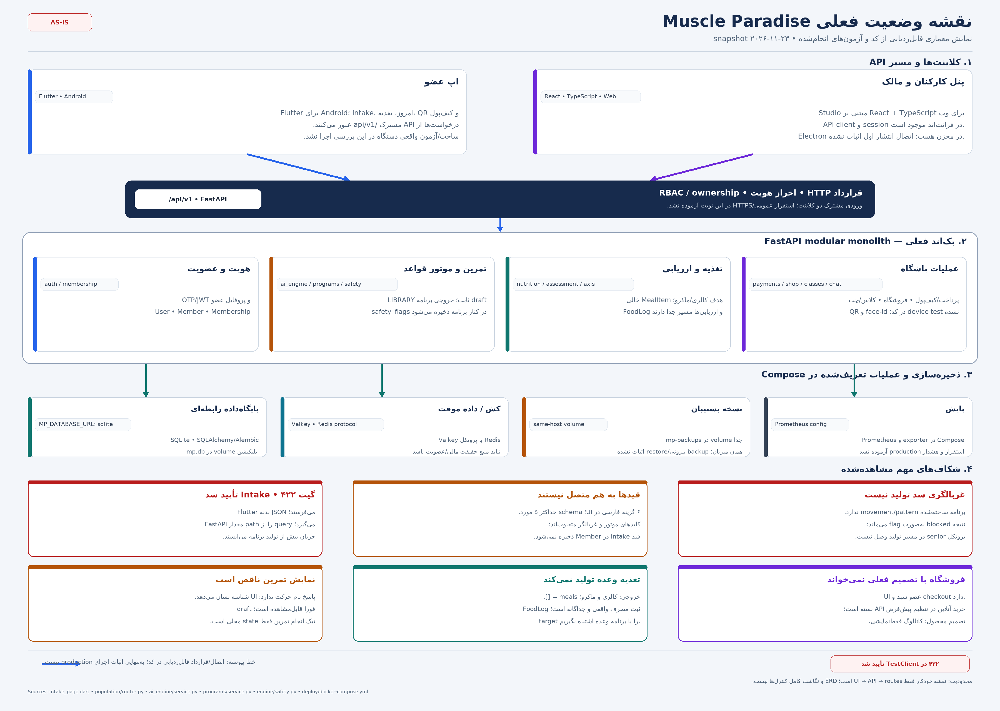
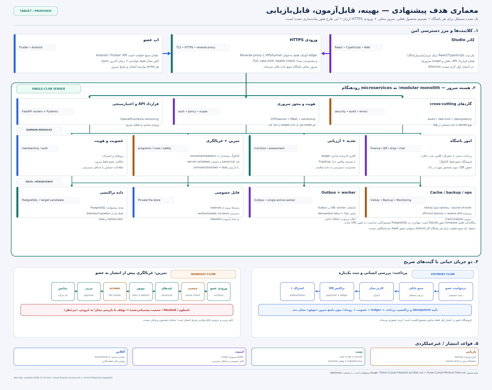
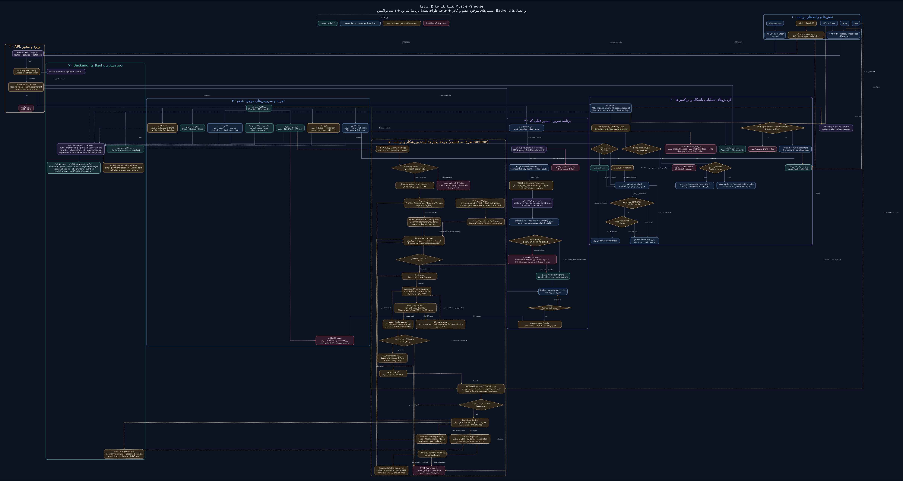
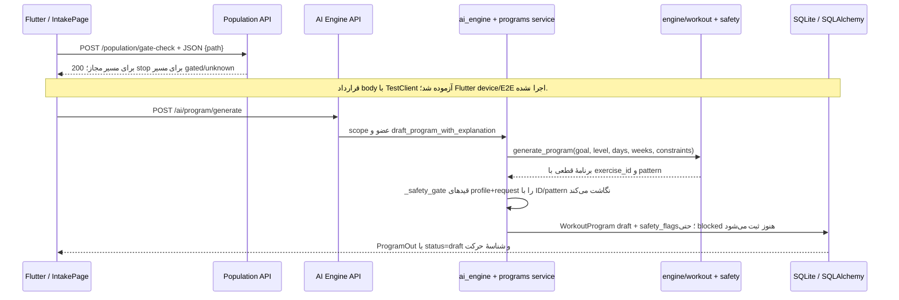

# گزارش تحلیل پروژهٔ Muscle Paradise — ۲۰۲۶-۱۱-۲۳

**مبنای نسخه:** شاخهٔ `arena/5e0f64cf-mp`، منشعب از commit `35d4b35184b4148c658b415bd009fc076bf24e00`؛ تغییرهای کاریِ موجود پیش از این ممیزی حفظ شده‌اند. این نسخه پیگیریِ ممیزی قبلی است: سه اصلاح تراکنشیِ checkout/rebook/refund حفظ شده‌اند و سه یافتهٔ تازهٔ ظرفیت waitlist، قرارداد `gate-check` و نگاشت ایمنی خروجی تمرین با تست رگرسیون اصلاح شده‌اند. parser فایل coverage نیز در برابر XML entity harden شده است.

> **جمع‌بندی:** موتور تمرین همچنان تولیدکنندهٔ قطعیِ draft با قواعد محدود است، نه سامانهٔ شخصی‌سازی‌شدهٔ بالینیِ تأییدشده. قرارداد `gate-check` اکنون با JSON body کلاینت همسو است و درخواست `adult` در TestClient پاسخ موفق می‌گیرد؛ خروجی واقعی موتور برای قید canonical زانو اکنون `blocked` می‌شود، نه `clear`. لغو رزرو waitlisted دیگر صندلیِ اشغال‌شده را دوباره ارتقا نمی‌دهد. ادعای `method=face` در API اکنون fail-closed با ۴۰۹ رد می‌شود، چون سرور probe معتبر/liveness ندارد؛ کلاینت به QR یک‌بارمصرف هدایت می‌شود. با این حال، vocabulary فارسی/انگلیسیِ قیدها هنوز یکپارچه نیست و نتیجهٔ `blocked/needs_review` همچنان به‌صورت draft ساخته و در Intake قابل نمایش است؛ بنابراین fail-closed محصولی هنوز کامل نیست. Semgrep پس از hardening فایل coverage، ۴ هشدار کم‌اطمینانِ urllib با ریسک وابسته به پیکربندی باقی گذاشت. هیچ‌یک از تست‌ها شاهد E2E روی دستگاه/شبکه یا آمادگی انتشار نیست.
>
> **حریم خصوصی پیوست:** PDF نمونه به‌صورت بصری مرور شد؛ هیچ نام، شناسه، عدد شخصی یا جزئیات پزشکی فرد نمونه در این گزارش بازگو نشده و تصویر/متن پیوست به مخزن افزوده نشده است.

## نقشه‌های معماری

**وضعیت فعلی — شواهد کد و اجرای API آزمایشی، نه ادعای استقرار production:**

**معماری هدف — طرح پیشنهادیِ هم‌راستا با تصمیم محصول؛ پیاده‌سازی‌نشده:**

**فلوچارت یکپارچهٔ کل برنامه، v2:** [PNG](muscle-paradise-combined-flow-v2-2026-11-23.png) · [SVG بزرگ‌نمایی‌پذیر](muscle-paradise-combined-flow-v2-2026-11-23.svg) · [سورس DOT](muscle-paradise-combined-flow-v2-2026-11-23.dot) · [ZIP مستقیم نمودارها](muscle-paradise-architecture-diagrams-v1-2026-11-23.zip) · [راهنما و شاخه‌های تفصیلی](muscle-paradise-full-program-flow-v1-2026-11-23.md).

**سه نمودار تفصیلیِ داده/تراکنش (هرکدام سورس DOT، SVG و PNG جدا دارد):** [راهنما و فایل‌ها](member-studio-dataflow-v1-2026-11-23.md) · [اپ عضو](member-app-dataflow-v1-2026-11-23.png) · [Studio](studio-dataflow-v1-2026-11-23.png) · [تراکنش‌ها و اصلاحات](transaction-findings-flow-v1-2026-11-23.png).

## ۱) دامنه و سطح شواهد

بررسی شامل کد Flutter عضو، Studio وب، route/service/engine بک‌اند، مدل‌های SQLAlchemy، قرارداد routeها، آزمون‌های هدفمند، ارزیابی rule-engine و مرور بصری PDF است. شواهد را باید در چهار سطح جدا نگه داشت:

1. **بازبینی کد:** نشان می‌دهد برنامه چه چیزی را فراخوانی یا ذخیره می‌کند؛ به‌تنهایی اجرای موفق را ثابت نمی‌کند.
2. **آزمون خودکار:** رفتار همان سناریوهای آزمون‌شده را ثابت می‌کند، نه همهٔ تعاملات یا کیفیت بالینی.
3. **اجرای API آزمایشی:** `TestClient` با دادهٔ ساختگی در محیط توسعه؛ این مرورگر/گوشی واقعی، شبکهٔ انتشار یا استقرار production نیست.
4. **ارزیابی حرفه‌ای/بالینی:** در این کار انجام نشده است. هیچ نتیجه‌ای دربارهٔ ایمنی یا اثربخشی پزشکی صادر نمی‌شود.

## ۲) ردیابی جریان‌های اصلی UI → API → سرویس/موتور → DB → UI

### ۲.۱ ساخت برنامهٔ تمرین

| گام | مسیر واقعی | داده/منطق | مقصد داده یا خروجی | نتیجهٔ مشاهده‌شده |
|---|---|---|---|---|
| فرم دریافت اطلاعات | [`intake_page.dart`](../../../mp-app/client/lib/features/intake/intake_page.dart#L64) | هدف، سطح، روز/هفته، سن، فعالیت، وزن و محدودیت‌ها | درخواست‌های `/population/gate-check`، `/members/me` و `/ai/...` | body گیت با route همسو شده؛ device/E2E هنوز اجرا نشده و vocabulary محدودیت‌ها هنوز ناهماهنگ است. |
| گیت جمعیتی | [`router.py`](../../../mp-app/backend/modules/population/router.py#L31) → `assert_generation_allowed` | `GateCheckIn` با `path` اجباری از JSON body | `POPULATION_PATHS` | درخواست body `{"path":"adult"}` در TestClient **۲۰۰**؛ مسیرهای gated/ناشناخته طبق E05 متوقف می‌شوند. |
| تولید تمرین | [`ai_engine/router.py`](../../../mp-app/backend/modules/ai_engine/router.py#L16) → [`ai_engine/service.py`](../../../mp-app/backend/modules/ai_engine/service.py#L37) → [`workout.py`](../../../mp-app/backend/engine/workout.py#L223) | هدف/سطح/روزها/هفته‌ها/محدودیت؛ خروجی شامل `exercise_id` و `pattern` | `WorkoutProgram`, `ProgramWeek`, `ProgramExercise` | تست API واقعی با قید `knee_injury` اکنون `blocked` می‌گیرد؛ همچنان draft است و device E2E نیست. |
| ثبت DB | [`programs/service.py`](../../../mp-app/backend/modules/programs/service.py#L74) | `exercise_id` با FK به جدول `exercises`؛ پیش از درج، کاتالوگ sync می‌شود | مدل‌های [`programs.py`](../../../mp-app/backend/db/models/programs.py#L13) و [`content.py`](../../../mp-app/backend/db/models/content.py#L11) | رابطهٔ FK وجود دارد؛ نگاشت نام حرکت در پاسخ عضو کامل نیست. |
| نمایش برنامه | [`program_result.dart`](../../../mp-app/client/lib/features/intake/program_result.dart#L113) و [`app_state.dart`](../../../mp-app/client/lib/core/app_state.dart#L8) | UI نتیجهٔ دریافت‌شده را می‌خواند؛ «برنامهٔ فعال» اولین مورد فهرست‌شده است | `GET /programs/member/{id}` | API خروجی `exercise_id` می‌دهد، نه نام؛ UI متن جایگزین «حرکت شناسه» نشان می‌دهد. |

**جزئیات مهم ورودی:** سطح برنامه از انتخاب جداگانهٔ «مبتدی/متوسط/پیشرفته» می‌آید. اسلایدر سابقهٔ تمرین فقط label را عوض می‌کند و به `level` تبدیل یا به API فرستاده نمی‌شود. سن در این جریان فقط برای انتخاب `adult`/`senior_healthy` در کلاینت استفاده می‌شود؛ در payload تولید تمرین وجود ندارد. فعالیت روزانه، وزن، قد، سن و جنسیت به مسیر تولید **تغذیه** می‌روند، نه به `generate_program`.

### ۲.۲ غربالگری ایمنی برنامه

`_safety_gate()` اکنون قیدهای ذخیره‌شده در `Member.constraints` و قیدهای همان درخواست تولید را ادغام می‌کند و هر حرکت را از `movement`/`pattern` یا شناسهٔ کاتالوگ به برچسب‌های safety می‌رساند ([`programs/service.py`](../../../mp-app/backend/modules/programs/service.py#L474)). نتیجهٔ اصلاح و شکاف‌های باقیمانده:

- ورودی تولید کلاینت شش گزینهٔ فارسی دارد؛ schema بک‌اند حداکثر پنج مورد می‌پذیرد ([`intake_page.dart`](../../../mp-app/client/lib/features/intake/intake_page.dart#L33)، [`ai_engine/schemas.py`](../../../mp-app/backend/modules/ai_engine/schemas.py#L10)).
- موتور تعویض حرکت کلیدهای انگلیسی `knee`, `shoulder`, `lower_back`, `wrist` را می‌شناسد؛ گزینه‌های فارسی فرم به این کلیدها تبدیل نمی‌شوند ([`workout.py`](../../../mp-app/backend/engine/workout.py#L170)). غربالگر نیز vocabulary دیگری، مانند `knee_injury` و `low_back_pain`، دارد ([`safety.py`](../../../mp-app/backend/engine/safety.py#L50)). بنابراین مقدار canonical در آزمون safety پوشش دارد، اما نگاشت مشترک Persian → engine → safety هنوز پیاده نشده است.
- پرسش‌نامه هنگام ذخیرهٔ پروفایل فقط `goal` و `gender` را می‌فرستد؛ `constraints` در همان درخواست ذخیره نمی‌شود ([`intake_page.dart`](../../../mp-app/client/lib/features/intake/intake_page.dart#L89)). برای همان درخواست، `ai_engine` اکنون قیدهای ارسال‌شده را همراه خروجی موتور به غربالگر می‌دهد؛ اما قیدها در پروفایل پایدار نمی‌شوند و مسیرهای بعدی که فقط به `Member.constraints` تکیه کنند همان داده را ندارند.
- `ProgramPlan.to_engine_output()` اکنون `pattern` را کنار `exercise_id` تولید می‌کند ([`workout.py`](../../../mp-app/backend/engine/workout.py#L200)). غربالگر نیز شناسهٔ شناخته‌شده را به نام canonical و pattern کاتالوگ نگاشت می‌کند؛ شناسهٔ بی‌نگاشت `needs_review` می‌شود، نه `clear`. تست واقعی `/ai/program/generate` با `knee_injury` و خروجی موتور نشان می‌دهد `squat` در `blocked_exercises` ثبت و `safe_to_generate=false` می‌شود ([`test_ai_engine.py`](../../../mp-app/backend/tests/integration/test_ai_engine.py)).
- با این حال، `blocked` یا `needs_review` تولید را متوقف نمی‌کند: رکورد همچنان `draft` می‌شود و پاسخ مستقیم Intake نتیجه/حرکت‌ها را نمایش می‌دهد؛ provider امروز نیز آخرین draft را برمی‌گزیند. این یک شکاف مصرفی جداگانه است، نه باگِ نگاشتِ رفع‌شده. غربالگری اکنون درست‌تر پرچم می‌زند، اما هنوز **تضمین fail-closed محصولی نیست** ([`programs/service.py`](../../../mp-app/backend/modules/programs/service.py#L87)، [`program_result.dart`](../../../mp-app/client/lib/features/intake/program_result.dart#L113)، [`app_state.dart`](../../../mp-app/client/lib/core/app_state.dart#L20)).

پروتکل `senior_healthy` نیز در گیت «پشتیبانی‌شده» است، اما `ProgramGenerateIn` فیلد population ندارد و `apply_senior_protocol()` در مسیر production تولید برنامه فراخوانی نمی‌شود؛ جست‌وجوی کد آن را فقط در تعریف تابع و تست‌ها یافت. این ادعا فنی است، نه ارزیابی پزشکی. همچنین route فقط `path` خوداظهاری می‌گیرد؛ اگر سن کمتر از ۱۸ یا ورودی نامعتبر باشد، کلاینت فعلی آن را `adult` انتخاب می‌کند، درحالی‌که تعریف `adult` در جدول مسیرها ۱۸+ است. با وجود اصلاح قرارداد JSON، طبقه‌بندی جمعیت هنوز باید سمت سرور اعتبارسنجی شود.

### ۲.۳ برنامهٔ امروز و ثبت انجام تمرین

`myProgramsProvider` آخرین برنامه را می‌گیرد؛ سرویس فهرست را بر اساس ID نزولی برمی‌گرداند و provider نخستین مورد را بدون فیلتر `approved` انتخاب می‌کند. برنامهٔ تولیدشده در مدل `draft` است، بااین‌حال نتیجهٔ Intake فوراً نمایش داده می‌شود. اگر تأیید مربی شرط استفادهٔ عضو است (طبق چرخهٔ وضعیتی توضیح‌داده‌شده در مدل)، فیلتر وضعیت در Client/API مفقود است.

`todayExercisesProvider` فقط هفتهٔ اول را می‌خواند؛ روز را از روز هفتهٔ سیستم می‌گیرد و اگر امروز تمرینی نباشد، روز ۱ را fallback می‌کند ([`app_state.dart`](../../../mp-app/client/lib/core/app_state.dart#L27)). در برنامهٔ چندروزه ممکن است روز استراحت به‌جای خالی‌بودن، جلسهٔ روز اول را نشان دهد. تیک انجام تمرین فقط `Set<int>` داخل Riverpod را تغییر می‌دهد و در مسیر مشاهده‌شده به API یا DB ارسال نمی‌شود ([`today_controller.dart`](../../../mp-app/client/lib/features/today/today_controller.dart#L8)).

### ۲.۴ تغذیه و دفتر غذای واقعی

`POST /ai/nutrition/generate` ورودی وزن/قد/سن/جنسیت/فعالیت/هدف را به موتور می‌دهد. سرویس `daily_kcal` و ماکروها را ذخیره می‌کند، اما payload صریحاً `meals: []` دارد ([`ai_engine/service.py`](../../../mp-app/backend/modules/ai_engine/service.py#L61)). پاسخ و مدل، `NutritionPlan` با وضعیت `draft` و صفر `MealItem` است. UI نیز کالری/ماکرو و توضیح را نشان می‌دهد، نه برنامهٔ وعده‌ها.

این با **ثبت خوراک واقعی** یکی نیست: `FoodLog` و `BodyWeightLog` داده‌های واقعی روزانه‌اند؛ `MealItem` جزء وعدهٔ تجویزی برنامه است ([`nutrition.py`](../../../mp-app/backend/db/models/nutrition.py#L11)). APIهای جست‌وجوی خوراک، ثبت log و خلاصهٔ روزانه جدا هستند ([`nutrition/router.py`](../../../mp-app/backend/modules/nutrition/router.py#L45)). بنابراین نباید «محاسبهٔ کالری/ماکرو» را معادل «برنامهٔ غذایی با وعده و مقدار» نمایش داد.

### ۲.۵ سایر حوزه‌ها — مسیرهای UI/API و نقشهٔ داده

جدول اول فهرست نمونهٔ مدل‌هاست؛ جدول بعدی مسیرهای مکملِ ردیابی‌شده از کد را نشان می‌دهد. این‌ها ERD کامل نیستند و به‌جز مواردی که صریحاً گفته شد، اجرای API انتها‌به‌انتها برایشان ادعا نمی‌شود.

| حوزه | دادهٔ پایدار مهم در `db/models` |
|---|---|
| ورود و مجوز | `User`, `OtpCode`, `RefreshToken`, `PhoneChangeChallenge`, `AdminPermission` (`auth.py`) |
| عضو و اشتراک | `Member`, `Membership` (`membership.py`) |
| برنامه/بازخورد | `WorkoutProgram → ProgramWeek → ProgramExercise → Exercise`; `SetFeedback` (`programs.py`, `content.py`) |
| تغذیه | `NutritionPlan → MealItem`; جدا از `FoodLog`, `BodyWeightLog` (`nutrition.py`) |
| ارزیابی | `Assessment14Domain`, `DomainScore`, `JacksonPollockMeasurement`, `NormEntry`, `AxisAssessment`, `AxisScore`, `FieldTestResult` (`assessment.py`) |
| پرداخت و مالی | `Payment`, `PaymentReceipt`, `WalletTransaction`, `LedgerEntry` (`payments.py`); `Expense`, `ExpenseRevision`, `ReportRun` (`finance.py`) |
| فروشگاه | `Product`, `ProductVariant`, `CartItem`, `Order`, `OrderItem`, `PaymentGatewayConfig`, `PriceBook`, `ChangeRequest` (`shop.py`) |
| کلاس، حضور، چت و پیام | `GymClass`, `ClassBooking` (`classes.py`); `CheckIn`, `BiometricConsent`, `FaceTemplate` (`face_id.py`); `Conversation`, `Message` (`chat.py`); `Notification`, `OutboxEvent`, `InboxMessage` (`notification.py`, `outbox.py`) |

| سطح UI | API → router/service | مدل/منبع داده | وضعیت شواهد |
|---|---|---|---|
| ورود OTP | `otp_page.dart` → `/auth/otp/request`, `/auth/otp/verify` → `auth/router.py` و `auth/service.py` | `OtpCode`, `User`, `RefreshToken` | مسیر کد ردیابی شد؛ تحویل SMS به provider/config وابسته است و در این نوبت production بررسی نشد. |
| پروفایل | `profile_page.dart` → `GET/PUT /members/me` → `membership/router.py` | `User`, `Member` | routeهای `/me`، برخلاف الگوی مرزی مستند، مستقیم ORM را در router می‌خوانند/می‌نویسند. |
| ارزیابی ۱۴محوره | `assessment14_providers.dart` → `/axis-assessments`، تاریخچه و matrix → `axis_assessment/router.py` و `service.py` | `AxisAssessment`, `AxisScore`, `FieldTestResult` | کدخوانی؛ E2E این مسیر اجرا نشد. |
| روند پیکرسنجی | `bodycomp_page.dart` → `/assessments/jp7/member/{id}/trend` → `assessment/router.py` و `service.py` | `JacksonPollockMeasurement` و مدل‌های ارزیابی مرتبط | کدخوانی؛ دادهٔ نمونه/فردی در گزارش نقل نشده است. |
| رضایت/حضور | `checkin_page.dart` → `/face/qr-token`, `/face/privacy-notice`, `/members/me/face-consent`, `/face/consent`; اسکن پذیرش → `/face/checkin-qr`؛ `/face/checkin` با `method=face` فعلاً ۴۰۹ می‌دهد | `BiometricConsent`, `FaceTemplate`, `CheckIn` | چک‌این چهره تا پیاده‌سازی تطبیق/proof/liveness غیرفعال است؛ آزمون QR روی دستگاه/پذیرش و production انجام نشد. |
| کلاس‌ها | Client → `/classes`, `/classes/book`, `/classes/cancel` → `classes/router.py` و `service.py` | `GymClass`, `ClassBooking` | کدخوانی؛ هر مسیر مجوز و scope خاص خود را دارد و این جدول آن‌ها را ممیزی نمی‌کند. |
| گفت‌وگو/اعلان | `member_chat_data.dart` → `/chat/conversations/...` → `notification/chat_router.py` و `chat_service.py`; اعلان → `/notifications/member/{id}` | `Conversation`, `Message`, `Notification` | کدخوانی؛ صندوق اعلان عضو را با push/تحویل پس‌زمینه یکی نگیریم. |
| کیف‌پول | `wallet_ledger.dart` → `/payments/wallet/{id}/transactions` → `payments/router.py` و `service.wallet_ledger` | `WalletTransaction`, `LedgerEntry` | API دفتر گردش در Client مصرف می‌شود؛ تطبیق مالی/بانکی production در این نوبت انجام نشد. |
| Studio مالی | API helperهای `fetchExpenses` و `fetchPeriodReport` → `/expenses`, `/finance/reports/period` و گزارش‌های پرداخت → `expenses`, `reports/reporting`, `payments` | `Expense`, `ExpenseRevision`, `ExpenseReceipt`, `ReportRun`, `Payment` | قرارداد و مسیرهای کد مرور شدند؛ تک‌تک گردش‌های مالی end-to-end آزموده نشدند. |
| فروشگاه عضو | `shop_page.dart` → `/shop/products`, `/shop/cart`, `/shop/checkout` → `shop/router.py` و `service.py` | `Product`, `CartItem`, `Order`, `OrderItem` | کاتالوگ قابل خواندن است؛ خرید آنلاین در تنظیم پیش‌فرض بک‌اند خاموش است ([`config.py`](../../../mp-app/backend/app/config.py#L65)) و writeهای سبد/checkout fail-closed می‌شوند؛ UI نیز باید با خواستهٔ نمایش‌محور بسته شود. |

وجود مدل یا route برابر با تکمیل جریان، دسترسی صحیح یا پذیرش production نیست. داده‌های ارزیابی و برخی رکوردها حساس‌اند و به سیاست رضایت، محدودیت دسترسی و نگهداری نیاز دارند.

### ۲.۶ یافته‌های تراکنشی/مجوز و اصلاحات تأییدشده

| مسیر | شاهد پیش از اصلاح | اصلاح ثبت‌شده در شاخه | شاهد پس از اصلاح و حد استنتاج |
|---|---|---|---|
| `POST /shop/checkout` با wallet ناکافی | Probe محلی `TestClient` با feature flag روشن: HTTP 400 ولی در همان DB آزمایشی order از ۱ به ۲، payment از ۲ به ۳ و stock از ۵ به ۴ رسید؛ cart یک قلم ماند. علت: `create_payment()` commit می‌کرد، پیش از آن‌که `wallet_pay()` موجودی ناکافی را رد کند. checkout موفق هم یک Payment pending یتیم علاوه بر Payment نهایی می‌ساخت. | `create_payment` و `wallet_pay` از checkout به‌صورت `commit=False` فراخوانی می‌شوند؛ order، stock، پرداخت/دفتر و پاک‌کردن cart در SAVEPOINT و یک commit نهایی قرار دارند. در مسیر wallet فقط Payment نهایی ساخته می‌شود. | تست رگرسیون ناکافی‌بودن موجودی: HTTP 400، cart=1، بدون order/payment/debit، stock و balance ثابت. تست موفق: دقیقاً یک Payment از نوع wallet با `paid`. تأیید فقط روی SQLite موقت/TestClient؛ race همزمانی موجودی در این آزمون اثبات یا رد نشده است. |
| `POST /classes/book` پس از cancel | بازتولید قبلی: رزرو ۲۰۰، لغو ۲۰۰، رزرو دوباره ۴۰۹؛ ردیف cancelled با قید یکتای `(class_id, member_id)` باقی می‌ماند. | ردیف لغوشده دوباره فعال می‌شود و `created_at` برای نوبت تازهٔ رزرو به‌روز می‌شود؛ ارتقای waitlist بر اساس `created_at` و سپس `id` است تا rebook با شناسهٔ قدیمی جلو نزند. | آزمون: رزرو/لغو/rebook همگی ۲۰۰ و همان ردیف دوباره confirmed؛ تست جداگانه نشان می‌دهد رزرو مجددِ waitlisted به انتهای FIFO می‌رود. این مدل یک وضعیت جاری را نگه می‌دارد، نه تاریخچهٔ append-only رویدادهای رزرو. |
| `POST /payments/{id}/refund` | Casbin به‌تنهایی برای `reception` روی `/api/v1/payments/*` allow می‌داد؛ route guard جداگانه نداشت و سرویس refund هم actor نمی‌گرفت. این شکاف در سطح route واقعی بود، نه صرفاً احتمال نظری. | DENY صریح Casbin برای پذیرش + guard نقش `manager/admin` + `finance.write`. مالک `super_admin` معاف است؛ actor در route به سرویس می‌رسد و AuditLog با تغییر وضعیت refund یک‌جا commit می‌شود. بازگشت مرورگر `GET .../gateway-return` مسیر عمومیِ جداگانهٔ درگاه باقی می‌ماند. `api/routes.json` نیز با نقش‌های مؤثر به‌روز شد. | تست: پذیرش ۴۰۳؛ مدیر بدون grant، ۴۰۳ `permission_required`؛ مدیر دارای grant در بانک صندباکس refund می‌کند، AuditLog همان actor را دارد و تکرار، `already_refunded` می‌دهد. هیچ اتصال بانکی واقعی یا بازپرداخت production اجرا نشد. |

### ۲.۷ پیگیری یافته‌های runtime و امنیت

| یافته | شاهد پیش از اصلاح | اصلاح/تریاژ فعلی | شاهد و ریسک باقی‌مانده |
|---|---|---|---|
| لغو رزرو waitlisted، ظرفیت کلاس را نقض می‌کرد | با ظرفیت ۱، رزرو A تأیید و B/C در صف بود؛ لغو B باعث ارتقای C می‌شد، بی‌آنکه صندلی آزاد شده باشد؛ حاصل ۲ رزرو confirmed برای ظرفیت ۱. | ارتقا فقط پس از لغو رزرو قبلیِ `confirmed` انجام می‌شود و شمار رزروهای confirmed پیش از ارتقا با ظرفیت مقایسه می‌شود. | تست regression جدید لغو waitlisted را با ظرفیت ۱ بررسی می‌کند؛ تست موجود تأیید می‌کند لغو رزرو confirmed همچنان نفر اول FIFO را ارتقا می‌دهد. رقابت همزمان چند لغو/رزرو در این تست‌ها ثابت نشده است. |
| قرارداد `POST /population/gate-check` | Flutter JSON body می‌فرستاد؛ route `path` را از query می‌گرفت: body **۴۲۲** و query **۲۰۰**. | route اکنون `GateCheckIn` از body می‌گیرد؛ payload فعلی Flutter بدون تغییر هم‌راستا است. | integration test برای عضو و super_admin با `{"path":"adult"}` پاسخ ۲۰۰ می‌گیرد؛ آزمون Flutter روی دستگاه اجرا نشده است. |
| چک‌این با `method=face` | `CheckInIn` این method را می‌پذیرفت، اما سرویس نه رضایت/قالب را کنترل می‌کرد و نه هیچ probe/liveness را تطبیق می‌داد؛ نشست عضو فعال می‌توانست رکورد `face` بسازد. | سرویس اکنون پیش از ساخت هر `CheckIn` با ۴۰۹ و `face_checkin_unavailable` رد می‌کند؛ تب Flutter دیگر درخواست جعلی نمی‌فرستد و کاربر را به QR امضاشده راهنمایی می‌کند. | regression با اشتراک فعال، هم بدون رضایت/قالب و هم پس از رضایت/ثبت قالب، ۴۰۹ و صفر رکورد را ثابت می‌کند. تطبیق واقعی، liveness و E2E دوربین هنوز پیاده/آزموده نشده‌اند؛ مسیر چهره عمداً غیرفعال است. |
| غربالگری قید زانو در خروجی واقعی موتور | `WorkoutPlan` فقط `exercise_id/name` می‌داد؛ safety تنها `movement/pattern` را می‌خواند. برای `knee_injury` الگو خالی بود و `clear/safe_to_generate=true` گزارش شد. | خروجی موتور `pattern` را حمل می‌کند؛ safety قیدهای profile+request را ادغام، شناسه را به key و pattern کاتالوگ نگاشت، و ID ناشناخته را `needs_review` می‌کند. | تست API واقعی با `knee_injury`، وجود ID اسکوات و safety=`blocked`/`safe_to_generate=false` را ثابت می‌کند. محدودیت UI فارسی هنوز canonical نمی‌شود و نتیجهٔ blocked همچنان draft قابل نمایش است؛ این دو گپ fail-closed/محصولی باز می‌مانند. |
| Semgrep: parser فایل coverage | اجرای اولیهٔ Semgrep OSS 1.186.0 (۱۱۶ قاعده، ۲۳۸ فایل) ۶ مورد داد: ۴ warning روی `urllib` و ۲ error XML در `scripts/coverage_gate.py`. | `coverage_gate.py` اکنون از `defusedxml.ElementTree` استفاده می‌کند؛ `defusedxml` در dev extras صریح شده و تست XML entity افزوده شده است. | scan پیگیری روی همان ۱۱۶ قاعده/۲۳۸ فایل: ۴ warning و صفر error. warningهای `app/sms.py` و `eval/llm_column.py` به URLهای config/env محدودند، نه ورودی مستقیم HTTP کاربر؛ SMS در runtime HTTPS می‌خواهد و LLM فقط `http/https` را می‌پذیرد (برای Ollama محلی). بااین‌حال host برای SMS allowlist نشده و مقصد LLM از env می‌آید؛ در صورت اعتمادناپذیری config، egress/SSRF و redirect باید جداگانه harden شوند. |

تصویر مستقل چرخه‌های تراکنشی، با DOT/SVG/PNG و توضیح محدودیت‌ها، در [راهنمای نمودارهای داده و تراکنش](member-studio-dataflow-v1-2026-11-23.md) است.

## ۳) مقایسهٔ برنامه‌ساز با PDF پیوست

### آنچه واقعاً ارزیابی شد

PDF هفت صفحه دارد. مرور تصویری، چیدمان کلی فارسی و راست‌به‌چپ را منظم و بدون بیرون‌زدگی واضح نشان داد؛ جدول‌ها در چند صفحه متراکم‌اند و در صفحات ۲ و ۷ حاشیهٔ خوانایی چاپی وجود دارد. اندازهٔ میانهٔ span متن در صفحهٔ ۲ حدود **۶٫۹ pt** است (۱۴۵ span زیر ۷ pt) و در صفحهٔ ۷ حدود **۶٫۶ pt** (۲۶۶ span زیر ۷ pt). این فقط شاخص تراکم/ریسک چاپ است، نه آزمون استاندارد خوانایی.

سند از نظر ساختار یک برنامهٔ چندمرحله‌ای و جزئی با جدول‌های نسخه‌محور و گزینه‌های جایگزین است. برای رعایت حریم خصوصی، هیچ مقدار فردی آن اینجا نقل نشده است. استخراج ماشینی متن RTL به‌هم‌ریخته بود؛ برداشت محتوایی فقط در سطح کلی و بر پایهٔ مرور بصری است.

| بُعد | PDF (بدون بازگویی دادهٔ فردی) | کد برنامه‌ساز فعلی | نتیجهٔ مقایسه |
|---|---|---|---|
| دامنهٔ حرکات | جدول‌های اختصاصی و انتخاب‌های جایگزین | `LIBRARY` ثابت ۱۷حرکتی و `CONSTRAINT_SWAPS` محدود | دامنه و تنوع خروجی هم‌سطح نیستند. |
| ورودی شخصی‌سازی تمرین | برنامهٔ سند ساختار و جزئیات شخصی‌سازی‌شده دارد؛ جزئیات محرمانه حذف شده‌اند | هدف، سطح، تعداد روز، هفته و رشتهٔ قیدها؛ سن/قد/وزن/فعالیت در generator تمرین نیستند. اسلایدر سابقه به `level` متصل نیست. | دادهٔ ورودی و منطق adaptation یکسان نیست. |
| دوره‌بندی | چند مرحله و جدول‌های متعدد | قواعد ثابت؛ `load_pct` هر سه هفته ۵ واحد زیاد می‌شود تا سقف قاعده؛ `focus` هر هفته همان goal است ([`workout.py`](../../../mp-app/backend/engine/workout.py#L238)). | یک progression قاعده‌ای ساده، معادل periodization سند نیست. |
| خروجی قابل‌استفاده | اسناد دارای متن/جدول حرکات قابل خواندن‌اند | پاسخ عضو `exercise_id` را دارد اما `ProgramExerciseOut` نام را تعریف نمی‌کند؛ نام در Client به fallback شناسه می‌رسد ([`schemas.py`](../../../mp-app/backend/modules/programs/schemas.py#L12)). | فعلاً خوانایی و قابلیت عملِ خروجی پایین‌تر است. |
| ایمنی | مرور سند، ارزیابی پزشکی نیست | خروجی موتور اکنون pattern دارد و gate شناسه‌های کاتالوگ را هم می‌خواند؛ اما vocabulary UI یکپارچه نیست و blocked/unknown هنوز draft و قابل نمایش است. | مورد زانوی canonical در تست API blocked شد؛ ایمنی یا هم‌ارزی بالینی قابل نتیجه‌گیری نیست. |

ارزیابی خودکار موتور در ۲۰۲۶-۱۱-۲۳: **۲۷ سناریو** (۲۰ تولید، ۷ توقف)، صفر نقض ثبت‌شدهٔ گیت/قید/یکپارچگی کتابخانه/ساختار، قطعیت PASS و توافق با gold برابر **۲۱۱۲/۲۱۱۲ slot = ۱۰۰٪**. اما `eval/harness.py` مقادیر ست/تکرار/لود/استراحت را با **بازه‌های gold بر مبنای هدف و سطح** می‌سنجد؛ PDF را ورودی نمی‌گیرد و مقایسهٔ متن/حرکت/دوره‌بندی با پیوست ندارد ([`harness.py`](../../../mp-app/backend/eval/harness.py#L58)). این درصد **اثبات کیفیت بالینی، شخصی‌سازی یا برابری با PDF نیست**.

## ۴) ارزیابی معماری و گزینه‌ها

مبنای انتخاب محصول در سند تصمیم‌های مالک، انتشار اول را **Android برای عضو + پنل وب برای کادر** می‌داند؛ سرور همان سرور محلی باشگاه است و با ورودی HTTPS ارزان از بیرون دسترس‌پذیر می‌شود. فروشگاه عضو نمایش‌محور است و خرید حضوری انجام می‌شود ([`TODO-CLOUD-FINANCE-ACCESS.md`](../TODO-CLOUD-FINANCE-ACCESS.md#L10)). این تصمیم از طرح قدیمی‌تر Full Cloud مقدم‌تر است.

| گزینه | مزیت | هزینه/ریسک | ارزیابی |
|---|---|---|---|
| **Flutter عضو Android + React/TypeScript Studio وب + FastAPI modular monolith** | با پلتفرم‌های مصوب هم‌راستاست؛ یک API و منبع مجوز/مالکیت؛ بازاستفاده از منطق فعلی و ریسک کمتر از بازنویسی | دو client و قرارداد API باید با integration/E2E پوشش داده شوند؛ Flutter/Android در این محیط build/test نشد | **توصیه: حفظ و اصلاح تدریجی همین مرزها**؛ Studio وب، نه Electron، برای انتشار اول. |
| یک Web/PWA واحد برای عضو و کادر | سطح build مشترک کمتر | جایگزینی انتخاب Android و رفتار QR/کش/دستگاه نیازمند تصمیم و آزمون جدید است؛ مزیت عملی در شواهد فعلی ثابت نشده | در حال حاضر انتخاب نشده؛ مهاجرت فقط با تصمیم محصول و شواهد. |
| Studio/رابط کادر Flutter یا Electron برای انتشار نخست | احتمالاً بازاستفادهٔ بخشی از تجربهٔ اپ | محصول اپ کادر/دسکتاپ را برای انتشار اول لازم نمی‌داند؛ اتصال Electron به HTTPS، نشست و اعلان جداگانه تأیید نشده | فعلاً اضافه‌کردن این client توجیه ندارد. |
| **سرور محلی تک‌باشگاه + HTTPS reverse proxy/tunnel/VPS کوچک به‌عنوان ورودی** | با تصمیم مالک، منبع داده در باشگاه و دسترسی بیرونی عضو هم‌زمان می‌مانند | برق/اینترنت/سخت‌افزار محلی SPOF؛ tunnel و TLS و restore واقعی باید آزموده شوند؛ قطع سرور یعنی عملیات server-side متوقف | **توصیه به‌عنوان گزینهٔ هدف فعلی**، مشروط به staging، پایش و backup رمزنگاری‌شدهٔ خارج از میزبان. |
| Full cloud VPS با DB ابری و worker | دسترسی بیرونی و عملیات متمرکز ساده‌تر | دامنه/هزینه/محل داده و عملیات متفاوت؛ با تصمیم جدید «سرور محلی + ورودی HTTPS» یکی نیست | گزینهٔ آینده فقط با تصمیم تازه؛ سند قدیمی آن را هدف پیشنهاد می‌کند، نه استقرار اثبات‌شده. |
| SaaS چندباشگاهی/میکروسرویس | جداسازی و مقیاس مستقل در صورت نیاز واقعی | `branch_id` و RBAC موجود به‌تنهایی جداسازی tenant نیستند؛ هزینهٔ مهاجرت، ارتباط و تراکنش چندسرویسی بالا | **فعلاً رد/تعویق**؛ نیاز و طراحی tenant ثابت نشده است. حفظ modular monolith منطقی‌تر است. |

### پایگاه‌داده و عملیات

Compose انتشار در حال حاضر SQLite و Valkey تعریف می‌کند؛ volume پشتیبان در همان میزبان است ([`deploy/docker-compose.yml`](../../../mp-app/deploy/docker-compose.yml#L12)). برنامهٔ Full Cloud قبلی PostgreSQL را «هدف پس از مهاجرت» می‌نامد و صریحاً می‌گوید تغییر URL کافی نیست: driver، migration، قفل‌گذاری/SQL، backup و CI باید جداگانه آزموده شوند ([`PLAN-CLOUD-PRODUCTION.md`](../PLAN-CLOUD-PRODUCTION.md#L18)). هیچ‌یک از استقرار، TLS بیرونی، بار همزمان یا restore روی محیط واقعی در این تحلیل آزموده نشد.

برای یک نصب محلی، انتخاب SQLite یا PostgreSQL را با بار/همزمانی واقعی و تراکنش‌های پرداخت/اشتراک تصمیم بگیرید؛ در هر دو حالت backup خارج از میزبان و تمرین restore لازم است. تا پایان آزمون نمی‌توان «SQLite کافی است» یا «PostgreSQL آماده است» را ادعا کرد.

### وضعیت نقشهٔ تعاملی

`python3 scripts/interaction_map.py --check` **PASS** شد: ۳۱ سطح، ۱۶۳ عملیات قراردادی، ۹۵ مسیر API یکتا و رانش قرارداد صفر. خروجی و محدودهٔ ابزار در [`interaction-map-2026-11-19.md`](interaction-map-2026-11-19.md) و [`interaction_map.py`](../../../scripts/interaction_map.py) ثبت‌اند.

این نقشه فقط سطح UI → endpoint → `routes.json` را می‌سازد؛ service، engine، مدل/رابطهٔ DB را خودکار ردیابی نمی‌کند، فقط یک سطح از componentهای Studio را می‌بیند، و شمارش کنترل‌ها بر regex محدود است. بر اساس شمارش خام، هشت سطح `tests: []` دارند؛ منطق گیت تنها سطح‌های endpoint‌دارِ تازه را با baseline می‌سنجد (شش مورد در خروجی فعلی). بنابراین PASS این گیت، inventory کامل کنترل/DB یا پوشش رفتاری کامل نیست.

## ۵) نتیجهٔ اجراها

| اجرا | نتیجه | محدودیت تفسیر |
|---|---|---|
| موتور `eval.run_eval` | ۲۷ سناریو؛ ۲۱۱۲/۲۱۱۲ gold؛ صفر تخلف معیارهای harness؛ deterministic | نه مقایسه با PDF و نه ارزیابی بالینی. |
| Backend — suiteهای کاملِ اجرای قبلی | پیش از اصلاحات این پیگیری، **۱۳۱۱ passed، ۲ skipped**: integration **۶۶۸ passed**؛ regression+unit **۶۳۷ passed، ۲ skipped**؛ evaluation **۶ passed**؛ پس از اصلاح exporter، آزمون دسترسی route **۱۰ passed**. | اجرای یکپارچه به محدودیت زمان ابزار خورد و پس از تغییرهای جاری دوباره کامل اجرا نشد؛ نتیجهٔ جاریِ هدفمند در ردیف بعد آمده است. این شمارش قدیمی‌تر اثبات E2E/production نیست. |
| Backend — قالب و lint | `ruff format --check` برای ۱۴ فایل Python هدفمند: **PASS**؛ `ruff check --ignore TC002,FURB162` برای همان مجموعه: **PASS**؛ `git diff --check: PASS`. | `ruff check .` در کل backend اکنون **۳۴۳ یافته** دارد؛ lint سراسری clean نیست. بررسی هدفمند دو قاعدهٔ `TC002` و `FURB162` را برای سازگاری با backlog موجود نادیده می‌گیرد. |
| Studio | `npm test`: **۴۶ فایل passed، ۱ skipped؛ ۲۹۹ passed، ۹ skipped**. `npm run build`: PASS. `npm run lint`: PASS. | چند هشدار test-environment از jsdom/React `act`/ابعاد chart چاپ شد؛ موارد skipped و هشدارها شکست نبودند. |
| مسیرهای API آزمایشی در TestClient | body JSON گیت `adult` اکنون ۲۰۰؛ تولید واقعی قواعد با `knee_injury` safety=`blocked`; لغو waitlisted بدون overbooking؛ `method=face` با ۴۰۹ و بدون درج check-in متوقف می‌شود. Checkout، rebook و refund نیز regression-tested هستند. | دادهٔ ساختگی در توسعه؛ نه Flutter device، مرورگر/network واقعی، بانک زنده یا production. برنامهٔ blocked هنوز draft و قابل نمایش می‌ماند؛ تطبیق چهره فعلاً عمداً غیرفعال است. |
| Regression هدفمند پس از اصلاحات | **۸۵ passed، ۱ warning** در ۱۵ فایل integration/unit، شامل safety، AI engine، waitlist، gate-check، QR/face fail-closed، routes artifact و coverage XML | هشدار فقط Starlette/httpx deprecation است؛ این مجموعه، کل backend suite نیست و Flutter test در این محیط اجرا نشد. |
| Semgrep follow-up | OSS `1.186.0`, ۱۱۶ قاعده، ۲۳۸ فایل: **۴ warning، صفر error**؛ دو XML finding با `defusedxml` حذف و برای entity-expansion تست افزوده شد. | چهار warning dynamic-URL در SMS/LLM به config/env محدودند؛ SSRF در صورت اعتمادناپذیری تنظیمات یا دسترسی ادمین به آن‌ها هنوز threat-model لازم دارد. |
| نمودار یکپارچه و archive | DOT با renderer Node (`@viz-js/viz` + `sharp`) به SVG/PNG **4800×2560** رندر شد؛ ۹۲ گره و ۱۲۳ یال، بدون endpoint تعریف‌نشده/یال تکراری. نمودار عضو نیز با **3200×1809** به‌روز شد؛ ZIP ۴۱ ورودی دارد و `unzip -t` موفق بود. | `dot` باینری نصب نیست؛ خروجی از renderer جایگزین تولید شد. |
| Docs و route inventory | `docs_gate.py` PASS: ۱۸ Markdown، ۲۹۳ لینک محلی، ۱۵ Mermaid؛ route exporter **۱۴۱ مسیر/۱۶۳ عملیات** و artifact بدون diff. | نه Flutter device build/test و نه runtime deployment در این مرحله اجرا نشد. |
| PDF | ۷ صفحه مرور بصری؛ سنجهٔ اندازهٔ متن صفحات ۲ و ۷ | نه استخراج کامل معنایی و نه داوری حرفه‌ای/بالینی. |
| Flutter/Android، PostgreSQL و deployment | اجرا نشد | ابزار Flutter/Dart در محیط موجود نبود؛ شبکه/دستگاه/میزبانی production آزموده نشد. |

## ۶) اولویت اصلاح قبل از عرضهٔ واقعی

1. **اعتبارسنجی مسیر جمعیت:** قرارداد `gate-check` با JSON body هم‌راستا و TestClient آن regression-tested شده است؛ باقیمانده، اعتبارسنجی server-side سن/جمعیت به‌جای اعتماد به `path` خوداظهاری و اجرای Flutter device/E2E است.
2. **ایمنی قیدها:** هنوز یک vocabulary canonical و mapping واحد لازم است؛ شش گزینهٔ فارسی UI و سقف پنج‌تایی schema را هماهنگ کنید و قید را با رضایت لازم در پروفایل پایدار کنید. قید همان درخواست فعلاً به غربالگر منتقل می‌شود، اما رشته‌های فارسی خودکار canonical نمی‌شوند.
3. **مصرف نتیجهٔ ایمنی:** تولید `pattern` و نگاشت شناسهٔ کاتالوگ به safety اصلاح و regression-tested شده است؛ باقیمانده این است که `blocked/needs_review/unknown` فقط flag نماند: draft unsafe به عضو نمایش داده نشود و workflow مربی/approved آن را fail-closed کند. پروتکل جمعیتی تا بازبینی حرفه‌ای و تست E2E ادعای اجراشده نداشته باشد.
4. **چک‌این چهره:** `method=face` اکنون تا وجود تطبیق embedding قابل اعتماد، liveness و مجوز/رضایت سمت سرور fail-closed و غیرفعال می‌ماند؛ مسیر QR امضاشده فعال است. این گیت را فقط پس از طراحی حریم خصوصی و آزمون دستگاهی باز کنید.
5. **قابل‌استفاده‌بودن تمرین:** نام فارسی را از `Exercise` در API برگردانید؛ وضعیت `draft/approved/rejected` را در Client رعایت کنید؛ روز استراحت را به جلسهٔ روز اول تبدیل نکنید؛ ثبت انجام تمرین را به API/DB پایدار وصل کنید.
6. **دقت برچسب تغذیه:** اگر فقط target کالری/ماکرو تولید می‌شود، همان را صریح بنویسید؛ وعدهٔ غذایی را فقط با `MealItem` واقعی نمایش دهید. `FoodLog` و برنامهٔ تجویزی همچنان دو مفهوم جدا بمانند.
7. **هم‌راستایی محصول:** دکمه‌های افزودن به سبد، ویرایش تعداد و checkout عضو را با تصمیم فروشگاه نمایش‌محور غیرفعال کنید؛ fail-closed سمت API را حفظ کنید.
8. **گیت انتشار:** بعد از رفع موارد، API E2E از Intake تا نمایش عضو، سناریوهای کم‌سن/قید/روز استراحت/تأیید برنامه، Flutter/Android device test، تست backup/restore، مجوزها و قطع شبکه را در staging ساختگی اجرا کنید. PASSهای فعلی جای این گیت‌ها نیستند.

**نظر نهایی:** معماری چندکلاینتی موجود را بازنویسی نکنید. در این پیگیری، ظرفیت waitlist، body قرارداد `gate-check`، نگاشت حرکات به safety و fail-closed کردن ادعای چک‌این چهره اصلاح شده‌اند؛ parser coverage نیز امن‌تر شده است. چهره فعلاً عمداً غیرفعال است تا تطبیق/اثبات واقعی پیاده شود. گپ‌های باقی‌مانده مهم‌اند: canonicalization/persistence قیدهای UI، جلوگیری از نمایش یا تأیید draftهای blocked/unknown، اعتبارسنجی جمعیت سمت سرور، و اثبات Flutter E2E/عملیات و بازیابی. اصلاحات checkout کیف‌پولی، rebook، refund و موارد این پیگیری rollout نشده‌اند. برای محصول فعلی، FastAPI modular monolith با Flutter عضو و Studio وب و نصب تک‌باشگاه هم‌راستاترین نقطهٔ شروع است؛ عرضهٔ واقعی از این شواهد قابل تأیید نیست.
