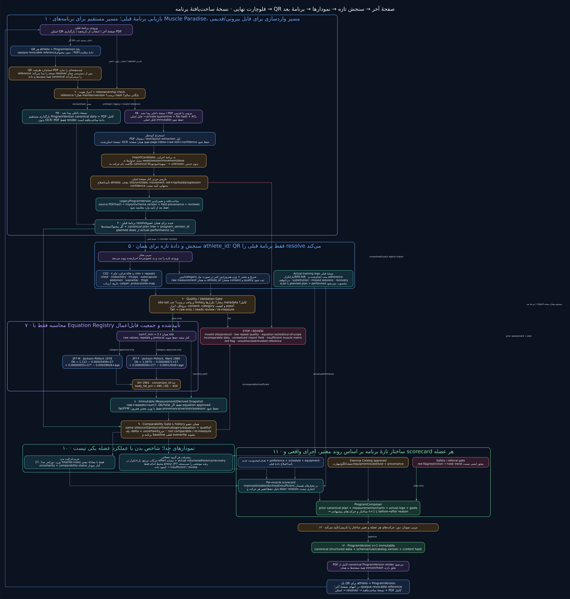
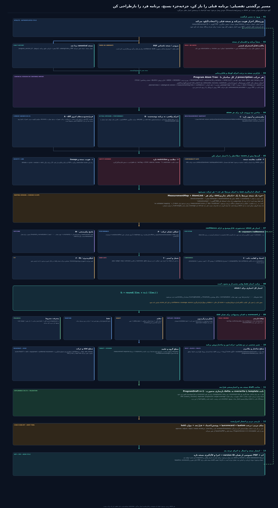
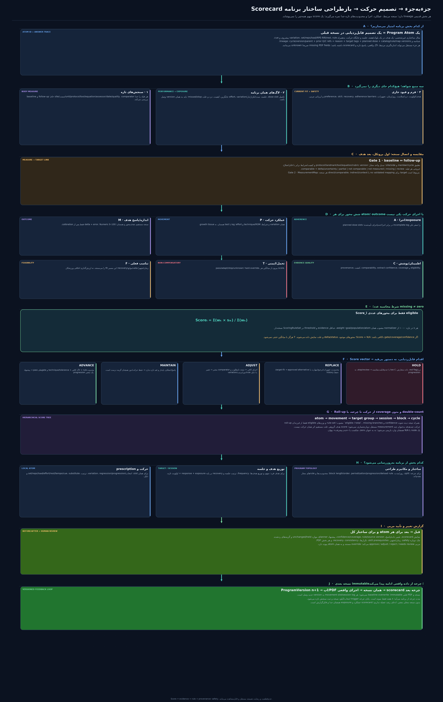
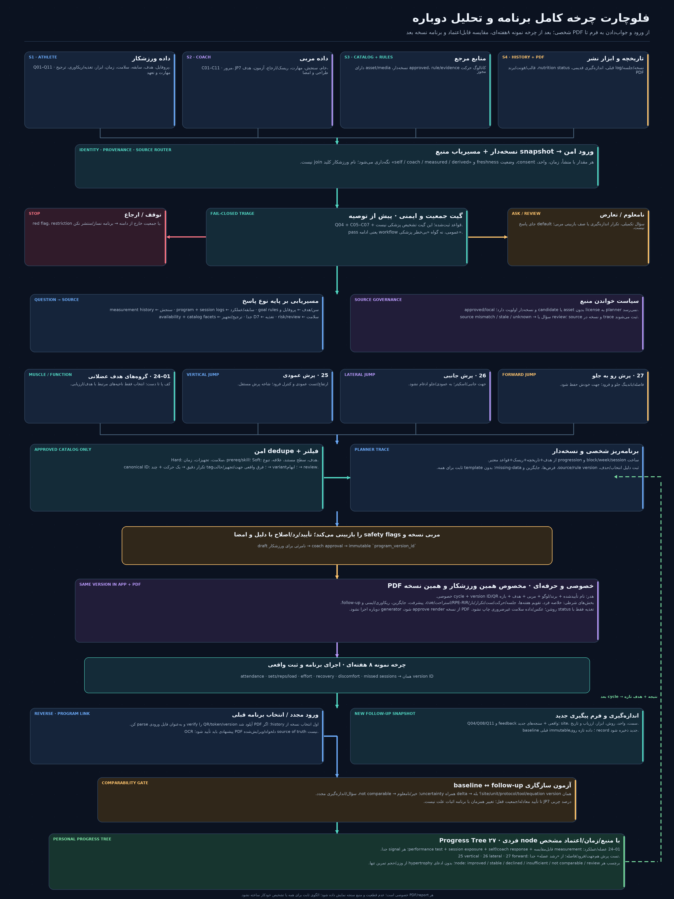
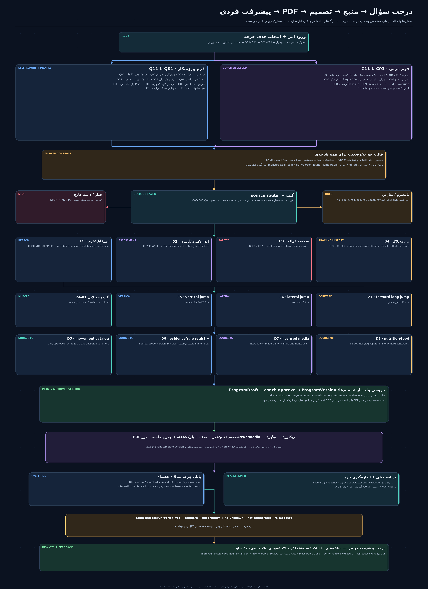
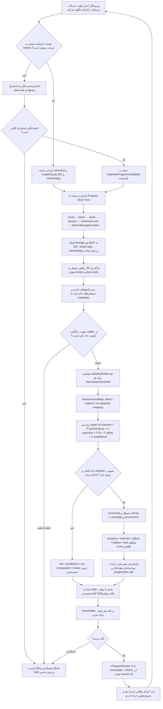

# طراحی چرخهٔ ورزشکار v2 + مسیر برگشت v6: JP7، نمودار پیشرفت و QR صفحهٔ آخر

**وضعیت:** طرح محصول/معماری برای مشورت. این نسخه QR صفحهٔ آخر را به نسخهٔ canonical ساخت‌یافته وصل می‌کند: برنامهٔ داخلی از ProgramVersion بازیابی می‌شود و PDF دوباره OCR نمی‌شود؛ PDF بیرونی/قدیمی مسیر import و بازبینی جدا دارد. محاسبه/ذخیرهٔ مشتق JP7، QR برنامه و تولید PDF متصل به روند هنوز در محصول پیاده‌سازی نشده‌اند.

**هدف:** از ورود ورزشکار و پاسخ به فرم تا انتخاب داده/قواعد مناسب، برنامهٔ شخصیِ نسخه‌دار، سنجش خودکار فقط پس از ورود دادهٔ خام، ذخیره و مقایسه با history همان عضو، نمودارهای معتبر چربی/عملکرد عضلانی، بازشدن نسخهٔ کامل قبلی با QR صفحهٔ پایانی، ثبت اجرای چرخه و تحویل برنامهٔ جدید یک مسیر قابل‌ردیابی داشته باشند. برنامهٔ قبلی در برگشت به اجزای سازنده‌اش باز می‌شود تا هر جزء جداگانه ارزیابی و نسخهٔ بعدی فردی‌سازی شود.

> **اصلاح برداشت مسیر برگشتی، پس از توضیح کاربر:** نمودار قبلی upload را بیشتر در حد پیوند نسخهٔ قبلی و مقایسهٔ سنجش نشان می‌داد؛ برای خواستهٔ کاربر کافی نبود. مسیر دقیق این طراحی این است: برنامهٔ قبلیِ ورزشکار بازیابی/تأیید می‌شود، به همان اجزای کوچک و قابل‌ردیابیِ فرم‌محور شکسته می‌شود، داده‌ها و سنجش‌های تازه به هر جزءِ مرتبط وصل می‌شوند، هر بخش scorecard مستقل می‌گیرد، سپس بر پایهٔ آن و لاگ اجرای واقعی، هم حرکات/دوزها و هم ساختار و روش طراحی برنامهٔ چرخهٔ بعدی فرد بازبینی می‌شود. این هنوز **طراحی پیشنهادی** است؛ در این نوبت منطق امتیازدهی یا محصول پیاده‌سازی نشده است.

> نمودارها هیچ پاسخ واقعی یا دادهٔ شخصی ورزشکار را فرض نمی‌کنند. پاسخ خالی، مقدار پیش‌فرض UI، یا PDF دست‌کاری‌شده به‌تنهایی پاسخ معتبر نیست.

## ۱) تصاویر طراحی

### چرخهٔ JP7، نمودارهای پیشرفت، برنامهٔ کامل و QR در آخرین صفحه



### مشخصات فرمول، داده‌ها، واردسازی برنامهٔ قبلی و رفتار QR

[طراحی JP7 خودکار، بازیابی نسخهٔ canonical و import امن PDF بیرونی](athlete-jp7-program-qr-v6-2026-11-23.md)

### فلوچارت تفصیلی مسیر برگشت: آپلود → خردکردن برنامه → سنجش/امتیاز → بازطراحی نسخهٔ بعد



### فلوچارت scorecard هر جزء و نحوهٔ تبدیل نتیجه به تغییر حرکت/ساختار



### نمای کلی چرخهٔ کامل



### درخت پرسش‌ها، منبع داده، بخش PDF و پیشرفت فردی



## ۲) اصل کاری: ورود واحد، اما چند مسیر ایمن

همه‌چیزِ **قابل‌قاعده‌گذاری** می‌تواند پس از ثبت فرم به‌صورت خودکار انجام شود: اعتبارسنجی، سؤال تکمیلی، خواندن کاتالوگ تأییدشده، حذف تکرار، ساخت draft، انتخاب بخش‌های PDF، تولید خروجی و مقایسهٔ عددیِ قابل‌مقایسه. اما کل سامانه نباید «بی‌قید و شرط خودکار» باشد:

| وضعیت پاسخ/داده | رفتار workflow |
|---|---|
| پاسخ کامل، تازه، سازگار؛ فرد در جمعیت پشتیبانی‌شده؛ گیت سلامت pass؛ قواعد/کاتالوگ review شده | برنامه‌ساز draft شخصی و PDF پیش‌نمایش را خودکار آماده می‌کند؛ مربی نسخه را بازبینی/تأیید می‌کند. |
| پاسخ ناقص، stale، نامعتبر، مجهول، واحد نامشخص یا دو منبع متعارض | فقط سؤال مربوط را می‌پرسد یا کار را در صف مربی می‌گذارد؛ مقدار حدسی/صفر نمی‌سازد. |
| red flag، restriction فعال، جمعیت خارج از دامنه، مسئلهٔ ارجاع یا مورد بالینی حل‌نشده | تولید/انتشار برنامه متوقف می‌شود؛ فقط مسیر ارجاع/بازبینیِ نقش مجاز. |
| تغییر سنجش/پروتکل بین baseline و بعد از ۸ هفته | مقایسهٔ مستقیم را `not comparable` می‌زند؛ روش همسان یا بازاندازه‌گیری درخواست می‌کند. |

**پیشنهاد عرضهٔ اول:** حتی اگر ساخت draft/PDF کاملاً خودکار شود، PDF اجرایی فقط پس از تأیید مربی منتشر شود. خودکارشدن گزارش یا «هیچ منع ثبت‌شده‌ای پیدا نشد» مجوز پزشکی/تشخیص محسوب نمی‌شود.

## ۳) سؤال‌ها، گزینهٔ پاسخ و مقصد منطقی

قالب‌های پاسخ باید نسخه‌دار باشند: single/multi-select، عدد+واحد، مقیاس+تعریف، بله/خیر/نامعلوم، متن اختیاری. «نامعلوم»، «ترجیح نمی‌دهم پاسخ دهم» و «فیلد ضروری ولی تکمیل‌نشده» سه وضعیت مستقل‌اند.

### ۳.۱ فرم ورزشکار — Q01 تا Q11

| ID | موضوع سؤال‌ها | پاسخ/اعتبارسنجی | داده و تصمیمی که تغذیه می‌کند | مصرف در خروجی/مسیر |
|---|---|---|---|---|
| Q01 | مشخصات و دادهٔ پایه: شناسه، سن، متغیر لازم برای محاسبه، قد/وزن و دورها | prefill از profile با منبع و تاریخ؛ سن از تاریخ مرجع؛ عدد+واحد؛ self-report از coach-measured جدا | هویت فقط برای پیوند؛ پروفایل برای جمعیت/حدود مجاز؛ measurement history برای baseline | PDF نام ورزشکار را فقط در سند خصوصی/مجوزدار می‌آورد؛ سنجهٔ لازم و تاریخ، نه همهٔ PII. |
| Q02 | هدف اصلی، اولویت و شاخص موفقیت | انتخاب یک هدف + اولویت‌ها/هorizon/metric؛ امکان «پرش» و نوع هدف ورزشی | وزن‌دهی تقسیم روز/عضله، بلاک و شاخص بازآزمایی | خلاصهٔ هدف و ساختار چرخه؛ نتیجه وعده داده نمی‌شود. |
| Q03 | سابقه، وقفه، برنامه/حرکت قبلی، رکورد و آشنایی تکنیکی | ماه/سال، انتخابی و log؛ منشأ/confidence؛ گزینهٔ «نمی‌دانم» | سابقهٔ `WorkoutProgram`, برنامهٔ قبلی و لاگ ست/بار برای نقطهٔ شروع؛ تست مربی جدا | baseline/فرض‌های مهم؛ دادهٔ قدیمی بدون تأیید مصرف نشود. |
| Q04 | سلامت، بیماری، جراحی، درد/آسیب، علائم و محدودیت | بله/خیر/نامعلوم + شاخهٔ تکمیلیِ حداقلی/منبع؛ در صورت نیاز coach/clinician | safety gate و `RiskCase`; red-flag به توقف/ارجاع می‌رود | فقط دستور توقفِ عمومیِ تأییدشده؛ هیچ تشخیص/درمان در PDF تولید نشود. |
| Q05 | روز، مدت، ساعت، کار/تحرک و سفر | روزهای قابل‌اجرا و دقیقهٔ جلسه؛ availability زمان‌دار | تعداد جلسه/روز استراحت، سقف زمان، تقویم و جایگزین سفر | تقویم شخصی هفتگی و ابزار لازم. |
| Q06 | محل و تجهیزات واقعاً در دسترس | چندانتخابی + availability: وزن بدن/دمبل/هالتر/دستگاه/کابل/کتل‌بل/مینی‌لوپ/کش بلند/جعبه/مانع/طناب/اسلد و … | فیلتر سخت روی `ExerciseCatalogEntry.requirements`؛ نبود ابزار یعنی حذف/جایگزین مجاز | فهرست تجهیز و جایگزین‌های قابل‌اجرا. |
| Q07 | تغذیه، وعده، آلرژی/حذف و آمادگی | اختیاری؛ بله/خیر/نامعلوم، چندانتخابی، واحد/منبع؛ consent لازم | `NutritionPlan`, `MealItem`, `FoodItem` و `FoodLog` جدا؛ آلرژی hard constraint | فقط `target-only` یا meal plan تأییدشده؛ مصرف واقعی با نسخه یکی نیست. |
| Q08 | خواب، ریکاوری، استرس، هوازی، تحرک، خستگی/کوفتگی | مقدار/بازه یا self-report؛ تاریخ و trend | recovery/adherence context؛ در تشدید علائم → review | بازیابی/ثبت پیگیریِ عمومی و پاسخ وابسته به قواعد؛ نه تشخیص. |
| Q09 | علاقه/عدم‌علاقهٔ حرکت، نوع تمرین و تجربهٔ درد | پسند/نپسند جدا از درد/منع؛ چندانتخابی و اختیاری | dislike یک وزن ترجیح نرم؛ گزارش درد به Q04/C05 | پیشنهاد جایگزین هم‌هدفِ تأییدشده؛ دلیل تغییر قابل‌دیدن. |
| Q10 | خودارزیابی ۱۴ مهارت | rubric version، score scale و `unknown` واقعی | `SelfAssessment`; برای skill gate پیشنهاد ارزیابی مربی/تست عینی | فقط مهارتی که برای اجرای برنامه لازم است؛ self-rating معادل مشاهده نیست. |
| Q11 | تعهد، مانع‌ها، انگیزه و نکتهٔ اختیاری | چندانتخابی + متن اختیاری پالایش‌شده | پیچیدگی/طول برنامه، یادآور و برنامهٔ قابل‌پایبندی | برنامهٔ کوتاه/سفر یا نکتهٔ ضروری؛ متن آزاد غیرضروری به PDF/log کپی نشود. |

### ۳.۲ فرم مربی — C01 تا C11

| ID | وظیفهٔ مربی | ثبت پاسخ/شواهد | مسیر بعدی |
|---|---|---|---|
| C01 | مرور دادهٔ ورزشکار | تأیید/اصلاح، منبع، علت، actor و timestamp | snapshot جدید؛ تاریخچهٔ قبل overwrite نشود. |
| C02 | Jackson–Pollock هفت نقطه‌ای | مقدار خام mm برای هر site، محل، ابزار، پروتکل، ارزیاب، کیفیت، تاریخ | معادله/نسخه/دامنهٔ جمعیت باید مستقل تأیید شود؛ کد فعلی `calf` می‌خواهد درحالی‌که فرم ارسالی `midaxillary` دارد؛ خام با درصد مشتق یکی نیست. |
| C03 | پیکرسنجی/اندازه‌های بدن و در صورت نیاز قامت | site، سمت، واحد، روش، ارزیاب و تاریخ؛ consent/retention برای عکس | trend فقط با site/protocol قابل‌مقایسه؛ عکس v1 پیش‌فرض خاموش. |
| C04 | ارزیابی ۱۴ مهارت | rubric مربی، روش مشاهده، تست، نمره، confidence و تاریخ | از self-rating مجزا؛ نگاشت به ۱۳ محور موجود فقط پس از بررسی معنا. |
| C05 | سلامت/ریسک و red flag | وضعیت، منبع، scope restriction، تاریخ انقضا و reviewer | red flag ⇒ stop/referral؛ نامعلوم یا قدیمی ⇒ `needs_review`. |
| C06 | ماژول‌های آسیب | ۱۰ ناحیهٔ ارسالی + فرم عمومی؛ سمت/محدودیت/گزارش درمانگر/مرحله در صورت ارائه | فقط restriction معتبر از candidateهای حرکت حذف می‌کند؛ تشخیص/توان‌بخشی تولید نمی‌شود. |
| C07 | تصمیم ارجاع | مقصد/مسئول/زمان پیگیری/وضعیت | تا رفع پیش‌شرط، مسیر شخصی‌سازی متوقف می‌ماند. |
| C08 | آزمون‌های عملکردی | protocol، نتیجه، واحد، زمان، شرایط و assessor | baseline معتبر برای مقایسه؛ تست بدون روش/جمعیت فقط توصیفی. |
| C09 | اولویت، متریک و تاریخ بازآزمایی | رتبهٔ هدف، آستانه/تعریف موفقیت و rationale | وزن‌دهی planner و درخت پیشرفت فردی. |
| C10 | طراحی برنامه و override مربی | تغییر حرکت/دوز/ترتیب، علت، rule/evidence | نسخهٔ جدید با reason؛ override بی‌دلیل/پنهان نباشد. |
| C11 | کنترل ایمنی نهایی و امضا | approve/reject/needs review، actor، زمان، reason | فقط approve یک نسخهٔ immutable اجرایی می‌سازد و PDF انتشار می‌یابد. |

## ۴) لایه‌های تصمیم و مسیریابی منبع داده

پیشنهاد معماری، هر پاسخ را به «منبع معتبرِ همان نوع داده» وصل می‌کند؛ نه اینکه همهٔ پاسخ‌ها به یک مدل عمومی داده شود.

| لایه/منبع | چه چیزی از آن خوانده می‌شود؟ | قاعدهٔ مصرف |
|---|---|---|
| D0 — Auth/Member | member ID، مالکیت، شعبه و نقش | شناسهٔ داخلی؛ مجوز/consent قبل از دادهٔ حساس. |
| D1 — Profile/Intake Snapshot | پاسخ‌های Q01–Q11 و منبع هر فیلد | prefill فقط با مقدار جاری/تاریخ؛ stale/conflict ⇒ سؤال، نه overwrite. |
| D2 — CoachAssessment/Measurement history | C01–C09، مقدار خام، پروتکل، مهارت/تست و کیفیت | measured، coach-assessed و self-report تفکیک شوند؛ مشتق با فرمول/نسخه. |
| D3 — Program/Training logs | نسخهٔ برنامه، انجام ست/تکرار/وزن، RPE/RIR، جلسات ازدست‌رفته و علائم | فقط وقتی به version/cycle مشخص پیوند دارند برای progression مقایسه شوند. |
| D4 — Approved Exercise Catalog | canonical IDs، alias، هدف عضله، تجهیزات، مهارت/پیش‌نیاز، نسخه/وضعیت | فقط `approved` وارد planner؛ `candidate` برای جست‌وجوی پیشنهادی/بازبینی است، نه نسخه. |
| D5 — Versioned evidence/rules | target، scope جمعیت، rule ID/version، منبع، reviewer، تاریخ/حدود | خروجی عددی از قواعدی که مرجع/دامنه/بازبین دارند؛ LLM عدد و منع اختراع نکند. |
| D6 — Exercise media | متن/تصویر/GIF/video، حق استفاده، attribution، وضعیت موجودبودن | نمایش رسانه فقط اگر asset موجود و مجاز است؛ GIF خالی ⇒ عکس/متن fallback. |
| D7 — Nutrition/food | `NutritionProfileDB`, `FoodDB`, `MealItem`, `MealPlan` و `FoodLog` با namespace مستقل | منبع غذایی/وعدهٔ wger را از WGER exercise و training planner جدا نگه دار؛ Compendium MET فقط فعالیت است، نه ترکیب مواد غذایی؛ پوشش/مجوز ناکافی ⇒ nutrition output نده. |
| D8 — Brand/PDF renderer | نام نمایشی ورزشکار، برند باشگاه، فونت، layout، template version | اطلاعات خصوصی، کنترل دسترسی، QR خصوصی و renderer ثابت. |
| D9 — Uploaded prior report | فایل PDF برنامه/آنالیز که ورزشکار بارگذاری می‌کند | ابتدا پیوند به برنامهٔ ذخیره‌شده از طریق token/QR/version؛ OCR/parsing فقط پیشنهادِ استخراج و نیازمند تأیید ورزشکار/مربی. فایل بارگذاری‌شده منبع حقیقت یا دستور executable نیست. |

### قانون تعارض و اولویت

1. شناسهٔ نسخهٔ برنامه/مقیاس اندازه‌گیری و provenance، کلید تطبیق‌اند؛ نام ورزشکار به‌تنهایی کلید join نیست.
2. مقدار coach-measured با مقدار self-report ادغام نمی‌شود؛ دو رکورد و دو تاریخ نگه‌داری می‌شوند.
3. دادهٔ جدید جای مقدار قبلی را در history نمی‌گیرد؛ snapshot و program version جدید ایجاد می‌شود.
4. منبع خارج از دامنه/بدون license/بدون review از data retrieval حذف یا به review منتقل می‌شود.
5. `no data`, `not measured`, `not comparable`, `no risk reported`, `not screened` جواب‌های متفاوت‌اند.

## ۵) منطق انتخاب برنامه و ساخت PDF شخصی

### مراحل planner

1. Q01–Q11 را اعتبارسنجی کند؛ مقدارهای قدیمی را به ورزشکار نشان دهد تا confirm/update کند.
2. با Q04 و C05–C07 population/safety/referral gate را اجرا کند؛ stop/review پیش از ranker.
3. هدف Q02 و اولویت C09 را به یکی از مسیرهای ۲۷گانه یا ترکیب مجاز وصل کند؛ «همهٔ ۲۷ دسته» برنامهٔ پیش‌فرض نیست.
4. تجهیزات و زمان Q05/Q06، مهارت Q10/C04، سابقهٔ Q03 و recovery Q08 را به hard constraints یا soft weights تفکیک کند.
5. فقط از D5 حرکت `approved` با media/metadata قابل‌ردیابی کاندید بسازد؛ exercise family/variation و هدف‌های عضلانی چندبرچسبی حفظ شوند.
6. dedupe را با canonical ID، نوع حرکت/ابزار/زاویه/جهت/تک‌پا/دوز انجام دهد؛ نام مشابه به‌تنهایی دلیل merge نیست.
7. از rule/evidence نسخه‌دار block/week/session بسازد؛ reason، فرض‌ها، confidence، حرکت جایگزین، rule version و منبع سنجه ذخیره شود.
8. محدودیت تعداد روز/زمان، توزیع recovery، equipment، دسته‌های duplicate، missing cues/media و progression را بررسی کند.
9. draft را به C10/C11 مربی دهد؛ مربی override/reject را با دلیل ثبت کند.
10. پس از approve، برنامه immutable شود؛ اپ و PDF یک `program_version_id` را بخوانند.

### هدر و بخش‌های انتخابی PDF

PDF برای همان ورزشکار و همان نسخه است؛ گزینه‌های حرفه‌ای به پاسخ/هدف/تجهیزات/مسیر او وابسته‌اند، نه یک قالب یکسان برای همه.

- **کاور/هدر:** نام موردتأیید ورزشکار (طبق درخواست کاربر)، برند/لوگوی Muscle Paradise یا باشگاه، نام مربی مجاز، عنوان هدف، شمارهٔ cycle، تاریخ شروع/پایان و `ProgramVersion ID`. نام/اطلاعات سلامت فقط در PDF خصوصی و با مجوز دسترسی؛ QR برنامه فقط در انتهای صفحهٔ آخر قرار می‌گیرد.
- **نمای کلی فردی:** هدف و اولویت، روز/مدت جلسات، تجهیزات، فرض‌های لازم برای اجرای تمرین و مواردی که ورزشکار/مربی باید دوباره بررسی کند؛ جزئیات حساس غیرضروری نه.
- **خلاصهٔ بلوک/۸ هفته:** فاز، تقویم، روزهای تمرین/استراحت، progression rules، شروط توقف/review و تاریخ ارزیابی مجدد؛ تعداد هفته قابل‌تنظیم است و ۸ هفته پیش‌فرض اجباری نیست.
- **صفحه/جدول هر جلسه:** نام فارسی حرکت، گروه عضله/هدف و order، warm-up، ست×تکرار یا بازه، بار/RPE/RIR با منشأ، استراحت، tempo/مدت در صورت نیاز، cue، تجهیز و substitute تأییدشده.
- **آموزش حرکت:** لینک/QR به جزئیات کتابخانه؛ تصویر/GIF فقط موجود و مجاز؛ توضیح و هشدارهای عمومیِ بازبینی‌شده؛ reduced motion و fallback چاپ.
- **آیتم‌های شرطی:** هوازی، mobility/skill، تغذیه/meal plan فقط اگر مسیر مربوطه دادهٔ معتبر و approval لازم را دارد. `target-only` با برنامهٔ وعده فرق کند.
- **برگه‌های پیگیری:** check box جلسه، بار/تکرار انجام‌شده، effort، adherence، symptom stop و یادداشت محدود.
- **برگهٔ بازآزمایی پایان چرخه:** همان protocol و siteهای baseline، تاریخ، واحد و نحوهٔ ارسال/اندازه‌گیری جدید. برنامه/نسخهٔ اصلی برای پیوند ثابت می‌ماند.
- **پایان/منابع:** نام نسخهٔ قواعد/کاتالوگ/فونت/renderer، متن حدود شواهد و QR یکتای همان عضو/نسخه در آخرین صفحه؛ شمارهٔ صفحه و جداول RTL با visual regression.

### QR برنامه در انتهای صفحهٔ آخرِ PDF کامل

برای **هر ورزشکار و هر نسخهٔ تأییدشدهٔ برنامه، یک PDF کامل چندصفحه‌ای** تولید شود و QR همان نسخه فقط در انتهای صفحهٔ آخر قرار بگیرد. یک QR استاندارد ظرفیت حمل PDF چندصفحه‌ای را ندارد؛ در حد بالای رایج حدود ۲٬۹۵۳ بایت binary در Version 40-L است. پس QR فقط opaque reference قابل‌ابطال دارد؛ پس از login و کنترل مالکیت، resolver نسخهٔ دقیق و fingerprint آن را پیدا می‌کند و دسترسی به کل PDF و همهٔ صفحه‌ها را می‌دهد. QR دادهٔ سلامت یا مجوز دسترسی نیست.

### برنامهٔ داخلی: بازیابی مستقیم، بدون OCR

`ProgramVersion` canonical شامل JSON ساخت‌یافتهٔ برنامه، `schema_version`, `rule/catalog_version`, `member_id`, `cycle_id`, `content_hash` و وضعیت تأیید است. PDF فقط از همین داده render می‌شود. QR/reference معتبر یا انتخاب برنامه از تاریخچه مستقیماً همان canonical record و PDF را resolve می‌کند؛ OCR دوباره روی PDF داخلی اجرا نمی‌شود. برنامه‌های قبلی و hash آن‌ها immutable می‌مانند.

### برنامهٔ بیرونی/قدیمی: واردسازی کنترل‌شده

اگر QR/reference به ProgramVersion داخلی نرسد یا فایل از سیستم دیگری باشد:

1. فایل اصلی خصوصی و immutable بارگذاری و hash شود؛ نسخهٔ اصلی حفظ شود.
2. برای PDF دیجیتال، text/layout extraction اجرا شود؛ OCR فقط روی صفحه‌های تصویری/اسکن‌شده انجام گیرد.
3. داده‌ها به `ImportCandidate` تبدیل شوند؛ برای هر فیلد متن خام، شمارهٔ صفحه، bounding box، روش استخراج و confidence ثبت شود. حرکت به canonical catalog پیشنهاد و ابهام `unknown` بماند؛ هیچ set، بار یا progression حدس زده نشود.
4. مربی candidate را کنار صفحهٔ اصلی تأیید/اصلاح کند. بعد از تأیید، `LegacyProgramVersion` تغییرناپذیر با source hash، import/schema version، provenance و reviewer ساخته شود.

### اسکن، سنجش تازه و برنامهٔ بعد

پس از بازیابی/تأیید نسخهٔ قبلی، مربی دادهٔ خام C02 تازه و لاگ واقعی تمرین را به همان عضو/cycle پیوند می‌دهد؛ اسکن QR به‌تنهایی تمرین یا سنجش را ثبت نمی‌کند. مقایسه فقط برای دادهٔ قابل‌مقایسه انجام می‌شود. نمودار چربی/ترکیب بدن فقط از سنجهٔ معتبر ساخته می‌شود؛ اگر JP7 قفل یا نامعتبر است، فقط `Σ7`/وزن/دورکمر با نام درست خودشان نشان داده شوند. نمودار هر گروه عضلانی بر عملکرد واقعی با effort مشابه، حجم انجام‌شده، adherence/recovery و در صورت وجود سنجهٔ موضعیِ استاندارد تکیه می‌کند؛ JP7 رشد موضعی عضله را اندازه نمی‌گیرد.

`ProgramComposer` نسخهٔ canonical/Legacy قبلی، سنجش‌ها، لاگ‌ها، هدف و محدودیت‌های تازه، کاتالوگ approved و safety gate را ترکیب می‌کند. برای هر عضله دلیل حفظ یا تغییر حرکت/دوز ثبت می‌شود؛ تعویض حرکت صرفاً به‌خاطر یک عدد JP7 یا به‌صورت اجباری نیست. مربی ساختار تازه و نمودارها را تأیید می‌کند؛ سپس `ProgramVersion n+1` canonical و PDF کامل جدید ساخته و QR نسخهٔ جدید در صفحهٔ آخر قرار می‌گیرد. برنامه‌ها و PDFهای قبلی private و immutable می‌مانند. QR برنامه از QR حضور باشگاه جداست.

### ردیابی هر پاسخ به منبع و بخش PDF

| پاسخ | منبع/منطق اصلی | بخش برنامه/PDF که از آن اثر می‌گیرد |
|---|---|---|
| Q01 هویت/پروفایل/اندازه‌ها | D0/D1/D2/D8 | هدر خصوصی، snapshot baseline و جدول سنجه‌های لازم؛ نه PII اضافی. |
| Q02 هدف و اولویت | goal/rule registry + tags کاتالوگ | کاور، هدف چرخه، تقسیم روزها و اولویت‌های تمرینی. |
| Q03 سابقه/رکورد | D3 program/log history + Q03 | فرض سطح شروع، انتخاب/تنوع حرکت و baseline؛ self-report برچسب می‌خورد. |
| Q04 سلامت/علائم | D2/D3 safety gate | فقط restriction/stop instruction مجاز؛ مورد حل‌نشده → توقف PDF اجرایی. |
| Q05 زمان/روز | availability profile | تقویم جلسه/استراحت و زمان تقریبی روز. |
| Q06 تجهیزات/محل | availability + D5 | لیست وسیلهٔ لازم و substitute قابل‌اجرا. |
| Q07 تغذیه | D7 + approval policy | بخش اختیاری `target-only` یا meal plan تأییدشده؛ آلرژی/حذف در حد لازم. |
| Q08 ریکاوری/هوازی | D3 logs + check-in snapshot | برگ ریکاوری، توقف/بازآزمایی و follow-up. |
| Q09 ترجیح/درد | preference profile + safety route Q04 | انتخاب/جایگزین و دلیل ترجیح؛ گزارش درد فقط از safety review. |
| Q10 خودارزیابی مهارت | SelfAssessment + D2/C04 | cue/skill block و نیاز به coach-check؛ نه مجوز خودکار سطح حرفه‌ای. |
| Q11 تعهد/موانع | adherence preference + D3 | نسخهٔ قابل‌پایبندی، کوتاه‌سازی/یادآور و برگهٔ پیگیری. |
| C01–C04/C08 اندازه‌گیری/ارزیابی | D2 measurement/assessment history | baseline/روش اندازه‌گیری/آزمون در پیوست و بازآزمایی همسان. |
| C05–C07 ریسک/ارجاع | safety/risk/referral registry | در حالت pass فقط حدود لازم؛ stop/ارجاع یعنی PDF اجرایی منتشر نشود. |
| C09–C11 هدف/طراحی/امضا | planner trace + `ApprovedProgramVersion` | خلاصهٔ تصمیم، برنامهٔ جلسه، نام تأییدکننده و version/date. |

### ۲۷ شاخهٔ هدف/حرکت در کاتالوگ

این‌ها شاخه‌های انتخاب‌اند؛ هر عضو فقط زیرمجموعهٔ مرتبط را دریافت می‌کند. هر ردیف ابزارهای ممکن در فهرست کاربر را می‌تواند داشته باشد: وزنه/ابزار، وزن بدن، مینی‌لوپ یا کش بلند.

| # | هدف عضله/جهت | # | هدف عضله/جهت |
|---:|---|---:|---|
| 01 | عضلات ذاتی کف پا | 15 | اوبلیک داخلی/خارجی |
| 02 | عضلات شست پا | 16 | ترنسورس ابدومینیس |
| 03 | گاستروکنمیوس | 17 | لاتیسیموس دورسی |
| 04 | سولئوس | 18 | تراپزیوس/رومبوئید |
| 05 | تیبیالیس قدامی | 19 | دلتوئید |
| 06 | تیبیالیس خلفی/پرونئوس | 20 | تریسپس براکی |
| 07 | چهارسر ران | 21 | بایسپس براکی |
| 08 | همسترینگ | 22 | روتاتور کاف |
| 09 | گلوتئوس ماکزیموس | 23 | ساعد و مچ |
| 10 | گلوتئوس مدیوس/مینیموس | 24 | عضلات دست/انگشتان |
| 11 | ادکتورها | 25 | پرش عمودی |
| 12 | فلکسورهای ران | 26 | پرش جانبی |
| 13 | ارکتور اسپاین | 27 | پرش طولی رو به جلو |
| 14 | رکتوس ابدومینیس |  |  |

## ۶) برگشت چرخه: آپلود برنامه و تحلیل پیکرسنجی پس از ۸ هفته

### مسیر پیشنهادی برای اتمام بلوک

1. در برنامه دکمهٔ «پایان بلوک / ارزیابی مجدد» فعال شود؛ موعد نمونهٔ هفتهٔ ۸ از calendar نسخه می‌آید، اما ورزشکار می‌تواند دیرتر/زودتر ثبت کند و فاصلهٔ واقعی نشان داده شود.
2. ورزشکار برنامهٔ قبلی را از تاریخچه انتخاب می‌کند؛ اگر PDF را دوباره آپلود می‌کند، QR/token یا `program_version_id` برای شناسایی کمک می‌کند. با نام/شناسهٔ تایپ‌شدهٔ بدون احراز هویت برنامه به حساب پیوند نخورد.
3. فایل از نظر مالکیت، نوع/حجم و سلامت upload بررسی شود. دادهٔ استخراج‌شده از PDF به فرم «پیش‌نویس استخراج» تبدیل و قبل از ذخیره تأیید گردد؛ هرگز محتوای دلخواه PDF را به‌عنوان قانون یا دستور موتور اجرا نکنید.
4. ثبت Qهای follow-up: تکمیل/پایبندی، missed sessions، set logs، effort، خستگی/خواب، درد/آسیب تازه، تغییر تجهیزات/زمان/هدف و reason هر توقف.
5. اندازه‌گیری جدید با site، سمت، واحد، protocol، ابزار، ارزیاب و زمان ثبت شود. اگر عضو فقط فایل آنالیز بدن دارد، هر فیلد استخراجی source و confidence دارد و خودش/مربی تأیید می‌کند.
6. baseline از snapshot اولیه/اندازه‌گیری همان cycle خوانده شود؛ مقدار جدید هرگز روی baseline overwrite نشود.
7. سازگاری baseline/follow-up چک شود: site برابر؟ واحد قابل‌تبدیل؟ روش/ابزار/rubric/equation version همسان؟ زمان‌بندی/شرایط ثبت شده؟ اگر نه ⇒ `not comparable` + درخواست اندازه‌گیری همسان یا گزارش محدود.
8. فقط فیلدهایی که واقعاً قابل‌مقایسه‌اند delta و trend می‌گیرند. delta با عدم‌قطعیت/خطای اندازه‌گیری و نوع منبع نمایش داده می‌شود؛ تغییر هم‌زمان با برنامه به‌تنهایی اثبات اثر علّی برنامه نیست.
9. درخت پیشرفت عضلانی هر شخص به‌روزرسانی می‌شود (جزئیات بخش ۷). مربی/ورزشکار داده و تفسیر را می‌بیند.
10. planner نسخهٔ بعد را از Qها، baseline/follow-up، actual training logs، هدف جدید و قواعد جاری می‌سازد؛ `ProgramVersion n+1` ایجاد می‌شود، نه ویرایش نسخهٔ قبلی. PDF بعدی و گزارش روند به cycle تازه پیوند دارند.

### مسیر برگشت v3: خردکردن هر برنامه به اجزای قابل‌ارزیابی و بازطراحی فردی

این مسیر، **پردازش خط‌به‌خط برنامهٔ قبلی** است؛ صرفاً مقایسهٔ دو PDF یا ساخت یک گزارش کلی نیست. هر جزء به نسخه و پرسش‌هایی که آن را ساخته‌اند lineage دارد. نتیجهٔ هر جزء هم scorecard خودش را دارد و به پیشنهاد مشخص برای حفظ، پیشرفت، تغییر یا بازبینی تبدیل می‌شود.

#### ۶.۱) بازیابی برنامه و تثبیت نسخهٔ مبنا

1. ورزشکار پس از احراز هویت، از history همان حساب نسخهٔ قبلی را انتخاب می‌کند؛ upload PDF مسیر جایگزین است، نه راه شناسایی با نام.
2. اگر QR/token/`program_version_id` معتبر باشد، نسخهٔ immutable ذخیره‌شده و snapshotهای فرم/مربی، rule/catalog versions و تاریخچهٔ PDF همان نسخه بازیابی می‌شوند. متن PDF دوباره‌خوانی و به منبع جدید حقیقت تبدیل نمی‌شود.
3. اگر فایل بیرونی است، ownership، مجوز دسترسی، نوع/امضای فایل، حجم و سلامت آن بررسی می‌شود. OCR/parse یک `ImportedProgramCandidate` می‌سازد؛ confidence در **سطح هر فیلد** می‌ماند و ورزشکار/مربی موارد استخراج‌شده را تأیید می‌کنند. low-confidence یا اطلاعات ناسازگار → اصلاح/صف review، نه حدس.
4. PDF یا متن استخراجی هرگز prompt، قانون موتور، دستور قابل‌اجرا یا اثبات اجرای برنامه نیست. برنامهٔ آپلودشده فقط شرح نسخهٔ تاریخی است؛ actual training logs منبع جداگانه‌اند.

#### ۶.۲) بازکردن نسخه به درخت اجزای کوچک (Program Atom Tree)

نسخهٔ ذخیره‌شده از دادهٔ canonical خوانده می‌شود؛ PDF بیرونی پس از تأیید تا حد اطلاعات قابل‌اعتماد به همین ساختار normalize می‌شود. کوچک‌ترین واحد قابل‌ارزیابی **program atom** است:

| سطح درخت | چه چیزی جداگانه بررسی می‌شود؟ | نمونهٔ provenance لازم |
|---|---|---|
| Cycle / هدف | هدف اصلی، اولویت، شاخص موفقیت، طول چرخه و فرض‌ها | Q02، C09، تاریخ/نسخهٔ baseline |
| معماری بلوک | نوع تقسیم‌بندی، ترتیب فازها، طول/توالی هفته‌ها و منطق progression | Q03/Q05/Q08، C09/C10، rule-set version |
| هدف/گروه | هر یک از ۲۴ هدف عضلانی/عملکردی یا شاخهٔ پرش ۲۵–۲۷ و سهم آن در چرخه | target tags، اولویت، measurement-map version |
| هفته/جلسه | روز، ترتیب، زمان، استراحت، توزیع هدف‌ها و ریکاوری | Q05/Q08/Q11، schedule/log IDs |
| جایگاه حرکت | حرکت canonical، variation، سمت/جهت، نقش هدف، skill/precondition، تجهیزات و جایگزین | Q06/Q09/Q10، C04/C06، catalog version، reason انتخاب |
| نسخهٔ حرکت/دوز | هر set/reps/load یا بازه، RPE/RIR، tempo/ROM/rest/cue و اجرای ثبت‌شده | prescription ID + dose-slot IDs + session logها |
| قاعدهٔ پیشروی/ماژول | شرط افزایش/کاهش، autoregulation، deload/stop، warm-up/skill/cardio و هر بخش شرطی | rule/evidence version، approval و source؛ تغذیه در منبع جدا |

هر node دارای `lineage_id`, `parent_id`, `cycle_id`, `program_version_id`, `atom_type`, `target_tags`, `prior_answer_refs` (Q/C)، دلیل انتخاب، planned dose، rule/catalog version، measurement links، actual-log links، confidence و reviewer است. این باعث می‌شود هر حرکت/ست/هفته به جواب‌های اولیه و سنجهٔ مربوطه قابل‌برگشت باشد. اگر PDF بیرونی اطلاعاتی مثل RIR، پروتکل یا دلیل انتخاب را ندارد، مقدار `unknown/not provided` می‌گیرد؛ سیستم آن را بازسازیِ قطعی نمی‌کند.

#### ۶.۳) اتصال برنامهٔ طراحی‌شده به آنچه واقعاً انجام شده

- برای هر `dose_slot` برنامهٔ مقرر و لاگ واقعی کنار هم قرار می‌گیرند: جلسهٔ انجام‌شده/نشد‌ه، حرکت جایگزین، ست/تکرار/بار، effort (RPE/RIR)، کیفیت یا cue، تاریخ و علت حذف/توقف.
- هر لاگ باید به ورزشکار، cycle، نسخه، session و movement/slot درست متصل باشد. دادهٔ خارج از نسخه به‌عنوان «اجرای همین برنامه» وارد score نمی‌شود.
- نبود لاگ با «جلسه انجام نشد» یکی نیست: ورزشکار می‌تواند عدم‌اجرا را تأیید کند؛ در غیر این صورت پوشش داده `unknown/incomplete` است، نه adherence صفر.
- پاسخ‌های جاری با snapshot قبلی diff می‌شوند: Q02 هدف/اولویت، Q04 علامت/محدودیت، Q05 زمان، Q06 تجهیزات، Q08 ریکاوری، Q09 ترجیح/درد، Q11 موانع؛ ارزیابی Cها نیز نسخه و منبع خود را حفظ می‌کند. تغییر پاسخ فقط روی نسخهٔ بعد اثر دارد و history قبلی را overwrite نمی‌کند.

#### ۶.۴) تطبیق سنجش تازه با هر جزء مرتبط

هر سنجش خام baseline و follow-up با شناسهٔ فرد، site و سمت، واحد، protocol/landmark، ابزار، assessor، تاریخ/شرایط، کیفیت، و اگر مشتق است equation/rubric version نگه‌داری می‌شود. comparator per-field بررسی می‌کند: **همان سنجه و site؟ سمت/واحد قابل‌تبدیل؟ روش/ابزار/نسخه همسان؟ baseline و follow-up متعلق به cycle درست؟ کیفیت کافی؟** فقط فیلدهایی که از gate می‌گذرند delta و uncertainty می‌گیرند؛ بقیه `not comparable`, `missing`, `not measured` یا `needs review` می‌مانند.

هر atom یک `MeasurementMap` نسخه‌دار دارد که targetهای حرکت را به سنجه‌های محلیِ واقعاً مرتبط طبقه‌بندی می‌کند:

- `direct/comparable`: سنجهٔ معتبرِ همان ناحیه/نتیجه با روش همسان؛ امکان محاسبهٔ response score با تفسیر هدف‌محور.
- `indirect/context`: داده‌ای مثل وزن یا ترکیب بدنِ کلی که فقط زمینه می‌دهد؛ مجاز نیست به رشد/پسرفت یک عضله نسبت داده شود.
- `no validated mapping`: سنجه‌ای برای آن atom تعریف نشده؛ نتیجهٔ پیکرسنجی آن بخش `N/A / insufficient` است، نه صفر و نه شکست.

بنابراین **هر جزء بررسی می‌شود، اما هر عدد با هر حرکت مقایسه نمی‌شود**. مثلاً JP7 کلی یا وزن کل به‌تنهایی برای نمرهٔ رشد سولئوس/دلتوئید کافی نیست. یک سنجهٔ گروهی می‌تواند به چند atom مرتبط وصل شود، اما نتیجهٔ گروهی علت مستقیم موفقیت یک حرکت خاص نیست. jump tests فقط به شاخهٔ همان جهت وصل می‌شوند، نه به رشد عضله.

#### ۶.۵) Scorecard مستقل برای هر atom و roll-up شفاف

برای هر atom و سپس هر سطح بالاتر (حرکت ← هدف/گروه ← جلسه ← بلوک ← چرخه)، خروجی یک بردار امتیاز و شواهد است؛ نه یک عدد جادوییِ بی‌منبع:

| محور scorecard | دادهٔ مجاز | معنای امتیاز/وضعیت |
|---|---|---|
| `M — measurement response` | فقط سنجهٔ مرتبط، معتبر و قابل‌مقایسه، delta، uncertainty، جهت هدف | ۰–۱۰۰ تنها وقتی normalization و target/threshold برای همان سنجه و هدف نسخه‌دار و تأیید شده باشد؛ در غیر این صورت delta و وضعیت کیفی، نه عدد ساختگی. |
| `P — movement performance` | عملکرد همان movement/variation با شرایط/تکنیک و effort قابل‌مقایسه؛ set log یا آزمون همسان | روند اجرای حرکت را نشان می‌دهد، نه اندازهٔ عضله؛ تغییر variation یا effort نامشابه → `not comparable`. |
| `A — adherence / exposure` | dose slotهای برنامه در برابر slotهای انجام‌شده/تأییدشده و علت جایگزینی/عدم‌اجرا | درصد تکمیل فقط با پوشش ثبت کافی و تعریف `work unit` نسخه‌دار؛ exposure با رشد بافت برابر نیست. |
| `F — fit / feasibility` | Qهای جاری دربارهٔ زمان، تجهیزات، ترجیح، موانع و recovery | میزان تطبیق نسخه با زندگی فعلی؛ mismatch معمولاً دلیل بازطراحی است، نه نمرهٔ اراده/شخص. |
| `T — tolerance / safety` | علائم تازه، درد، restriction معتبر، recovery و توقف | gate مجزا با `pass / adapt / stop / unknown`; هرگز با امتیاز خوب در محورها جبران نمی‌شود. |
| `C — evidence confidence` | کامل‌بودن، provenance، کیفیت، comparability و confidence استخراج | برچسب/coverage جدا: high/medium/low یا مقدار قراردادی؛ confidence کم composite score را مسدود می‌کند. |

اگر برای یک atom normalization مصوب وجود داشته باشد، اجزای عددی ۰–۱۰۰ هستند. composite اختیاری `S_i` فقط با `ScoringRuleSet` نسخه‌دار و حداقل کفایت داده محاسبه می‌شود:

`S_i = round( Σ(w_k × s_ik) / Σ(w_k) )`  فقط برای محورهای عددیِ واجدشرایط؛ `w_k`، جهت هدف، حداقل محور/پوشش، آستانه‌ها و روش normalization باید برای هدف، جمعیت و نوع atom تعیین و review شوند.

وزن/آستانهٔ جهان‌شمول در این طراحی جعل نمی‌شود. اگر پوشش یا comparability کافی نیست، مقدار `S_i` تهی و نتیجه `insufficient/not comparable/review` است؛ محور غایب صفر فرض یا با دادهٔ نامرتبط جایگزین نمی‌شود. score هر سطح بالاتر همراه با `eligible_count/total_count` و شواهد فرزندان نمایش داده شود؛ atom چندهدفه در roll-up دوباره‌شماری نشود. `score`, subscoreها, data refs, map/rule versions, reason و confidence همگی audit trail دارند.

#### ۶.۶) ترجمهٔ امتیاز هر جزء به تصمیم حرکت

| وضعیت scorecard و gateها | نتیجهٔ پیشنهادی برای همان حرکت/دوز |
|---|---|
| قابل‌مقایسه، score/عملکرد در محدودهٔ progression rule، اجرای کافی، T=pass و skill معتبر | `progress candidate`: مربی می‌تواند طبق rule یک متغیر مناسب (بار، تکرار، دامنه، tempo، پیچیدگی، ست یا شرط) را تغییر دهد؛ نه همه با هم و نه خودکار خارج از scope. |
| پاسخ/عملکرد در محدودهٔ نگهداری و محدودیت تازه‌ای نیست | `maintain`: حرکت و دوز/روش فعلی حفظ شود؛ نسخهٔ بعد الزاماً تعویض حرکت نیست. |
| score پایین اما adherence کم/موانع/تجهیز یا زمان عوض شده | اول دلیل اجراپذیری حل شود؛ کوتاه‌سازی/جایگزینی/بازچینی، نه افزایش کورکورانهٔ حجم یا برچسب «ضعف ورزشکار». |
| score/عملکرد نامطلوب با اجرای کافی، دادهٔ معتبر و gate ایمن | `adjust candidate`: مربی با review علت، دوز/ترتیب/variation/rule را تغییر دهد و فرض/دلیل را ثبت کند. |
| preference یا equipment تغییر کرده، variation تکراری/نامناسب یا مهارت کافی نیست | `replace/regress candidate` به حرکت approved هم‌هدف؛ canonical ID و تاریخچه حفظ، رکورد قبلی حذف نمی‌شود. |
| درد/علامت تازه، restriction، پاسخ متعارض، data کم‌اعتماد یا comparator نامعتبر | `hold/review/stop`; امتیاز عددی اجازهٔ عبور از safety gate ندارد. |

**حرکتِ متفاوت برای هر فرد** از اینجا حاصل می‌شود: هر exercise slot score و محدودیت خود، outcome گروه هدف، عملکرد/effort واقعی، مهارت، ترجیح، وسیله و rule شخصی را دارد. سیستم حرکتِ جدید را به‌عنوان فرضیهٔ برنامه‌ریزی و جایگزین بازبینی‌شده پیشنهاد می‌کند، نه نتیجهٔ قطعی پیکرسنجی یا رابطهٔ علّی با یک عضله.

#### ۶.۷) تغییر ساختار و مکانیزم طراحی، نه فقط فهرست حرکات

پس از scorecard جزءها، امتیازهای معتبر به لایه‌های مختلف planner بازمی‌گردند؛ layout ثابت روی همهٔ ورزشکاران اعمال نمی‌شود:

| لایهٔ بازطراحی | سیگنال‌های scorecard/پاسخ تازه | چیزی که می‌تواند در نسخهٔ بعد تغییر کند |
|---|---|---|
| چرخه/فاز | هدف و اولویت تازه، پاسخ کلیِ قابل‌مقایسه، محدودیت و recovery | طول چرخه، focus و ترتیب/مدت فازها، معیار بازآزمایی و rule-set مجاز. |
| ساختار هفته (microcycle) | زمان/روز واقعی، adherence، خستگی، توزیع outcome و قیود | تعداد/چیدمان روزها، split یا full-body/ترکیبیِ مجاز، فاصلهٔ جلسات و recovery. |
| هدف/گروه | measurement map، عملکرد/آزمون، میزان exposure و اولویت C09 | سهم هدف‌ها و تخصیص دوز/توجه، فقط در دامنهٔ شواهد و قواعد تأییدشده. |
| جلسه/حرکت | P/A/F/T به‌ازای movement slot، skill و equipment | انتخاب/ترتیب حرکت، variation، regression/progression، جایگزین و cue. |
| دوز و مکانیزم progression | موفقیت setها با effort، اجرای واقعی، تحمل و rule قبلی | load/reps/sets/rest/tempo، شرط افزایش/نگهداری/کاهش، autoregulation یا deload در حدود rule مصوب. |

Planner برای هر تصمیم `before → after`, علت، atom scorecard، پاسخ/سنجهٔ پشتیبان، rule version، دادهٔ غایب و گزینه‌های ردشده را ثبت می‌کند. تغییر چندهدفهٔ یک حرکت دوباره‌شماری نمی‌شود؛ goal/measurement score گروهی را مستقیماً به تمام حرکات آن گروه کپی نمی‌کنیم. ابتدا draft delta نسبت به نسخهٔ قبل ساخته می‌شود؛ مربی می‌تواند approve/adjust/reject کند و هر override دلیل دارد.

#### ۶.۸) ممیزی و نسخهٔ بعد

مربی در یک نمای before/after می‌بیند: درخت اجزا، scorecard هر بخش، سنجهٔ مرتبط و کیفیت مقایسه، لاگ واقعی، موارد `N/A/unknown`, و اینکه planner کدام تغییر ساختاری یا حرکتی را پیشنهاد داده است. reject/needs-review به atom مشخص و سؤال/اندازه‌گیری لازم برمی‌گردد. پس از تأیید، `ProgramVersion n+1` immutable ساخته می‌شود؛ نسخهٔ قبلی، baseline و PDF آن دست‌نخورده می‌مانند. اپ و PDF تازه همان version ID را مصرف می‌کنند و لاگ چرخهٔ بعد به آن وصل می‌شود.

### نمودار متنی قابل‌ویرایش مسیر برگشت



### C02 — JP7: مربی عدد خام وارد می‌کند؛ محاسبه خودکار، اما فقط پس از approval

**جای مشخص فرمول:** جزئیات کامل در [سند JP7/QR برنامه](athlete-jp7-program-qr-v6-2026-11-23.md) و فلوچارت [ProgramVersion → سنجش → برنامهٔ جدید → QR صفحهٔ پایانی](athlete-jp7-program-qr-flow-v6-2026-11-23.png) است. ورودی مربی هفت قرائت mm + metadata است؛ خروجی density/درصد/توده‌ها را موتور می‌سازد، نه مربی.

هفت site در طرح: `chest, midaxillary, triceps, subscapular, abdomen, suprailiac, thigh`. `Σ7` برحسب mm و age سن در روز اندازه‌گیری است؛ `Db` برحسب g/cm³:

```text
JP7 male (Jackson–Pollock 1978):
Db = 1.112 - 0.00043499*Σ7 + 0.00000055*(Σ7^2) - 0.00028826*age

JP7 female (Jackson–Pollock, Ward 1980):
Db = 1.0970 - 0.00046971*Σ7 + 0.00000056*(Σ7^2) - 0.00012828*age

Siri 1961 conversion (equation ID جدا):
body_fat_pct = 495/Db - 450
fat_mass_kg = weight_kg * body_fat_pct/100   # اگر وزن همان ارزیابی موجود/معتبر باشد
fat_free_mass_kg = weight_kg - fat_mass_kg   # FFM معادل muscle mass نیست
```

Equation category نباید از gender profile حدس زده شود؛ category، population scope، age، site protocol، repeat/quality و consent gate لازم‌اند. منابع مرجع پیشنهادی Jackson & Pollock 1978، Jackson/Pollock/Ward 1980 و Siri 1961 در سند اختصاصی ذکر شده‌اند، اما ثبت این فرمول در طراحی **قفل کد فعلی را باز نمی‌کند**؛ equation/protocol/جمعیت باید scientific owner مستقلاً review و در Equation Registry approve کند.

**Mismatch فعلی:** `equations.py` دارای registry خالی و قفل است؛ validator/schema کنونی `calf` می‌خواهد، درحالی‌که این طرح JP7 استاندارد `midaxillary` دارد. تا هم‌راستایی form/schema/API/validator/protocol/test و approval، فقط raw values ذخیره شوند و مشتق‌های قطعی تولید نشوند.

پس از approval، raw sites، repeatها، sum7، Db، %BF، fat mass، fat-free mass، quality، equation/protocol version و source در snapshot immutable پروفایل همان ورزشکار ذخیره می‌شوند؛ baseline قبلی overwrite نمی‌شود. فقط همان عضو/تاریخچه و سنجه‌های site/unit/protocol/tool/category/equation-compatible مقایسه و نمودار روند برای عضو و مربی مجاز به‌روزرسانی می‌شوند. mismatch → `not comparable/re-measure`، نه delta ساختگی.

درصد چربی کلی، وزن، BMI، دورها یا BIA به‌تنهایی **رشد عضلهٔ خاص مثل سولئوس یا دلتوئید** را اندازه نمی‌گیرند. `FFM` هم تودهٔ بدون چربی است، نه اندازه‌گیری muscle mass. نتیجهٔ هم‌زمان با برنامه اثبات اثر علّی یک حرکت نیست.

## ۷) درخت پیشرفت عضلانیِ شخصی (نه یک امتیاز جادویی)

ریشه: `Athlete → Program Cycle → baseline / after-cycle snapshot → group node`. دسته‌های ۱–۲۴، گروه‌های هدف حرکت/عملکردند؛ ۲۵–۲۷ شاخهٔ عملکرد پرش‌اند و نباید به رشد عضله ترجمه شوند.

هر یک از ۲۴ node عضله می‌تواند سیگنال‌های زیر را کنار هم، با منبع/تاریخ/قابلیت مقایسه نگه دارد:

1. **سنجش مستقیم یا نزدیک به گروه هدف:** فقط اگر روش معتبرِ مربوط به همان ناحیه وجود دارد؛ site/protocol/measurement error لازم است. دور اندام به‌تنهایی بافت عضلهٔ خالص نیست.
2. **عملکرد/مهارت:** تست تعریف‌شدهٔ مربی، دامنه و protocol یکسان؛ self-report جدا.
3. **مواجههٔ تمرینی:** تعداد جلسات، ست‌های انجام‌شده، بار/تکرار، effort و adherence که به نسخهٔ برنامه و exercise-muscle tags وصل‌اند. این exposure است، نه اندازهٔ عضله.
4. **پاسخ/ریکاوری:** علائم/کوفتگی/خواب و گزارش ورزشکار؛ زمینه‌ای‌اند و به‌تنهایی افزایش/کاهش عضله را ثابت نمی‌کنند.
5. **نتیجهٔ قابل‌گزارش:** `improved / stable / declined / insufficient / not comparable / needs review` برای هر signal جدا؛ rule و دلیل status قابل مشاهده باشد.

شاخه‌های پرش (25 vertical، 26 lateral، 27 forward) با آزمون اختصاصی همان جهت، protocol/سطح/فرود/ارتفاع یا فاصله و effort مقایسه می‌شوند؛ شاخص‌های پرش را در «پیشرفت عضله» وارد نکنید.

**ممنوعیت ادعای خودکار:** بدون measurement محلی معتبر، سیستم به‌جای «عضله رشد کرد» می‌گوید «تمرین/عملکرد این گروه تغییر کرده» یا «دادهٔ رشد عضلهٔ موضعی موجود نیست». از weight change، JP7 کلی، BIA نامعلوم یا حجم تمرین به‌تنهایی رشد موضعی استنباط نشود. اگر داده کم است، برگ درخت `insufficient` خواهد بود، نه صفر یا شکست.

### خط مبنای کد فعلی که با هدف فرق دارد

این‌ها محدودیت‌های وضعیت فعلی‌اند؛ دیاگرام جدید **رفتار فعلی اپ را نشان نمی‌دهد**:

- فرم فعلی مقادیر اولیه مثل هدف hypertrophy، beginner، ۳ روز، ۸ هفته، ۶ ماه سابقه، وزن ۷۵ و سن ۲۸ دارد؛ این‌ها default رابط‌اند، نه پاسخ واقعی/تأییدشده. قد نیز در مسیر فعلی مقدار fallback دارد. workflow هدف باید unanswered/stale را جدا نگه دارد.
- موتور فعلی ۱۷ شناسهٔ پایه دارد؛ فهرست ۲۷ دستهٔ شما هنوز به catalog canonical تأییدشده و ruleهای سطح/دوز متصل نشده است. فایل vendor حاوی ۸۷۶ کاندیداست، اما تعداد کل/وجود runtime DB و review هر حرکت یکی نیستند.
- مسیر جمعیت فعلی contract mismatch دارد: Flutter `path` را در body می‌فرستد، FastAPI آن را query می‌خواند؛ پیش از اتوماسیون باید با E2E رفع شود.
- UI فعلی پاسخ برنامهٔ `draft` را مستقیماً نمایش می‌دهد؛ مرحلهٔ goal این طراحی draft را تا C11/coach approval از ورزشکار پنهان می‌کند.
- در مخزن مسیر تولید PDF برنامه پیدا نشده؛ هدر شخصی و خروجی حرفه‌ای در این سند هدف پیشنهادی‌اند، نه قابلیت منتشرشده.
- فرمول JP7 قفل است و نام site در فرم ارسالی (`midaxillary`) با validator موجود (`calf`) یکسان نیست؛ هیچ محاسبه/مقایسه‌ای نباید این اختلاف را پنهان کند.

## ۸) state machine و فایل‌های تولیدی

مسیر شامل ورود اولیه، محاسبهٔ قابل‌تأیید JP7، انتشار PDF کاملِ نسخه‌دار با QR در صفحهٔ پایانی و برگشت چرخه‌ای است (بعضی ورودی‌ها موازی‌اند):

`prior_program_source → (native_QR/history_ref → auth+ownership+hash_check → direct_canonical_ProgramVersion_load; no_OCR) | (external/unlinked_PDF → private_quarantine+hash → text/layout_extract → OCR_scanned_pages_only → ImportCandidate+field_provenance → coach_side_by_side_review → immutable_LegacyProgramVersion) → resolved_prior_program → coach_new_C02_raw + actual_training_logs → site/protocol/quality_gate → equation_scope_and_consent_gate → jp7_derived_snapshot | raw_only_hold → history_comparability → private_fat_and_per_muscle_performance_charts → per_muscle_scorecards → ProgramDraft n+1 → coach_review/approval → immutable_canonical_ProgramVersion n+1 + content_hash → render_complete_private_PDF → final_page_QR`.

حالات توقف شامل `equation_locked`, `invalid_site`, `repeat_quality_fail`, `population/category_not_approved`, `not_comparable/re-measure`, `unresolved_import_field`, `insufficient_muscle_metric`, `safety_hold/referral`, `QR_unauthorized/revoked`, `no_new_measurement/logs`, `score_insufficient`, `atom_needs_review` و `coach_rejected` است. هر transition، actor/time/reason/source/version و provenance فیلد را ثبت می‌کند؛ retry/idempotency با `athlete_id + cycle_id + program_version_id + measurement_id + training_log_event_id + source_document_hash` کنترل می‌شود. baseline، فایل اصلی، سنجش‌ها و نسخه‌های قبلی overwrite نمی‌شوند؛ QR نسخهٔ کامل را resolve می‌کند، نه measurement/adherence را اثبات.

## ۹) گیت‌های کنترل کیفیت قبل از پیاده‌سازی

- Q01–Q11/C01–C11 با هر فیلد فعلی code/profile mapping داشته باشند؛ option/default UI را پاسخ واقعی ندانیم.
- status رضایت، ownership، access private PDF، حذف داده و retention طراحی شود.
- `unknown/no/not measured/not comparable` در API و PDF از هم تفکیک شوند.
- تمام جمعیت/علائم/measurements مسیر stop/review fail-closed داشته باشند.
- Atom Tree در import round-trip با نسخهٔ canonical تطبیق داده شود؛ برای PDF بیرونی fixture ساختگی، confidence فیلدبه‌فیلد، user/coach confirmation و provenance missing آزمون شود.
- هر `dose_slot` به لاگ همان version و exercise وصل شود؛ لاگِ گمشده در برابر «عدم انجام تأییدشده» جدا و از denominator/score درست استفاده کند.
- `MeasurementMap` برای هر target/source دارای scope، رابطهٔ direct/indirect، version و reviewer باشد؛ site/unit/protocol mismatch نباید وارد score outcome شود.
- ScoringRuleSet با دادهٔ ساختگی و edge-caseها تست شود: goal direction، missingness، coverage floor، multi-target roll-up، uncertainty، zero logs، incomparable variation و safety override. وزن/threshold بدون owner و approval فعال نشود.
- خروجی before/after باید تغییر هر atom و تغییر split/block/dose/rule را همراه scorecard، confidence، provenance، rationale و unchanged/hold نشان دهد.
- catalog exact/variant/alias با dry-run و coach review؛ حذف DB فقط با migration، حفظ FK/history و approval مالک.
- PDF personalization با fixture ساختگی، فارسی RTL، اعداد، فونت مجاز و report/plan comparison تست شود.
- follow-up با سناریوهای هم‌پروتکل، تغییر واحد، تغییر روش، missing data، red flag تازه، وزن ثابت/متغیر و عدم adherence آزمون شود.
- خروجی پیشرفت هیچ‌وقت یک score مبهم و بدون روش/منبع/coverage یا یک ادعای علّی دربارهٔ اثر حرکت ندهد.

## ۱۰) تصمیم‌های باز برای نهایی‌کردن طراحی

1. آیا PDF اولیه/چرخهٔ بعد فقط بعد از coach approval منتشر می‌شود یا برای افراد کم‌ریسک auto-publish مجاز است؟ پیشنهاد اولیه: approve مربی.
2. نام در هدر PDF: نام کامل یا نام نمایشی؟ چه نقش‌هایی فایل را می‌بینند/دانلود می‌کنند و لینک چه زمانی expire می‌شود؟
3. آیا آپلود همان PDF لازم است اگر نسخه در تاریخچهٔ حساب وجود دارد؟ پیشنهاد: انتخاب برنامهٔ ذخیره‌شده مسیر اصلی، upload فقط fallback.
4. کدام سنجه‌های محلی واقعاً برای هر یک از ۲۴ گروه ممکن است؟ چه اندازه‌گیری/تستی اعتبارسنجی شده و چه کسی مجاز به اجراست؟
5. کدام owner تخصصی، scoring profile هر هدف/جمعیت/نوع atom، normalizer، weight، coverage floor و threshold composite را تأیید می‌کند؟ پیش‌فرض طراحی، scorecard چندمحوری و شفاف است؛ composite عددی تا تصویب/اعتبارسنجی این پارامترها غیرفعال می‌ماند.
6. آیا تغذیه در PDF فقط `target-only` است یا meal plan هم دارد و چه نقش حرفه‌ای آن را approval می‌کند؟
7. پنجرهٔ ۸ هفته ثابت است یا athlete/coach می‌تواند طول cycle را مشخص کند؟ اگر تغییر کند، موعد follow-up از version محاسبه شود.

## ۱۱) فایل‌های مرتبط

- [درخت سؤال/پاسخ و تطبیق اولیهٔ ۲۷ دسته](training-intake-decision-tree-2026-11-23.md)
- [معماری routing همهٔ منابع اوپن‌سورس، namespaceها و سؤال‌به‌منبع](open-source-question-routing-and-layered-data-architecture-v1-2026-11-23.md)، [فلوچارت Graphviz](open-source-question-routing-flow-v1-2026-11-23.png) و [درخت source registry](open-source-source-registry-tree-v1-2026-11-23.png)
- [طرح برنامه‌ساز، مرور PDF نمونه و مرز ایمنی](training-program-builder-design-2026-11-23.md)
- [فلوچارت وضعیت فعلی](muscle-paradise-current-state-2026-11-23.png) و [معماری هدف کلی](muscle-paradise-target-architecture-2026-11-23.png)

**یادداشت اجرا:** هیچ تغییری به کد، schema، دیتابیس، منابع داده، مجوزها یا PDF واقعی اعمال نشده است؛ این نسخه یک طراحی جدید برای گفت‌وگو و تأیید است.
