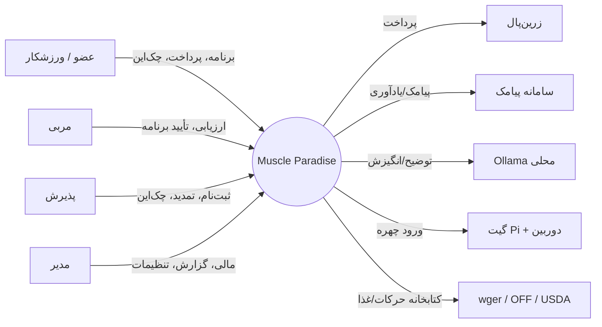
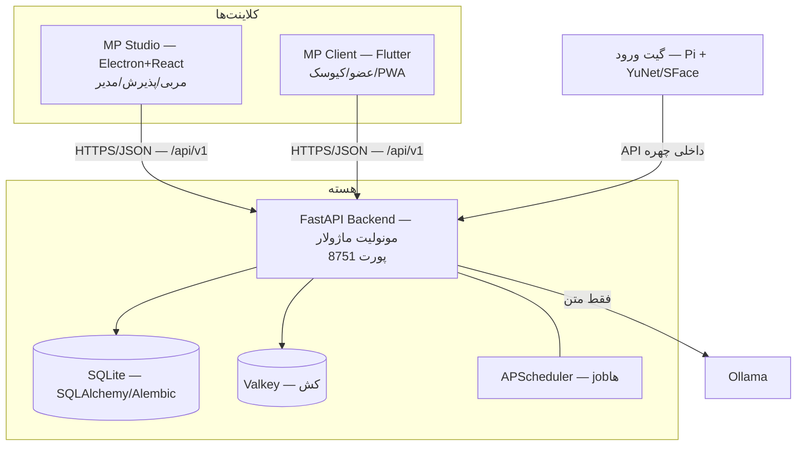
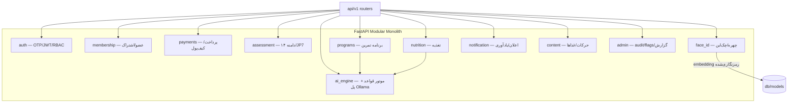

# معماری C4 — Muscle Paradise (توصیف متنی + Mermaid)

> چرخه: M02 | وضعیت: پذیرفته | همراه: ADR-001..004

## سطح ۱ — Context



## سطح ۲ — Container



## سطح ۳ — Component (داخل Backend)



## سطح ۴ — Code (الگوی هر ماژول)

هر ماژول یک پکیج پایتون با مرز مشخص است (ADR-001):

```
mp-app/backend/modules/<name>/
├── router.py       # فقط HTTP: دریافت/اعتبارسنجی/پاسخ — بدون منطق تجاری
├── service.py      # تمام منطق تجاری (قابل تست بدون HTTP)
├── repository.py   # فقط دسترسی داده (SQLAlchemy Session)
├── schemas.py      # Pydantic (ورودی/خروجی API)
└── models.py       # مدل‌های SQLAlchemy متعلق به ماژول (یا ارجاع به db/models)
```

**قواعد مرزی (مکانیکی — با تست import اجرا می‌شود):**
1. `router.py` فقط به `service.py` و `schemas.py` ماژول خودش وابسته است
2. `service.py` به router هیچ ماژولی وابسته نیست
3. ارتباط بین ماژول‌ها فقط از طریق `service` عمومی (interface صریح) — نه import مستقیم models
4. منطق تجاری هرگز داخل router نوشته نمی‌شود (دام لایهٔ ۵)
