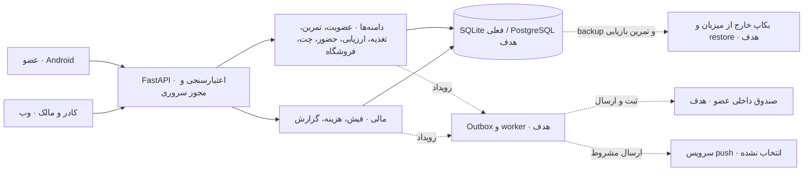
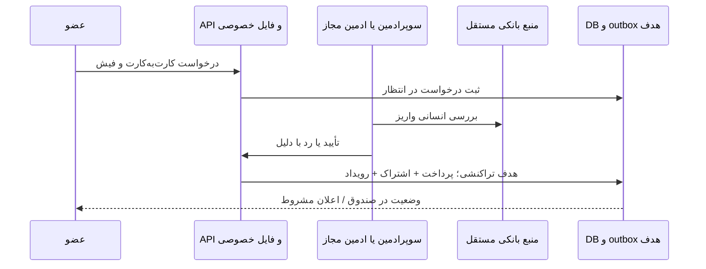
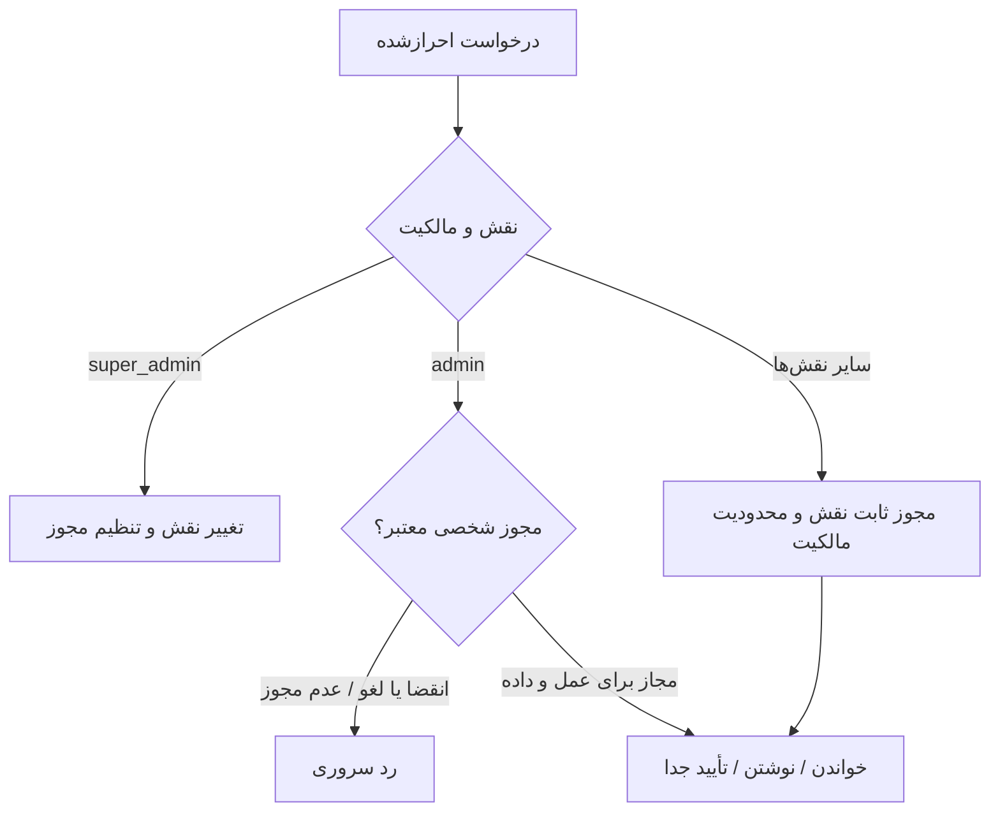
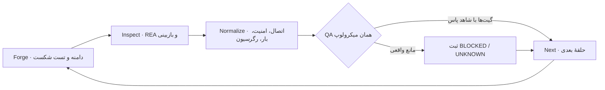

# معماری هدف: ابر، مجوزها و مالی Muscle Paradise

**وضعیت:** نقشهٔ هدف و فهرست مرزها، نه مدرک پیاده‌سازی یا استقرار. تکمیل هر پیکان به شاهد همان build و گیت‌های [برنامهٔ QF](../PLAN-FINN-ECC-MICROLOOPS-QA.md) وابسته است. مبنای تصمیم‌ها [TODO مالک](../TODO-CLOUD-FINANCE-ACCESS.md) و واقعیت رفتار فعلی کد و تست‌هاست.

## نقشهٔ محصول و محیط

خط پیوسته = مسیر معماری موردنظر بین سطوح، نه تضمین runtime؛ خط‌چین = انتخاب/اتصال آینده یا مشروط. SQLite و Valkey در مسیر فعلی زیرساخت مطرح‌اند؛ PostgreSQL، بکاپ عملیاتی، push، worker و staging **هدف/نامعلوم** هستند.

مسیرهای آغاز بررسی: [`mp-app/backend/modules/`](../../../mp-app/backend/modules/), [`client/lib/features/`](../../../mp-app/client/lib/features/), [`studio/src/`](../../../mp-app/studio/src/), [`mp-app/infra/`](../../../mp-app/infra/). وجود مسیرها به معنی کامل‌بودن قابلیت نیست. scheduler باید در محیط واقعی شروع و تک‌اجرایی آن اثبات شود.

## تأیید واریز و اشتراک — هدف انتشار اول

فیش **اثبات واریز نیست**. خواندن اطلاعات واریز از منبع بانکی مستقل توسط super_admin یا admin مجاز است؛ دسترسی شخصی به نقش غیر admin بدون تصمیم تازه فرض نمی‌شود.

**مرز فعلی:** policy مستقل و تست‌های محلی در [`manual_transfer_policy.py`](../../../mp-app/backend/modules/payments/manual_transfer_policy.py) و [`test_manual_transfer_policy.py`](../../../mp-app/backend/tests/regression/test_manual_transfer_policy.py) هستند؛ آن‌ها به‌تنهایی API و عملیات تراکنشی نیستند. [`service.py`](../../../mp-app/backend/modules/payments/service.py) مسیرهای مالی کنونی را نشان می‌دهد؛ semantics `card` قدیمی با کارت‌به‌کارت جدید اشتباه نشود. اتصال، کنترل رقابت و خصوصی‌بودن باید واقعاً تست شود.

## دسترسی و مالکیت — هدف

دسترسی مالی admin و manager پیش‌فرض خاموش و super_admin مجاز است. تصمیم مورد نظر باید روی **همهٔ مسیرهای سرور**، نه فقط منو، اعمال شود. فایل‌های موجود [`security/rbac.py`](../../../mp-app/backend/security/rbac.py), [`app/security/hierarchy.py`](../../../mp-app/backend/app/security/hierarchy.py), [`modules/admin/`](../../../mp-app/backend/modules/admin/) و [`RoleManager.tsx`](../../../mp-app/studio/src/components/RoleManager.tsx) باید قبل از هر ادعای پیاده‌سازی بازبینی شوند؛ وضعیت فعلی با هدف یکسان نیست.

## تضمین کیفیت تکرارشونده

پیکان از `BLOCKED` به Next فقط برای **حلقهٔ مستقل** است؛ حلقهٔ وابسته قبول‌شده فرض نمی‌شود. ECC subagent تنها در صورت فراخوانی واقعی و ثبت شاهد نامیده می‌شود. [جزئیات QA-QF و منشأ](../PLAN-FINN-ECC-MICROLOOPS-QA.md) و [آزمایش میزبان](../REPORT-ECC-SUBAGENT-SMOKE.md).

## ممنوعیت‌ها و تصمیم‌های باز

- عکس پیشرفت بدن خارج از scope؛ فایل فیش و عکس محصول جداگانه، با حفاظت و retention مناسب. دادهٔ سلامت نیازمند محدودیت دسترسی و سیاست حقوقی است.
- همهٔ قابلیت‌های اصلی برای انتشار اول ضروری‌اند؛ ابتدا فقط staging با دادهٔ ساختگی پس از اجازه، سپس یک انتشار هم‌زمان برای همه پس از گیت‌ها و تأیید مالک. خرید و deploy خودکار مجاز نیست.
- مدل forecast، push، هزینه، RPO/RTO، ساعت گزارش و سیاست داده هنوز تصمیم/آزمون می‌خواهند. OSS فقط نامزد است؛ [گزارش تحقیق](../OSS-DEEP-RESEARCH-2026-11-18.md) و [NOTICE](../../../NOTICE-THIRD-PARTY.md).
