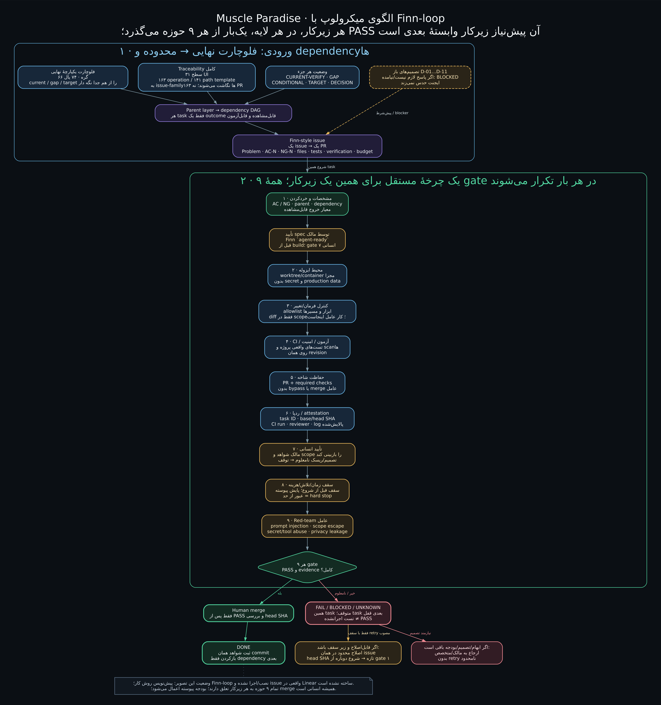

# فلوچارت میکرولوپ Finn-loop و فلوچارت نهایی سامانه

> **پیش‌نویس مستقل برای بازبینی مالک**؛ این صفحه به Architecture Atlas/ADR رسمی اضافه نشده است. نمودار میکرولوپ، الگوی ۹حوزه‌ای را در هر زیرکار نشان می‌دهد؛ نمودار یکپارچهٔ زیر، نقشهٔ سامانه را نشان می‌دهد. «هدف» یا پیکان خط‌چین به معنی قابلیت جاری/تأییدشده نیست.

## چرخهٔ ۹حوزه‌ای برای هر زیرکار

- [دانلود مستقیم PNG](finn-loop-microtask-flow-v1-2026-11-23.png) · [نسخهٔ SVG](finn-loop-microtask-flow-v1-2026-11-23.svg) · [منبع DOT](finn-loop-microtask-flow-v1-2026-11-23.dot)
- [پیش‌نویس کامل خردسازی و traceability](finn-loop-microtask-backlog-draft-v1-2026-11-23.md)

## فلوچارت نهایی یکپارچهٔ سامانه

- [دانلود مستقیم PNG فلوچارت نهایی](system-integrated-flow-v1-2026-11-23.png)

## وضعیت اجرا

این بسته فقط نمودار و اسناد پیش‌نویس است: Finn-loop نصب/اجرا نشده، issueای در Linear ساخته نشده و هیچ قابلیت محصولی از روی نمودار «پیاده‌شده» فرض نمی‌شود. همهٔ ۹ حوزه در **هر** task تکرار می‌شوند؛ بدون PASS و تصمیم انسانی، زیرکار وابسته باز نمی‌شود. هیچ رسید یا دادهٔ شخصی در این تصاویر استفاده نشده است.
