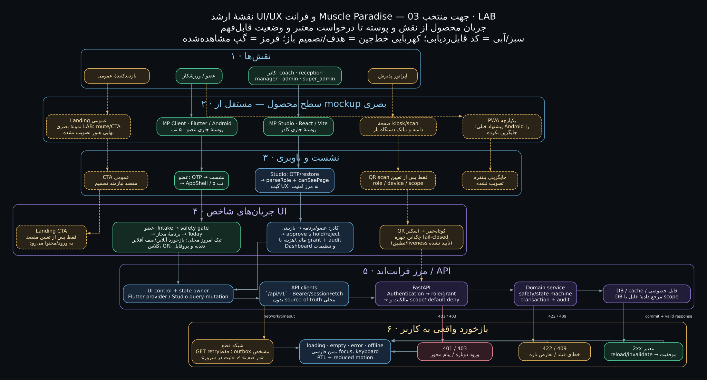

# فلوچارت UI/UX و فرانت‌اند Muscle Paradise — Option 03 · LAB

> **تصمیم این نوبت:** جهت بصری شمارهٔ ۰۳، **LAB · دقت و پیشرفت**، انتخاب شده است. این یعنی زبان بصریِ شبکه‌ای/داده‌محورِ RTL برای ادامهٔ طراحی؛ به‌تنهایی تصمیم PWA، دامنه و CTA عمومی، scope کیوسک، یا تغییر پلتفرم عضو نیست.
>
> **نوع سند:** نقشهٔ مهندسیِ interaction و wiring بر مبنای کد/قراردادهای همین شاخه، با تفکیک «جریان مشاهده‌شده» از «رفتار هدف/گپ». این سند اعلام آمادگی انتشار، تضمین E2E، یا مشخصات پزشکی نیست.
>
> **الحاقیهٔ دامنه — ۲۰۲۶-۱۱-۲۳:** مالک پس از ثبت این design baseline در OQ-01 انتخاب کرد PWA مشترک React برای عضو و کادر، بر پایهٔ Studio، رابط اصلی انتشار اول باشد؛ Flutter/Android حفظ شود. تصمیم در [ADR-007](../adr/007-pwa-primary-release.md) رسمی شده است. دیاگرام‌ها و جمله‌های پایین که Android/Flutter را baseline عضو یا PWA را آینده می‌خوانند، snapshot زمان طراحی‌اند و اکنون باید به PWA target crosswalk شوند؛ این اصلاح scope هیچ‌یک را به پیاده‌سازی/QA تبدیل نمی‌کند.

## نقشه‌های قابل‌نمایش و sourceهای قابل‌ویرایش

### نمای یکپارچهٔ محصول



- [SVG](frontend-ui-ux-overview-option-03-v1-2026-11-23.svg) · [Graphviz DOT](frontend-ui-ux-overview-option-03-v1-2026-11-23.dot)

### جزئیات هر تجربه

- **عضو — Flutter/Android:** [SVG](frontend-ui-ux-member-option-03-v1-2026-11-23.svg) · [DOT](frontend-ui-ux-member-option-03-v1-2026-11-23.dot)
- **Studio — مربی/مدیر:** [SVG](frontend-ui-ux-studio-option-03-v1-2026-11-23.svg) · [DOT](frontend-ui-ux-studio-option-03-v1-2026-11-23.dot)
- **قرارداد سیم‌کشی کنترل‌ها:** [SVG](frontend-ui-ux-control-wiring-option-03-v1-2026-11-23.svg) · [DOT](frontend-ui-ux-control-wiring-option-03-v1-2026-11-23.dot)

نمونهٔ Landing در قالب تصویر Chromium در workspace وجود داشت، اما screenshotهای PNG و artifactهای تصویر بنا بر دامنهٔ PR وارد Git نمی‌شوند. SVG/DOTهای بالا نسخهٔ قابل‌حملِ نمودارها هستند؛ هیچ‌یک UI منتشرشده یا QA محصول را ثابت نمی‌کنند.

## قرارداد جهت بصری ۰۳

- ساختار دقیق و داده‌محور: وضعیت/منبع/زمان به‌جای کارت‌های تزئینی یا KPI ساختگی؛ چارت و جدول فقط از دادهٔ سرور.
- زمینهٔ تیرهٔ موجود `#0B0F14`، سطح `#111827`، primary زمردی `#00B86A`، تأکید `#FFD700`، Vazirmatn، متن/عدد فارسی در UI و ISO/اعداد canonical در API.
- RTL واقعی در ریشهٔ هر client؛ آیکون جهت‌دار آینه می‌شود، آیکون جهانی مثل خانه نه. تاریخ جلالی فقط لایهٔ نمایش است؛ wire/storage به ISO می‌ماند.
- Studio داده‌محور اما نه بی‌جهت متراکم: KPI، فیلتر، table, details drawer, empty/error states. عضو همچنان موبایل‌اول و Android/Flutter است؛ این طرح به‌معنای PWA replacement نیست.
- موشن فقط برای نشان‌دادن تغییر وضعیت/سلسله‌مراتب: `150 / 250 / 450ms`، easing استاندارد، حداکثر ۲–۳ اثر در صفحه، ترجیح transform/opacity و احترام به `prefers-reduced-motion` یا `disableAnimations`.

### نتیجهٔ ممیزی runtime Studio — ۲۳ نوامبر ۲۰۲۶

- ریشهٔ وب در اجرای dev پاسخ می‌دهد و حالت بدون نشست همان فرم ورود OTP است؛ landing عمومیِ عملیاتی پیدا نشد. صفحه‌های محافظت‌شده را با نشست/نقش ساختگی برای ممیزی دور نزدیم. hero تولیدشده نیز هنوز به runtime وصل نیست.
- پوستهٔ فعال از `mp-app/shared/design-tokens.json` تغذیه می‌شود: Tailwind و تم Ant Design توکن‌های رنگ/فونت/شعاع را مستقیماً می‌خوانند و نمودارهای Studio همان رنگ‌های مشترک را مصرف می‌کنند. در ممیزی، مرز Ant Design روی `0.24` به‌جای `0.18` بود، سطح elevated دیالوگ از الگوریتم dark مشتق می‌شد و tooltip نمودار مالی پیش‌فرض روشن بود؛ هر سه با surface/border مشترک هم‌راستا شدند.
- متن سفید روی پرشدگی کامل سبز `#00B86A` فقط **۲٫۶۰:۱** و روی طلایی `#FFD700` فقط **۱٫۴۰:۱** کنتراست داشت. متن foreground این CTAهای پرشده اکنون `#0B0F14` است: به‌ترتیب **۷٫۳۸:۱** و **۱۳٫۷۰:۱**؛ رنگ سطح برند عوض نشده است.
- نمای SLO حضور قبلاً نوار `93%` داشت، با اینکه همان کارت می‌گفت «اندازه‌گیری‌نشده». آن نوارِ بدون منبع حذف شد؛ برچسب نامعلوم باقی است. در گزارش مالی نیز وقتی refund بدون تاریخ، `complete=false` می‌کند، سود هم «نامعلوم» نمایش داده می‌شود و هم از میلهٔ نمودار حذف است؛ مقدار ناقص API به‌عنوان عدد قطعی عرضه نمی‌شود.
- برای کاهش ریسک، گردش تأیید/لغو دست‌کاری زیبایی‌شناختی نشد: Modal و Popconfirm فعلی حفظ شدند و تأیید بازپرداخت بومی مرورگر همچنان مبلغ و شناسه را نشان می‌دهد. `window.prompt` دلیل رد برنامه هنوز در کد جاری است؛ تبدیل آن به Modal کار جداگانه‌ای با تست cancel/empty/submit می‌خواهد و در این ممیزی رفتارش تغییر نکرد.
- مرورگر Chromium قابل اجرا نبود چون کتابخانهٔ سیستمی `libnspr4.so` در sandbox موجود نیست؛ بنابراین برای این دور snapshot پیکسلی ادعا نمی‌شود. endpoint زندهٔ Vite، کد تم runtime و تست‌های component/token بررسی شدند؛ preview در پنل قابل مشاهده است.

## منابع کد متن‌باز و قاعدهٔ reuse

**کد کنترل را از پکیج‌های موجود import می‌کنیم؛ سورسِ ناشناس را کپی نمی‌کنیم.** به این شکل نسخه، مجوز، RTL، تست و به‌روزرسانی یک نقطهٔ مالکیت دارند.

| سمت | منبع حاضر در مخزن | استفاده در گزینهٔ ۰۳ | وضعیت/مرز |
|---|---|---|---|
| Studio controls | `antd@5.29.3`؛ MIT؛ `@ant-design/cssinjs` + `StyleProvider layer` + `ConfigProvider direction="rtl"`, `fa_IR` | `Button`, `Form`, `Input`, `Select`, `Segmented`, `Table`, `Statistic`, `Progress`, `Date/ Jalali field`, `Modal`, `Drawer`, `Upload.Dragger` فقط برای endpointی که واقعاً وجود دارد | طبق گیت Q11 و `mp-app/studio/package.json`، antd سیستم کنترل جاری است. فایل‌های `DESIGN.md` و `design-system.md` در بعضی بندهای قدیمی هنوز shadcn را می‌گویند؛ آن تعارض مستنداتی است و نباید با نصب هم‌زمان shadcn/DaisyUI حل شود. |
| موشن Studio | `framer-motion` موجود؛ MIT؛ APIs مورد استفادهٔ جاری `motion`, `AnimatePresence`, `useReducedMotion` | transition تب/صفحه، reveal محدود نمودار/کارت، disable یا کاهش حرکت | Motion جایگزین کنترل تعاملی نیست؛ easing/timing از `mp-app/shared/motion-spec.md`. |
| داده‌نگاری Studio | `recharts` موجود در dependencyهای Studio | chartهای `AttendanceChart`, `ScheduleTimeline` و نمودارهای دارای داده/حدود معتبر | Recharts package تازه نیست؛ عدد null/نامعلوم را صفر یا KPI ساختگی نکنید. |
| آیکون Studio | `@ant-design/icons` موجود؛ MIT | آیکون با نام دسترس‌پذیر و tooltip برای کنترل‌های icon-only | `title` تزئینی جای `aria-label` را نمی‌گیرد. |
| تقویم Studio | `react-multi-date-picker` و `react-date-object`؛ MIT؛ `JalaliDateField` جاری | تاریخ جلالی در تجربهٔ کاربر، ISO در مرز API | از `DatePicker` میلادی برای ورودی‌ای که باید جلالی باشد استفاده نکنید. |
| عضو Android | Material 3 بومی Flutter + `go_router`, `flutter_riverpod`, `flutter_animate` موجود در Client | فرم/انتخاب/slider/bottom sheet و `MpMotion`; AppShell فعلی یک نوار ۵‌تبی سفارشی با `InkWell` دارد | نوار فعلی را با semantics/focus/keyboard و hit target audit کنید؛ `NavigationBar` فقط گزینهٔ بازطراحی است، نه توصیف کد فعلی. کتابخانهٔ web را به Flutter وارد نکنید؛ dependency جدید لازم نیست. |
| چک‌لیست‌ها | [Vercel Web Interface Guidelines](https://github.com/vercel-labs/web-interface-guidelines) — MIT؛ [Chrome Modern Web Guidance](https://github.com/GoogleChrome/modern-web-guidance) — Apache-2.0 | دسترس‌پذیری، semantics، فرم، motion، keyboard، performance و responsive | این دو **راهنما** هستند؛ منبع کامپوننت یا runtime dependency نیستند. |

نمونهٔ الگوی import؛ نسخهٔ قفل‌شدهٔ مخزن ملاک است:

```tsx
import { Button, Form, Input, Modal, Progress, Select, Table } from "antd";
import { AnimatePresence, motion, useReducedMotion } from "framer-motion";
import { useMotionPreset } from "../lib/motion";
```

در Flutter به‌جای بازنویسی gesture/animation از Material 3 و packageهای فعلی استفاده می‌شود. برای نمودارهای قابل‌خواندن، Recharts فعلی؛ برای جدول/فرم/دیالوگ Studio، Ant Design؛ برای موشن، Motion موجود. هیچ dependency جدیدی به محصول اضافه نشده است.

## نمودارهای جزئی: چه چیزی به چه چیزی وصل است

### ۱. Public Landing و تصمیم CTA

Landing عمومی از اپ خصوصی جداست. فلوچارت آن را به‌شکل سطح طراحی/هدف نشان می‌دهد، نه route پیاده‌شدهٔ قطعی. ممیزی runtime تأیید کرد `/` در Studio فعلی به OTP Login می‌رسد و route عمومیِ Landing نیست؛ hero تولیدشده نیز هنوز مصرف نمی‌شود.

| intent/control | مقصد در فلو | سیم‌کشی/تصمیم |
|---|---|---|
| لوگو/خانه و لینک‌های بخش‌ها | anchorهای خود Landing | `<a>`/لینک معنایی؛ بدون route جعلی. |
| «تجربهٔ عضو» / «ورود عضو» | destination **باز** | بعد از تصمیم محصول می‌تواند به مسیر Android/OTP یا مقصد web-approved برود؛ PWA هنوز جایگزین مصوب نیست. |
| «برای مربی/مدیر» | Studio Login در صورت تأیید مقصد | route جاری Studio از OTP/staff gate می‌گذرد؛ Landing نباید role یا نشست را جعل کند. |
| CTA ثانویه | توضیح قابلیت/اسکرول بخش Landing | بدون قیمت، آمار، نتیجهٔ پزشکی یا وعدهٔ تأییدنشده. |
| جابه‌جایی/موشن hero | فقط reveal/progress illustration | ۲–۳ موشن معنادار، fallback ثابت، reduced motion؛ هیچ loading/timer ساختگی. |

### ۲. کلاینت عضو — صفحه و کنترل اصلی

مقصدهای فعلی در `mp-app/client/lib/core/router.dart` هستند. shell با پنج تب خانه/برنامه/توانایی‌ها/پیشرفت/پروفایل است؛ مسیرهای کلاس، QR، wallet، chat، shop، notifications، nutrition، bodycomp و intake جدا هستند.

| صفحه / control | فعل یا endpoint | قرارداد UI/UX و گارد |
|---|---|---|
| ورود عضو | `/auth/otp/request` → `/auth/otp/verify` | شماره/کد با validation و مهلت؛ موفقیت فقط با token pair معتبر؛ expiry/شبکه پیام فارسی و retry کنترل‌شده. |
| Bottom navigation پنج‌تب | `AppShell` فعلی: نوار سفارشی `InkWell`، index محلی؛ انیمیشن `AnimatedSwitcher/AnimatedScale` | برچسب هر تب/selected state حفظ شود؛ semantics و focus/keyboard و hit target ≥48dp را تست کنید. `MpMotion` با کاهش حرکت سیستم‌عامل مدت را صفر می‌کند؛ built-in `NavigationBar` هنوز جایگزین فعلی نیست. |
| Home: آیکون profile | `/profile` | push route؛ back طبیعی. |
| Home: اعلان‌ها | `/notifications` + mark-read | شمارنده فقط از دادهٔ خوانده‌شده؛ GET reminder در بعضی مسیرهای server می‌تواند notification materialize کند، پس read-only فرض نکن. |
| Home: Quick Check-in | `/checkin` | shortcut فقط به صفحهٔ حضور؛ ثبت حضور در سرور/اسکن QR تأیید می‌شود. |
| Home: بنر اشتراک | `GET memberships` | active/expired/none/unknown؛ خطا/دادهٔ ناقص به تاریخ یا پیشنهاد تجاری ساختگی تبدیل نشود. |
| Home: جست‌وجو | **فعلاً handler متصل دیده نشد** | باید API/search contract و نتایج را پیاده کند یا تا آن زمان ظاهر input/دکمه حذف/غیرفعال شود. |
| Intake: هدف/سطح/روز/هفته | local form → next/back | گام‌ها `هدف/سطح → سابقه/دادهٔ پایه → محدودیت`؛ بازگشت نباید ورودی را پاک کند؛ label/validation و dirty-exit guard. |
| Intake: وزن/سن/جنسیت/فعالیت | validation سمت client، دوباره سمت server | جنسیت اجباری در فرم فعلی؛ ارقام فارسی فقط نمایش. Age path خوداظهاری نباید مرجع مجوز/ایمنی سرور شود. |
| Intake: محدودیت/«ساخت برنامه» | `POST /population/gate-check` → `PUT /members/me` → `POST /ai/program/generate` | هر مرحله pending/خطای مستقل؛ `422` inline؛ قیدها در payload generate و persistence پروفایل را یکی ندانید. |
| Safety result | program response: draft + flags | target: فقط `approved + safety clear` به عضو برسد. `blocked/needs_review/unknown` → توقف امن/مربی؛ وضعیت فعلی این گیت را کامل enforce نمی‌کند و Intake ممکن است draft را نمایش دهد. |
| تولید تغذیهٔ اختیاری | `POST /ai/nutrition/generate` | شکست این مسیر نباید موفقیت/شکست تمرین را جعل کند؛ `NutritionPlan` جاری macro target دارد و `meals=[]` است، نه برنامهٔ وعده. |
| Today: refresh | invalidation و GET برنامه | loading skeleton؛ empty روز استراحت؛ error retry؛ فقط نسخهٔ عضو/approved. وضعیت فعلی provider فیلتر approved ندارد و ممکن است تازه‌ترین draft را برگزیند. |
| Today: تیک هر حرکت / progress ring | **فقط `TodayController` local `Set<int>`** | فعلاً persist/API نیست؛ نباید «در سرور ثبت شد» بگوید. تا endpoint واقعی تکمیل تمرین نیامده، نشانگر را موقت/روی این دستگاه معرفی کن. |
| Today: «بازخورد ست» | bottom sheet → `POST /programs/set-feedback` | پس از schema معتبر refresh readiness و نمایش توضیح backend؛ نه عدد تخمینی در کلاینت. |
| Feedback: ثبت آنلاین | POST → پاسخ/خطا | pending و duplicate guard؛ 2xx معتبر → success/haptic؛ timeout با outcome نامعلوم را خودکار دوباره نفرست؛ ابتدا وضعیت را reconcile کن. |
| Feedback: قطع شبکهٔ قطعی | local owner-scoped outbox | فقط ساختار بازخورد مشخص در صف؛ queued ≠ synced. حالات pending/retry/failed/conflict/synced، sync/retry دستی، تعارض نیازمند تصمیم، پاک‌کردن صف با confirmation. درد/یادداشت/پیشنهاد آنلاین طبق کد فعلی در offline queue ذخیره نمی‌شود. |
| کلاس: «رزرو» | `GET /classes` → `POST /classes/book` | seats/status فقط از پاسخ server؛ pending per class؛ confirmed/waitlisted را از هم جدا کن؛ capacity را کلاینت تصمیم نگیرد. |
| کلاس: «لغو رزرو/انتظار» | `POST /classes/cancel` | پس از پاسخ، دوباره GET؛ اگر در صف بود به‌اشتباه «صندلی آزاد شد» نگو؛ لغو waitlisted نباید فرد بعدی را ارتقا دهد. |
| حضور: QR | local biometric unlock → `GET /face/qr-token` | signed one-time QR، عمر کوتاه (کد فعلی 30s)، خروج/پس‌زمینه آن را مخفی و token را invalidate کند؛ پذیرش اسکن endpoint مستقل `/face/checkin-qr` را دارد. |
| حضور: چهره/«رضایت» | privacy notice + `GET face-consent` + `POST /face/consent` | رضایت برای قالب ≠ مطابقت/liveness و **چهره مسیر ورود فعال نیست**؛ `method=face` در server با 409 fail-closed می‌شود. UI نباید CTA اسکن/چک‌این چهره نمایش دهد. |
| حضور: تاریخچه | GET check-ins | pagination/retry/empty؛ QR token خصوصی را در history، analytics یا log بازتاب نده. |
| توانایی‌ها/ارزیابی ۱۴محوره | انتخاب آزمون → `POST /axis-assessments`; history/matrix GET | validation واحد و گزارش از پاسخ سرور؛ بدون نتیجهٔ پزشکی یا کپی عدد قدیمی به ارزیابی جدید. |
| BodyComp / JP7 | `GET /assessments/jp7/member/{id}/trend` | منبع/زمان/روش، missing/stale/conflict و واحدها روشن؛ اختلاف calf/midaxillary و review علمی/حریم باز است؛ مجوز نمایش دادهٔ حساس جدا. |
| Nutrition: جست‌وجو/ثبت خوراک | foods GET → `POST /nutrition/food-logs` + daily GET | log واقعی از plan جدا؛ تکرار write کنترل شود؛ empty/error واضح. |
| وزن/تغذیهٔ adaptive | `POST /nutrition/weight-logs`, GET adaptive | save پس از 2xx؛ مقادیر null/نامعلوم را صفر نساز. |
| Wallet/پرداخت/رسید | GET wallet transactions/payments/receipt | موفقیت پرداخت فقط status تأییدشده از سرور؛ کارت‌به‌کارت نیازمند پذیرش انسانی/زمان سرور است؛ رسید خصوصی. |
| Shop عضو | GET products/categories | سیاست محصول جاری view-only است؛ Add/Qty/Cart/Checkout را از UI عضو پنهان/disabled کن تا تصمیم تازه و backend gate هماهنگ شود. API خرید فعلاً fail-closed و آنلاین پیش‌فرض خاموش است. |
| Chat: بازکردن گفتگو/ارسال/خوانده‌شدن | GET conversations/messages; POST messages/read | `sending → sent` فقط بعد از پاسخ؛ offline یعنی pending local فقط اگر قابلیت sync صریح/owner-scoped وجود دارد؛ در غیر این صورت ارسال‌نشدن را نمایش بده. |
| Profile: ذخیره | `GET/PUT /members/me` | dirty state و تایید خروج؛ server field errors؛ اطلاعات عضو دیگر هرگز از route/id کاربر تعیین نشود. |
| Profile: تغییر شماره | request → verify old → confirm new OTP | challenge/expiry stepper؛ هر کد به گام درست وصل؛ شکست مرحله، شمارهٔ قبلی/نشست را خودکار تغییر ندهد. |
| خروج و پاک‌کردن صف | confirm keep/discard pending feedback → logout | روشن کن «از این دستگاه خارج شد» با «لغو سرور تأیید شد» یکی نیست؛ صف owner-scoped فقط بعد از انتخاب کاربر حذف شود. |

### ۳. Studio — صفحه و control map

مسیرهای اصلی از `mp-app/studio/src/App.tsx`, `Sidebar.tsx`, `roleNav.ts`, `pages/*` هستند. AppStore فعلی صفحهٔ انتخابی را در state نگه می‌دارد؛ URL deep-link/history sync یک بهبود باز است.

| صفحه / control | فعل/endpoint | قرارداد UI/UX و guard |
|---|---|---|
| Boot / restore | `AuthProvider` → `sessionFetch(GET /members/me)` | checking UI؛ only staff roles accepted; خطای شبکه به protected UI تبدیل نمی‌شود؛ OTP login fallback. Token در `localStorage` است، پس این پیاده‌سازی XSS-proof نیست؛ CSP/output encoding/threat model لازم است. |
| OTP Login | `POST /auth/otp/request`, `/auth/otp/verify` | phone/code labels، pending/resend cooldown، rate limit، field error؛ member در Studio پذیرفته نمی‌شود. |
| Sidebar item | `useAppStore.setPage()` + `canSeePage()` | صفحهٔ غیرمجاز/ناشناخته در UI deny می‌شود؛ **هر endpoint هنوز نیازمند server role/grant/scope است**. |
| خروج | `signOut()` → revoke + clear local session | صفحه فوراً protected UI را مخفی می‌کند؛ نتیجهٔ server revoke جدا از «خروج این مرورگر» نمایش یابد. |
| Dashboard: KPI/حضور | `GET /admin/kpis`, `/admin/attendance` | `null` → unknown نه صفر؛ loading skeleton, empty real-zero, error retry; Recharts فقط برای series معتبر. |
| Dashboard: انتخاب عضو | کلیک ردیف `MemberTable` → صفحهٔ Members + `selectMember(id)` | callback اکنون ID کلیک‌شده را پس از `setPage("members")` ثبت می‌کند؛ `setPage` خودش انتخاب را پاک می‌کند. همان عضو در پنل جزئیات/Programs/Readiness/Volume باقی می‌ماند. |
| Members: جست‌وجو/بازکردن پرونده | `GET /admin/members-summary` و endpointهای پرونده | ownership/scope و permission؛ فیلدهای حساس حداقلی؛ stale/missing/unknown صریح؛ لینک route/deep-link نباید دسترسی بسازد. |
| Programs: فیلتر status | `GET /programs?status=...` | همه/draft/approved/rejected؛ badge status + SafetyBadge + timestamp/version؛ empty براساس دادهٔ واقعی. |
| Programs: بازبینی | بارگیری readiness/volume، قیدها و context عضو | selectedMemberId واحد؛ دادهٔ stale/ناقص/متعارض → hold؛ منبع و تاریخ اندازه‌گیری نشان داده شود. |
| Programs: تأیید | `POST /programs/{id}/approve` | target: approve فقط با مجوز، safety=clear، دادهٔ معتبر و state تازه؛ فعلاً UI دکمه را برای همهٔ draftها نشان می‌دهد، پس blocked gate در UI و backend گپ است. |
| Programs: رد | `POST /programs/{id}/reject` | دلیل غیرخالی پیش از POST؛ کد جاری `window.prompt` است. برای کاهش ریسک، در این ممیزی به Modal جدید تبدیل نشد؛ تغییر آینده باید cancel/متن خالی را بدون mutation نگه دارد و تست شود. |
| Programs: after mutation | reload/refetch summary | spinner per row؛ هیچ موفقیتی قبل از 2xx/schema؛ 409 وضعیت جدید را بخوان؛ 403 permission؛ reject reason را دوباره نشان بده. |
| Assessment / JP7 | read/write assessments, trend, reports | روش/واحد/actor/time، unknown/stale/conflict و grant؛ فرمول یا تأیید علمی را UI جعل نکند. |
| Nutrition / food library | GET foods / daily logs / adaptive + food log writes | plan generator target macros است؛ meals خالی را «برنامهٔ وعده» ننام؛ Form کنترل‌شده/جلالی و validation. |
| Chat | conversations/messages/read/send | conversation/member scope؛ sent state server-confirmed؛ no optimistic send if offline. |
| CheckIn | `GET /admin/checkins` و عملیات QR مجاز | feed واقعی؛ دکمهٔ start/stop فقط شبیه‌سازی بصری است و دوربین/چهره را فعال نمی‌کند. SLO اندازه‌گیری‌نشده است و درصد نمایشی ندارد؛ face route/service فعلی fail-closed و kiosk تصمیم جداست. |
| Finance: summary/period/CSV/ledger | `finance.read` + GET/download | مالی فقط role/grant مجاز؛ null/unknown؛ export با filename/error handling. در گزارش دوره‌ای، اگر refund بدون تاریخ باشد (`complete=false`)، سود «نامعلوم» است و عدد/میلهٔ سود نمایش داده نمی‌شود. |
| Payments: approve/reject/refund/verify | server mutation + `finance.write` | فیش کارت‌به‌کارت با Popconfirm و دلیلِ رد در Modal؛ refund در صفحهٔ پرداخت native `window.confirm` با مبلغ/شناسه دارد، اما UI دلیل جمع نمی‌کند. سرور refund را به manager/admin/super_admin + grant محدود و actor را در AuditLog ثبت می‌کند؛ 409 already_refunded → refresh، نه ارسال تکراری. |
| Expenses: create/revise/receipt | `finance.write`; `POST /expenses/{id}/receipt`; read با `finance.read` | کد جاری `Expenses.tsx` از AntD `Upload` و helperهای upload/read استفاده می‌کند؛ storage خصوصی و `no-store` سمت read وجود دارد. گپ UX: `beforeUpload` نتیجه را در خطا می‌گذارد اما per-row pending/success/refetch ندارد؛ upload تکراری ممکن است 409 بگیرد. تست size/type/grant/duplicate و بازخوانی وضعیت لازم است. این مسیر فیش هزینه است، نه رسید پرداخت کارت‌به‌کارت. |
| Settings: feature flags | GET `/admin/flags` → PUT → GET | فعلی no optimistic toggle؛ busy per key، 403/error، refresh after response. |
| Settings: roles/grants/sessions/audit | admin permissions / role endpoints | role/grant mutation فقط صاحب مجاز؛ client guard علاوه بر server؛ audit actor/id؛ self-elevation negative tests. |
| Analytics | GET churn/leaderboard | permission gate, provenance/date range, `unknown` vs zero; privacy aggregation. |
| Studio Shop | catalog management | مدیریت کاتالوگ جدا از فروشگاه عضو؛ قیمت/درگاه، role, `ChangeRequest`/audit مطابق قرارداد server. |

### ۴. نمودارِ shared wiring برای دکمه، فرم و آیکون

هر کنترل باید شش چیز داشته باشد: `intent → source component → state owner → request/route → permission/scope → success/failure`. برای مثال:

1. **Navigation:** `<a>/<Link>` به مقصد واقعی؛ state تب/فیلتر می‌تواند URL را بازتاب دهد؛ لینک نه `<div onClick>`.
2. **Query:** GET با abort/refresh و loading skeleton؛ پاسخ typed → data; صفر مورد → empty CTA; 401/403/شبکه → state متناسب.
3. **Mutation:** validate locally برای UX، دوباره server; pending per-resource; double click مهار; dangerous action confirmation + reason; success فقط پس از 2xx معتبر; سپس cache/query invalidate و aria-live update.
4. **Security:** نقش/permission در UI فقط منوی روشن‌تر می‌سازد؛ backend هر request را با نقش، grant و مالکیت رکورد می‌سنجد؛ URL، hidden button و disabled button جای مجوز نیستند.
5. **Unknown commit:** timeout پس از write می‌تواند نتیجهٔ نامعلوم باشد؛ retry کور ممنوع. ابتدا GET/reconcile یا idempotency key فقط اگر قرارداد API دارد.
6. **Offline:** پوستهٔ وب می‌تواند نصب/asset داشته باشد، ولی API requestهای Studio cache نمی‌شوند. نوشتن عمومی آفلاین نداریم؛ صف مشخص Flutter فقط برای set-feedback است و «در صف» به‌معنی «سرور ثبت کرد» نیست.
7. **خطاها:** `401` یک refresh/retry؛ `403` بدون refresh؛ `422` inline و preserve input؛ `409` تازه‌خوانی/تصمیم انسان؛ `429` احترام به retry-after؛ `5xx` پیام فارسی و retry فقط برای عملیات امن.

## معیار پذیرش پیش از «آمادهٔ توسعه/عرضه»

- [ ] همهٔ CTAهای Landing به مقصدی واقعی و مصوب می‌روند؛ Landing با login/private route اشتباه نشود.
- [ ] route tree Flutter و Sidebar Studio با direct URL، back, refresh, 401/403 و role coverage تست شده است.
- [ ] member Today فقط approved/clear را مصرف می‌کند؛ تیک local با server completion اشتباه نمی‌شود.
- [ ] draft blocked/unknown عضو را متوقف و مربی را به دلیل/اصلاح راهنمایی می‌کند؛ approval API نیز همین rule را enforce می‌کند.
- [ ] هر دکمهٔ مالی/حساس role+grant+scope دارد، دلیل/تأیید لازم ثبت می‌شود، actor در audit می‌آید و 2xx واقعی نمایش موفقیت می‌دهد.
- [ ] فیش هزینهٔ Studio: upload/read private endpoint، size/type/grant/duplicate (409), pending/success/refetch و پاک‌سازی Blob URL تست شده؛ از رسید پرداخت و فیش کارت‌به‌کارت جداست.
- [ ] QR کوتاه‌عمر، one-time و در اسکن سمت سرور آزموده؛ face flow همچنان خاموش تا match+liveness+privacy review.
- [ ] feature policy فروشگاه عضو view-only و UI/Backend هر دو fail-closed هستند.
- [ ] RTL/keyboard/focus/labels/contrast/screen reader/reduced-motion/mobile-safe-area audit؛ 48dp Android / target اندازهٔ مناسب وب.
- [ ] page states loading/empty/error/offline/conflict طراحی و به‌شکل تست‌شده‌اند؛ فرم dirty exit و double submit پوشش دارد.
- [ ] contract/API coverage و role-negative tests؛ Flutter Android device E2E؛ Studio responsive E2E؛ visual snapshots گزینهٔ ۰۳؛ offline sync conflict تست شده‌اند.
- [ ] regression: `npm run lint`, `npm test`, `npm run build`, Flutter analyze/test/build، route-map drift check و secret/permission checks.

## گیت‌های باز (این انتخاب به‌تنهایی حلشان نمی‌کند)

1. **Landing:** دامنه/میزبانی و destination CTA عضو/Studio.
2. **Platform:** Android/Flutter عضو مسیر مصوب/مبنا می‌ماند؛ تبدیل به PWA هنوز تصمیم محصولی تازه می‌خواهد.
3. **Kiosk:** مالک سخت‌افزار، نقش، privacy، fallback و offline check-in باید تعیین شود؛ QR scanner endpoint به‌تنهایی صفحهٔ kiosk نیست.
4. **UI library docs:** `UI-CONTROLS-Q11.md` و dependency/runtime فعلی Ant Design را انتخاب کرده‌اند؛ بندهای قدیمی shadcn در `DESIGN.md`/`design-system.md` باید در change جدا همسو شوند.
5. **Policy:** فروشگاه عضو read-only؛ ابزار/نتیجهٔ سلامت بدون validation علمی؛ face check-in غیرفعال؛ صفحهٔ مالی بر اساس API guards.

## مرز این نمودار

- نمودارها هر journey/کنترل اصلی و wire contract را نشان می‌دهند؛ برای **فهرست مکانیکی و خط‌به‌خط همهٔ elementها** از `scripts/interaction_map.py --check`، `mp-app/backend/api/routes.json` و تست‌های هر صفحه استفاده کنید. `interaction-map-2026-11-19.md` و `analysis-2026-11-23.md` دو snapshot با شمارش/دامنهٔ متفاوت‌اند؛ عددهای آن‌ها را با هم ادغام یا وضعیت جاری کامل فرض نکنید.
- مسیرهای dashed/amber design target/decision gate هستند؛ رنگ قرمز گپ مشاهده‌شده است؛ فیروزه‌ای یعنی مسیر در کد قابل ردیابی است، نه لزوماً E2E/production-verified.
- وضعیت جاری Android/Studio/Backend را از «هدف PWA» و «برنامهٔ نسخه‌دار آینده» جدا نگه دارید. Data-plane و server-side permission source of truth هستند؛ Frontend هیچ مجوزی را اعطا نمی‌کند.

## منابع داخلی بررسی‌شده

- `mp-app/client/lib/core/router.dart`, `features/shell/app_shell.dart`, `home/home_page.dart`, `today/today_page.dart`, `today/today_controller.dart`, `intake/intake_page.dart`, `checkin/checkin_page.dart`, `classes/classes_page.dart`, `feedback/set_feedback_sheet.dart`, `feedback/offline_feedback_queue_card.dart`.
- `mp-app/studio/src/App.tsx`, `auth/AuthContext.tsx`, `lib/roleNav.ts`, `lib/session.ts`, `lib/api.ts`, `components/Sidebar.tsx`, `pages/Programs.tsx`, `Dashboard.tsx`, `Finance.tsx`, `Expenses.tsx`, `Settings.tsx`; `mp-app/backend/modules/expenses/router.py` و `receipts.py`.
- `mp-app/shared/design-tokens.json`, `motion-spec.md`; `docs/MuscleParadise/UI-CONTROLS-Q11.md`, `design/DESIGN.md`, `design/design-system.md`, `design/web-interface-guidelines.checklist.md`.
- `architecture/member-studio-dataflow-v1-2026-11-23.md`, `architecture/muscle-paradise-full-program-flow-v1-2026-11-23.md`, `architecture/muscle-paradise-final-pwa-access-flow-v1-2026-11-23.md`, `architecture/analysis-2026-11-23.md`.

## بازتولید نمودارها

با renderer محلی پروژه (بدون Graphviz CLI):

```bash
cd tools/graphviz-renderer
npm ci
npm run render -- ../../docs/MuscleParadise/architecture/frontend-ui-ux-overview-option-03-v1-2026-11-23.dot ../../docs/MuscleParadise/architecture/frontend-ui-ux-overview-option-03-v1-2026-11-23.png 5200
```

برای سه نمودار دیگر، ورودی/خروجی را با نام `frontend-ui-ux-member-option-03-v1-2026-11-23`, `frontend-ui-ux-studio-option-03-v1-2026-11-23`, `frontend-ui-ux-control-wiring-option-03-v1-2026-11-23` عوض کنید.
