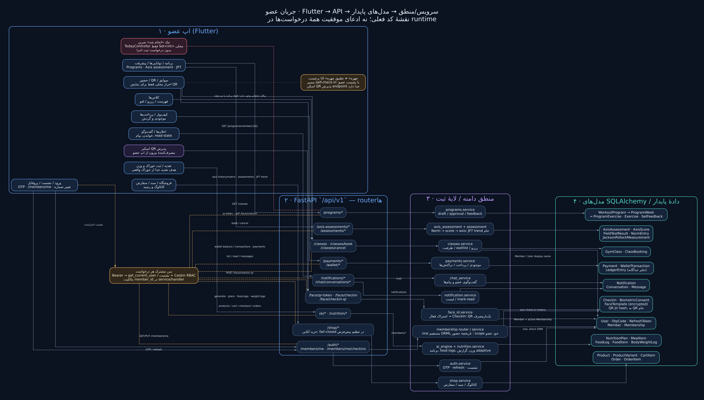
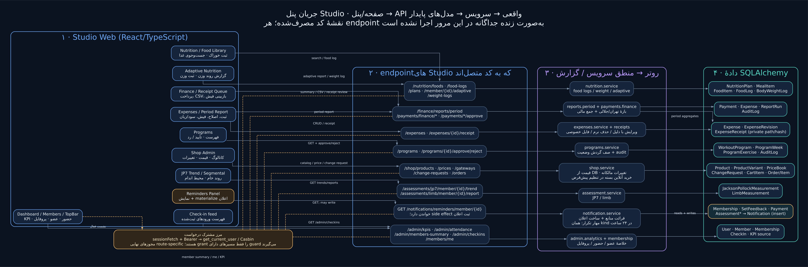
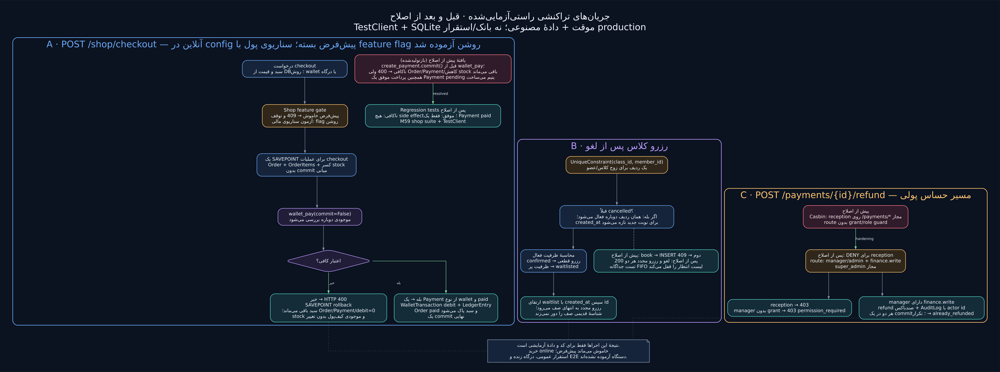

# نمودارهای مستقل جریان داده — عضو، Studio و تراکنش‌های حساس

**نسخهٔ شواهد:** شاخهٔ `arena/5e0f64cf-mp`، مرور کد و آزمون‌های Backend در محیط توسعه. این تصاویر نقشهٔ مسیرهای کد هستند؛ به‌تنهایی اثبات اجرای موفق UI-to-API، دستگاه، شبکه یا production نیستند. جزئیات کل ممیزی و محدودیت استنتاج در [گزارش تحلیل](analysis-2026-11-23.md) آمده است.

## ۱. اپ عضو: Flutter → API → سرویس → مدل‌ها

- فایل قابل‌ویرایش: [DOT](member-app-dataflow-v1-2026-11-23.dot) · خروجی برداری: [SVG](member-app-dataflow-v1-2026-11-23.svg).
- تیک «انجام شد» در `TodayController` در مسیر مرورشده فقط state محلی `Set<int>` را عوض می‌کند؛ درخواست ثبت اجرای تمرین دیده نشد.
- داده‌های عضو از APIهای احرازشده می‌آیند؛ membership/ownership و سیاست مسیر باید جداگانه لحاظ شوند.
- دو مسیر چهره/QR با هم یکی نیستند: self-check-in عضو، تطبیق چهره را ثابت نمی‌کند؛ اسکن QR پذیرش endpoint مستقلی دارد.
- خرید آنلاین از API به‌صورت پیش‌فرض fail-closed است؛ وجود UI فروشگاه، فعال‌بودن checkout را ثابت نمی‌کند.

## ۲. Studio: پنل وب → endpointهای مصرف‌شده → سرویس → مدل‌ها

- فایل قابل‌ویرایش: [DOT](studio-dataflow-v1-2026-11-23.dot) · خروجی برداری: [SVG](studio-dataflow-v1-2026-11-23.svg).
- مسیرها از مصرف‌کننده‌های `studio/src` و router/service بک‌اند ردیابی شده‌اند؛ هر endpoint در این مرور به‌صورت زنده اجرا نشده است.
- خواندن `/notifications/reminders/member/{id}` در سرویس می‌تواند اعلان را materialize کند؛ از روی فعل GET نمی‌توان آن را صرفاً read-only فرض کرد.
- guardها route-specific هستند؛ وجود Casbin allow یا نام permission در یک helper جای بررسی dependency و منطق همان route را نمی‌گیرد.

## ۳. Checkout، رزرو مجدد و بازگشت وجه

- فایل قابل‌ویرایش: [DOT](transaction-findings-flow-v1-2026-11-23.dot) · خروجی برداری: [SVG](transaction-findings-flow-v1-2026-11-23.svg).
- پیش از اصلاح، probe با کیف‌پول ناکافی HTTP 400 می‌گرفت ولی order/payment و کاهش stock commit شده بود؛ علت، `create_payment()` با commit میانی پیش از بررسی نهایی کیف‌پول بود.
- پس از اصلاح، checkout از SAVEPOINT و commit واحد استفاده می‌کند؛ آزمون رگرسیون نبودن سفارش/پرداخت/debit، ثابت‌ماندن stock و balance و باقی‌ماندن cart را بررسی می‌کند. خرید موفق نیز فقط یک Payment از نوع wallet و با وضعیت paid می‌سازد.
- رزرو لغوشده با همان ردیف یکتا دوباره فعال می‌شود؛ زمان رزرو فعلی تازه می‌شود تا rebook با شناسهٔ قدیمی، ترتیب FIFO صف انتظار را جلو نزند.
- بازگشت وجه از پذیرش مسدود است؛ مسیر به نقش manager/admin و `finance.write` نیاز دارد (مالک سیستم مجاز است). AuditLog، شناسهٔ actor را ثبت می‌کند و با وضعیت refund در یک commit می‌آید. تست بانک صندباکس، پذیرش، مدیر بدون grant، مدیر دارای grant، انتساب actor و بازپرداخت تکراری را از هم تفکیک می‌کند.
- این شواهد از `TestClient`، SQLite موقت و gateway sandbox هستند؛ نه اتصال بانکی واقعی و نه استقرار عمومی.

## ابزار رندر

DOT با ابزار محلی `tools/graphviz-renderer/` به SVG و PNG مستقل تبدیل شده است؛ Graphviz CLI لازم نیست. سورس DOT را ویرایش و فایل‌های SVG/PNG همان نمودار را دوباره تولید کنید.
