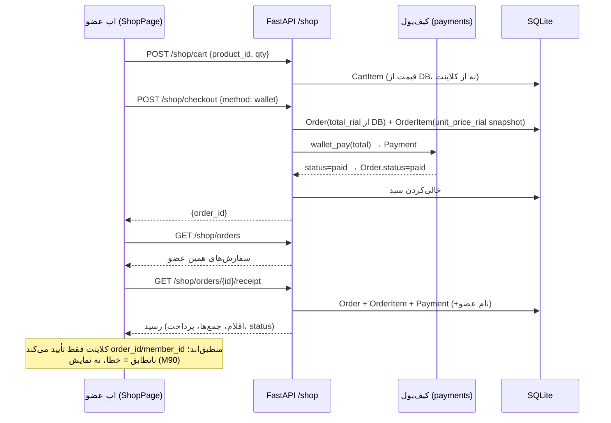

# ماژول Shop — کاتالوگ، سبد، سفارش، پرداخت کیف‌پولی و رسید

> سطح: Component/Code. این صفحه «مسئولیت + مسیرها + جریان» را نگه می‌دارد؛ جزئیات اولویت و وضعیت loop در [TODO صف جاری](../../TODO-2026-11-16.md) و شاهد هر loop در `finn/reports/` است. هیچ ادعایی در این صفحه بدون فایل کد/تست نوشته نشده است.

## مسئولیت

فروشگاه مکمل/تجهیزات باشگاه: کاتالوگ با واریانت و موجودی، سبد عضو، تسویه از موجودی کیف‌پول، ثبت سفارش با **قیمت قفل‌شده در لحظهٔ سفارش**، و رسید برای تحویل/بایگانی. تغییر قیمت/درگاه از مسیر «درخواست تغییر ← تأیید مالک» می‌آید، نه نوشتن مستقیم ادمین.

مرزهایی که در همین ماژول نگه داشته می‌شوند (`mp-app/backend/modules/shop/service.py`، بلوک «قواعد آهنین» بالای فایل):

1. قیمت از کلاینت پذیرفته نمی‌شود — فقط `product_id`/`variant_id`/`qty`.
2. `OrderItem.unit_price_rial` در لحظهٔ ثبت سفارش snapshot می‌شود.
3. نوشتن کاتالوگ/قیمت/درگاه = `super_admin`؛ ادمین فقط `ChangeRequest` می‌سازد.
4. خواندن درگاه/شمارهٔ کارت ماسک‌شده برای همه مجاز، `secret_key` هرگز.
5. دسترسی به سبد/سفارش/رسید با مالکیت عضو (`ensure_member_scope` / `ensure_record_scope`).

## مسیرها

| لایه | مسیر | نکته |
|---|---|---|
| API | `mp-app/backend/modules/shop/router.py` | `/shop/products`, `/shop/categories`, `/shop/cart` (+`PATCH`/`DELETE /cart/{id}`), `/shop/checkout`, `/shop/orders`, **`GET /shop/orders/{order_id}/receipt`**, `/shop/gateways`, `/shop/prices`, `/shop/change-requests` |
| Service | `mp-app/backend/modules/shop/service.py` | `list_orders` (عضو ← فقط سفارش خودش)، `mark_order` با ماشین گذار وضعیت |
| رسید | `mp-app/backend/modules/payments/invoice.py:91` → `build_order_receipt` | رسید **سفارش** است، جدا از رسید **پرداخت** (`build_receipt`)؛ اقلام + جمع‌ها + بلوک پرداخت + `issued_at` |
| مدل | `mp-app/backend/db/models/shop.py` | `product_categories`, `products`, `product_variants`, `cart_items`, `orders`, `order_items`, `payment_gateway_configs` |
| Client | `mp-app/client/lib/features/shop/` | `shop_page.dart` (کاتالوگ/سبد/تسویه)، `my_orders_sheet.dart` + `order_receipt_sheet.dart` (M90)، providerها در `lib/core/app_state.dart` (`shopProductsProvider`, `cartProvider`, `shopOrdersProvider`, `orderReceiptProvider`) |
| Studio | `mp-app/studio/src/lib/api.ts` (~`getOrderReceipt`) | همان endpoint برای پنل کادر |
| کیف‌پول | `mp-app/client/lib/features/wallet/wallet_ledger.dart` | debit پس از checkout از ledger واقعی خوانده می‌شود (M83) |

### ماشین وضعیت سفارش

`pending → paid | failed | cancelled`، `paid → delivered | cancelled`، `failed → pending`، و `delivered`/`cancelled` حالت‌های پایانی. گذار نامعتبر `409` و نوشتن بدون نقش کادر `403` (`service.mark_order`).

## جریان checkout و رسید

## برچسب صحت

| ادعا | وضعیت | چرا |
|---|---|---|
| مسیرهای خواندن/نوشتن و مالکیت‌ها | **verified** | کد بالا + `mp-app/backend/tests/integration/test_m60_shop.py`، `test_m59_shop.py`، `test_m83_wallet_ledger.py` |
| رسید سفارش در اپ عضو | **verified (کد) / unknown (device)** | `mp-app/client/test/shop_orders_receipt_test.dart` نوشته و در CI اجرا می‌شود؛ روی دستگاه/RTL واقعی دیده نشده (`finn/reports/m90-member-receipt.md`) |
| چاپ/PDF رسید | **target** | هنوز هیچ مسیر چاپ یا export در دو اپ پیاده نشده؛ `pdf` dependency عمداً اضافه نشد |
| موجودی و رزرو هم‌زمان دو خرید | **unknown** | کسر موجودی در `checkout` هست، اما آزمون رقابت هم‌زمانِ موجودی (inventory race) در `tests/` پیدا نشد |
| درگاه live (زرین‌پال) | **blocked/unknown** | merchant ID و تصمیم مالک لازم است (Q6 در TODO؛ `MP_PAYMENT_GATEWAY` در Compose) |
| مالیات/تخفیف روی سفارش | **not implemented** | `total_rial` همان جمع سبد است؛ هیچ فیلد discount در `Order` نیست |

## تست‌های مرتبط

- backend: `mp-app/backend/tests/integration/test_m59_shop.py`, `test_m60_shop.py`, `test_m83_wallet_ledger.py`, `tests/regression/test_rbac.py`
- client: `mp-app/client/test/shop_page_test.dart`, `mp-app/client/test/shop_orders_receipt_test.dart`, `mp-app/client/test/wallet_history_test.dart`
- Studio: `mp-app/studio/tests/apiCoverage.test.ts` (هر مسیر `/shop/*` باید call واقعی یا exception مستند داشته باشد)

بازگشت به [نقشهٔ معماری](../README.md) · [module-map](../module-map.md)
