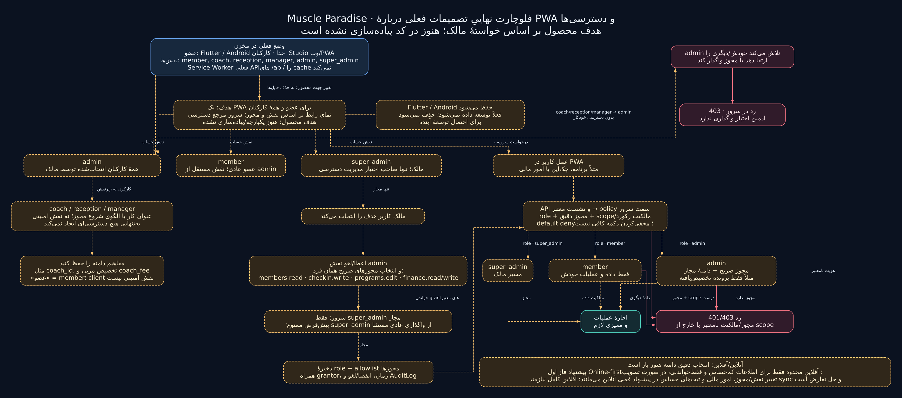

# فلوچارت نهاییِ مقصد PWA و دسترسی‌ها

> **وضعیت:** نمودار خواستهٔ ثبت‌شدهٔ مالک دربارهٔ PWA مشترک و سه نقش را بازتاب می‌دهد، اما **به‌تنهایی تصمیم نهایی انتشار یا مجوز کنارگذاشتن Android نیست**؛ این خواسته با مسیر Android+Studio در TODO جاری تعارض دارد و باید در G0/ADR حل شود. نمودار طرح مقصد است، نه قابلیت پیاده‌شده. پیشنهاد آنلاین‌محوربودن فاز اول و دامنهٔ دقیق آفلاین نیز هنوز تصمیم نهایی نیست.

- [PNG برای نمایش/چاپ](muscle-paradise-final-pwa-access-flow-v1-2026-11-23.png)
- [SVG برای بزرگ‌نمایی](muscle-paradise-final-pwa-access-flow-v1-2026-11-23.svg)
- [سورس Graphviz DOT](muscle-paradise-final-pwa-access-flow-v1-2026-11-23.dot)
- [بستهٔ ZIP همهٔ نمودارها](muscle-paradise-architecture-diagrams-v1-2026-11-23.zip)

## تصمیم‌های محصولی منعکس‌شده

1. تجربهٔ هدف برای عضو و کارکنان یک PWA است؛ اپ Android فعلی فعلاً خارج از دامنهٔ توسعه می‌ماند، اما فایل‌های Flutter/Android حذف نمی‌شوند.
2. نقش‌های امنیتی هدف سه موردند: `super_admin` (مالک)، `admin` (همهٔ کارکنانی که مالک انتخاب می‌کند) و `member` (عضو عادی). عضو زیرشاخهٔ ادمین نیست.
3. فقط مالک می‌تواند نقش کارکنان و مجوزهای شخصی را اعطا یا لغو کند. `admin` نمی‌تواند خودش یا دیگری را ارتقا دهد یا اختیار واگذاری بگیرد؛ مسیر عادی هم نباید `super_admin` بسازد.
4. دسترسی با allowlist مجوزهای دقیق هر حساب و scope/مالکیت رکورد در **سرور** کنترل می‌شود؛ پیش‌فرض رد است. پنهان‌کردن کنترل در PWA به‌تنهایی کنترل امنیتی نیست.
5. `coach`, `reception` و `manager` در صورت نیاز، عنوان کار، رابطهٔ دامنه یا الگوی شروع مجوزند؛ نه نقش امنیتی و نه مجوز ضمنی. نام‌ها و داده‌های دامنه مثل `coach_id` و `coach_fee` را بی‌دلیل در کل مخزن تغییر ندهید. نقش عضو در فهرست فعلی `member` است؛ `client` نقش امنیتی فعلی نیست.

## تفاوت با وضعیت فعلی

- کد عضو Flutter و Studio وب کارکنان دو تجربهٔ جدا هستند؛ یک PWA یکپارچهٔ عضو/کارکنان هنوز پیاده‌سازی نشده است.
- بک‌اند فعلاً نقش‌های `member`, `coach`, `reception`, `manager`, `admin`, `super_admin` را می‌شناسد.
- در کد فعلی، API اعطای نقش و مدیریت grant به `super_admin` محدود شده و `super_admin` در نقش‌های قابل‌اعطای API عادی نیست؛ این پایهٔ مفید است، اما به‌معنای پیاده‌شدن مدل نهایی نیست.
- دامنهٔ guard مجوزهای شخصی فعلی تمام نقش‌های جاری و تمام endpointها را به‌طور یکسان پوشش نمی‌دهد؛ هنگام مهاجرت باید همهٔ route/serviceها با allowlist و scope صریح بازبینی شوند تا نقشی از مسیر قدیمی ناخواسته دسترسی نگیرد.
- Service Worker فعلی درخواست‌های `/api/` را cache نمی‌کند؛ بنابراین آفلاین‌بودن داده و عملیات API در محصول فعلی تضمین نشده است.

## یادداشت آنلاین/آفلاین

Online-first برای شروع پیشنهاد شده، نه تصمیم قطعی: ورود و عملیات API به اتصال نیاز داشته باشند؛ در صورت نیازِ اثبات‌شده، فقط پوستهٔ PWA و داده‌های کم‌حساسِ فقط‌خواندنی آفلاین شوند. تغییر نقش/مجوز، امور مالی و ثبت‌های حساس در پیشنهاد فعلی آنلاین می‌مانند. آفلاینِ نوشتنی پیش از اجرا نیازمند طراحی صف sync، idempotency، حل تعارض، انقضا و لغو دسترسی روی دستگاه است.

## موارد لازم پیش از پیاده‌سازی

- ماتریس مجوزهای دقیق (عمل، منبع داده، scope، نقش پیش‌فرض و مجری مجاز) و تعریف مجوزهای پرخطر مالی؛
- تبدیل نقش‌های فعلی به `admin` بدون اعطای خودکار دسترسی گسترده و ثبت سابقهٔ مهاجرت؛
- آزمون منفیِ API برای ارتقای خود/دیگری، دورزدن UI، مجوز منقضی/لغوشده و دسترسی عضو به دادهٔ دیگران؛
- تصمیم صریح برای اینکه کدام صفحه یا عملیات، اگر اصلاً موردی هست، باید آفلاین کار کند.

## بازتولید نمودار

فایل DOT همراه این سند با `tools/graphviz-renderer/render.mjs` به SVG و PNG تبدیل شده است. رنگ آبی وضعیت فعلیِ مشاهده‌شده را نشان می‌دهد؛ کادر کهربایی و خط‌چین طرح مقصد/پیشنهاد پیاده‌سازی‌نشده است؛ قرمز رد دسترسی را نشان می‌دهد.
