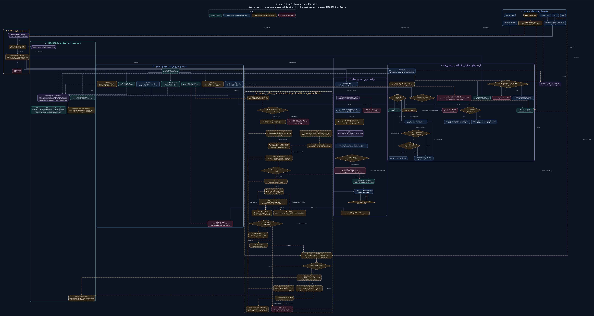

# فلوچارت جامع برنامهٔ Muscle Paradise

> **فلوچارت یکپارچهٔ کل برنامه، نسخهٔ v2** همهٔ نمودارهای اصلی را در یک نقشه جمع می‌کند: گردش‌های فعلی عضو و کادر، تراکنش‌ها و Backend، به‌علاوهٔ چرخهٔ پیشنهادیِ پرسش‌نامه → منابع/مجوز → برنامهٔ نسخه‌دار → PDF/QR → بازخورد و چرخهٔ بعد. خط‌چین کهربایی بخش‌های طراحی‌شده اما پیاده‌سازی‌نشده را از مسیرهای فعلی جدا می‌کند.

## فایل‌های فلوچارت و بستهٔ دانلود

- **فلوچارت یکپارچه (همهٔ شاخه‌ها):** [PNG](muscle-paradise-combined-flow-v2-2026-11-23.png) · [SVG بزرگ‌نمایی‌پذیر](muscle-paradise-combined-flow-v2-2026-11-23.svg) · [سورس DOT](muscle-paradise-combined-flow-v2-2026-11-23.dot)
- **نمای کلی ساده‌تر:** [PNG](muscle-paradise-overview-flow-v1-2026-11-23.png) · [SVG](muscle-paradise-overview-flow-v1-2026-11-23.svg) · [سورس DOT](muscle-paradise-overview-flow-v1-2026-11-23.dot)
- **پوستر تفصیلی مسیرهای جاری:** [PNG](muscle-paradise-full-program-flow-v1-2026-11-23.png) · [SVG](muscle-paradise-full-program-flow-v1-2026-11-23.svg) · [سورس DOT](muscle-paradise-full-program-flow-v1-2026-11-23.dot)
- **ZIP همهٔ نمودارهای تصویری و سورس‌های DOT:** [دانلود بسته](muscle-paradise-architecture-diagrams-v1-2026-11-23.zip)

## محدوده‌ای که در نمودار آمده

- نقش‌ها و رابط‌ها: عضو، مربی، پذیرش، مدیر، اپ Flutter، Studio وب و مسیر کیوسک/اسکن؛
- OTP، نشست، کنترل نقش/مجوز و scope مالکیت رکورد؛
- پروفایل و اشتراک، ارزیابی/برنامهٔ تمرین، برنامهٔ امروز، تغذیه و ثبت خوراک/وزن؛
- کلاس، ظرفیت و صف انتظار، لغو/رزرو مجدد، QR و حضور؛
- کیف‌پول و پرداخت، کاتالوگ/سبد، checkout، بازگشت وجه و ثبت AuditLog؛
- عملیات Studio، گزارش/هزینه/رسید خصوصی، اعلان/گفت‌وگو، حریم خصوصی؛
- مسیر پیشنهادیِ Q01–Q11 و C01–C11، Question Router، Source Registry مستقل، کنترل مجوز/کیفیت، کاتالوگ approved و جداسازی کامل تغذیه از موتور تمرین؛
- چرخهٔ هدفِ ProgramDraft → بازبینی مربی → ProgramVersion تغییرناپذیر → PDF کامل با QR در صفحهٔ آخر → ثبت لاگ و سنجش چرخهٔ بعد؛ بازیابی QR داخلی بدون OCR و واردسازی PDF بیرونی با تأیید مربی؛
- لایه‌های router/service/ORM، مدل‌های اصلی داده، SQLite پیش‌فرض، cache، job و وابستگی‌های بیرونی.

این نقشه همهٔ **دامنه‌ها و گردش‌های اصلی** را پوشش می‌دهد، نه یک جعبه برای تک‌تک ۱۶۳ عملیات API. برای جزئیات endpoint/role، [قراردادهای route](../../../mp-app/backend/api/routes.json) را ببینید؛ برای جریان‌های ریزتر، نمودارهای پایین پیوند دارند.

## راهنمای رنگ و خط

- **فیروزه‌ای:** مسیر، سرویس یا مدل موجود در کد؛ به‌تنهایی به‌معنی موفقیت E2E یا آمادگی production نیست.
- **آبی:** سناریوی مشخصی که در محیط توسعه آزموده شده است؛ دامنهٔ آزمون در متن هر گره آمده.
- **کهربایی و خط‌چین:** وابسته به تنظیمات/سخت‌افزار، طراحی اختیاری، یا نیازمند شاهد بیشتر.
- **قرمز:** گیر یا شکاف مشاهده‌شده در مسیر فعلی.
- **خط‌چین/پیکان‌های جانبی:** مسیر فرضی یا وابسته، نه ادعای اجرای end-to-end.

## یافته‌های مهمی که عمداً روی خود نمودار آمده‌اند

1. **ساخت برنامه از Intake:** قرارداد فعلی `POST /population/gate-check` با payload کلاینت هم‌خوان نیست و درخواست فرم در اجرای آزمایشی به ۴۲۲ می‌رسد؛ نمودار این توقف را نشان می‌دهد. مسیر مستقیم API موتور تمرین، E2E شدن فرم عضو را ثابت نمی‌کند.
2. **ایمنی برنامه:** وضعیت safety می‌تواند به‌صورت flag ذخیره شود؛ `blocked`/`unknown` در همهٔ مسیرها به‌طور قطعی مانع ساخت draft نمی‌شود.
3. **برنامهٔ امروز:** checkbox انجام تمرین در مسیر مرورشده فقط state محلی است؛ به API/DB ثبت نمی‌شود و منطق نمایش روز نیز محدودیت گزارش‌شده دارد.
4. **تغذیه:** موتور هدف کالری/ماکرو می‌دهد؛ `NutritionPlan` جاری وعدهٔ `MealItem` ندارد. ثبت خوراک واقعی و وزن مسیر جداگانه است.
5. **کلاس:** رزرو لغوشده با همان رکورد دوباره فعال می‌شود و زمان رزرو تازه می‌گیرد تا ترتیب FIFO صف انتظار حفظ شود؛ سناریو در integration test پوشش دارد.
6. **Checkout فروشگاه:** خرید آنلاین در تنظیم پیش‌فرض خاموش است. تست محیطی، rollback checkout ناموفق و commit اتمیک خرید کیف‌پولی موفق را بررسی کرده؛ race همزمانی موجودی در این آزمون اثبات نشده است.
7. **Refund:** پذیرش/مدیر بدون grant رد می‌شوند؛ نقش لازم و `finance.write` اعمال می‌شود و `actor_user_id` در AuditLog با وضعیت refund commit می‌شود. تست فقط با gateway sandbox انجام شد.
8. **چهره، پیامک، بانک و استقرار:** وجود ماژول یا نمودار به‌معنی آزمون دستگاه واقعی، provider پیامک، بانک زنده یا production نیست؛ پیکان‌های وابسته عمداً کهربایی/خط‌چین‌اند.

## نمودارهای تفصیلی برای بازکردن هر شاخه

- [اپ عضو: Flutter → API → سرویس → داده](member-app-dataflow-v1-2026-11-23.png) · [سورس DOT](member-app-dataflow-v1-2026-11-23.dot)
- [Studio: صفحه‌ها → endpointها → سرویس → داده](studio-dataflow-v1-2026-11-23.png) · [سورس DOT](studio-dataflow-v1-2026-11-23.dot)
- [Checkout، رزرو کلاس و refund](transaction-findings-flow-v1-2026-11-23.png) · [سورس DOT](transaction-findings-flow-v1-2026-11-23.dot) · [راهنمای آزمون و محدودیت](member-studio-dataflow-v1-2026-11-23.md)
- [چرخهٔ طراحی‌شدهٔ ورزشکار/برنامه، JP7 و QR](athlete-program-lifecycle-v2-2026-11-23.md) — **طرح پیشنهادی** است و با مسیر runtime فعلی یکی نیست.
- [طرح برنامه‌ساز تمرین و PDF](training-program-builder-design-2026-11-23.md) — **طرح پیشنهادی** است؛ ادعای پیاده‌سازی قابلیت‌های آن ندارد.
- [نقشهٔ کلی معماری فعلی](system-atlas.md) و [گزارش محدودیت شواهد](analysis-2026-11-23.md).

## مرز شواهد

این فلوچارت از کد، قرارداد routeها، مستندات و تست‌های موجود در شاخهٔ کاری ساخته شده است. نتایج آزمون checkout، کلاس و refund از SQLite/TestClient و gateway sandbox هستند؛ آن‌ها را نباید معادل تست موبایل واقعی، بانک زنده، race همزمان، استقرار یا production دانست. برای وضعیت دقیق هر claim، گزارش تحلیل و آزمون همان مسیر را باز کنید.
