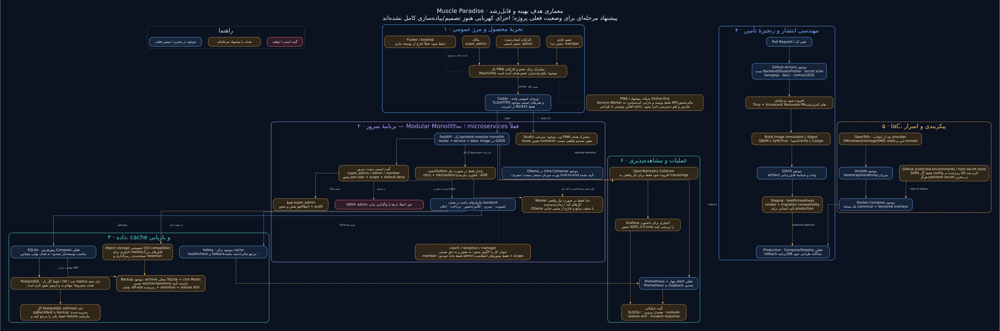

# معماری هدفِ بهینه و قابل‌رشد Muscle Paradise

> **نوع سند:** پیشنهاد معماری و gap analysis بر پایهٔ فایل‌های همین مخزن، نه گزارش production audit و نه ادعای پیاده‌سازی. تاریخ بررسی: ۲۰۲۶-۱۱-۲۳. نمودار، وضعیت مشاهده‌شده را از هدف پیشنهادی جدا می‌کند: آبی = موجود، کهربایی خط‌چین = هدف/نیازمند تصمیم، قرمز = رد صریح دسترسی.
>
> «سطح جهانی» را این سند با قابلیت سنجش، امنیت، حریم، بازیابی، کیفیت انتشار و تجربهٔ پایدار تعریف می‌کند؛ نه با زیادکردن تعداد سرویس‌ها یا مهاجرت زودهنگام به microservices/Kubernetes.

- [PNG با وضوح بالا](muscle-paradise-world-class-target-architecture-v1-2026-11-23.png)
- [SVG بزرگ‌نمایی‌پذیر](muscle-paradise-world-class-target-architecture-v1-2026-11-23.svg)
- [سورس Graphviz DOT برای بازتولید](muscle-paradise-world-class-target-architecture-v1-2026-11-23.dot)
- [بستهٔ ZIP همهٔ نمودارها](muscle-paradise-architecture-diagrams-v1-2026-11-23.zip)
- [فلوچارت مقصد PWA و نقش‌ها](muscle-paradise-final-pwa-access-flow-v1-2026-11-23.md)
- [Architecture Atlas و C4 موجود](README.md)

## جمع‌بندی مدیریتی

MuscleParadise از قبل پایه‌های مهمی دارد: backend به‌صورت **modular monolith**، CI با تست و اسکن‌های کد، انتشار image در GHCR، deploy کنترل‌شده با readiness/rollback، Caddy برای TLS/reverse proxy، Valkey برای cache و Prometheus/alert. بنابراین پیشنهاد اصلی «بازنویسی» یا «شکستن به سرویس‌های متعدد» نیست.

مهم‌ترین شکاف‌های قابل‌اقدام از روی پیکربندی فعلی:

1. **یک قرارداد قطعی برای اجرا و انتشار:** دو Compose هم‌پوشان اما متفاوت وجود دارد؛ مرز مسئولیت Dokploy/Ansible و Compose باید روشن و آزمون‌پذیر شود.
2. **اثبات بازیابی داده:** backup محلی SQLite وجود دارد و Ansible نیز Restic را زمان‌بندی می‌کند؛ اما مسیر Restic به‌وضوح به volume نام‌دار Docker وصل نشده و off-site بودن/restore موفق از فایل‌های پیکربندی به‌تنهایی اثبات نمی‌شود.
3. **زنجیرهٔ تأمین image:** تست، secret scan، Semgrep، Bandit و pip-audit موجودند؛ اسکن image/IaC، SBOM و امضای قابل‌راستی‌آزمایی image به‌عنوان گیت انتشار در workflowهای مرورشده دیده نشد.
4. **hardening یکدست کانتینرها و عملیات:** حداقل دسترسی، healthcheck سرویس‌ها، سقف منابع، هشدار بیرونی، SLO و runbook باید سرویس‌به‌سرویس بررسی و عملیاتی شوند.
5. **تصمیم‌های مقیاس با داده:** SQLite در Compose تولیدی فعلی است. PostgreSQL پیشنهاد مشروط است، نه الزام خودکار؛ انتخاب باید بر اساس بار نوشتن، تعداد instanceها، نیاز دسترس‌پذیری و تمرین مهاجرت باشد.

## معماری فعلیِ مشاهده‌شده

| حوزه | وضعیت قابل مشاهده در مخزن | شاهد / مرز ادعا |
|---|---|---|
| تجربهٔ کاربر | Flutter/Android عضو و Studio وب جدا هستند. PWA یکپارچه برای عضو و کارکنان **هدف محصولی** است، نه قابلیت پیاده‌شده؛ فایل‌های Android/Flutter حفظ می‌شوند. | `mp-app/client/`، `mp-app/studio/` و [فلوچارت دسترسی](muscle-paradise-final-pwa-access-flow-v1-2026-11-23.md) |
| هستهٔ برنامه | FastAPI و ساختار modular monolith؛ مسیر منطقیِ پیشنهادی همین مرزبندی ماژول‌هاست، نه microservices فعلی. | [C4 و محدودیت snapshot آن](c4.md)، [نقشهٔ ماژول‌ها](module-map.md)، `mp-app/backend/modules/` |
| دسترسی | کد نقش‌های قدیمی‌تر `member/coach/reception/manager/admin/super_admin` را می‌شناسد. مدل سه‌نقشی جدید، grantهای ریز و پوشش یکنواخت همهٔ routeها هنوز نیازمند مهاجرت/بازبینی است. | `mp-app/backend/app/security/` و [طرح مقصد و شروط پیاده‌سازی](muscle-paradise-final-pwa-access-flow-v1-2026-11-23.md) |
| پایگاه داده | پیش‌فرض تنظیمات backend و هر دو Compose تولیدی SQLite است؛ Compose به `sqlite:////data/mp.db` وصل می‌شود. | `mp-app/backend/app/config.py`؛ `mp-app/infra/docker-compose.yml`؛ `mp-app/deploy/docker-compose.yml` |
| Cache | Valkey در هر دو Compose داخلی است؛ healthcheck و fallback cache در کد/تست‌ها وجود دارد. دادهٔ مرجع دامنه یا مالی نباید فقط در cache باشد. | `mp-app/infra/docker-compose.yml`، `mp-app/backend/tests/unit/test_cache.py` |
| ورودی شبکه | در Compose زیرساخت، Caddy پورت‌های 80/443 را منتشر می‌کند و API را reverse proxy می‌کند؛ metrics عمومی در Caddy بسته و Prometheus روی loopback میزبان bind شده است. Compose مسیر deploy دیگری برای Studio روی loopback دارد. | `mp-app/infra/Caddyfile` و دو Compose؛ این توصیف معادل آزمون firewall یا تنظیم واقعی DNS نیست. |
| اجرا و IaC | Docker Compose و Ansible موجودند. workflow استقرار دستی Dokploy را با GitHub Environment، URLهای HTTPS، readiness gate و rollback به image صریح پشتیبانی می‌کند. | `mp-app/infra/ansible/playbook.yml`؛ `.github/workflows/deploy.yml`؛ [runbook provision](../runbooks/provisioning.md) |
| CI و image | CI شامل تست‌های backend/studio/client و گیت‌های کد/secret است؛ imageها در GHCR با tag مبتنی بر SHA ساخته/منتشر می‌شوند. workflow deploy نیز build/push خودش را دارد؛ انتشار یک digest واحد از build تا production باید هدف باشد. | `.github/workflows/ci.yml`، `.github/workflows/container.yml`، `.github/workflows/deploy.yml` |
| پایش | Prometheus، exporter و alertهای backend/5xx/Valkey/check-in تنظیم شده‌اند؛ در Compose زیرساخت retention برابر ۱۵ روز است. داشبورد یا alert بیرونیِ متصل به اپراتور را از فایل‌ها نمی‌توان تأیید کرد. | `mp-app/infra/monitoring/prometheus.yml`، `alerts.yml`، دو Compose |
| backup | سرویس Compose هر روز archive محلی SQLite را در volume `mp-backups` می‌سازد. Ansible یک Restic cron دارد، اما منبع آن `{{ app_dir }}/data` است و در playbook به volume نام‌دار `mp-data` bind نشده؛ تطبیق مسیر، repository، credential و موفقیت واقعی باید توسط اپراتور تأیید شود. هیچ‌یک از این تنظیمات به‌تنهایی off-site بودن یا restore موفق را ثابت نمی‌کند. | `mp-app/infra/docker-compose.yml`، `mp-app/deploy/docker-compose.yml`، `mp-app/infra/ansible/playbook.yml`؛ [راهنمای deployment](../DEPLOYMENT.md)، [runbook عملیات](../OPS-RUNBOOK.md) |
| Ollama | container آن در Compose زیرساخت با پورت داخلی دیده می‌شود؛ مسیر مصرف end-to-end و health/resource policy از پیکربندی بازبینی‌شده اثبات نشد. | `mp-app/infra/docker-compose.yml`؛ تا تأیید مصرف، آن را وابستگی حیاتی API فرض نکنید. |

> بررسی YAMLها در این مرحله با بازرسی متنی فایل‌ها انجام شد، نه parser کامل Compose. هر تغییر زیرساخت باید با `docker compose config` روی فایل نهایی و تنظیمات واقعی محیط اعتبارسنجی شود.

## معماری هدف و اصول طراحی

### ۱. تجربه و مجوزها

- یک PWA مشترک برای عضو و کارکنان هدف بماند؛ Flutter/Android حذف یا بازنویسی خودکار نشود.
- سه نقش امنیتی هدف: `super_admin` (مالک)، `admin` (کارکنانی که مالک انتخاب می‌کند) و `member` (عضو عادی).
- **فقط `super_admin`** نقش و مجوز ریز اعطا/لغو کند. `admin` نه خودش و نه دیگری را ارتقا دهد و نتواند مجوز واگذار کند.
- API در سمت سرور با default-deny، مجوز per-user و scope مالکیت/رکورد محافظت شود؛ پنهان‌کردن دکمه در PWA کنترل دسترسی محسوب نمی‌شود.
- `coach/reception/manager` در صورت نیاز عنوان کار یا الگوی مجوزند، نه نقش دارای حق ضمنی. عملیات حساس و دادهٔ عضو باید scope مستقل داشته باشند.
- PWA را online-first نگه دارید مگر نیاز آفلاین واقعی تأیید شود. Service Worker ابتدا فقط پوسته/دارایی کم‌حساس را نگه دارد؛ نوشتن آفلاین قبل از طراحی sync، idempotency، تعارض، انقضا و لغو دسترسی فعال نشود.

### ۲. برنامهٔ سرور

- FastAPI modular monolith را حفظ کنید: مرزهای دامنه و لایه‌های router/service/data روشن، با تست قرارداد و وابستگی ماژول‌ها.
- API و Studio از Caddy عبور کنند؛ backend، Valkey، Prometheus و Ollama روی شبکهٔ داخلی بمانند. پورت عمومی فقط برای نیاز مستندشده منتشر شود.
- worker مستقل را فقط وقتی کار زمان‌بر/زمان‌بندی‌شده به پایداری صف، retry و جداسازی منابع نیاز دارد اضافه کنید. اگر اضافه شد، وضعیت jobهای مهم باید durable و idempotent باشد؛ Valkey cache را بدون بررسی semantics به صف/دفترکل مرجع تبدیل نکنید.
- Ollama، اگر واقعاً مصرف می‌شود، در پروفایل/محیط اختیاری، با سقف CPU/RAM، healthcheck و بررسی مجوز هر مدل باشد؛ شکست LLM نباید عملیات حیاتی عضویت/مالی را متوقف کند.

### ۳. تصمیم پایگاه داده: SQLite یا PostgreSQL

| وضعیت اندازه‌گیری‌شده | تصمیم مناسب |
|---|---|
| یک backend/یک میزبان، بار نوشتن پایین، قفل‌شدن/latency قابل‌قبول، HA چندگرهی لازم نیست و backup/restore تمرین‌شده است | SQLite را نگه دارید؛ ساده‌تر بودن deployment مزیت است. ابتدا WAL/نحوهٔ snapshot و محدودیت‌های اتصال را در load test تأیید کنید. |
| چند backend instance/چند میزبان، write contention، نیاز عملی به replication/failover، migration بدون توقف یا همزمانی‌ای که از آزمون SQLite عبور می‌کند | PostgreSQL را با ADR، migration دوطرفه/بازگشت‌پذیر، load test، reconciliation و restore drill وارد کنید. |
| PostgreSQL مدیریت‌شده | backup/PITR و restore سرویس‌دهنده را با شواهد/مانور بسنجید؛ pgBackRest را خودکار اضافه نکنید. |
| PostgreSQL خودمیزبان | یک راهکار واحد backup/PITR انتخاب کنید؛ pgBackRest فقط یکی از گزینه‌هاست و پس از تصمیم PostgreSQL معنا دارد. |

**هیچ پیکربندی فعلی PostgreSQL را اثبات نمی‌کند.** معیار مهاجرت، load/concurrency و RPO/RTO موردنیاز کسب‌وکار است؛ نه اینکه صرفاً «استانداردتر» به نظر برسد.

### ۴. داده، cache و فایل‌ها

- Valkey برای cache/دادهٔ موقت با TTL و رفتار fallback باقی بماند؛ حقیقت مالی/عضویت/مجوز در دیتابیس مرجع ذخیره شود.
- Object storage خصوصی S3-compatible فقط اگر حجم/تعداد media یا نیاز به نگهداری مستقل فایل‌ها آن را توجیه کرد؛ دسترسی private، encryption، lifecycle و retention از ابتدا مشخص شوند.
- backup باید off-host، رمز‌شده، دارای retention و قابل‌بررسی باشد. مسیر منبع Restic را به دادهٔ واقعی production متصل کنید؛ secret مخزن backup خارج از Git بماند؛ restore روی محیط پاک و زمان بازیابی ثبت شود.
- RPO/RTO را مالک محصول بر اساس تحمل از دست‌رفتن داده و downtime تعیین کند؛ عدد ساختگی در سند نگذارید.

### ۵. انتشار امن و زنجیرهٔ تأمین

هدف جریان انتشار: **PR → CI/test → scan → یک build immutable → SBOM + امضا → staging → approval → production**.

- یک image برای هر commit بسازید و همان digest را در staging و سپس production ارتقا دهید؛ tag به‌تنهایی شناسهٔ غیرقابل‌تغییر نیست.
- Trivy را مرحله‌ای برای dependency/image/IaC پیکربندی کنید؛ ابتدا گزارش و آستانهٔ شدت را تنظیم، سپس فقط سیاست شفاف و قابل‌استثنا را blocking کنید.
- Syft یا خروجی SBOM مناسب از image بسازید؛ SBOM را کنار artifact همان release نگه دارید.
- Cosign را برای امضای digest و verify کردن identity/issuer در deploy اضافه کنید. تنظیم identity، مجوز OIDC و سیاست pinning باید همراه workflow بازبینی شود.
- OpenSSF Scorecard را برای سنجش دوره‌ای شیوه‌های امنیت مخزن و تصمیم‌های قابل‌اقدام اجرا کنید؛ یک score عددی را به‌تنهایی گیت قبولی محصول یا مدرک امنیت production نکنید.
- Renovate را با PRهای گروه‌بندی‌شده و قابل بازبینی شروع کنید؛ dependency، action و image update خودکارِ بی‌تأیید/بی‌آزمون فعال نشود.
- image پایه و actionها را نسخه‌گذاری/pin کنید و به‌روزرسانی امنیتی را با PR زمان‌بندی‌شده برگردانید؛ pin بدون مسیر update خودش ریسک کهنگی دارد.

### ۶. Container، زیرساخت و اسرار

- برای هر سرویس Compose جداگانه `user` غیر root، `cap_drop`, `security_opt`, filesystem read-only در صورت سازگاری، tmpfs محدود، healthcheck و سقف CPU/RAM ارزیابی شود. این گزینه‌ها را یک‌جا و بدون آزمون روی سرویس‌های stateful اعمال نکنید.
- Caddy/Ansible/Compose فعلی را حفظ کنید؛ ابتدا منبع canonical Compose و قرارداد Dokploy/Ansible را روشن کنید. Composeهای محیطی را فقط به‌شکل base + overrideهای نام‌گذاری‌شده نگه دارید، نه دو تعریف مستقلِ driftپذیر.
- OpenTofu را فقط پس از مشخص‌شدن provider/منابع cloud یا زیرساختی که واقعاً باید IaC شود وارد کنید؛ برای یک VM/Dokploy ثابت، Ansible + Compose ممکن است کافی باشد. state باید remote، محدوددسترسی و backup‌شده باشد.
- secretها در حال حاضر از `.env` خارج از Git و GitHub protected environment تغذیه می‌شوند. SOPS فقط وقتی لازم است که نگهداری **نسخهٔ رمز‌شده**ٔ config در Git هدف صریح باشد؛ plaintext secret هرگز commit نشود.

### ۷. مشاهده‌پذیری و اعتمادپذیری

- Prometheus/alertهای موجود را حفظ و alert routing، گیرندهٔ انسانی، سلامت backup، فضای disk، expiry گواهی و آزمایش alert را تکمیل کنید.
- SLIها را برای journeyهای واقعی مانند ورود، check-in، خواندن برنامه و عملیات مالی تعریف کنید؛ پس از مشاهدهٔ baseline، SLO و error budget را با مالک تعیین کنید.
- dashboard مثل Grafana اختیاری است؛ پیش از انتخاب deployment/توزیع، شرایط license و هزینهٔ نگهداری را بررسی کنید.
- OpenTelemetry Collector را فقط اگر tracing/log pipeline متمرکز، fan-out یا telemetry بین چند سرویس نیاز واقعی شد اضافه کنید. در معماری تک‌backend، افزودنش بدون مقصد/retention/کنترل PII فقط جزء عملیاتی دیگری می‌سازد.
- یک health check مستقل از همان میزبان/شبکهٔ production و runbook برای alertها مفید است؛ ابزارهایی مثل Uptime Kuma گزینه‌اند، نه الزام معماری.
- logها ساخت‌یافته و correlation ID داشته باشند؛ OTP، token، اطلاعات سلامت/زیست‌سنجی و payload حساس در log یا telemetry ثبت نشود. دسترسی، retention و حذف داده با مقررات محل ارائهٔ خدمت تطبیق داده شود.

## شکاف‌ها و پیشنهادهای اولویت‌دار

| اولویت | شکاف قابل استناد | اقدام پیشنهادی | معیار پایان |
|---|---|---|---|
| **P0 · تصمیم deployment** | `infra/docker-compose.yml` و `deploy/docker-compose.yml` سرویس/پورت‌های یکسانی ندارند؛ playbook Ansible، `infra` را کپی می‌کند و workflow دستی با Dokploy صحبت می‌کند. | ADR برای منبع حقیقت Compose و مسئولیت هر محیط؛ یکی canonical یا base + overlays؛ اعتبارسنجی Compose نهایی با `.env` نمونهٔ بی‌خطر و گیت deployment. | یک فرمان مستند staging/prod؛ اختلاف فقط در override صریح؛ هر دو مسیر واقعی بدون drift. |
| **P0 · backup/recovery** | archive روزانه در volume محلی هست؛ Restic path در Ansible با Docker named volume آشکارا جفت نشده و `restic_repo`/credential باید بیرون Git تامین شود. | تطبیق source با `/data` واقعی یا snapshot امن؛ off-site/retention/رمزگذاری؛ alert شکست؛ restore ماهانه در staging و ثبت زمان/نتیجه. | restore از نسخهٔ خارج میزبان روی محیط پاک موفق و RPO/RTO اندازه‌گیری‌شده. |
| **P0 · مجوز محصول** | نقش‌های فعلی از مدل سه‌گانهٔ مقصد بیشترند و مستندات قبلی هم پوشش همهٔ routeها را کامل نمی‌دانند. | قبل از UI جدید، permission matrix (عمل/داده/scope/نقش)، مهاجرت امن، audit و تست منفی owner-only grant بسازید. | `admin` نه خودش را ارتقا می‌دهد نه به دیگری role/grant می‌دهد؛ عضو به دادهٔ دیگران دسترسی ندارد؛ تمام endpointهای حساس پوشش تست دارند. |
| **P1 · container** | در Composeهای بازبینی‌شده برای بعضی سرویس‌ها healthcheck صریح/محدودیت منابع و سخت‌سازی صریح دیده نشد؛ این مشاهده محدود به همین manifestهاست. | Trivy config scan؛ hardening به‌ازای سرویس و آزمون startup/backup/rollback. | پیکربندی نهایی بدون یافتهٔ high-risk پذیرفته‌شدهٔ بی‌مالک؛ همهٔ dependencyهای حیاتی readiness دارند. |
| **P1 · artifact trust** | CI اسکن کد دارد، اما Trivy/SBOM/امضای verifyشده در مسیر image deploy مرورشده پیدا نشد. | Trivy + Syft + Cosign با digest؛ promotion همان artifact از staging به prod. | deploy هر image unsigned/غیرمنتسب را رد می‌کند؛ SBOM به digest همان artifact وصل است. |
| **P1 · وابستگی‌ها و سلامت مخزن** | تنظیمات Renovate/Scorecard در `.github`/`mp-app/infra` مرورشده پیدا نشد؛ این ادعا به همان scope محدود است. | Renovate PR-only؛ Scorecard زمان‌بندی‌شده؛ بررسی branch protection، review، action pin و token permissions. | dependency update قابل‌آزمون و مالک‌دار؛ گزارش Scorecard به اقدام مشخص تبدیل شده است. |
| **P1 · عملیات** | Prometheus و چند alert هست؛ اجرای alert بیرونی، SLO، runbook و drill را از compose به‌تنهایی نمی‌توان اثبات کرد. | SLI/SLO با baseline، notification واقعی، monitoring بیرونی، runbook و مانور قطعی سرویس/disk/backup. | alert end-to-end آزمایش شده و اپراتور می‌داند چه اقدام کند. |
| **P2 · مقیاس داده** | SQLite در استقرار فعلی است؛ هدف throughput، همزمانی و نیاز HA در این بررسی اندازه‌گیری نشده. | load test + ADR؛ حفظ SQLite اگر محدودیت‌ها کافی است، وگرنه PostgreSQL با برنامهٔ مهاجرت و rollback. | تصمیم بر اساس آزمون و نیاز RPO/RTO، نه بر اساس فرض. |
| **P2 · IaC/telemetry** | provider مقصد OpenTofu، مقصد Collector و نیاز dashboard هنوز معلوم نیست. | این ابزارها را به trigger روشن (provider انتخاب شد / tracing چندسرویسی لازم شد / dashboard نیاز است) مشروط کنید. | هیچ سرویس/secret/state جدید بدون مالک، backup، license و threat model اضافه نشده باشد. |

## فیت ابزارهای متن‌باز

وضعیت «فعلاً دیده نشد» یعنی در فایل‌های اجرایی `.github/` و `mp-app/infra/` که برای این بررسی جست‌وجو شدند پیکربندی فعال پیدا نشد؛ معادل اثبات نبود ابزار در کل سازمان/runner نیست.

| ابزار | وضعیت/کاربرد برای این پروژه | تصمیم پیشنهادی |
|---|---|---|
| [LikeC4](https://github.com/likec4/likec4) | در مسیر اجرایی فعلی دیده نشد؛ C4/Markdown و Graphviz از قبل در مستندات هستند. | اختیاری؛ اگر ناوبری تعاملی/مدل قابل lint لازم شد، یک مدل canonical بسازید و از نگهداری دو نقشهٔ ناسازگار جلوگیری کنید. |
| [Trivy](https://github.com/aquasecurity/trivy) | در CI/Compose اجراییِ مرورشده یافت نشد؛ پوشش پیشنهادی image، dependency، secret و config است. | P1، ابتدا گزارش غیرمسدودکننده، سپس severity policy. |
| [OpenSSF Scorecard](https://github.com/ossf/scorecard) | workflow یا config فعال در scope مرورشده یافت نشد. | P1، ارزیابی دوره‌ایِ سیاست‌های repo؛ نه شاخص مطلق کیفیت محصول. |
| [Renovate](https://github.com/renovatebot/renovate) | config فعال در scope مرورشده یافت نشد. | P1، dependency PRهای کنترل‌شده و تجمیع به‌روزرسانی‌ها. license ابزار AGPL-3.0-only است؛ پیش از self-hosting/license use بررسی شود. |
| [Syft](https://github.com/anchore/syft) | ساخت SBOM در workflowهای مرورشده مشاهده نشد. | همراه build برای SBOM نسخه‌دار image؛ خروجی به release/digest متصل باشد. |
| [Cosign](https://github.com/sigstore/cosign) | image signing/verification در deploy مرورشده مشاهده نشد. | بعد از CI قابل‌اعتماد، امضای digest و verify در gate استقرار. |
| [Restic](https://github.com/restic/restic) | نصب و cron در Ansible موجود است؛ اتصال آن به volume واقعی و مقصد خارج میزبان نیازمند تأیید است. | ابزار را عوض نکنید؛ مسیر، repository/credential، retention و restore را ثابت کنید. |
| [OpenTofu](https://github.com/opentofu/opentofu) | در زیرساخت جاری دیده نشد؛ provider هم در این بررسی تعیین نشده است. | مشروط به انتخاب cloud/provider؛ state امن/remote و review plan الزامی. |
| [SOPS](https://github.com/getsops/sops) | در مسیر secret جاری دیده نشد؛ `.env` خارج Git و protected environment از قبل قرارداد فعلی‌اند. | فقط در صورت نیاز به encrypted config در Git؛ در غیر این صورت افزودن کلید/چرخهٔ decrypt غیرضروری است. |
| [OpenTelemetry Collector](https://github.com/open-telemetry/opentelemetry-collector) | Collector اجرایی در Compose مرورشده دیده نشد؛ Prometheus و alert حاضرند. | مشروط به tracing/log pipeline و تعیین backend، retention و redaction. |
| [Docker Compose](https://github.com/docker/compose)، [Caddy](https://github.com/caddyserver/caddy)، [Ansible](https://github.com/ansible/ansible)، [Prometheus](https://github.com/prometheus/prometheus) | ابزارهای زیرساختی موجود و با نیاز self-hosted فعلی سازگارند. | حفظ و یکپارچه‌سازی؛ ساده‌سازی drift قبل از جایگزینی با پلتفرم جدید. |
| [pgBackRest](https://github.com/pgbackrest/pgbackrest) | PostgreSQL اکنون استفاده نمی‌شود. | فقط در صورت انتخاب PostgreSQL خودمیزبان؛ در غیر این صورت موضوعیت ندارد. |
| [Grafana](https://github.com/grafana/grafana) | داشبورد در stack بررسی‌شده نیست. | اختیاری؛ پیش از انتشار/خودمیزبانی مجوز AGPL و بار نگهداری بررسی شود. |

## دروازهٔ پذیرش برای نزدیک‌شدن به آمادگی جهانی

پیش از گسترش واقعی کاربران یا تغییر backend production، این شواهد را از «پیکربندی به‌نظر درست می‌آید» به «آزموده و ثبت شده» تبدیل کنید:

- یک manifest/overlay deployment canonical و تست render/health؛
- ماتریس RBAC، default-deny، مالکیت داده و تست منفی ارتقای نقش/grant؛
- ADR پایگاه داده با بار/همزمانی اندازه‌گیری‌شده، migration و rollback drill؛
- backup خارج میزبان با restore واقعی، retention و RPO/RTO مصوب؛
- همان image digest از CI تا production، SBOM و verify امضا؛
- container hardening و vulnerability triage با owner/deadline؛
- alert بیرونی آزمایش‌شده، SLO، runbook و تمرین incident؛
- سیاست حریم برای دادهٔ حساب، سلامت و زیست‌سنجی: حداقل‌سازی، دسترسی، retention، حذف و جلوگیری از نشت به log/telemetry؛
- اگر multi-club/tenant هدف است، مرز tenant و آزمون عدم نشت بین tenantها پیش از عرضهٔ آن قابلیت تعریف شود؛ اگر نه، فعلاً پیچیدگی چندمستاجری وارد نشود.

## پرسش‌های تصمیم‌گیری باز

1. در یک تا دو سال آینده چند باشگاه/tenant و چه تعداد کاربر همزمان هدف‌اند؟
2. بیشینهٔ downtime و از‌دست‌رفتن دادهٔ قابل‌تحمل برای پرداخت، عضویت و check-in چیست؟
3. زیرساخت مقصد همان یک VM/Dokploy است یا provider ابری مشخصی انتخاب می‌شود؟ volume واقعی data و Restic repository کجا هستند؟
4. PWA دقیقاً کدام صفحات کم‌حساس را باید آفلاین کند؛ آیا نیاز محصولی قابل‌اندازه‌گیری وجود دارد؟
5. چه کسی alert شبانه را دریافت می‌کند و مقصد رسمی log/trace چقدر نگهداری می‌شود؟

## منابع مخزن و ابزارها

- [runbook provision](../runbooks/provisioning.md) و [runbook rollback](../runbooks/rollback.md)
- [راهنمای deployment](../DEPLOYMENT.md)، [release checklist](../RELEASE-CHECKLIST.md)، [runbook عملیات](../OPS-RUNBOOK.md)
- [Trivy](https://github.com/aquasecurity/trivy) برای scan کردن image/filesystem/config؛ [OpenSSF Scorecard](https://github.com/ossf/scorecard) برای سنجش heuristicهای امنیت مخزن.
- [Syft](https://github.com/anchore/syft) برای SBOM؛ [Cosign](https://github.com/sigstore/cosign) برای امضای/راستی‌آزمایی artifact؛ [Restic](https://github.com/restic/restic) برای backup رمز‌شده و آزمون restore.
- [OpenTofu](https://github.com/opentofu/opentofu)، [SOPS](https://github.com/getsops/sops)، [OpenTelemetry Collector](https://github.com/open-telemetry/opentelemetry-collector) و [LikeC4](https://github.com/likec4/likec4) فقط با trigger و مسئول مشخص.

> این مستند پیشنهاد زیرساخت و کیفیت مهندسی است. هیچ package/tool جدیدی در runtime، هیچ provider ابری، PostgreSQL، سرویس telemetry، انتشار production یا تغییر منطق محصول را فعال نمی‌کند.
