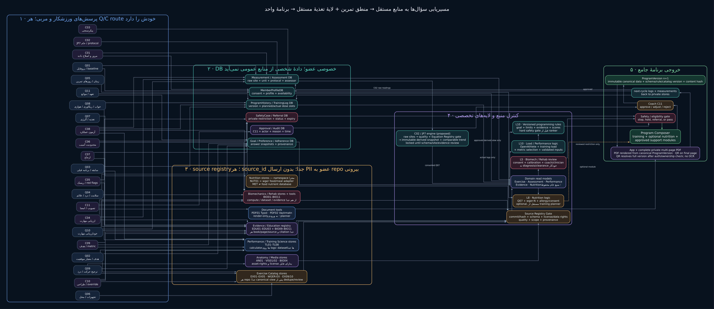

# معماری لایه‌ای منابع ورزشی و مسیریابی هر پرسش به منبع مستقل

**وضعیت:** طراحی/نقشهٔ منابع برای بازبینی. هیچ دیتاستی از فهرست زیر در DB محصول وارد نشده و هیچ سؤال یا پاسخ فردی به GitHub/API بیرونی ارسال نمی‌شود. این سند نوع هر منبع را از «database»، «library/calculator»، «dataset»، «knowledge reference» و «renderer» تفکیک می‌کند تا به مخزن کد به‌اشتباه نقش دیتاست ندهیم.

**خواستهٔ کاربر:** همهٔ منابعی که در فهرست ۳۲‌گانه آمده‌اند ــ نه فقط منابع مرتبط با پرش ــ با شناسه و namespace مستقل ثبت شوند؛ هر پرسش به لایه/منبع مشخص route شود؛ منطق تمرین از پاسخ‌های معتبر، کاتالوگ تأییدشده، `OpenAthlete`، `training-load`، قواعد نسخه‌دار و منابع علمی منتخب تشکیل شود؛ تغذیه مسیر مستقل داشته باشد؛ خروجی لایه‌ها در یک برنامهٔ نسخه‌دار و قابل‌بازبینی مربی ترکیب شود.

## نمودارهای تولیدشده با Graphviz DOT

### جریان سؤال‌ها به منبع‌های جدا، منطق تمرین، تغذیه و برنامهٔ واحد

مسیر تفصیلی C02 تا بازیابی مستقیم ProgramVersion داخلی (بدون OCR)، fallback واردسازی امن PDF بیرونی، نمودارهای پیشرفت و QR در انتهای PDF کامل در [فلوچارت نهایی JP7/برنامه/QR](athlete-jp7-program-qr-flow-v6-2026-11-23.png) آمده است. QR به‌جای حمل همهٔ صفحات، نسخهٔ canonical را پس از access check resolve می‌کند. این نمودار طراحی پیشنهادی است؛ محاسبهٔ JP7 هنوز قفل است.

### درخت source_idها و namespace مستقل هر منبع

## ۱) اصل معماری: «منبع مستقل» بله؛ «همه repoها یک نوع DB هستند» خیر

برای **هر repo، API، دیتاست، کتاب یا موتور** یک `source_id` و connector/adapter مستقل تعریف می‌شود. دیتاست‌های واقعی در صورت مجازبودن، در snapshot خام جداگانه ذخیره می‌شوند؛ کتابخانه‌ها/موتورها در sandbox محاسبه اجرا می‌شوند؛ فهرست‌لینک‌ها و کتاب‌ها در مخزن evidence/citation ثبت می‌شوند. خروجی canonical فقط read-model مشتق است و هر رکوردش source ID و نسخه/commit/hash خود را حفظ می‌کند. دو منبع با نام مشابه یا لایسنس متفاوت در raw store ادغام نمی‌شوند.

هر پاسخ داخلیِ منبع، یک `AnswerEnvelope` پیشنهادی دارد: `question_id`, `source_id`, `source_snapshot/commit`, `record_id`, `schema_version`, `retrieved_at`, `transform/rule_version`, `confidence`, `license/asset_status`, `evidence_refs`. دادهٔ سلامت، نام، و اندازه‌گیری شخص به منبع عمومی فرستاده نمی‌شود؛ درخواست بیرونی فقط از سمت سرور و با حداقل فیلد لازم یا روی snapshot محلی انجام می‌شود.

> یک دیتاست حرکت می‌تواند جواب «کدام حرکت با این وسیله وجود دارد؟» بدهد؛ نمی‌تواند سابقهٔ خصوصی، درد، پیکرسنجی یا جواب شخصی ورزشکار را حدس بزند. کتابخانهٔ محاسبهٔ بار هم DB پاسخ‌ها نیست؛ روی لاگ‌های همان فرد اجرا می‌شود.

## ۲) لایه‌های پیشنهادی و خروجی هر لایه

| لایه | namespace / مسئولیت | خروجی برای برنامه‌ساز |
|---|---|---|
| L0 — هویت، رضایت و دسترسی (داخلی) | member/cycle IDs، دسترسی فایل، scope رضایت، مجوز coach | مجاز/غیرمجاز برای ادامه؛ شناسهٔ داخلی غیرقابل‌حدس. |
| L1 — پاسخ و پروفایل (داخلی) | snapshot مجزای Q01–Q11، پاسخ تأییدشده/نامعلوم، زمان و provenance | مقادیر جاری فرد؛ default فرم پاسخ محسوب نمی‌شود. |
| L2 — سنجش و ارزیابی (داخلی) | قرائت خام C02/C03/C08، site/unit/protocol/tool/assessor/date، skill/test rubric و مشتق نسخه‌دار | baseline/follow-up قابل‌مقایسه یا `unknown/not comparable/review`. هیچ repo عمومی دادهٔ پیکرسنجی عضو را تأمین نمی‌کند. |
| L3 — سابقهٔ برنامه و لاگ (داخلی) | ProgramVersion، هر atom/slot، انجام ست و RPE/RIR، adherence، درد/توقف | اجرای واقعی متصل به همان نسخه؛ planned با performed اشتباه نمی‌شود. |
| L4 — کاتالوگ حرکات مستقل | هر منبع EX/AN جدا؛ canonical ID و read-model فقط پس از mapping/review | کاندید، gear/skill/target و variant؛ فقط رکورد `approved` وارد نسخه می‌شود. |
| L5 — بیومکانیک/بازتوانی | مخزن جدا برای هر dataset؛ ابزارهای OpenSim/OpenCap/Pose2Sim در compute sandbox؛ کتاب/سایت در evidence registry | دادهٔ تحقیق/تحلیل یا reference برای coach؛ نه تشخیص یا نسخهٔ بازتوانی خودکار. |
| L6 — بار و عملکرد ورزشی | هر library/dataset از TL جدا؛ محاسبه فقط روی لاگ/حسگر معتبر همان ورزشکار | متریک‌های بار/عملکرد با ورودی، فرمول، نسخه و محدودیت scope. |
| L7 — شواهد و دانش | OTEP/LibreTexts/IntechOpen/Physiopedia و فهرست‌های علمی با citation/نسخه/licence | rationale/rule candidate برای بازبین؛ متن حقوق‌دار کورکورانه به خروجی کپی نمی‌شود. |
| L8 — تغذیه (جدا از planner تمرینی) | namespace مجزای NUT، با food/meal/profile/log و رضایت؛ فعلاً منبع فهرست‌شدهٔ مستقیم عمدتاً wger است | آیتم/هدف غذایی فقط اگر پوشش داده، مجوز، provenance و approval کافی باشد؛ وگرنه `not configured`. |
| L9 — آناتومی و رسانه | مدل/نقشهٔ عضله و تصویر/animation؛ حقوق رسانه به‌ازای asset | body map یا راهنمای حرکت اختیاری؛ هرگز جای safety gate یا کاتالوگ approved نیست. |
| L10 — منطق بار و prescription | OpenAthlete + training-load + قواعد برنامه‌نویسی داخلیِ نسخه‌دار + evidence تأییدشده | شاخص قابل‌توضیح؛ پیشنهاد progression/volume/frequency فقط داخل scope؛ تضاد/کمبود داده → review. |
| L11 — ترکیب برنامه | join کنترل‌شدهٔ تمرین + هدف/زمان/وسیله + safety + نتیجهٔ اختیاری تغذیه/ارزیابی | یک `ProgramDraft` توضیح‌پذیر؛ تغییرات before/after و منبع هر جزء ثبت شود. |
| L12 — تأیید و نشر | C11، دسترسی خصوصی، Typst، فونت و template version | `ApprovedProgramVersion` immutable؛ اپ و PDF همان version ID را می‌خوانند. |

### جریان منطقی کلان

`Q/C + member snapshot → question router → source-specific connector/query → source-isolated raw store → license/schema/quality gate → domain read models → training-load & evidence/rule logic + nutrition module (جدا) + safety/assessment modules → program composer → coach review → versioned plan/PDF → logs و سنجش چرخهٔ بعد`.

`OpenAthlete` و `training-load` در L10 موتور/کتابخانه‌اند، نه دیتابیس. هرکدام روی دادهٔ تاریخ‌دار و مجازِ خود ورزشکار محاسبه می‌شوند. متریک‌های هم‌پوشان (مثل TRIMP، EWMA/ACWR، CTL/ATL/TSB، Session-RPE) نباید بی‌قاعده با هم جمع یا میانگین شوند؛ rule-set باید انتخاب کند کدام شاخص برای کدام ورزش، نمونه‌برداری، population و تصمیم معتبر است. هیچ آستانه‌ای از صرف وجود کد متن‌باز مجوز پزشکی/تجویز بار نمی‌گیرد.

## ۳) route صریح هر سؤال به DB داخلی و منبع متن‌باز

`internal` در جدول یعنی دادهٔ شخص از DB خصوصی Muscle Paradise می‌آید؛ منابع بیرونی فقط برای کاتالوگ/روش/محاسبهٔ مجاز کمک می‌کنند. پیوندهای چندتایی جایگزین هم‌اند، نه اینکه برای هر سؤال به تمام منابع query شود.

| سؤال | DB/namespace اصلی و منابعی که می‌تواند query شوند | پاسخ/کنترل برگشتی |
|---|---|---|
| Q01 مشخصات و baseline | `MemberProfileDB` + `MeasurementDB` داخلی؛ منابع L7 فقط تعریف روش/واحد را توضیح می‌دهند | سن/قد/وزن/اندازه با source/date؛ دادهٔ موجودی در repo عمومی نیست. |
| Q02 هدف/اولویت/متریک | `GoalMetricRuleDB` + `ExerciseCatalog` (EX01–05, WGER-EX)؛ TL01/TL05/TL08 فقط اگر متریک همان رشته مرتبط باشد؛ EDU01–03 برای review | هدف‌های برنامه‌ساز و tagهای کاندید؛ بدون metric/rule معتبر، hold یا تأیید مربی. |
| Q03 سابقه و رکورد | `ProgramHistoryDB` + `TrainingLogDB` داخلی؛ TL08a/b فقط رکورد مسابقهٔ عمومی با هویت تأییدشده و رضایت، نه تخمین سابقهٔ باشگاهی | برنامه/ست واقعی از history خصوصی؛ رکورد بیرونی جدا با provenance و امکان خطای تطبیق فرد. |
| Q04 بیماری/درد/علامت | `SafetyCaseDB` + `ReferralDB` داخلی؛ RB10/RB11/RB08/RB09 فقط read-only برای coach/clinician review | stop/review/referral. هیچ کاتالوگ/مدل عمومی diagnosis یا clearance نمی‌دهد. |
| Q05 زمان/روز/محل زندگی | `AvailabilityDB` داخلی | برنامهٔ ممکن در تقویم فرد؛ در فهرست فعلی منبع بیرونی معادل موجود نیست. |
| Q06 تجهیزات/محل | `ExerciseCatalog` با namespaceهای مستقل EX01–05 و WGER-EX؛ EX09/10 فقط بعد از license gate؛ AN01/VIS01/02 فقط برای anatomy UI | مجموعهٔ movementهای قابل‌اجرا و جایگزین‌های دارای gear؛ free-text gear به constraint canonical تبدیل و review می‌شود. |
| Q07 تغذیه/آلرژی/آمادگی | `NutritionProfileDB`, `FoodDB`, `MealDB`, `FoodLogDB` کاملاً جدا؛ WGER-N تنها منبع غذایی/برنامه‌ای فهرست‌شده؛ TL07a–c فقط MET فعالیت، نه food nutrients | غذای/وعده فقط با داده و license کافی؛ MET هرگز کالری و ترکیب غذاییِ یک خوراک نیست. منبع جامع nutrient/food در فهرست کاربر موجود نیست. |
| Q08 خواب/ریکاوری/کاردیو/خستگی | `RecoveryCheckinDB` + `TrainingLogDB` داخلی؛ محاسبهٔ مرتبط از TL01, TL02a–c, TL03a–b, TL04–07 و در صورت scope از TL05 | جداکردن self-report، دادهٔ ساعت و derived metric؛ متریک نامعتبر/ورودی ناقص ⇒ بدون score یا hold. |
| Q09 ترجیح/حرکت نامطلوب | `PreferenceDB` + EX01–05/WGER-EX و metadata کاتالوگ؛ AN/VIS فقط نمایش | preference نرم برای رتبه‌بندی؛ درد از Q04/SafetyCaseDB می‌رود، نه از فیلتر dislike. |
| Q10 خودارزیابی مهارت | `SkillAssessmentDB` داخلی؛ RB05/RB06b فقط reference/validation dataset؛ BIO01–03 فقط compute adapter معتبر با consent/کالیبراسیون؛ EDU منابع rubric | self-score از coach observation جدا؛ dataset پژوهشی به‌جای مشاهدهٔ تکنیک عضو نمره نمی‌دهد. |
| Q11 تعهد/مانع/پیگیری | `AdherenceDB` + `AvailabilityDB` + لاگ نسخه‌دار؛ TL01/TL05 در صورت دادهٔ ورودی کامل | کوتاه‌سازی/تقویم/یادآور؛ adherence ناموجود صفر یا شکست شخص تلقی نمی‌شود. |
| C01 مرور داده | `MemberSnapshotDB` + audit | تأیید/اصلاح مربی با منبع، actor، timestamp؛ نسخهٔ قبلی محفوظ. |
| C02 JP7 | `AnthropometryRawDB` + `Equation/Protocol Registry` داخلی؛ Jackson–Pollock 1978/1980 و Siri 1961 به‌عنوان equation candidates در سند JP7 | مربی raw readings می‌دهد؛ بعد از site/category/protocol/consent approval، engine مشتق‌ها را خودکار ذخیره/مقایسه می‌کند. فرمول طراحی درج شده، اما registry کد همچنان قفل و mismatch `calf/midaxillary` نیازمند رفع است. |
| C03 سنجش بدنی | `MeasurementDB` + `ProtocolRegistry` داخلی | site/side/unit/tool/assessor/time و خطای روش؛ منبع خارجی جای قرائت عضو نیست. |
| C04 ارزیابی ۱۴ مهارت | `CoachAssessmentDB` + RB05–08/EDU و در موارد مجاز BIO01–03 | rubric/version/روش مشاهده؛ صرف دیتاست بازتوانی به rubric عمومی Muscle Paradise تبدیل نشود. |
| C05 ریسک و red flags | `SafetyCaseDB` + `ReferralDB`; RB10/11, RB08/09 فقط evidence دسترس‌پذیر برای متخصص | stop/hold یا referral؛ هیچ auto-clear. |
| C06 آسیب و محدودیت | `InjuryRestrictionDB` خصوصی + تاریخ/منبع/انقضا؛ RB08/10/11 و EDU به‌صورت دانشِ بازبینی‌شده | فقط restriction معتبر در planner؛ تشخیص/توان‌بخشی از repo اجرا نشود. |
| C07 ارجاع | `ReferralDB` داخلی + منابع مرجع RB10/11 | مسئول/زمان/وضعیت پیگیری؛ تا روشن‌شدن شرط، gate بسته می‌ماند. |
| C08 آزمون عملکرد | `PerformanceTestDB` + TL02a–c/TL03a–b/TL04–08 و BIO01–06 طبق scope آزمون | protocol، واحد، assessor و مقایسه‌پذیری؛ دادهٔ OpenPowerlifting فقط رقابت و جمعیت خودش را توصیف می‌کند. |
| C09 متریک/اولویت | `GoalMetricRuleDB` + L7/L10 (TL01–08 و EDU01–03 مطابق هدف) | معیار موفقیتِ نسخه‌دار/قابل‌ردیابی؛ نه score بدون مرجع. |
| C10 طراحی/override | Planner از read-modelهای approved حرکت، load، safety، goal، assessment و rule | before/after، rule version، source IDs، علت انتخاب/حذف؛ no silent override. |
| C11 امضا و انتشار | `Approval/AuditDB` + PDF renderer DOC01–02 | approve/reject/review؛ فقط approve نسخهٔ immutable می‌سازد. |

## ۴) فهرست مستقل منبع‌ها (هر source_id یک connector/namespace)

در ستون «Route» از Q01–Q11 و C01–C11 استفاده شده است. این table mapping طراحی است؛ نوع/مجوز باید در `Source Registry` با commit یا snapshot واقعی pin شود.

### ۴.۱ کاتالوگ حرکت، anatomy و نمایش

| source_id | لینکِ ارائه‌شده | نوع و store/adapter مستقل | Route/کاربرد |
|---|---|---|---|
| EX01 | [yuhonas/free-exercise-db](https://github.com/yuhonas/free-exercise-db) | JSON exercise catalog؛ snapshot خام مستقل، Unlicense طبق فهرست | Q02/Q06/Q09/C10؛ candidate/metadata، پس از review. |
| EX02 | [wrkout/exercises.json](https://github.com/wrkout/exercises.json) | JSON exercise catalog مستقل؛ Unlicense طبق فهرست | Q02/Q06/Q09/C10. |
| EX03 | [Glowupp-app/open-exercisedb](https://github.com/Glowupp-app/open-exercisedb) | دیتاست exercise و عضله P/S/T؛ MIT طبق فهرست؛ namespace جدا | Q02/Q06/Q09/C10. |
| EX04 | [longhaul-fitness/exercises](https://github.com/longhaul-fitness/exercises) | سه دستهٔ strength/cardio/flexibility؛ MIT طبق فهرست | Q02/Q06/Q08/Q09/C10. |
| EX05 | [Snouzy/workout-cool](https://github.com/Snouzy/workout-cool) | برنامه/کد و exercise records؛ کد MIT طبق فهرست؛ دیتاست/media license جدا verify | Q02/Q06/Q09/C10؛ repo code را با catalog source یکی نکن. |
| AN01 | [Rippy1911/anatome](https://github.com/Rippy1911/anatome) | API/engine نقشهٔ عضله؛ Apache-2.0 و SVG pathهای MIT طبق فهرست | Q02/Q09/C10 برای display/target mapping؛ خروجی visualization به‌تنهایی prescription نیست. |
| VIS01 | [giavinh79/react-body-highlighter](https://github.com/giavinh79/react-body-highlighter) | UI component، MIT طبق فهرست | نمایش target به Q02/Q09؛ نه مرجع تشخیص عضله. |
| VIS02 | [MichaelMjc/react-body-highlighter](https://github.com/MichaelMjc/react-body-highlighter) | مخزن/نسخهٔ جدا، MIT طبق فهرست | فقط پس از بررسی اختلاف/fork، همان store VIS01 فرض نشود. |
| WGER-EX | [wger-project/wger](https://github.com/wger-project/wger) | REST/backend و exercise records؛ کد AGPL طبق فهرست؛ داده/رسانه license جدا | Q02/Q06/Q09/C10. |
| WGER-APP | [wger-project/flutter](https://github.com/wger-project/flutter) | client Flutter، نه دیتابیس مستقل | رابط/قرارداد API؛ Qهای کاربر منبع دادهٔ تازه نمی‌گیرد. |
| EX09 | [hasaneyldrm/exercises-dataset](https://github.com/hasaneyldrm/exercises-dataset) | candidate code/text/media، طبق یادداشت کاربر متن MIT و تصاویر Gym Visual | Q06/Q09 فقط text/metadata پس از تأیید؛ تصویر/GIF پیش‌فرض مسدود. |
| EX10 | [RepDB/exercise-dataset](https://github.com/RepDB/exercise-dataset) | dataset candidate، attribution/نسخهٔ پولی طبق یادداشت کاربر | Q06/C10 فقط پس از شروط انتساب/دسترسی؛ نسخهٔ پولی را scrape نکن. |

### ۴.۲ بیومکانیک، بازتوانی و حرکت اصلاحی

| source_id | لینکِ ارائه‌شده | نوع و store/adapter مستقل | Route/کاربرد |
|---|---|---|---|
| BIO01 | [opensim-org/opensim-core](https://github.com/opensim-org/opensim-core) | engine biomechanical compute، Apache-2.0 طبق فهرست | C04/C08 و clinician/coach review؛ نه exercise DB. |
| BIO02 | [opencap-org/opencap-core](https://github.com/opencap-org/opencap-core) | capture/process service، Apache-2.0 طبق فهرست | Q10/C04/C08 فقط با consent، calibration و quality gate. |
| BIO03 | [perfanalytics/pose2sim](https://github.com/perfanalytics/pose2sim) | pose-to-3D compute library، BSD-3-Clause طبق فهرست | C04/C08؛ خطای pose/confidence باید همراه خروجی باشد. |
| BIO04 | [alcazardaas/kimorel](https://github.com/alcazardaas/kimorel) | animation/reference library؛ code MIT و sample metadata CC0 طبق فهرست | Q09/Q10/C04؛ media asset per-file license. |
| BIO05 | [UI-PRMD article / DOI](https://doi.org/10.3390/data3010002) · [PMC mirror](https://pmc.ncbi.nlm.nih.gov/articles/PMC5773117/) | dataset/protocol paper؛ license PDDL طبق یادداشت کاربر؛ DOI و مقاله دو mirror یک منبع‌اند | Q10/C04/C08 برای validation research، نه نمرهٔ مستقیم عضو. |
| BIO06-CODE | [alina-miron/intellirehabds](https://github.com/alina-miron/intellirehabds) | کد/loader مستقل؛ license user says CC BY 4.0 برای دیتاست، باید code/data تفکیک شود | Q10/C04/C08 پس از scope review. |
| BIO06-DATA | [IntelliRehabDS Zenodo record](https://doi.org/10.5281/zenodo.4610859) | dataset snapshot مستقل، 2,589 رکورد طبق فهرست | فقط benchmark/research با attribution/version/hash؛ personal health data نیست. |
| BIO07 | [Rehab posture correction](https://github.com/alessandrogheller/Rehab_posture_correction_Gheller-Lorenzon) | research computer-vision project؛ license/weights/assets نیازمند review | C04/C08 در sandbox/fixture؛ نه ارزیابی زندهٔ بالینی بدون validation. |
| BIO08 | [Easeur exercise knowledge base](https://github.com/founder-easeur/exercise-dataset) | API/taxonomy/mobility/stretching source؛ repo license در فهرست ذکر نشده | Q06/Q09/C04/C10، ابتدا terms/schema review؛ candidate تا آن موقع. |
| BIO09-A | [Awesome Biomechanics](https://github.com/modenaxe/awesome-biomechanics) | فهرست لینک‌ها، نه دیتاست بیومکانیک | C04/C08/C10 برای کشف منابع؛ هر منبع مقصد باید source_id جدا داشته باشد. |
| BIO09-B | [Rehab Agent Stack](https://github.com/HarmannBitte/rehab-agent) | کد/agent stack؛ repo `NOASSERTION` طبق بررسی API قبلی | C04–C07 فقط sandbox/review؛ اجرا یا استفاده از خروجی بدون مجوز/اعتبارسنجی ممنوع. |
| BIO10 | [PhysiotherapyExercises.com](https://www.physiotherapyexercises.com/) | وب‌سایت/کتابخانهٔ محتوایی؛ رایگان/غیرانتفاعی طبق یادداشت کاربر، bulk/API rights را verify کن | Q04/Q09/Q10/C04–C07 فقط reference برای متخصص؛ نه scraper یا treatment engine. |
| BIO11 | [Physiopedia](https://www.physio-pedia.com/) | دانشنامهٔ محتوا؛ license باید در سطح صفحه/asset چک شود | Q04/C04–C07 evidence/citation؛ متن/تصویر با reuse approval. |

### ۴.۳ بار تمرین، فیزیولوژی، performance و آموزش

| source_id | لینکِ ارائه‌شده | نوع و store/adapter مستقل | Route/کاربرد |
|---|---|---|---|
| TL01 | [m27w/training-load](https://github.com/m27w/training-load) | TS calculator، MIT طبق فهرست؛ ورودی logs، نه DB پاسخ | Q08/Q11/C08–C10 در L10. |
| TL02-GC | [GoldenCheetah desktop](https://github.com/GoldenCheetah/GoldenCheetah) | software/client و performance model؛ license اختلاف دارد: فهرست کاربر GPL-2.0، GitHub API قبلی GPL-3.0 گزارش کرد؛ pin/قرارداد واقعی لازم | Q08/C08/C09؛ نصب/ادغام تا رفع اختلاف لایسنس بررسی شود. |
| TL02-SWEAT | [sweatpy](https://github.com/GoldenCheetah/sweatpy) | Python compute library، MIT طبق فهرست | Q08/C08–C09، روی دادهٔ مجاز خود فرد. |
| TL02-OPEN | [GoldenCheetah OpenData](https://github.com/GoldenCheetah/OpenData) | dataset/research store؛ repository-level license در فهرست قبلی یافت نشد | Q03/Q08/C08 فقط با terms/data license و privacy review. |
| TL03-WHIPPR | [whippr](https://github.com/fmmattioni/whippr) | R CPET/gas-exchange analysis; repo `NOASSERTION` طبق بررسی API قبلی | Q08/C08/C09 فقط در scope داده/protocol و license روشن. |
| TL03-LACTATER | [lactater](https://github.com/fmmattioni/lactater) | R lactate-threshold analysis; repo `NOASSERTION` طبق بررسی API قبلی | C08/C09؛ نه تمرین/آستانهٔ خودکار بدون آزمون معتبر. |
| TL04 | [physusp/physusp](https://github.com/physusp/physusp) | energy system scientific calculator، GPL-3.0 طبق فهرست | Q08/C08/C09 فقط با ورودی/protocol معتبر؛ لایسنس code deployment جدا بررسی شود. |
| TL05 | [openathleteorg/openathlete](https://github.com/openathleteorg/openathlete) | training platform/models، AGPL-3.0 طبق فهرست | Q03/Q08/Q11/C08/C09/C10؛ metric engine روی logs، نه athlete database آماده. |
| TL06 | [tanhtruong/makerundev](https://github.com/tanhtruong/makerundev) | FIT/GPX/TCX/metrics Python library؛ repo metadata قبلی Apache-2.0 گزارش شده | Q08/C08 برای endurance data در scope؛ license/version دوباره pin شود. |
| TL07-COMP | [Compendium of Physical Activities repository](https://github.com/andyreagan/compendium-of-physical-activity) | MET dataset/code؛ license repo در بررسی قبلی اعلام نشده | Q07/Q08 فقط activity MET context؛ مجوز داده جدا verify. |
| TL07-TRAINCALC | [TrainCalc MET dataset](https://github.com/traincalc/traincalc-met-dataset) | MET JSON/CSV؛ MIT طبق بررسی API قبلی | Q08/Q09 activity energy estimate؛ food nutrient DB نیست. |
| TL07-OFFICIAL | [2024 Compendium reference](https://pacompendium.com/) | وب‌مرجع/فهرست فعالیت و MET؛ terms/export/API و attribution را پیش از استفاده بررسی کن | Q08/C08 contextual classification؛ نه nutrition composition. |
| TL08-GH | [OpenPowerlifting GitHub mirror](https://github.com/sstangl/openpowerlifting) | mirror/code repository؛ user says data CC0/code AGPL، dataset/code را جدا pin کن | Q03/C08/C09 فقط رکورد مسابقهٔ متصل و consented یا aggregate مجاز؛ نه log عادی باشگاه. |
| TL08-GL | [OpenPowerlifting primary GitLab](https://gitlab.com/openpowerlifting/opl-data) | primary data source؛ خارج از GitHub API این بررسی، user reports CSV CC0 | Q03/C08؛ هر نسخه/hash و روش identity matching جدا. |
| EDU01 | [Open Textbook of Exercise Physiology](https://pressbooks.pub/drbmac/) · [University page](https://kinesiology.ucalgary.ca/macintosh/open-textbook-exercise-physiology) | متن درسی، CC BY-NC 4.0 طبق فهرست؛ non-commercial limitation مهم است | Q02/Q08/C02–C04/C08–C10 برای evidence review/citation، نه کپی تجاری خودکار. |
| EDU02 | [Medicine LibreTexts — Sports and Exercise](https://med.libretexts.org/Bookshelves/Sports_and_Exercise) | کتاب/مقالهٔ OER؛ license per page/book بررسی شود | Q04/Q08/Q10/C04–C09؛ citation/claim review. |
| EDU03-PHYS | [IntechOpen Exercise Physiology books](https://www.intechopen.com/subjects/1119) | هر کتاب/chapter license و reuse rule جدا | Q02/Q08/C08–C10، evidence registry/citation. |
| EDU03-REHAB | [IntechOpen Physical Medicine & Rehabilitation books](https://www.intechopen.com/subjects/197) | هر کتاب/chapter license و reuse rule جدا | Q04/Q10/C04–C07/C09؛ clinician review. |
| EDU03-SPORTS | [SportsScience Student Hub](https://github.com/seif4d/SportsScience) | فهرست/محتوای curated؛ license در repository-level بررسی قبلی مشخص نبود | Q02/Q08/C04/C08/C09 برای کشف منبع، نه authority خودکار. |

### ۴.۴ تغذیه، حروف‌چینی و رسانه

| source_id | لینکِ ارائه‌شده | نوع و store/adapter مستقل | Route/کاربرد |
|---|---|---|---|
| NUT01 | [wger backend/API](https://github.com/wger-project/wger)؛ جدا از WGER-EX | `NutritionFoodDB`/`MealTemplateDB`/`FoodLog` namespace مستقل؛ کد AGPL طبق فهرست و حقوق هر رکورد/تصویر داده جدا | Q07؛ کاربر/مربی فقط به sourceهای مجاز query می‌کند. Data license/coverage/locale/serving units پیش از ingest لازم است. |
| NUT-GAP | منبع nutrient/food composition جامع در فهرست ارسالی نیامده | رکورد missing در registry، نه fallback به MET | تا انتخاب/تأیید منبع مستقل، meal plan/macros از این فهرست به‌تنهایی ساخته نشود. |
| PDF01-GH | [Typst](https://github.com/typst/typst) | typesetting/render engine؛ Apache-2.0 طبق فهرست | L12 پس از approval؛ renderer منبع داده یا recommendation نیست. |
| PDF01-PYPI | [Python `typst` package](https://pypi.org/project/typst/) | Python binding/package؛ نسخه و license package metadata جدا | اجرای renderer؛ repo/binding license را به PyPI package تعمیم نده. |
| PDF02 | [Vazirmatn](https://github.com/rastikerdar/vazirmatn) | font، OFL-1.1 طبق فهرست | PDF فارسی؛ فایل font/version و attribution بسته‌بندی شود. |

## ۵) منطق ترکیبی و خروجی واحد برنامه

1. **Question router** فقط از پاسخ تأییدشده/مجوزدار استفاده می‌کند و به registry نگاشت سؤال→DB/source ID نگاه می‌کند؛ دادهٔ مجهول به هیچ‌جا به‌عنوان صفر/خیر ارسال نمی‌شود.
2. **Source adapters** هر منبع را در schema/snapshot جدا می‌خوانند. dataset در صورت اجازه به raw store مستقل pin می‌شود؛ API rate/terms رعایت می‌شود؛ calculator فقط در sandbox با input contract نسخه‌دار اجرا می‌شود.
3. **Validation & canonical mapping** alias/واحد/شناسه‌ها را نرمال می‌کند؛ اصل رکورد خام و اختلاف منابع می‌ماند. conflict به `needs_review` می‌رود؛ source priority عمداً طراحی می‌شود، نه اینکه آخرین repo برنده باشد.
4. **Training logic L10** از `OpenAthlete + training-load + exercise rules + verified session/test logs + goal/population/evidence registry` شاخص‌های مرتبط را حساب می‌کند. هر الگوریتم جدا، با input requirements/metrics, scope, formula/version, thresholds, data gaps و reviewer ثبت می‌شود؛ rule engine حرکات `approved` و قیود سخت را به draft تبدیل می‌کند.
5. **Biomechanics/rehab** یک مسیر تخصصی و consent-gated است. دادهٔ benchmark از UI-PRMD/IntelliRehabDS و ابزار pose/openSim خروجی تشخیصی/نسخهٔ درمانی تولید نمی‌کند؛ یافتهٔ واجدشرایط فقط برای بازبینی مربی/متخصص و محدودیت تأییدشدهٔ فرد استفاده می‌شود.
6. **Nutrition L8** با Q07 و sourceهای nutrition مستقل کار می‌کند؛ هیچ food log/meal prescription به training-load engine داده نمی‌شود. خروجی تغذیه فقط در صورت منبع معتبر، آلرژی/شرط‌ها، رضایت و approval نقش حرفه‌ای به برنامهٔ جامع join می‌شود.
7. **ProgramComposer L11** training blocks/session slots را می‌گیرد؛ nutrition/recovery/rehab/media را فقط به‌صورت ماژول شرطی و مجاز اضافه می‌کند؛ source conflict، safety hold یا ناقص‌بودن مهم → draft یا انتشار متوقف/بازبینی می‌شود.
8. **C11 → L12** مربی نسخهٔ نهایی را تأیید می‌کند. `ProgramVersion` شامل source trace هر جزء است؛ اپ و PDF از همان version ID خوانده می‌شوند. Typst/Vazirmatn فقط نشر می‌دهند و نباید planner را دوباره اجرا کنند.
9. **چرخهٔ برگشت:** لاگ هر جلسه/slot به همان version وصل می‌شود؛ سنجه‌های جدید با baseline/protocol مقایسه می‌شوند؛ component scorecards به planner می‌روند؛ `n+1` ساخته می‌شود، نسخهٔ قبلی overwrite نمی‌شود.

## ۶) مجوز، اعتماد و حدود این نقشه

- لایسنس نوشته‌شده کنار هر repo در فهرست کاربر، metadata اولیه است، نه مجوز قطعی استفادهٔ تجاری یا حق redistribution هر dataset/تصویر. در منابع قبلی GitHub API، بعضی موارد `NOASSERTION`/بدون repo license گزارش شده‌اند؛ نبود لایسنس را «آزاد» فرض نکن.
- ناسازگاری‌های مشخص برای registry: GoldenCheetah در ورودی کاربر GPL-2.0 اعلام شده، ولی repo metadata قبلی GPL-3.0 گزارش کرده؛ `hasaneyldrm`, `RepDB`, OpenData و SportsScience repo metadata روشن نداشتند؛ license کد wger/OpenPowerlifting با license داده/عکس یکی نیست؛ Physiopedia/LibreTexts/IntechOpen و PhysiotherapyExercises باید صفحه/asset به صفحه بررسی شوند؛ OTEP با CC BY-NC برای استفادهٔ تجاری قابل فرض نیست؛ Typst repo و PyPI package metadata یکسان فرض نشوند.
- هر source snapshot به `source_id + commit/release + acquired_at + SHA-256 + schema + license evidence + attribution + asset rights` ثبت شود؛ media license به تک‌تصویر/GIF وابسته است.
- OpenSim/OpenCap/Pose2Sim/rehab code یا دیتاست benchmark هستند، نه مخزن پزشکی معتبر برای همهٔ افراد. هر workflow بالینی نیازمند validation، consent، جمعیت کاربرد و نقش متخصص است.
- هیچ دیتاستی، کد متن‌بازی یا سیستم live در این مرحله نصب/متصل/وارد DB محصول نشده؛ **فقط ابزار رسم نمودار** در بخش ۷ به‌صورت dev-tool نصب شده است.

## ۷) ابزار رسم نمودار انتخاب/نصب‌شده از GitHub

برای این نقشه، Graphviz DOT مناسب‌تر از یک چارت دستی است: graph، tree، cluster/subgraph و مسیرهای چندبه‌چند را با layout خودکار نشان می‌دهد و خروجی SVG/PNG می‌دهد. wrapper فعال و MIT از مخزن [mdaines/viz-js](https://github.com/mdaines/viz-js) انتخاب شد؛ npm package قفل‌شده `@viz-js/viz@3.31.0`، WASM build of Graphviz است. برای rasterization PNG از `sharp@0.35.5` (Apache-2.0) استفاده می‌شود. این‌ها فقط dependency ابزار مستندسازی‌اند، نه dependency/runtime اپ.

- نصب محلی ابزار: `tools/graphviz-renderer/package.json` و `package-lock.json`؛ بازتولید: `cd tools/graphviz-renderer && npm ci`.
- renderer: `tools/graphviz-renderer/render.mjs`; DOT به SVG و PNG تبدیل می‌شود، بدون نیاز به نصب system Graphviz یا اجرای مرورگر. نمونهٔ اجرا از پوشهٔ ابزار: `npm run render -- ../../docs/MuscleParadise/architecture/open-source-question-routing-flow-v1-2026-11-23.dot ../../docs/MuscleParadise/architecture/open-source-question-routing-flow-v1-2026-11-23.png 5000`.
- خروجی‌ها: [فلوچارت route پرسش‌ها و لایه‌ها](open-source-question-routing-flow-v1-2026-11-23.png) · [SVG مقیاس‌پذیر همان flow](open-source-question-routing-flow-v1-2026-11-23.svg)، [درخت منابع و source IDها](open-source-source-registry-tree-v1-2026-11-23.png) · [SVG مقیاس‌پذیر درخت](open-source-source-registry-tree-v1-2026-11-23.svg)، و فایل‌های editable [`DOT`](open-source-question-routing-flow-v1-2026-11-23.dot) / [`source tree DOT`](open-source-source-registry-tree-v1-2026-11-23.dot).

**محدوده:** نمودارها منطقِ پیشنهادی‌اند؛ endpoint زنده یا انبارهای فیزیکی ایجاد نشده‌اند. قبل از پیاده‌سازی باید برای هر source دقیقاً انتخاب شود: local snapshot یا API، refresh cadence، schema transform، license approval، retention، population scope و مسئول بازبینی.
