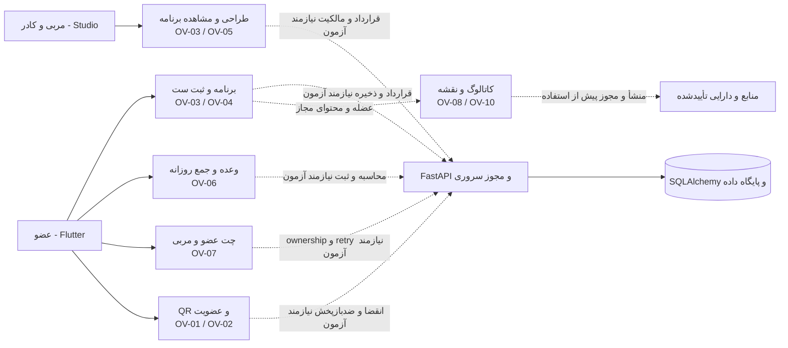
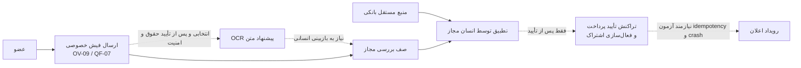

# جریان ارزش‌های تمرین و حضور — نقشهٔ هدف با پشتوانهٔ RepoWise

**وضعیت: هدف/برنامه‌ریزی‌شده، نه اثبات کارکرد انتهابه‌انتها.** شناسه‌ها برش‌های [برنامهٔ ارزش‌ها](../PLAN-OSS-VALUE-MICROLOOPS-2026-11-18.md) هستند. پیکان‌های نقطه‌چین به معنی تطبیق یا اتصال نیازمند بررسی‌اند. RepoWise 0.61.0 روی mirror گزینشی بدون مدل، ساختار کد و نشانه‌های وابستگی را بررسی کرد؛ سپس این نقشه با خواندن کد توسط عامل اصلی ترسیم شد. index موقت و مصنوعی، پوشش کامل یا QA نیست؛ [گزارش روش](../REPORT-OSS-VALUE-DEEP-DIVE-2026-11-18.md).

## تعامل عضو، کادر و backend

نقاط فعلی برای بازبینی: `mp-app/backend/modules/{programs,exercises,nutrition,face_id}`، `mp-app/client/lib/features/{today,nutrition,checkin,chat}` و `mp-app/studio/src/components/ExerciseLibrary.tsx`. وجود source به معنی اتصال یا آمادگی نیست.

## فیش و عضویت: OCR تأییدکنندهٔ پرداخت نیست

مسیر هدف است؛ `manual_transfer_policy.py` مستقل محلی به‌خودی‌خود جریان متصل یا تأیید بانکی نیست. عکس پیشرفت بدن خارج scope است؛ تصویر فیش و کالا سیاست خود را دارند.
