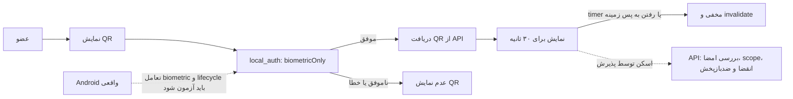
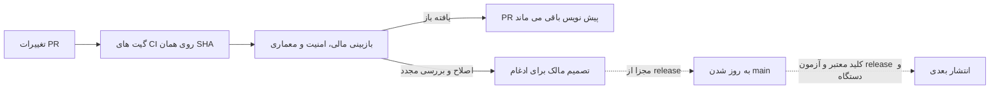

# جریان‌های مؤثر PR شمارهٔ ۳ — بازبینی منبع

**مبنای تاریخی بررسی:** commit `da73f2e81bd9e70b9ed395407481fe133a4ca731` نسبت به `5482930587ce18e14f136d78296542a2de5af091`. PR شمارهٔ ۳ سپس ادغام شد؛ اصلاح R1/R2 در پیگیری بعدی انجام شده است. [گزارش بازبینی تاریخی](../REPORT-PR-3-REVIEW-2026-11-18.md) و [هندآف جاری](../SESSION_HANDOFF.md) را با هم بخوانید. نمودارها تصویر کدند، نه گواه آمادگی مالی یا دستگاه؛ فلش‌های خط‌چین شرط‌های نیازمند اثبات را نشان می‌دهند.

## بازگشت وجه درگاهی موجود، نه کارت‌به‌کارت هدف

```mermaid
flowchart LR
  Staff[کادر در PaymentPanel] --> Lookup[تغییر شناسه یا شروع جستجو]
  Lookup --> Clear[حذف انتخاب، شروع و رسید قبلی]
  Clear -->|شناسه نامعتبر| Error[پیام خطا؛ بدون انتخاب]
  Clear -->|شناسه معتبر| List[GET /payments و جستجو در کل فهرست دریافتی]
  List -->|پیدا شد| Selected[پرداخت انتخاب شده در state]
  List -->|پیدا نشد یا خطا| Error
  Selected -->|paid و authority| Confirm[تأیید دستی: شماره و مبلغ]
  Confirm -->|کاربر تأیید کند| Refund[POST /payments/:id/refund]
  Refund --> Service[refund_payment و پاسخ درگاه]
  Service --> DB[(payments: status و refund_reference)]
  DB --> Receipt[GET /payments/:id/receipt]
  Pending[هنگام درخواست: ورودی جستجو قفل] -. جلوگیری از پاسخ انتخاب کهنه .-> List
```

**پیگیری R1:** در کد اصلاح‌شده تغییر شناسه و شروع جستجو انتخاب و رسید قبلی را پاک می‌کنند و هنگام درخواست، ورودی جستجو قفل می‌شود؛ تست‌های ساختگی تغییر ورودی، شناسهٔ نامعتبر، پیدا نشدن، شکست شبکه/HTTP و بازیابی را بررسی می‌کنند. یافتهٔ قبلی در snapshot تاریخی بود. این تست‌ها به‌تنهایی ایمنی گردش مالی در محیط واقعی را اثبات نمی‌کنند. [`PaymentPanel.tsx`](../../../mp-app/studio/src/components/PaymentPanel.tsx) · [`paymentPanel.test.tsx`](../../../mp-app/studio/tests/paymentPanel.test.tsx) · [`payments/router.py`](../../../mp-app/backend/modules/payments/router.py) · [`payments/service.py`](../../../mp-app/backend/modules/payments/service.py) · [migration](../../../mp-app/backend/db/migrations/versions/b19c28d37e46_m111_refund_reference.py).

مسیر `refund_payment` از پیش وجود داشت؛ اتصال و نمایش آن در Studio در این PR افزوده شده است. تست پیشین مسیر موفق و تکرار ترتیبی را پوشش می‌دهد، نه رقابت بین دو درخواست/worker و crash پس از پاسخ درگاه. قابلیت عملی و نقش‌های مجاز باید جداگانه با تست و تصمیم مالک بررسی شوند.

## QR عضو: مرز فعلی و آنچه باید روی دستگاه بررسی شود

[`checkin_page.dart`](../../../mp-app/client/lib/features/checkin/checkin_page.dart) و [`qr_biometric_gate_test.dart`](../../../mp-app/client/test/qr_biometric_gate_test.dart) گیت محلی، نمایش زمان‌دار و آزمون widget را نشان می‌دهند؛ [`face_id/router.py`](../../../mp-app/backend/modules/face_id/router.py) بررسی سروری QR را دارد. موفقیت widget و Android debug در CI به معنی آزمون حسگر و lifecycle روی دستگاه نیست.

## انتشار و checkpoint

**پیگیری R2:** workflow دستی `format-qr` ابتدا فرمت و fingerprint فایل‌ها را ثبت می‌کند، سپس تست QR اجرا می‌شود و تنها بعد از موفقیت تست و تطبیق fingerprint می‌تواند همان فایل‌ها را commit/push کند. [تست مصنوعی failure/success و تغییر فایل](../../../mp-app/backend/tests/regression/test_qr_format_workflow.py)، [گزارش تاریخی](../REPORT-PR-3-REVIEW-2026-11-18.md) و [`client-format-fix.yml`](../../../.github/workflows/client-format-fix.yml) را ببینید.
