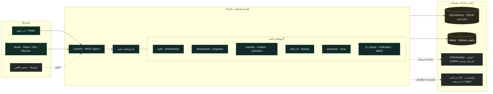

# System Atlas — نقشهٔ خواندنی معماری

> **وضعیت:** نقشهٔ مفهومی از ساختار موجود در این checkout، نه تأیید همهٔ مسیرهای E2E یا استقرار production. خط‌چین نشان‌دهندهٔ مسیر ناقص، وابسته به تنظیمات یا نیازمند اثبات است؛ وضعیت این موارد یکسان نیست. برای وضعیت و هدف پرداخت، [صف ابری و مالی](../TODO-CLOUD-FINANCE-ACCESS.md)، [صف پیشین](../TODO-2026-11-16.md) و تست همان مسیر را بررسی کنید. هدف کارت‌به‌کارت و تأیید انسانی با مسیر موجود متفاوت است و اتصال کامل آن هنوز اثبات نشده است.

[نمودار تصویری قابل‌ویرایش در README](../assets/system-architecture.svg) با همان رنگ‌های هویت پروژه ساخته شده است. فایل SVG خودش منبع قابل‌ویرایش و versioned است؛ فونت، تصویر یا اسکریپت خارجی ندارد. متن داخل نمودار انگلیسی است تا نمایش تصویر در GitHub به فونت فارسی محیط وابسته نباشد؛ شرح فارسی و مسیرهای کد در این صفحه آمده است.

## گراف متنی

این گراف برای بازبینی و diff است؛ فلش‌ها ارتباط مفهومی را نشان می‌دهند، نه اثبات عملکرد کامل. گروه‌بندی دامنه‌ها به‌معنای وجود یک رابطهٔ مستقیم بین تک‌تک ماژول‌های هر گروه نیست.

## راهنمای خواندن و شواهد

| بخش | توضیح و محل بررسی | وضعیت و مرز ادعا |
|---|---|---|
| تجربه‌ها | [اپ Flutter](../../../mp-app/client/) و [Studio](../../../mp-app/studio/) | کلاینت‌ها و کد آن‌ها موجودند؛ اتصال همهٔ صفحه‌ها و کیوسک به‌صورت E2E اثبات نشده است. |
| API | [ساخت اپ](../../../mp-app/backend/app/main.py) و [روترهای نسخه‌دار](../../../mp-app/backend/api/v1/api.py) | ساختار و ثبت `/api/v1` در کد موجود است؛ تصویر جای تست API را نمی‌گیرد. |
| دامنه‌ها | [ماژول‌ها](../../../mp-app/backend/modules/) و [نقشهٔ ماژول‌ها](module-map.md) | نام‌های داخل کارت‌ها گروه‌بندی خوانایی‌اند، نه فهرست کامل یا تضمین کارکرد تک‌تک جریان‌ها. |
| داده | [تنظیمات](../../../mp-app/backend/app/config.py)، [مدل‌ها و مهاجرت‌ها](../../../mp-app/backend/db/) | SQLite مقدار پیش‌فرض تنظیمات است؛ وضعیت deployment و بازیابی باید جداگانه سنجیده شود. |
| کش | [پیاده‌سازی کش](../../../mp-app/backend/cache/store.py) و [تست کش](../../../mp-app/backend/tests/unit/test_cache.py) | Valkey/Redis و fallback حافظه در کد تعریف شده‌اند؛ این نقشه تضمین دسترسی سرویس خارجی نیست. |
| کارهای زمان‌بندی‌شده | [تعریف scheduler](../../../mp-app/backend/jobs/scheduler.py) و [lifespan اپ](../../../mp-app/backend/app/main.py) | تعریف job موجود است؛ نحوهٔ راه‌اندازی runtime و تک‌اجرایی نیازمند تأیید جداگانه است. |
| اتصال‌های بیرونی | [آداپتور پرداخت](../../../mp-app/backend/modules/payments/gateway.py) و [موتور قواعد](../../../mp-app/backend/modules/ai_engine/) | اتصال واقعی، تنظیمات و عملکرد پرداخت یا AI وابسته به محیط است و با این نمودار اثبات نمی‌شود. |
| چک‌این | [ماژول face_id](../../../mp-app/backend/modules/face_id/) و [تست امنیت QR](../../../mp-app/backend/tests/integration/test_m65_qr_security.py) | وجود کد و تست به‌معنای تأیید دستگاه فیزیکی یا تشخیص واقعی چهره نیست. |

## نگهداری

- `../assets/system-architecture.svg` فایل اصلی و قابل‌ویرایش تصویر است، نه خروجی تولیدشده از Mermaid یا D2. پس از تغییر معماری، تصویر و گراف این صفحه را با کد و شواهد همان تغییر هماهنگ کنید.
- تصویر برای GitHub به‌صورت asset محلی نمایش داده می‌شود. متن جایگزین در README و `<title>`/`<desc>` داخل SVG وجود دارند. تصویر را در اندازهٔ README و در صفحه‌نمایش کوچک هم بررسی کنید.
- هیچ دادهٔ واقعی، کلید یا endpoint خصوصی در نمودار قرار ندهید. طراحی و متن این نمودار فقط مستندسازی‌اند و قابلیت تازه یا تغییر runtime ایجاد نمی‌کنند.
