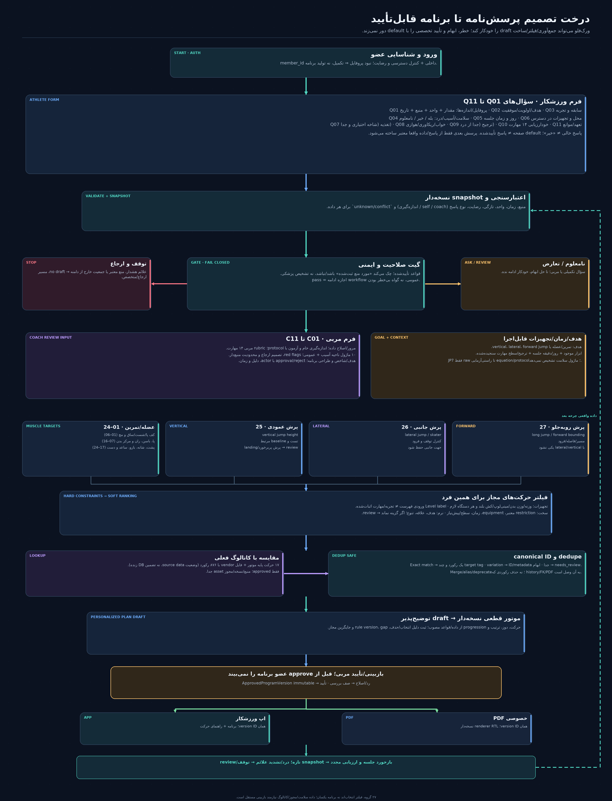
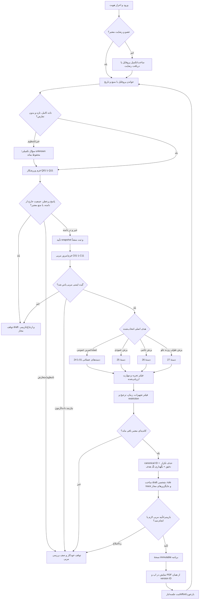

# درخت تصمیمِ فرم ورزشکار/مربی و انتخاب حرکات از ۲۷ دسته

**وضعیت:** سند و دیاگرام طراحی برای بررسی؛ اجرای خودکار در محصول، تغییر داده‌های DB یا حذف ردیف‌های موجود **انجام نشده است**. فهرست ۲۷ دستهٔ حرکتیِ کاربر اکنون کامل دریافت شده است. اطلاعات PDF نمونه یا دادهٔ شخصی ورزشکار وارد این نمودار نشده است.

**هدف:** پس از ورود و تکمیل پاسخ‌ها، فرم‌های شرطی، اعتبارسنجی، طبقه‌بندی، حذف تکرارهای واقعی، پیشنهاد draft، PDF و بازخورد تا جای ممکن خودکار شوند؛ اما پاسخ ناقص/متعارض یا نشانهٔ خطر به توقف یا بازبینی هدایت شود، نه اینکه سیستم با پیش‌فرض برنامه بسازد.

## ۱) نمودار درختی اصلی

### نسخهٔ متنیِ قابل‌ویرایش (Mermaid)

> شاخهٔ «فرم ورزشکار کامل است» یا «هیچ پاسخ پرخطر گزارش نشد» به‌تنهایی مجوز پزشکی نیست. در صورت نامعلومی، پاسخ خالی را No تلقی نمی‌کنیم. انتشار بدون مربی یک تصمیم سیاست محصولی جداست؛ پیشنهاد این سند برای نسخهٔ اول، تأیید draft توسط مربی پیش از نمایش به عضو است.

## ۲) پرسش‌ها، پاسخ‌ها و مسیر هر پاسخ

این جدول قرارداد پیشنهادی برای سؤال‌هاست. بعضی گزینه‌های موجود در کد مشخص‌اند؛ گزینه‌های دیگر، قالب پاسخ پیشنهادی از فرم‌هایی است که کاربر شرح داده، نه پاسخِ واقعیِ یک ورزشکار.

| شناسه | سؤال/داده | قالب پاسخ مجاز | مسیر بعدی |
|---|---|---|---|
| Q00 | ورود، شناسهٔ عضو و مالکیت پروفایل | شناسهٔ داخلی؛ موجود/نیاز به تکمیل | نبودن پروفایل ⇒ تکمیل؛ دادهٔ شخصی وارد موتور نشود. |
| Q01 | سن/قد/وزن و اندازه‌های موردنیاز | عدد + واحد + زمان/منبع؛ self-report یا اندازه‌گیری | تأیید مقدار قدیمی/نامعتبر؛ مقادیر نامعلوم ناشناخته بماند؛ فقط فیلد لازم پرسیده شود. |
| Q02 | هدف اصلی و تعریف موفقیت | انتخاب یک هدف + اولویت رتبه‌بندی‌شده/متریک/زمان | hypertrophy، strength، weight-loss، fitness در کد فعلی؛ هدف‌های پرش و ناحیهٔ هدف به شاخه‌های 01–27 وصل شوند. |
| Q03 | سابقه، وقفه‌ها، حرکات آشنا و رکوردها | ماه/سال، انتخابی، log اختیاری، confidence | self-report سطح تجربه را مشخص می‌کند ولی اثبات تکنیک نیست؛ ارزیابی skill در C04 و آزمون در C08. |
| Q04 | بیماری/جراحی/آسیب/درد/علائم فعلی | بله/خیر/نامعلوم + محل/سمت/زمان؛ متن آزاد اختیاری | بله یا علامت هشدار ⇒ triage و ماژول مربی؛ نامعلوم/تعارض ⇒ hold؛ هرگز درمان خودکار. |
| Q05 | روزهای قابل‌تمرین و طول واقعی جلسه | روزهای هفته + دقیقه/روز + ترجیح روز | برنامه فقط در تقویم واقعی جا بگیرد؛ خارج از بازهٔ پشتیبانی ⇒ مربی/تنظیم، نه fallback خاموش. |
| Q06 | محل و تجهیزات واقعاً در دسترس | چندانتخابی: وزن بدن، دمبل، هالتر، دستگاه، کابل، کتل‌بل، مینی‌لوپ، کش بلند، جعبه/مانع/طناب/اسلِد و … | عدم موجودی تجهیزات، قید سخت برای انتخاب حرکت؛ محل و زمان دسترسی هم ذخیره شود. |
| Q07 | الگوی تغذیه، آلرژی، محدودیت غذایی و آمادگی | اختیاری؛ multi-select + منبع/consent | به موتور تغذیهٔ جدا؛ آلرژی hard constraint؛ خروجی target با meal-plan یکی نیست. |
| Q08 | خواب، ریکاوری، استرس، کوفتگی، هوازی/تحرک | self-report/مقدار+واحد/بازهٔ زمانی | baseline و feedback؛ نه تشخیص پزشکی یا مجوز افزایش بار. |
| Q09 | ترجیح/عدم‌علاقه/حرکت دردزا | چندانتخابی + «دوست ندارم» جدا از «درد/منع» | dislike امتیاز ترجیح است؛ درد/منع از مسیر safety. |
| Q10 | خودارزیابی ۱۴ مهارت | rubric version + مقیاس و «نمی‌دانم» | self-rating به‌تنهایی انتخاب حرکت سطح‌بالا را تأیید نمی‌کند؛ در صورت نیاز ارزیابی مربی. |
| Q11 | تعهد، مانع‌ها، نکتهٔ اختیاری | انتخاب/متن آزاد کنترل‌شده | تنظیم پیچیدگی/یادآوری؛ دادهٔ غیرضروری سلامت از موتور و log حذف شود. |
| C01 | آیا مربی دادهٔ ورزشکار را بازبینی و تأیید کرد؟ | تأیید/اصلاح + دلیل + actor + زمان | تغییر مقدار جدید ایجاد می‌کند و snapshot قبلی حفظ می‌شود. |
| C02 | اندازه‌گیری Jackson–Pollock هفت نقطه‌ای | قرائت خام mm، نقطه، روش/ابزار/ارزیاب/کیفیت | در کد محاسبه قفل است؛ نام محل فرم و validator فعلی تفاوت دارد؛ درصد مشتق تا تأیید منبع/جمعیت نمایش داده نشود. |
| C03 | پیکرسنجی، قامت و اندازه‌های بدن | مقدار/واحد/روش/تاریخ/ارزیاب | measured و self-report جدا؛ عکس در v1 خاموش تا تصمیم privacy. |
| C04 | ارزیابی مربیِ ۱۴ مهارت | rubric + نمره + شواهد/آزمون + confidence | CoachAssessment از SelfAssessment جدا؛ نگاشت به ۱۳ محور فعلی فقط پس از بررسی معنا. |
| C05 | خطرهای سلامت و علائم هشدار | بله/خیر/نامعلوم، منبع گزارش، وضعیت بررسی | red flag ⇒ توقف/ارجاع؛ restriction منقضی/ناشناس ⇒ hold. |
| C06 | ماژول‌های ناحیهٔ آسیب | ناحیه/سمت/محدودیتِ منبع‌دار/انقضا/مرحلهٔ گزارش‌شده | ۱۰ دسته + قالب عمومی؛ فقط محدودیتِ تأییدشده وارد موتور می‌شود؛ diagnosis/rehab خودکار نه. |
| C07 | تصمیم ارجاع | بله/خیر/در انتظار + مقصد/مسئول/زمان پیگیری | ارجاع حرفه‌ای از تمرین عمومی جدا؛ وضعیت تا رفع شرط hold می‌ماند. |
| C08 | آزمون‌ها و baseline | نتیجه+واحد+پروتکل+زمان | فقط metricهای معتبر/محدود به scope وارد هدف‌گذاری شوند. |
| C09 | اولویت، هدف و شاخص بازآزمایی | رتبه، target metric، تاریخ/علت | اولویت را برای انتخاب/توزیع draft وزن می‌دهد. |
| C10 | طراحی برنامه، محدودیت و توضیح مربی | انتخاب/override + دلیل/منبع | دلیل تغییر و گزینه‌های حذف‌شده به نسخه پیوند بخورند. |
| C11 | ایمنی نهایی، تأیید/رد و امضا | approve/reject/needs review + reason + timestamp | فقط approve نسخهٔ قابل‌انتشار می‌سازد؛ رد/توقف مسیر را به سؤال یا ارجاع می‌برد. |

### وضعیت واقعی فیلدهای همین مخزن (مهم برای پاسخ خودکار)

- ورودی فعلی برنامه: goal از چهار گزینهٔ hypertrophy/strength/weight-loss/fitness، سطح beginner/intermediate/advanced، روز ۳–۶، طول ۱–۲۴ هفته و حداکثر ۵ constraint در schema است.
- UI intake در حال حاضر مقدارهای اولیهٔ `hypertrophy`, `beginner`, ۳ روز، ۸ هفته، ۶ ماه سابقه، activity=`moderate`, وزن ۷۵ و سن ۲۸ را در کنترل‌ها می‌گذارد. این‌ها **default رابط‌اند، نه پاسخ تأییدشدهٔ یک ورزشکار**؛ در ورک‌فلو تازه باید از مقدار واقعی profile با منبع/تاریخ prefill شود یا به‌صورت سؤال تأیید گردد. مقدار پیش‌فرضی که کاربر ندیده/تأیید نکرده نباید برنامه‌ساز را فعال کند.
- UI فعلی شش محدودیت فارسی دارد، ولی schema API حداکثر پنج مورد قبول می‌کند و واژگان constraintها بین UI/ایمنی استاندارد نشده‌اند.
- کد فعلی `experienceMonths`, هدف، سطح، روز، هفته و constraintها را به بخش‌هایی از درخواست می‌دهد؛ تجربه به‌صورت مستقل برای برنامهٔ فعلی مصرف نمی‌شود. سن/وزن/فعالیت به مسیر تغذیه می‌روند، نه personalization کامل تمرین؛ قد/وزن fallback فعلی هم باید با دادهٔ واقعی/نامعلوم جایگزین شود.
- **ناسازگاری قرارداد:** Flutter مسیر `/population/gate-check` را با body می‌خواند، ولی FastAPI مقدار `path` را query می‌خواهد؛ این mismatch می‌تواند ۴۲۲ بدهد. باید پیش از فعال‌کردن هر workflow در پیاده‌سازی آینده اصلاح و با E2E آزمون شود؛ در این مرحله تغییری نکرده است.
- فهرست نمونهٔ تمرین کاربر گزینه‌های شدت `مبتدی، مبتدی-متوسط، متوسط، متوسط-پیشرفته، پیشرفته، حرفه‌ای` دارد؛ با سه سطح موتور فعلی یک‌به‌یک نگاشت ندارد. سطح ورودی را فقط با label این فهرست map نکنید؛ پیش‌نیاز، سابقه و review لازم است.

## ۳) شاخهٔ هدف و ۲۷ دستهٔ حرکتی

این دسته‌ها **کتابخانه/برچسب هدف** هستند؛ سیستم برای هر عضو همهٔ دسته‌ها را اجرا نمی‌کند و «اصلاحی» بودن عنوان یک گروه به‌تنهایی اثبات درمان یا نیاز فرد نیست.

| شاخه در درخت | دسته‌های ارسالی کاربر | انتخاب/کاربرد در workflow |
|---|---|---|
| عضلات/کنترل/قدرت (01–24) | 01 کف پا؛ 02 شست پا؛ 03 گاستروکنمیوس؛ 04 سولئوس؛ 05 تیبیالیس قدامی؛ 06 تیبیالیس خلفی/پرونئوس؛ 07 چهارسر؛ 08 همسترینگ؛ 09 گلوتئوس ماکزیموس؛ 10 گلوتئوس مدیوس/مینیموس؛ 11 ادکتورها؛ 12 فلکسورهای ران؛ 13 ارکتور اسپاین؛ 14 رکتوس ابدومینیس؛ 15 اوبلیک‌ها؛ 16 ترنسورس ابدومینیس؛ 17 لاتیسیموس؛ 18 تراپزیوس/رومبوئید؛ 19 دلتوئید؛ 20 تریسپس؛ 21 بایسپس؛ 22 روتاتور کاف؛ 23 ساعد/مچ؛ 24 دست/انگشتان | عضو/مربی هدف یا نیاز را مشخص می‌کند؛ فقط زیرمجموعهٔ مرتبط به ranker می‌رود؛ ماژول آسیب/سلامت پیش از آن gate می‌شود. |
| پرش عمودی (25) | قدرت/ارتفاع پرش عمودی | فقط در صورت هدف/آزمون مرتبط؛ وضعیت فرود، سابقهٔ پرش، سطح و حجم plyometric برای بررسی مربی لازم‌اند. |
| پرش جانبی (26) | حرکت lateral/skater/side-to-side | جهت‌گیری و کیفیت توقف/فرود را با پرش عمودی/روبه‌جلو یکی نگیرید. |
| پرش طولی رو به جلو (27) | forward long jump/bounding | فاصله/فرود و مسیر خطی جداست؛ bounding جهت‌دار با lateral bounding ادغام نشود. |

چهار شاخهٔ ابزار در بخش‌های ارسالی: **وزنه/ابزار خارجی، وزن بدن، مینی‌لوپ، کش بلند/لانگ‌بند**. هر حرکت باید علاوه بر گروه عضله/هدف این ویژگی‌ها را داشته باشد: canonical movement، variation، جهت حرکت، unilateral/bilateral، سطح مهارت/پیش‌نیاز، تجهیزات و محل اتصال کش، زاویهٔ زانو/وضعیت بدن، بار، cue، media/license و وضعیت بازبینی. تنها نام حرکت برای اجرای خودکار کافی نیست.

## ۴) تطبیق تکرارها و دیتابیس موجود

### یافتهٔ قابل‌اثبات از repository (نه ادعای وضعیت دیتابیس زنده)

- موتور فعلی [`engine/workout.py`](../../../mp-app/backend/engine/workout.py#L14) یک `LIBRARY` دارای ۱۷ شناسهٔ ثابت دارد. [`catalog_sync.py`](../../../mp-app/backend/engine/catalog_sync.py#L38) ردیف‌های شناسه‌های لازم را هنگام ساخت برنامه idempotent در `Exercise` تضمین می‌کند.
- مخزن فایل دادهٔ vendor با pin فعلی شامل **۸۷۶ رکورد** `free-exercise-db` در [`exercises.json`](../../../mp-app/backend/data/external/free_exercise_db/exercises.json) است. SHA-256 فایل با مقدار pin‌شدهٔ importer برابر `5bb747e3fc658f095a60dcbf6d53c96627acdcc6ffb6fffde86f7e26995d40bf` است. این فایل وجود/کیفیت رکورد در دیتابیس runtime را ثابت نمی‌کند؛ importer در این نوبت اجرا نشده است.
- در این workspace فایل SQLite زنده پیدا نشد؛ بنابراین من وضعیت ردیف‌های DB شعبه/production را query نکرده‌ام و هیچ ردیفی حذف نشده است. رکوردهای catalog واردشده، پیش‌فرض `candidate` دارند و خودبه‌خود اجازهٔ انتخاب برای برنامه ندارند.

### هم‌پوشانی فهرست کاربر با ۱۷ حرکت پایهٔ موتور

**دامنهٔ این تطبیق:** جدول زیر ۱۷ شناسهٔ فعلی موتور را با نام‌های ارسالی کاربر و شناسه‌های متناظرِ فایل vendor مقایسه می‌کند؛ هنوز کل فهرست ۲۷×حرکت به‌صورت رکوردهای نرمال‌شده با تمام ۸۷۶ نام vendor تطبیق fuzzy/دستی نشده است. پس «۱۴ تطبیق پایه» را نتیجهٔ حذف کامل از کل دیتاست تلقی نکنید.

| ID موتور | حرکت پایهٔ کد | مورد متناظر در ۲۷ دسته | تصمیم dedupe این طرح |
|---:|---|---|---|
| 1 | اسکوات پشت/هالتر | اسکوات هالتر (07/09) | یک movement canonical؛ عضله/هدف چندبرچسبی. |
| 2 | پرس سینه هالتر | پرس سینه با هالتر، کمکی (20) | با نام/variant دقیق ثبت شود؛ عضلهٔ کمکی را tag کنید، نه رکورد دوم. |
| 3 | ددلیفت | ددلیفت هالتر (08/09/17) | canonical ددلیفت؛ variantهای Romanian، تک‌پا، پا‌پنجه و jump جدا بمانند. |
| 4 | پرس سرشانه هالتر | پرس شانه هالتر (19) | match پایه؛ dumbbell/band جدا هستند. |
| 5 | روئینگ هالتر خم | روئینگ هالتر خم (17) | match پایه؛ grip/زاویه/تکی متفاوت ممکن است variant مستقل باشد. |
| 6 | بارفیکس وزن بدن | pull-up وزن بدن (17) | match پایه؛ weighted pull-up variation جدا. |
| 7 | leg press | لگ پرس (07/03/04 و موارد مشابه) | یک movement؛ جای پا/تأکید target metadata باشد. |
| 8 | dumbbell biceps curl | بایسپس کرل دمبل (21) | match پایه؛ hammer/concentration curl جدا. |
| 9 | triceps pushdown کابل | تریسپس اکستنشن کابل (20) | **نامزد تطبیق**؛ اگر extension بالای سر است merge نشود؛ attachment و مسیر نیرو تأیید مربی لازم است. |
| 10 | plank | پلانک پایه (13/14/16) | یک movement پایه با target tags؛ forearm/shoulder-tap/extension variants جدا. |
| 11 | دمبل لانژ | لانژ دمبل (07/09/12) | یک movement پایه با target tags؛ lateral/jumping/unilateral variant جدا. |
| 12 | lat pulldown | لت پول‌داون (17) | match پایه؛ عرض/گیره مشخص ثبت شود. |
| 13 | lying leg curl | لگ‌کرل خوابیده دستگاه (08) | match همین variant؛ seated/standing leg curl جدا. |
| 14 | face pull کابل | face pull کابل (18/19) | یک movement؛ external-rotation variation از «face pull» پایه جدا tag شود. |
| 15 | barbell hip thrust | هیپ‌تراست هالتر (08/09) | یک movement با چند muscle/goal tag. |
| 16 | standing calf raise دستگاه | calf raise دستگاه (03) | **نامزد تطبیق**؛ فهرست کاربر وضعیت ایستاده/نشسته را برای مورد کلی روشن نمی‌کند. variant را تا تعیین posture یکی نکنید. |
| 17 | machine chest press | مورد صریحاً هم‌نام در ۲۷ دسته پیدا نشد | حفظ در catalog؛ با barbell bench press یکی نیست. |

نام upstream هفده‌تایی هرکدام در فایل ۸۷۶ رکوردی موجود است؛ این match سطح نام/خانواده است، نه اثبات کیفیت محتوای بالینی یا تأیید review آن.

### تکرارهای روشن در متن ارسالی (یک ردیف، چند tag)

این جدول **گزارش اولیهٔ تکرارهای هم‌نام/هم‌حرکت با اطمینان بالا** است، نه خروجی یک import/dedupe کامل ماشینی از تمام ردیف‌های ۲۷ بخش. شماره‌گذاری به بخش/زیرگروه/ردیف متن کاربر اشاره دارد؛ تکرارها باید بعد از ساخت canonical ID از انتخاب‌های تکراری حذف شوند، اما برچسب عضله/هدف همهٔ بخش‌ها بماند. موارد نزدیک/دارای تفاوت در بخش بعدی جدا شده‌اند.

| خوشهٔ تکراری با اطمینان بالا | جایگاه‌های هم‌نام/هم‌حرکت | رفتار پیشنهادی |
|---|---|---|
| سیتد کالف‌ریس با وزنه روی زانو | 01-A3، 03-A1، 04-A2 | یک variant، سه target tag (کف پا/گاستروکنمیوس/سولئوس). |
| هیل‌ریس تک‌پا دمبل با زانوی خم حدود ۳۰° | 01-A4، 04-A3 | یک variant با target tags؛ زاویهٔ زانو در metadata بماند. |
| استپ‌آپ پنجه با دمبل | 01-A6، 03-A5 | یک variant؛ target tags چندگانه. |
| استندینگ کالف‌ریس هالتر | 01-A9، 03-A8 | یک variant؛ «فشار شست» فقط cue/tag است مگر تکنیک واقعاً متفاوت باشد. |
| ددلیفت پنجه با هالتر | 01-A10، 03-A10 | یک variant با دو target tag؛ نیازمند review تکنیک. |
| هیل‌ریس دوپا، وزن بدن | 01-B6، 03-B1 | یک پایه، target tags مشترک. |
| هیل‌ریس تک‌پا، وزن بدن | 01-B8، 03-B3 | یک پایه؛ تفاوت cue/ROM را جدا نگه دارید. |
| راه‌رفتن روی پنجه | 01-B9، 03-B2 | یک پایه؛ مدت/مسافت/سرعت پارامتر نسخه باشد. |
| pogo دوپا | 01-B10، 03-B5، 25-B7 | یک movement با tag ساق + vertical plyometric؛ نسخهٔ فشار/حجم متفاوت است، برنامه‌اش نه لزوماً. |
| بالانس تک‌پا روی سطح ثابت | 01-B7، 10-B4 | یک variant ثابت؛ سطح ناپایدارِ 06-B6 جداست. |
| toe flexion با کش بلند | 01-D1، 02-D1 | یک variant؛ هدف عضله/شست multi-tag. |
| toe extension با کش بلند | 01-D2، 02-D2 | یک variant؛ target tags مشترک. |
| اینورژن مچ با کش بلند | 01-D4، 06-D1 | یک variant؛ جهت حرکت/سمت بدن metadata باشد. |
| اورژن مچ با کش بلند | 01-D5، 06-D2 | یک variant؛ جهت حرکت/سمت بدن metadata باشد. |
| هیل‌ریس با مینی‌لوپ دور مچ | 01-C4، 03-C2 | match محتمل/روشن در متن؛ دور مچ، وضعیت زانو و کش حفظ شود. |
| face pull با کابل | 18-A2، 19-A2 | یک پایه با target tags؛ 22-A3 «چرخش خارجی» variation جدا. |
| هیپ‌تراست هالتر | 08-A4، 09-A6 | یک movement با target tags hamstring/glute. |
| Romanian deadlift با هالتر | 08-A6، 09-A7، 13-A4 | یک movement با target tags؛ تک‌پا/دمبل/کش variantهای جدا هستند. |
| تک‌پا deadlift دمبل | 02-A8، 08-A7، 13-A5 | match معنایی قوی؛ نام variant را به «single-leg RDL» فقط پس از تأیید فرم حرکت canonical کنید. |
| استپ‌آپ با دمبل | 07-A5، 09-A3، 12-A4 | یک base؛ ارتفاع پله/زانوی جلو/تأکید target فیلد باشد. |
| لانژ دمبل | 07-A6، 09-A4، 12-A5 | یک base؛ نوع forward/lateral و طول گام variant است. |
| استپ‌آپ وزن بدن | 07-B3، 09-B5، 12-B5 | یک base با target tags. |
| لانژ وزن بدن | 07-B4، 09-B6، 12-B6 | یک base؛ جهت/عمق فیلد variant. |
| پل/گلوت بریج وزن بدن | 08-B1، 09-B1، 13-B1 | یک پایه؛ اگر tempo/دامنه/حالت متفاوت است variant مستقل. |
| bear crawl | 23-B4، 24-B4 | یک movement با target tags ساعد/دست؛ سطح تماس/مدت ثبت شود. |
| grip با مینی‌لوپ | 23-C1، 24-C3 | یک پایه فقط اگر نوع grip/hand posture یکسان باشد؛ otherwise variants. |

### مواردی که «مشابه» هستند اما نباید کورکورانه حذف شوند

- اسکوات/لانژ/استپ‌آپ/هیل‌ریس/پل، وقتی ابزار، سمت، زانو صاف/خم، زاویه، الگوی پرش، محل بستن کش یا بار تغییر می‌کند، variant جدا دارند. Target tag را یکی کنید؛ خودِ نسخه را نه.
- پرش عمودی، جانبی و جلو جهت‌های متفاوت‌اند؛ حتی اگر نام پایه «jump/bounding» باشد، با هم dedupe نشوند.
- jump squat عادی، jump squat رو به جلو، تک‌پا، وزنه‌دار و miniband variation یکسان نیستند. `Bounding` direction-specific است.
- single-leg balance روی سطح ثابت/ناپایدار، یا با زانوی خم/صاف، یک نام کلی دارند اما دوز و سطح دشواری متفاوت؛ variant data حفظ شود.
- ارتقای سطح «مبتدی → حرفه‌ای» پاسخ شخصی نیست. labelهای سطح در فهرست، فقط metadata پیشنهادی‌اند و قبل از فعال‌شدن باید با prerequisites و coach review سازگار شوند.

## ۵) سیاست حذف تکرار و اجرای خودکار

1. **Normalization:** فارسی/انگلیسی/aliasها به `canonical_movement_id` وصل شوند؛ املای متفاوت به‌تنهایی رکورد تازه نسازد.
2. **تشخیص هویت حرکت:** equipment + type + stance/position + unilateral/bilateral + direction + attachment/anchor + load class + ROM/technique را مقایسه کند.
3. **Exact duplicate:** یک canonical record + چند muscle/goal/equipment/skill tags؛ aliasها نگه داشته شوند تا جست‌وجو همه را پیدا کند.
4. **Variant واقعی:** child `ExerciseVariant` یا stable ID مستقل بماند؛ parent family مشترک.
5. **معناییِ نامطمئن:** `needs_review`; هیچ‌کدام از دو رکورد حذف نشود تا مربی taxonomy را تأیید کند.
6. **وجود قبلی در DB:** به‌جای `DELETE` واقعی، `merge/alias/deprecate` با mapping تاریخچه پیشنهاد می‌شود؛ FK برنامه‌ها، feedback و PDF قدیمی نباید بشکند.
7. **انتخاب:** فقط catalog `approved` وارد candidate list می‌شود. Search library ممکن است candidate را نمایش ندهد؛ محتوای جست‌وجو و اجازهٔ prescription وضعیت جدا دارند.
8. **Auto flow:** اگر پاسخ‌های لازم کامل و تازه، کاربر داخل دامنه، safety pass، equipment/زمان feasible و catalog approved باشد، ساخت draft، شرح، PDF و schedule می‌تواند خودکار انجام شود؛ red flag/unknown/تعارض/پرش پُربرخورد یا حدبالای تمرین به stop/review می‌رود.
9. **Feedback:** session log باید به نسخهٔ دقیق برنامه متصل باشد؛ افزایش بار/پرش از یک پاسخ یا template ثابت به همه انجام نشود.

## ۶) ترتیب پیاده‌سازی پیشنهادی (هنوز اجرا نشده)

1. تکمیل mapping فیلدها/گزینه‌های پاسخ و تبدیل UI defaultها به `unanswered` تا تأیید ورزشکار.
2. یکدست‌کردن constraint/population contracts و رفع mismatch جمعیتی در API/UI.
3. بررسی پاسخ‌ها و فرم مربی: consent, red flags, referral, age scope, JP7 protocol, 14-skill rubric.
4. canonical dictionary + alias map + 27 target tags؛ ردیف‌های candidate از ۸۷۶ رکورد را مربی بررسی کند؛ media license به‌صورت asset-level جدا.
5. ساخت گزارش duplicate به شکل dry-run: exact merge، variant، needs-review؛ ابتدا پیشنهادها، بعد از approval تغییر دیتابیس در migration آینده.
6. طراحی/آزمون rule engine و draft lifecycle؛ coach approval؛ فقط بعداً PDF/اپ یک نسخهٔ canonical را بخوانند.
7. E2E با پروفایل مصنوعی: data entry → branches → stop/review/pass → exercise selection → dedup → coach approval → app/PDF → next-session feedback.

## ۷) منابع داخلی

- [معماری routing همهٔ منابع اوپن‌سورس و نگاشت هر Q/C به لایه/منبع مستقل](open-source-question-routing-and-layered-data-architecture-v1-2026-11-23.md)
- [فلوچارت Graphviz پرسش‌ها/منابع/لایه‌ها](open-source-question-routing-flow-v1-2026-11-23.png) و [درخت source registry](open-source-source-registry-tree-v1-2026-11-23.png)
- [طرح کامل برنامه‌ساز، فرم‌ها، مدل داده و PDF](training-program-builder-design-2026-11-23.md)
- [گزارش تحلیل وضعیت فعلی](analysis-2026-11-23.md)
- [موتور فعلی ۱۷حرکتی](../../../mp-app/backend/engine/workout.py)
- [sync کاتالوگ موتور به DB](../../../mp-app/backend/engine/catalog_sync.py)
- [مدل‌های Exercise/CatalogExercise](../../../mp-app/backend/db/models/content.py)
- [فایل vendor ۸۷۶حرکتی](../../../mp-app/backend/data/external/free_exercise_db/exercises.json)
- [قرارداد intake فعلی](../../../mp-app/client/lib/features/intake/intake_page.dart)
- [گیت جمعیت](../../../mp-app/backend/modules/population/router.py)
- [قفل معادلهٔ JP7](../../../mp-app/backend/modules/assessment/equations.py)

**محدودیت مهم:** این یک درخت تصمیم و پیشنهاد workflow است، نه تأیید بالینیِ هیچ‌یک از حرکات یا برنامهٔ اصلاحی/پرش. فهرست کاربر کامل دریافت شده، اما هیچ حرکت از فایل‌های DB یا دادهٔ اصلی حذف/تغییر نکرده است؛ برای تطبیق live DB یا حذف‌های بعدی، باید محیط DB هدف و بازبینی مربی/مجوز مشخص شود.
