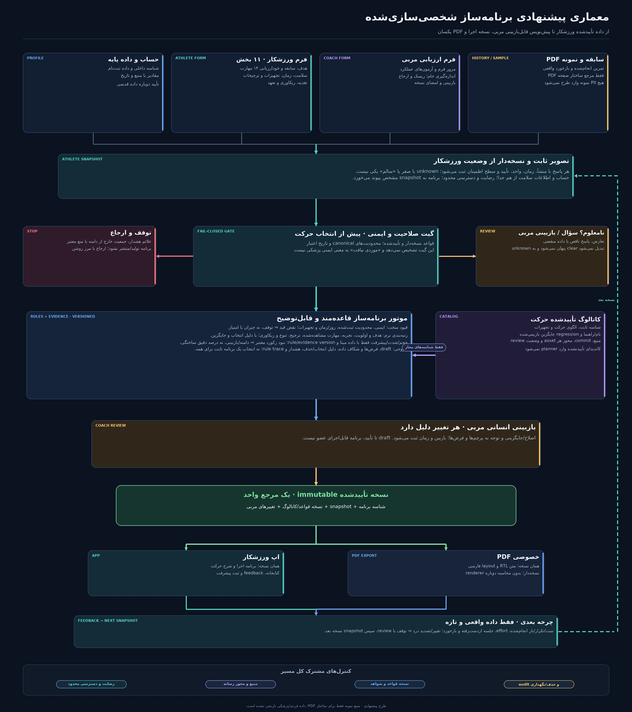
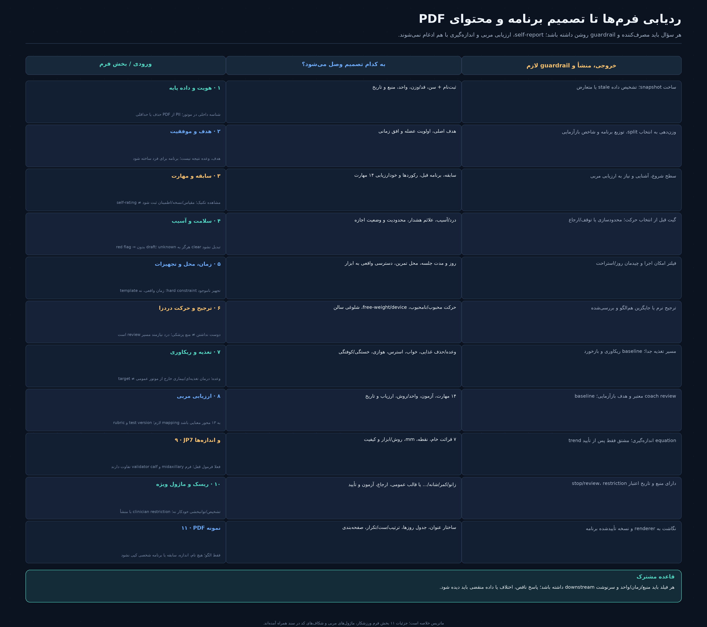
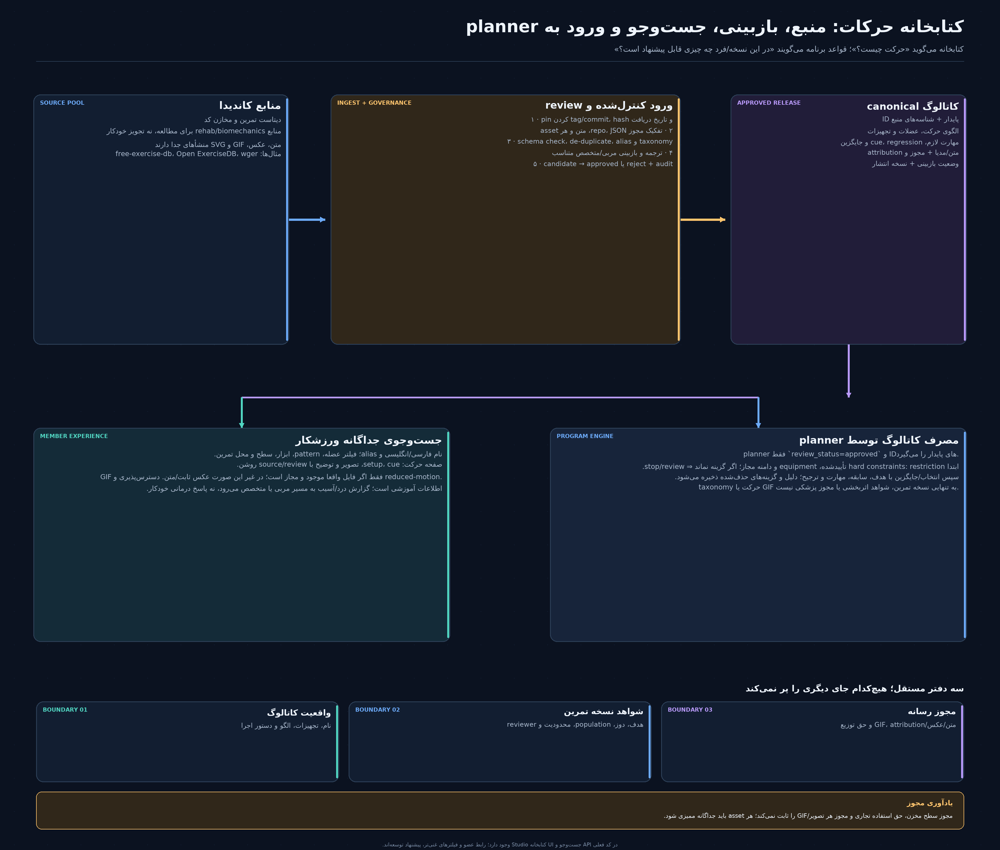

# طرح طراحی بخش برنامه‌ساز تمرین، کتابخانهٔ حرکات و خروجی PDF

**وضعیت:** سند طراحی برای گفت‌وگو و تصمیم‌گیری؛ **هیچ قابلیت برنامه‌ساز، فرم، دیتاست، وابستگی یا محتوایی در این نوبت پیاده‌سازی/وارد نشده است.** فقط این سند و سه تصویر شماتیک برای بازبینی ساخته شده‌اند.

**مبنای کد:** شاخهٔ `arena/5e0f64cf-mp`، snapshot با HEAD برابر `35d4b35184b4148c658b415bd009fc076bf24e00`، تاریخ ۲۰۲۶-۱۱-۲۳. پنج تغییر کاریِ از قبل موجود دست‌نخورده‌اند.

> **حریم خصوصی:** محتوای فردی PDF نمونه در این طرح نقل یا بازتولید نشده است. PDF فقط مرجع شکل کلی یک خروجی برنامهٔ تمرینی بوده؛ اطلاعات هویتی، پزشکی، اندازه‌ها، رکوردها و برنامهٔ فردی به سند/دیاگرام اضافه نشده‌اند.
>
> **حد علمی:** این طرح، مشخصات نرم‌افزار است، نه پروتکل درمان یا توصیهٔ پزشکی. «علمی» بودن مستلزم منابع قابل‌ردیابی، تناسب دامنهٔ کاربرد، بازبینی متخصص، اندازه‌گیری معتبر و آزمون است؛ فراوانی دادهٔ یک کاتالوگ یا آزادبودن مجوز، شواهد اثربخشی نسخهٔ تمرینی نیست.

## ۱. تصمیم طراحی در یک جمله

برنامه‌ساز باید **کامپایلرِ نسخه‌دار از وضعیت مستند ورزشکار به پیش‌نویس قابل‌توضیح و قابل‌بازبینی مربی** باشد، نه انتخاب‌گر ۳ یا ۴ برنامهٔ کامل و ثابت. اگر ۳–۴ الگوی اولیه وجود داشته باشند، فقط اسکلت تقسیم روزها/ساختار هفته‌اند؛ انتخاب حرکت، حجم، ترتیب، شدت، جایگزین، ریکاوری و پیشرفت برای هر ورزشکار از ورودی معتبر، محدودیت واقعی، کتابخانهٔ بازبینی‌شده و قواعد نسخه‌دار مشتق می‌شود.

پیشنهاد اصلی:

```text
دادهٔ ثبت‌نامِ تأییدشده + فرم خوداظهاری + ارزیابی مربی/اندازه‌گیری
    → snapshot نسخه‌دار با منشأ و تاریخ هر داده
    → گیت سلامت/صلاحیت و تعیین «توقف / بازبینی / مسیر عمومی مجاز»
    → انتخاب حرکات از کاتالوگ تأییدشده با قید تجهیزات، ترجیح و الگوی حرکت
    → موتور قاعده‌مندِ شخصی‌سازی + کنترل سازگاری و ریکاوری
    → پیش‌نویس توضیح‌پذیر → بازبینی/تغییر مربی → نسخهٔ تأییدشده
    → همان نسخه در اپ ورزشکار و PDF؛ ثبت جلسه و بازخورد برای چرخهٔ بعد
```

یک کتابخانه می‌تواند پاسخ دهد «این حرکت چیست، چگونه اجرا می‌شود، چه تجهیزاتی می‌خواهد و چه رسانهٔ مجازیِ مجاز دارد؟» اما **نمی‌تواند اطلاعات شخصی/سلامتی ورزشکار را حدس بزند، تشخیص بدهد یا جای مربی/متخصص را بگیرد**. اگر پاسخ یک سؤال از پروفایل موجود معتبر نیست، سیستم باید از ورزشکار بپرسد، آن را «نامعلوم» نگه دارد یا مسیر را برای بازبینی متوقف کند.

## ۲. سه تصویر شماتیک

### ۲.۱ معماری کل جریان تولید برنامه



### ۲.۲ ردیابی فرم‌ها به داده، تصمیم‌ها و بخش‌های خروجی



### ۲.۳ کتابخانهٔ منابع، جست‌وجوی ورزشکار و ورودی موتور



هر سه تصویر **طرح پیشنهادی** هستند؛ تصویر وضعیت فعلی مخزن را می‌توان در [نقشهٔ فعلی](muscle-paradise-current-state-2026-11-23.png) دید. لینک‌های کد و شکاف‌های فعلی در [گزارش تحلیل](analysis-2026-11-23.md) آمده‌اند.

## ۳. خط مبنای فعلی و چیزهایی که نباید اشتباه فرض شوند

این بخش بر کد فعلی و مسیرهای آزمایشی تحلیل قبلی متکی است؛ «موجود بودن ماژول» با کامل بودن جریان عضو یکی نیست.

| موضوع | وضعیت قابل‌ردیابی فعلی | پیامد برای طراحی |
|---|---|---|
| برنامه‌ساز | [`generate_program`](../../../mp-app/backend/engine/workout.py#L223) از جدول قواعد و کتابخانهٔ کوچک فعلی استفاده می‌کند؛ ورودی اصلی goal/level/days/weeks/constraints است. فعلاً ۱۷ حرکت ثابت گزارش شده است. | این موتور نقطهٔ شروع است، نه پوشش علمی یا شخصی‌سازی کافی. ورودی فرم‌های جدید باید به‌صورت صریح به وضعیت ورزشکار و قوانین وصل شود. |
| پرسش‌نامه | [`intake_page.dart`](../../../mp-app/client/lib/features/intake/intake_page.dart#L64) هدف، سطح، روز/هفته، سن، وزن، فعالیت، جنسیت و قیدها را می‌گیرد. اسلایدر سابقه به سطح انتخاب‌شده وصل نیست؛ سن/وزن/سابقهٔ کامل به موتور تمرین نمی‌رود. | اسلایدر یا سؤال نباید فقط نمایشی باشد. هر فیلد باید منبع، تصمیم پایین‌دستی و وضعیت «استفاده شد/نشد» داشته باشد. |
| جمعیت و محدودیت | گیت route در [`population/router.py`](../../../mp-app/backend/modules/population/router.py#L31) `path` را query می‌گیرد، در حالی که Client body می‌فرستد؛ مسیر فعلی ۴۲۲ می‌گیرد. UI شش گزینهٔ فارسی و schema حداکثر پنج قید دارد؛ vocabulary قیدها یکدست نیست. | قرارداد و vocabulary باید پیش از طراحی ruleها حل شوند؛ محدودیت خام فارسی نباید مستقیماً کلید تصمیم ایمنی باشد. سن/جمعیت باید در سرور اعتبارسنجی شود. |
| غربالگری | [`_safety_gate`](../../../mp-app/backend/modules/programs/service.py#L474) محدودیت را از `Member.constraints` و حرکت را از `movement/pattern` می‌خواند؛ خروجی موتور این الگوها را کامل نمی‌فرستد و نتیجهٔ blocked فعلاً الزاماً مانع ساخت draft نمی‌شود. | unknown/blocked باید رفتار صریح داشته باشد؛ هیچ سکوتی به معنی ایمنی نیست. قواعد سلامت نیازمند منبع و بازبینی حرفه‌ای‌اند. |
| چرخهٔ برنامه | سرویس برنامه را `draft` می‌سازد و safety result را روی آن ثبت می‌کند؛ UI فعلی intake همان پاسخ تولید را مستقیماً در `ProgramResult` نشان می‌دهد، پیش از آنکه چرخهٔ تأیید مربی در UI عضو وصل شده باشد؛ ردیف‌های برنامه در UI فعلی به‌صورت «حرکت + شناسه» نمایش داده می‌شوند. | در طرح هدف، draft تا review/approval از دید عضو پنهان بماند؛ تأیید مربی، نام قابل‌خواندن، reason هر تغییر و پیوند immutable نسخه نیاز است. |
| ارزیابی ۱۴/۱۳ | کد [`axes.py`](../../../mp-app/backend/modules/reporting/axes.py#L1) ۱۴ دامنه را به ۱۳ محور نگاشت می‌کند؛ ابزار فعلی عیناً معادل مقیاس خوداظهاری یا rubric جدید فرم نیست. | مقیاس، تعریف هر نمره، ارزیاب و تاریخ را جدا نگه دارید؛ اتصال بر اساس شمارهٔ ردیف کافی نیست. |
| Jackson–Pollock | معادله در [`equations.py`](../../../mp-app/backend/modules/assessment/equations.py#L1) عمداً قفل است تا منبع مستقل و دامنهٔ جمعیتی ثبت شود. اعتبارسنجی خام فعلی `calf` می‌خواهد؛ فرم پیشنهادی کاربر `midaxillary` دارد. | ورودی‌های هفت نقطه و فرمول تا تطبیق محل اندازه‌گیری/پروتکل/جمعیت/مرجع مستقل نباید به‌عنوان خروجی قطعی فعال شوند. |
| کتابخانهٔ حرکت | API موجود [`/library/exercises`](../../../mp-app/backend/modules/exercises/router.py#L43) جست‌وجوی نام فارسی/انگلیسی و گروه عضلانی دارد و توضیح، تصویر و در صورت وجود `gif_url` برمی‌گرداند. کامپوننت فعلی [`ExerciseLibrary.tsx`](../../../mp-app/studio/src/components/ExerciseLibrary.tsx#L26) در Studio است؛ رابط کتابخانه برای عضو Flutter در جست‌وجوی کد یافت نشد. | سرویس داده وجود دارد؛ نیاز جدید، تجربهٔ جداگانه و قابل‌دسترس عضو، فیلترهای غنی‌تر و پیوند آن به شناسهٔ canonical حرکت است. GIF دو فریم شروع/پایان را نباید با تحلیل دقیق دامنهٔ حرکت اشتباه گرفت. |
| خروجی PDF | در جست‌وجوی این نوبت، موتور/endpoint تولید PDF تمرین پیدا نشد. | PDF باید از همان نسخهٔ canonical تأییدشده ساخته شود؛ نه اینکه یک برنامهٔ جداگانه، محاسبات را دوباره انجام دهد. |
| تغذیه | موتور فعلی `daily_kcal`/ماکرو می‌سازد اما `meals: []` می‌فرستد؛ `FoodLog` ثبت مصرف واقعی و `MealItem` جزء وعدهٔ تجویزی است. | «هدف تغذیه» و «برنامهٔ وعده‌ها» دو محصول و دو وضعیت جدا هستند؛ نبود وعده را نباید با خروجی ساختگی پنهان کرد. |

## ۴. قواعد طراحی که از ابتدا باید تثبیت شوند

### ۴.۱ شخصی‌سازی واقعی، نه PDF قالبی

- template فقط می‌تواند فرم ارائه، گزینه‌های split یا اسکلت قابل‌تنظیم باشد. template نباید مجموعهٔ یکسان حرکت/ست/تکرار را برای همه تجویز کند.
- برنامه از پروفایلِ معتبر، هدف اولویت‌دار، دسترس‌پذیری واقعی، تجربه، تجهیزات، ترجیحات، آخرین چرخه و بازخورد ساخته شود؛ نبود داده با default خاموش پر نشود.
- برای هر انتخاب، `rule_id`, `rule_set_version`, `catalog_exercise_id`, دلیل انتخاب، گزینه‌های کنارگذاشته‌شده و منبع/نسخهٔ شواهد قابل ثبت باشد.
- وزن/شدت نسبی از مقدار مبنا و روش معتبر می‌آید؛ اگر 1RM یا آزمون معتبر موجود نیست، نباید درصد دقیق با ظاهر قطعی جعل شود. مسیر RPE/RIR یا دامنهٔ محافظه‌کارانه تنها پس از تعریف و بازبینی قاعده قابل انتخاب است.
- یک الگوریتم قطعی و قابل‌آزمون بهتر از LLM برای اعداد نسخه است. در صورت استفاده از مدل زبانی، کاربرد پیشنهادی فقط گفت‌وگوی جمع‌آوری اطلاعات یا توضیح متنِ ازپیش‌محاسبه‌شده است؛ مدل نباید تشخیص، مجوز پزشکی، محدودیت ممنوعه یا عدد ست/لود را آزادانه اختراع کند.
- ۱۴ حوزهٔ عملکردی را الزاماً به ۱۴ تمرین تبدیل نکنید. «ارزیابی کامل» به معنی «تمرین برابر برای هر حوزه» نیست؛ هدف، اولویت و شواهد هر بخش را تعیین می‌کند.

### ۴.۲ منشأ و کیفیت داده

هر مقدار مهم به‌جای یک ستون بدون زمینه، باید حداقل این metadata را داشته باشد:

| فیلد منشأ | نمونهٔ مقدار/قاعده |
|---|---|
| مقدار و واحد | `height_cm`, `weight_kg`, `skinfold_mm`, pain scale با نسخهٔ مشخص |
| نوع منشأ | خوداظهاری ورزشکار، پروفایل ثبت‌نام، اندازه‌گیری مربی، دستگاه/آزمون، محاسبهٔ سرور |
| ثبت‌کننده/تأییدکننده | user/coach/qualified professional؛ برای اطلاعاتی که لازم است، نه بیشتر |
| زمان | `observed_at`, `recorded_at`, منطقهٔ زمانی و زمان انقضا/نیاز به تأیید مجدد |
| روش و کیفیت | پروتکل اندازه‌گیری، device، خطای اندازه‌گیری، کیفیت داده، نسخهٔ فرم |
| اطمینان و وضعیت | confirmed, self_reported, stale, conflicting, unknown; نبود داده ≠ صفر |
| نسخهٔ مشتق | فرمول، rule-set، catalog commit، PDF renderer و template version |

اگر پروفایل قد/وزن یا محدودیت قدیمی است، پیش از مصرف دوباره از ورزشکار تأیید بگیرید. هر تغییر مهم باید snapshot قبلی را حفظ کند تا معلوم باشد برنامه با کدام داده تولید شده است.

### ۴.۳ هویت، سلامت و حریم خصوصی

- نام/شمارهٔ تماس برای عملیات حساب لازم است؛ موتور برنامه تا حد ممکن با `member_id`/شناسهٔ داخلی کار کند، نه نام یا شمارهٔ تماس.
- آسیب، علائم، دارو، اندازه‌های بدن، درصد چربی و گزارش ارزیابی داده‌های حساس‌اند. دسترسی آن‌ها باید از access عمومی پروفایل جدا، role/scope محدود و auditشده باشد.
- اطلاعات دارو/هورمون/تشخیص را فقط در صورت نیاز واقعی، مبنای مجاز و رضایت روشن بگیرید؛ برای نسخهٔ تمرینی عمومی ترجیحاً از restrictionهای حداقلی و غیرتشخیصی استفاده شود. متن آزاد را بی‌دلیل در prompt، PDF، log یا analytics کپی نکنید.
- فیلد «عکس وضعیت فعلی» با تصمیم قبلی محصول دربارهٔ خارج‌بودن عکس پیشرفت بدن از انتشار اول تداخل دارد. **پیش‌فرض طراحی: ذخیره/آپلود عکس در v1 خاموش**؛ هر نوع عکس باید تصمیم جدا، هدف، رضایت، دسترسی، محل خصوصی، retention و حذف روشن داشته باشد.
- نسخهٔ PDF ورزشکار فقط اطلاعاتی را نشان دهد که برای اجرای برنامه لازم است. صفحهٔ مربی/یادداشت خصوصی/اطلاعات سلامت از PDF عمومی جدا باشد. فایل دانلودی private، signed/authorized و بدون URL عمومی باشد.
- مدت نگهداری، حذف از DB/backups، اصلاح اطلاعات و خروجی داده، رضایت فارسی و مسئول رسیدگی نیازمند تصمیم مالک و بررسی حقوقی است.

## ۵. فرم شمارهٔ ۱ — ورزشکار: ردیابی کامل پرسش‌ها

**نکتهٔ مهم:** اطلاعاتی که از ثبت‌نام یا اندازه‌گیری قبلی می‌آیند فقط به‌صورت prefill پیشنهاد شوند و منبع/تاریخشان دیده شود؛ ورزشکار باید موارد قدیمی یا حساس را تأیید کند. کتابخانهٔ حرکات پاسخ هویت، بیماری، رکورد یا تجربهٔ ورزشکار نیست.

| بخش فرم | اطلاعاتی که باید نگه داشته/تأیید شود | اثر مجاز در تصمیم برنامه | وضعیت داده/کنترل لازم |
|---|---|---|---|
| ۱) فردی | کد داخلی و تاریخ از سیستم؛ سن ترجیحاً مشتق از birth-date و تاریخ مرجع؛ جنس/متغیرهای فیزیولوژیک موردنیاز با معنای صریح؛ قد/وزن با واحد/تاریخ/روش؛ خوداظهاری درصد چربی و اندازه‌های دور به‌عنوان دسته‌ای جدا از اندازه‌گیری مربی | مشخص‌کردن دامنهٔ الگوریتم و خواندن روند اندازه‌گیری؛ نه رتبه‌بندی فرد صرفاً از روی ظاهر/عدد | نام، تلفن و کد به‌عنوان شناسهٔ یکتا در PDF/خروجی عمومی استفاده نشود. مقدار خوداظهاری با مقدار اندازه‌گیری‌شده ادغام نشود. |
| ۲) هدف اصلی | یک هدف اصلی، اولویت‌های عضلانی با ترتیب/وزن، افق زمانی، انتظارات و تعریف موفقیت | وزن‌دهی اهداف در انتخاب split، توزیع حجم و شاخص پیگیری؛ زمان هدف ورودی/انتظار است نه وعدهٔ نتیجه | هدف مسابقه/ورزش تخصصی مسیر متفاوت و نیازمند بازبینی مربی متخصص است؛ توضیح انتظارات غیرواقع‌بینانه با متن غیرقطعی. |
| ۳) سابقهٔ تمرین | سابقهٔ منظم به ماه/سال، برنامهٔ قبلی و مدت، حرکت/وزن/تکرار اخیر، آشنایی تکنیک، سبک‌های قبلی و مربیگری؛ source و confidence هر رکورد | کالیبره‌کردن سطح، آشنایی، انتخاب تمرین، نوآوری/تنوع و نقطهٔ شروع؛ تمرین قبلی را فقط وقتی log قابل‌تأیید است وارد progression کنید | «با تکنیک آشنا هستم» خوداظهاری است، نه گواه مشاهدهٔ تکنیک. رکوردهای آزمایشی/قدیمی باید expiry یا سطح اطمینان داشته باشند. |
| ۴) سلامت و آسیب | بیماری، سابقهٔ جراحی، درد/آسیب فعلی و قبلی، ناحیه/سمت/زمان، دارو و مکمل لازم، آلرژی/رژیم و وضعیت اجازهٔ تمرین از منبع مناسب | فقط گیت صلاحیت، جلوگیری از انتخاب ناسازگار و ارجاع/بازبینی؛ نه تشخیص یا تجویز بازتوانی | برای هر restriction، منشأ (خوداظهاری/مربی/پزشک)، تاریخ، دامنه و انقضا بماند. پاسخ خطر بالا مسیر را متوقف کند. |
| ۵) زندگی و زمان | روزهای واقعاً قابل‌استفاده، طول جلسه، ساعت، نوع/فعالیت شغلی، خواب/کیفیت، استرس و سفر | زمان‌بندی جلسه، سقف زمان، توزیع خستگی و حجم قابل‌پایبندی؛ دورهٔ سفر می‌تواند برنامهٔ جایگزین بسازد | سنجهٔ خواب/استرس خوداظهاری و contextual است؛ آن را تشخیص یا نشانگر قطعی بیماری نکنید. |
| ۶) تجهیزات/محل | محل، دستگاه/وزنهٔ واقعاً در دسترس، محدودیت استفاده و availability زمان‌بندی‌شده | فیلتر hard برای حرکات ناممکن، ترجیح تجهیز و پیشنهاد جایگزین هم‌الگو | equipment در کاتالوگ باید canonical باشد؛ «ندارد/نامعلوم» با «موجود است» یکی نیست. |
| ۷) تغذیه | تعداد وعده، الگوی غذایی، دریافت تخمینی انرژی/پروتئین، حذف غذایی، آب و آمادگی پیروی | جدا از workout engine؛ نمایش target فقط از موتور تغذیهٔ مصوب، یا برنامهٔ وعده فقط با MealItem واقعی و بازبینی لازم | آلرژی و بیماری تغذیه‌ای دادهٔ حساس؛ بدون متخصص، نسخهٔ درمانی یا وعدهٔ قطعی نسازید. «آب» و دریافت تخمینی را اندازه‌گیری دقیق جا نزنید. |
| ۸) ریکاوری/هوازی | خستگی، کوفتگی، وضعیت هوازی فعلی، مقدار تحرک/پیاده‌روی | ضبط baseline، تنظیم load/frequency در محدودهٔ قواعد و ارجاع بازبینی در تشدید علائم | درد حاد، بیماری یا الگوی تشدید با خستگی عادی یکی نیست؛ rule باید این تفاوت را حفظ کند. |
| ۹) ترجیح تمرین | حرکت محبوب/نامحبوب، حرکت دردزا با زمینه، وزنه آزاد/دستگاه، روز دلخواه و شلوغی سالن | preference نرم برای پایبندی/جایگزین؛ درد/ممنوعیت باید به restriction جداگانه برود | «دوست ندارم» مساوی contraindication نیست؛ «درد می‌گیرد» به معنی تشخیص یا مجوز ادامه‌دادن نیست. |
| ۱۰) خودارزیابی ۱۴ مهارت | هر امتیاز همراه نام instrument، تعریف سطح، تاریخ و پاسخ‌دهنده؛ گزینهٔ «نمی‌دانم» واقعی | تعیین نیاز ارزیابی مربی یا پیشنهاد آموزش/پایش؛ نه حدس ظرفیت جسمی | self-rating، coach rating و تست عینی سه ستون/نوع دادهٔ متفاوت‌اند؛ مقیاس و نسخه را ذخیره کنید. |
| ۱۱) تعهد و نکته‌ها | روزهای قابل‌پایبندی، موانع خواب/تغذیه، انگیزه، سابقهٔ وقفه و نکتهٔ آزاد | کاهش پیچیدگی، یادآور/پیشنهاد نسخهٔ کوتاه‌تر و برنامهٔ قابل اجرا | متن آزاد حساس را قبل از استفاده/نمایش پالایش کنید؛ اطلاعات غیرضروری به موتور نرود. رضایت و تاریخ ثبت جدا. |

### راهبرد «سؤال یکی‌یکی»

1. صفحهٔ اول فقط هدف، موجودی پروفایلِ قابل‌تأیید، روز/زمان، تجهیزات و consent مربوط را نشان دهد.
2. سیستم پاسخ موجود را **با تاریخ و منبع** نمایش دهد؛ نه اینکه آن را بی‌صدا درست فرض کند.
3. بر اساس missing/unknown و انتخاب ورزشکار، سؤال بعدی شاخه‌ای شود. مثلاً انتخاب محدودیت، فقط ماژول مرتبط و نیازمند review را باز کند؛ پاسخ منفی به معنی «بدون خطر پزشکی» تعبیر نشود.
4. اگر پاسخ لازم نداریم، سؤال حذف شود؛ اگر لازم است ولی قابل پاسخ نیست، `unknown` + توقف/بازبینی یا مسیر محدودتر صریح باشد.
5. نمایش درصد پیشرفت فرم نباید ورزشکار را وادار به پرکردن اطلاعات حساس غیرلازم کند.

## ۶. فرم شمارهٔ ۲ — مربی: پروتکل و ماژول‌های ارزیابی

| بخش/ماژول | مدل دادهٔ پیشنهادی | خروجی نرم‌افزاری | گیت علمی/ایمنی |
|---|---|---|---|
| ۱) مرور ورزشکار | coach review روی snapshot پاسخ ورزشکار، corrected value و reason | تأیید/اصلاح، منشأ، actor، زمان | تغییر دادهٔ خوداظهاری نباید تاریخچه را overwrite کند؛ تغییر حساس audit شود. |
| ۲) JP7 | هر نقطهٔ خام mm + site key + protocol/instrument + assessor + date + quality; derived value جدا و equation versioned | جمع هفت نقطه و مشتقات، فقط اگر equation approved | **پیش از فعال‌سازی تطبیق لازم:** فرم ارسالی `midaxillary` دارد، در validator فعلی `calf` درخواست می‌شود؛ equation در کد قفل است تا منبع مستقل/جمعیت تأیید شود. دادهٔ خام، خروجی مشتق و نتیجهٔ نامعلوم را جدا کنید. |
| ۳) دورها/وضعیت/عکس | measurement per site, unit, protocol, assessor, date; posture note با scope مشخص | روند اندازه‌گیری با توضیح روش | عکس در انتشار اول خاموش تا تصمیم حریم خصوصی جداگانه؛ هیچ تشخیص posture خودکار صرف عکس. |
| ۴) ۱۴ مهارت | skill id, operational definition, self vs coach score, test/method, scale, observed date, assessor, confidence | پیشنهاد ارزیابی/آموزش/تمرین، با reason | فرم ورزشکار و مربی ممکن است از نظر rubric فرق کنند. نگاشت به ۱۳ محور فعلی پروژه نیازمند جدول semantically reviewed، نه اتصال سطر ۱ به ۱. |
| ۵) سلامت/Red Flags | `HealthReview` + check result + action + reviewer + referral state; نگهداری حداقل اطلاعات | توقف، پیام ایمنی، ارجاع به فرد واجد صلاحیت و ثبت پیگیری | وجود red flag = هیچ draft تمرینی از مسیر خودکار ساخته/منتشر نشود. نرم‌افزار بیماری را تشخیص ندهد و جای تصمیم متخصص نباشد. |
| ۶) ماژول‌های آسیب و ۵-۹ عمومی | `RiskCase[]`: body region, side, onset, source, diagnosis source, symptoms, function, clinician restriction, rehab phase if provided, status, expiry, review | انتخاب یک ماژول مرتبط یا فرم عمومی برای ناحیهٔ دیگر؛ هر مورد مستقل | فهرست ACL/زانو، کمر/ستون فقرات، شانه، مچ پا، هیپ/کشاله، همسترینگ، مچ/آرنج، گردن، آشیل/ساق و پا را به تگ حرکت/قواعد درمان تبدیل نکنید. فقط ممنوعیت‌های تأییدشده مصرف شوند. |
| ۷) جمع‌بندی ریسک | نتیجهٔ rule version + unknown items + blocked patterns + required review | stop / coach review / restricted general program | `clear` فقط می‌تواند بگوید «قاعدهٔ ثبت‌شده ناسازگاری پیدا نکرد»؛ هرگز ادعای «از نظر پزشکی ایمن» نیست. |
| ۸) آزمون عملکرد | result, units, protocol, conditions, assessor, validity window | baseline و هدف قابل‌اندازه‌گیری | آزمون‌ها باید پروتکل پایا و جمعیت قابل‌استفاده داشته باشند؛ تا آن زمان نتیجه descriptive باقی بماند. |
| ۹) اولویت/هدف‌گذاری مربی | ranked goals, target metrics, reassessment date, rationale | weighting و plan review | شاخص هدف، منبع، زمان بازآزمایی و شخص مسئول داشته باشد. |
| ۱۰) طراحی/آموزش/امضا | plan draft, coach edits, evidence links, stop signs, approval signature+time | نسخهٔ تأییدشده و PDF | هر override مربی reason داشته باشد؛ PDF با نسخهٔ ذخیره‌شده تولید شود، نه با محاسبهٔ مجدد. |

### قاعدهٔ ایمنی غیرقابل مذاکره در طرح

- Red Flag یا جمعیت خارج از پشتیبانی = stop. نرم‌افزار نه برنامهٔ عمومی را به‌عنوان fallback می‌دهد و نه با هشدار کوچک، خطر را می‌پوشاند.
- تشخیص، تصمیم بازگشت به ورزش، فازبندی ACL/دیسک/پس از جراحی یا تجویز بازتوانی فقط با credential/authority مشخص و پروتکل مستقلِ تأییدشده؛ خارج از موتور عمومی v1.
- پاسخ unknown، قید ناشناخته، پروتکل منقضی، دادهٔ ناسازگار یا حرکت بدون pattern = `needs_review`/stop، نه `clear`.
- همهٔ قیدها باید به vocabulary استاندارد و نسخه‌دار map شوند. alias فارسی/انگلیسی و معادل‌های catalog از canonical ID جدا هستند.
- تولید draft، اجازهٔ نمایش به ورزشکار نیست. lifecycle پیشنهادی: `draft → coach_review → approved → published → superseded/archived`; رد/تغییر دلیل دارد.

## ۷. مدل دادهٔ پیشنهادی برای گفت‌وگو (نه schema نهایی)

| شیء مفهومی | نقش و حداقل داده | پیوند اصلی |
|---|---|---|
| `AthleteIdentity` | شناسه، حساب و ارتباط؛ جدا از snapshot سلامت | به `Member` فعلی، با scope شعبه/مالکیت |
| `AthleteSnapshot` | نسخهٔ پاسخ فرم، consent version، زمان، missing/unknown و provenance هر فیلد | هر plan به دقیقاً یک snapshot |
| `GoalProfile` | هدف اصلی، اولویت عضلات، horizon، معیار موفقیت و وزن preference | قابل نسخه‌بندی و اصلاح، بدون تغییر تاریخچهٔ برنامه |
| `TrainingHistorySnapshot` | سابقهٔ خوداظهاری، برنامهٔ قبلی، log ست/تکرار/لود و مهارت مشاهده‌شده | منبع هر رکورد مشخص: self-report, import, coach, device |
| `Measurement` | قد/وزن/دورها/skinfold خام، واحد، پروتکل، quality، assessor، date | derived metric در شیء جدا، با equation id/version و population scope |
| `HealthReview` و `RiskCase[]` | red flag, report type, region/side, restriction, source, expiry/reviewer, action/referral state | دسترسی role-limited؛ آدرس مستقیم عمومی ندارد |
| `CoachAssessment` | rubric version، ۱۴ skill/result، test/value/unit، assessor/time/confidence | جدا از `SelfAssessment`، نگاشت به محورهای فعلی صریح |
| `AvailabilityEquipment` | زمان‌های مجاز، session duration، gym/equipment availability | به exercise requirements فیلتر می‌دهد |
| `TrainingPreference` | likes/dislikes، free weights/machine، شلوغی، preferred days | امتیاز نرم؛ با contraindication قاطی نشود |
| `NutritionContext` | allergy/diet restriction, target source, current log | از تمرین مجزا؛ target-only با meal-plan یکی نیست |
| `ExerciseCatalogSource` | URL، commit/tag، license text/hash، retrieval date، dataset digest، asset-license scope | از قبل در مدل `CatalogSource` بخشی از پایه موجود است |
| `ExerciseCatalogEntry` | canonical id، external ids/aliases، نام/fa/en، pattern، muscle roles، equipment, skill, cues, contraindications-reviewed, regressions/progressions، media rights/status | با `Exercise` و `CatalogExercise` فعلی قابل تطبیق است؛ نیازمند taxonomy واحد |
| `EvidenceRecord` و `RuleSetVersion` | claim/scope, source, version/page, population, confidence/limitations, reviewer, date, expiry, license | هر rule به این recordها پیوند دارد |
| `ProgramDraft` | snapshot id، rule/cat versions، assumptions، scores، chosen/omitted exercise reasons، alternatives | ساختار Block → Week → Session → Prescription |
| `CoachReview` | reviewer, approved/rejected/modified, reason, timestamp, comments scope | append-only audit; تغییر به نسخهٔ جدید |
| `ApprovedProgramVersion` | برنامهٔ immutable قابل اجرا و export؛ status و issue date | همان منبع برای اپ، PDF و history |
| `WorkoutSession/SetLog` | planned vs actual, reps, effort, discomfort, missed reason, date | feedback به نسخهٔ مشخص برنامه وصل است |
| `NutritionPlanVersion` / `MealItem` | target/meal status, approved-by, sources | از `FoodLog` مصرف واقعی جداست |
| `GeneratedDocument` | program version, renderer/font/template version, checksum, owner, created_at, retention | فایل PDF خصوصی؛ حذف/دسترسی ممیزی می‌شود |

### تفاوت کلیدی با مدل فعلی

مدل فعلی بخشی از `WorkoutProgram/ProgramWeek/ProgramExercise`, `Member`, `Exercise`, `CatalogSource/CatalogExercise`, `ProgressionLadder/Step`, `NutritionPlan/MealItem`, `FoodLog`, `JacksonPollockMeasurement`, `AxisAssessment` را دارد. پیشنهاد این نیست که همه‌چیز دوباره نوشته شود؛ ابتدا mapping و gaps مشخص شوند. مهم‌ترین افزوده‌های مفهومی: snapshot/provenance، assessment source/scale، canonical constraints/movement pattern، rule/evidence version، coach-review history و PDF linked to immutable approved plan.

## ۸. معماری موتور شخصی‌سازی

### ۸.۱ ورودی‌ها و خروجی صریح

**ورودی موتور تمرین پیشنهادی:**

- `AthleteSnapshot` تأییدشده با تاریخ/منبع؛ هدف اصلی و weights اولویت‌ها.
- تعداد روز و زمان واقعی جلسه؛ تقویم دسترسی و سفر.
- سطح تجربه با شاخص‌های معلوم و confidence؛ نه فقط یک label.
- آخرین برنامهٔ قابل‌مقایسه و actual session/set logs؛ اگر نیست، علامت نبود داده.
- equipment availability per facility؛ کاتالوگ مجاز فقط از `review_status=approved`.
- محدودیت‌های canonical، red-flag state، medical/professional clearance scope و زمان اعتبار.
- ترجیحات حرکتی، disliked vs pain-related, coach constraints.
- rule-set و evidence source version.

**خروجی موتور:** `ProgramDraft` با جلسات، حرکات نام‌دار و stable id، دوز/هدف تمرین، RPE/RIR یا دامنهٔ load، استراحت، cue، جایگزین مجاز، دلیل selection، دلیل omission، assumptions, warnings, rule trace و data gap. هر فیلد باید «اندازه‌گیری‌شده/خوداظهاری/محاسبه‌شده/پیشنهادی» را از هم جدا نگه دارد.

### ۸.۲ قیود سخت و ترجیحات نرم

| نوع | مثال | رفتار لازم |
|---|---|---|
| Hard — ایمنی/صلاحیت | red flag، جمعیت gated، movement ممنوع با restriction تاییدشده، clinician restriction، حداکثر زمان/روز در حد فرم | candidate حذف؛ اگر گزینهٔ معتبر باقی نماند، stop و بازبینی. موتور حق ندارد قید را با score منفی «جبران» کند. |
| Hard — امکان اجرا | تجهیزات موجود نیست، روز/زمان دسترس‌ناپذیر، حرکت خارج از کاتالوگ approved، داده/پروتکل منقضی لازم | انتخاب ناممکن ممنوع؛ سؤال تکمیلی یا توقف. |
| Soft — هدف | goal، اولویت عضله، زمان‌بندی، آمادگی/تجربه | candidateها رتبه‌بندی شوند؛ trade-off در توضیح و نسخهٔ مربی قابل‌دیدن باشد. |
| Soft — پایبندی | پسند/نپسندیدن، انتخاب دستگاه/آزاد، سالن شلوغ، سفر | امتیاز ترجیح یا جایگزین، نه rule پزشکی. |
| Adaptive — دادهٔ واقعی | انجام ست، RIR/RPE، missed sessions، درد/کوفتگی، ریکاوری | فقط در محدودهٔ rule-set و آستانهٔ بازبینی؛ تشدید درد یا دادهٔ ناسازگار ⇒ stop/review، نه افزایش خودکار load. |

### ۸.۳ الگوریتم پیشنهادی، نه نسخهٔ نهایی

1. اعتبار snapshot، units، timestamps، source، consent و completeness را بررسی کند.
2. `unknown`ها را از صفر و مقادیر پیش‌فرض جدا کند؛ اگر فیلد ضروری missing است، پرسش پویا یا review بسازد.
3. gate جمعیت و red flags را اجرا کند؛ نتیجه باید قبل از تولید candidate باشد.
4. اطلاعات خوداظهاری، coach-assessed و measured را به featureهای جدا تبدیل کند؛ چیزی را بی‌صدا merge نکند.
5. از catalog فقط حرکت‌هایی را بردارد که منبع/licensing/status آن‌ها approved است و requirements آن‌ها با تجهیزات، مهارت و محدودیت‌های ثبت‌شده سازگار است.
6. candidateهای هفتگی/بلوک را از ترکیب روزهای قابل اجرا، اولویت، حرکات اصلی/کمکی، توزیع محرک و ریکاوری بسازد. الگوریتم نباید صرفاً نام هدف را به split ثابت تبدیل کند.
7. scoring صرفاً بین candidateهای hard-valid انتخاب کند: هدف، اولویت، آشنایی، علاقه، تنوع، تجهیزات و زمان؛ reasoning و score contributions ذخیره شوند.
8. برنامه را با قواعد consistency بررسی کند: حد ست/جلسه، زمان، تکرار بی‌دلیل، pattern coverage، progression، rest days، movement duplicates، asset/name completeness و safety-state.
9. اگر هیچ candidate قابل دفاع نماند، خروجی «توقف/نیاز به review» باشد؛ سیستم نباید برنامهٔ پیش‌فرض مشابه همه بدهد.
10. draft و گزینه‌های جایگزین را برای مربی نمایش دهد؛ مربی override را با دلیل ثبت کند.
11. `ApprovedProgramVersion` را منتشر کند. PDF، اپ و صفحهٔ «برنامهٔ من» همگی همان `program_version_id` را بخوانند.
12. پایان چرخه، actual training log و دادهٔ تازه را به snapshot بعد وصل کند؛ نسخهٔ قبلی را تغییر ندهد.

**قاعدهٔ progression:** تغییر load/volume ثابت مثل «هر سه هفته +۵٪ برای همه» فقط اگر در دامنهٔ مشخص، برای نوع برنامه/ورزشکار و evidence مناسب تأیید شده باشد می‌تواند یک rule candidate باشد. تنظیم واقعی باید به سابقهٔ load، effort، موفقیت ست، recovery، برنامهٔ زمانی و محدودیت وابسته باشد؛ rule version و شروط فعال‌شدن شفاف‌اند.

## ۹. لایهٔ شواهد/کتابخانه و منشأ

### ۹.۱ چهار مفهوم را یکی نکنید

1. **Catalog fact:** نام، تجهیزات، عضلات/الگو، cue و رسانهٔ حرکت.
2. **Exercise prescription rule:** چه وقت/برای چه هدف/دوز/سطح یک حرکت یا متغیر تمرینی مطرح می‌شود.
3. **Safety/clinical restriction:** کدام اطلاعات/پروتکل تخصصی می‌تواند تولید را متوقف یا محدود کند.
4. **Media license:** حق مستقل متن، تصویر، GIF، SVG، ترجمه و برند.

وجود ۸۰۰ یا ۱۲۰۰ حرکت به‌تنهایی برنامه‌ساز علمی نمی‌سازد؛ دیتاست حرکت معمولاً randomized dose، progression، adherence، فردیت یا ایمنی پزشکی را اثبات نمی‌کند.

### ۹.۲ کاتالوگ پایهٔ موردنیاز

برای هر حرکت canonical:

- نام فارسی تأییدشده + نام اصلی + spelling/alias و search tokens.
- stable ID خود پروژه و source external IDs؛ de-duplication و redirect تاریخچه‌دار.
- الگوی حرکتی canonical، muscle group(s) با نقش primary/secondary، تجهیزات و نیاز فضا.
- سطح مهارت/پیش‌نیاز، setup، مراحل اجرا، cueهای کوتاه، خطاهای شایع، دامنهٔ قابل‌مشاهده در رسانه.
- regression/progression و substitute با دلیل «هم‌الگو/هم‌هدف»؛ صرفاً حرکت هم‌نام جایگزین نیست.
- contraindication/restriction relation فقط با منبع بازبینی‌شده، rule id، reviewer و scope؛ برچسب مدل خام منبع مستقیم منع پزشکی نیست.
- `image`, `gif/video`, `source`, `asset_license`, attribution, hash, update date, review state. GIF خالی = UI به تصویر ثابت/توضیح برگردد؛ تصویر شکسته نباید نشان داده شود.
- localization status/fa reviewer، confidence و source mapping.
- وضعیت import: `candidate → metadata_review → media_license_review → coach_review → approved → deprecated`.

### ۹.۳ کتابخانهٔ جست‌وجوی مستقل برای ورزشکار

**قابل‌استفاده از اپ عضو، جدا از فرم تولید برنامه:**

- جست‌وجوی فارسی/انگلیسی، alias و غلط‌های نوشتاری؛ فیلتر گروه عضلانی، تجهیزات، pattern، سطح و محل تمرین؛ sort قابل توضیح.
- کارت خلاصه: نام، تصویر/GIF با حق نشر روشن، تجهیزات و عضلات/الگو.
- صفحهٔ حرکت: setup، cueها، ترتیب اجرا، احتیاط‌های عمومیِ منبع‌دار، regressions/progressions و جایگزین‌های بررسی‌شده.
- GIF تنها وقتی واقعاً موجود و مجاز است؛ controls برای شروع/توقف، عدم autoplay پیش‌فرض در اپ عضو، alt-text، احترام به reduced-motion، fallback عکس ثابت.
- متن‌ها آموزشی‌اند و جای تشخیص، درمان یا تجویز بازتوانی را نمی‌گیرند. سؤال آسیب/درد از مسیر محتوا به فرم سلامت یا مربی/متخصص هدایت می‌شود، نه chatbot که درمان بسازد.
- کلیک «این حرکت را دوست دارم/نمی‌خواهم» اگر اضافه شود، فقط preference است؛ وضعیت خودکار سلامت را تغییر ندهد.

**وضع فعلی:** endpoint جست‌وجو `/library/exercises` و UI `ExerciseLibrary` در Studio وجود دارند؛ endpoint فعلی q را در name-fa/name-en می‌جوید و muscle_group می‌گیرد و image/GIF را برمی‌گرداند. رابط عضو Flutter و فیلتر pattern/equipment/skill/alias در جست‌وجوی این نوبت پیدا نشد. GIFهای فعلی به دو فریم شروع/پایان متکی‌اند؛ بدون ارزیابی هر asset نباید آن را capture کامل ROM یا آموزش تکنیکِ بازبینی‌شده نامید.

### ۹.۴ فرآیند منبع و مجوز — پیشنهاد

1. منبع، owner، exact commit/release، license text/SPDX، تاریخ دریافت، source hash و تعداد رکورد ثبت شود؛ import با URL شناور `main` تنها کافی نیست.
2. مجوز **کد، JSON، متن دستور، عکس/GIF/SVG، ترجمه و نام تجاری** جداگانه بررسی شود. repo-level license پاسخ حقوق هر asset را تضمین نمی‌کند.
3. واردات candidate در staging؛ گزارش duplicate/empty/invalid IDs، missing Persian text، equipment/pattern conflict، broken link و rejected items.
4. human review برای ترجمه، دسته‌بندی، cues، media attribution و تناقض‌های safety؛ دادهٔ خام به‌عنوان قاعدهٔ بالینی استفاده نشود.
5. catalog release versioned و قابل rollback؛ برنامهٔ قدیمی به کاتالوگ/قواعدی که با آن تولید شده لینک داشته باشد.
6. بازبینی حقوقی برای استفادهٔ تجاری و redistributing در PDF/offline build؛ attribution در محصول و `NOTICE` در صورت الزام.
7. برای دادهٔ آسیب/بازتوانی، review متخصص واجد صلاحیت جدا از review نرم‌افزار/مجوز لازم است.

## ۱۰. منابع تمرین/علم و ابزارهای نشر

**محدودیت ثبت فهرست:** خلاصهٔ درخواست جاری می‌گوید کاربر ۳۲ منبع/ابزار ارائه کرده، اما snapshot گفت‌وگوی در دسترس برای این مرحله نام تک‌تک آن ۳۲ مورد را نگه نداشته است. بنابراین جدول زیر رونویسی دقیقِ آن ۳۲ مورد نیست؛ پیش از تصمیم به استفاده، آن را با فهرست اصلی کاربر تطبیق دهید. در این draft، metadata سطح repository برای ۳۳ مخزن GitHub فهرست‌شده از API رسمی GitHub در ۲۰۲۶-۱۱-۲۳ خوانده شد (SPDX/license، branch پیش‌فرض، آرشیوشدن و زمان آخرین به‌روزرسانی) و metadata بستهٔ Python `typst` از PyPI خوانده شد. هیچ upstream commit pin، دیتاست/کیفیت، مجوز تک‌تک فایل‌های رسانه‌ای، حق ترجمه/توزیع PDF یا مجازبودن استفادهٔ تجاری بررسی کامل نشده است. فرادادهٔ نبودن لایسنس یا `NOASSERTION` یعنی وضعیت استفاده نامشخص است، نه مجوز آزاد.

### ۱۰.۱ حرکت، کاتالوگ و پلتفرم تمرین

| منبع | کاربرد پیشنهادی برای مطالعه | مجوز/وضعیت فعلی در این طرح |
|---|---|---|
| [free-exercise-db](https://github.com/yuhonas/free-exercise-db) | candidate metadata/تصویر حرکت؛ پروژه فعلی هم از آن import/media دارد. | GitHub API: repo-level `Unlicense`؛ هر media، commit دقیق و attribution هنوز جداگانه audit شود. |
| [wrkout/exercises.json](https://github.com/wrkout/exercises.json) | مقایسهٔ metadata/شناسه‌ها و تکمیل aliasها. | GitHub API: repo-level `Unlicense`; رکوردها/media مستقل بررسی شوند. |
| [Open ExerciseDB](https://github.com/Glowupp-app/open-exercisedb) | candidate JSON برای تجهیزات، عضله و intensity tags. | GitHub API: repo-level `MIT`; schema/محتوا و assetها هنوز بازبینی نشده‌اند. |
| [Longhaul Fitness Exercises](https://github.com/longhaul-fitness/exercises) | candidate تفکیک strength/cardio/flexibility. | GitHub API: repo-level `MIT`; دقت برچسب‌ها و media unverified. |
| [Workout.cool](https://github.com/Snouzy/workout-cool) | مطالعهٔ معماری محصول/ساخت برنامه و exercise catalog. | GitHub API: repo-level `MIT`; مجوز repo به تنهایی حقوق تمام محتوای درون آن را ثابت نمی‌کند؛ کپی‌کردن برنامه/کد هدف این طرح نیست. |
| [Anatome](https://github.com/Rippy1911/anatome) | نقشهٔ عضلات/heatmap؛ قابلیت اختیاری آینده. | GitHub API در ۲۰۲۶-۱۱-۲۳: لایسنس repo-level `Apache-2.0`؛ حق SVGها و هر asset مسیر جدا دارد و بررسی نشده است. |
| [react-body-highlighter](https://github.com/giavinh79/react-body-highlighter) | component نمایشی اختیاری برای Studio/محتوای anatomy. | GitHub API: لایسنس repo-level `MIT`؛ مجوز/provenance هر SVG و اجزای fork هنوز جدا بررسی شود. |
| [wger](https://github.com/wger-project/wger) و [Flutter client](https://github.com/wger-project/flutter) | مطالعهٔ API/تجربهٔ محصول؛ نه اینکه لزوماً کد را وارد کنیم. | GitHub API برای مخزن اصلی و Flutter client: هر دو `AGPL-3.0` در سطح repo؛ ادعای Creative Commons داده و مجوز هر media/record جدا بررسی شود؛ ادغام سرور تجاری review حقوقی می‌خواهد. |

### ۱۰.۲ ابزارها و داده‌های حرکت/بازتوانی

| منبع | ارزش تحقیقاتی | شرط استفاده |
|---|---|---|
| [OpenSim Core](https://github.com/opensim-org/opensim-core) | مدل‌سازی اسکلتی/عضلانی و بیومکانیک، نه نسخهٔ آمادهٔ بدنسازی. | GitHub API: repo-level `Apache-2.0`; نیاز به specialist، model validation و محدودهٔ پژوهشی. |
| [OpenCap Core](https://github.com/opencap-org/opencap-core) | motion-capture/تحلیل حرکت؛ احتمالاً فاز پژوهشی آینده. | GitHub API: repo-level `Apache-2.0`; ویدئوی حرکت سلامت‌حساس است؛ رضایت/پردازش و خطای pose باید جدا طراحی شود. |
| [Pose2Sim](https://github.com/perfanalytics/pose2sim) | pipeline pose-to-biomechanics. | GitHub API: repo-level `BSD-3-Clause`; خروجی ابزار، تشخیص/مجوز حرکت محسوب نمی‌شود. |
| [Kimorel](https://github.com/alcazardaas/kimorel) | انیمیشن سه‌بعدی حرکت؛ محتوای بازتوانی. | GitHub API: repo-level `MIT`; ادعای CC0 برای sample data و هر مدل/انیمیشن جداگانه راستی‌آزمایی نشده است. |
| [UI-PRMD](https://doi.org/10.3390/data3010002) | دیتاست پژوهشی خطای حرکت. | ادعای PDDL در یادداشت منبع؛ در این نوبت از منبع اولیه راستی‌آزمایی نشد. پیش از آموزش/انتشار، حقوق، consent، scope و population bias بررسی شود. |
| [IntelliRehabDS](https://github.com/alina-miron/intellirehabds) | دیتاست/کد posture و حرکات rehab. | GitHub API برای repo: `NO_REPO_LICENSE`; ادعای CC BY 4.0 برای dataset/فایل‌ها در این نوبت تأیید نشد. فعلاً import نشود. |
| [Rehab posture correction](https://github.com/alessandrogheller/Rehab_posture_correction_Gheller-Lorenzon) | نمونهٔ بینایی ماشین. | GitHub API: repo-level `Apache-2.0`; لایسنس weights/dataset، منشأ داده و شرایط privacy هنوز جدا audit نشده‌اند. |
| [Easeur Exercise Knowledge Base](https://github.com/founder-easeur/exercise-dataset) | کاندیدای taxonomy کششی/موبیلیتی. | GitHub API: `NO_REPO_LICENSE`; import تا تعیین مجوز dataset و assetها متوقف بماند. |
| [Awesome Biomechanics](https://github.com/modenaxe/awesome-biomechanics)، [Rehab Agent Stack](https://github.com/HarmannBitte/rehab-agent) | فهرست لینک برای تحقیق منابع؛ نه خودِ dataset یا evidence registry. | GitHub API: Awesome Biomechanics `NO_REPO_LICENSE` و Rehab Agent `NOASSERTION`; مجوز هر downstream منبع جداست و فعلاً محتوای این مخازن import نشود. |
| [PhysiotherapyExercises.com](https://www.physiotherapyexercises.com/) | ایده برای طبقه‌بندی تمرین فیزیوتراپی/توضیح عمومی. | شرایط/مالکیت/مجوز صفحه و رسانه در این نوبت بررسی نشده؛ scrape/reuse نکنید تا حق تجاری و بازنشر روشن شود. |
| [Physiopedia](https://www.physio-pedia.com/) | سرنخ برای منابع و اصطلاحات rehab. | صفحات بیرونی در این نوبت بررسی نشدند؛ مجوز فصل/صفحه/تصویر را جدا بخوانید و متن را bulk-copy نکنید. |

### ۱۰.۳ فیزیولوژی/بار تمرین/متن علمی و نشر

| منبع | جایگاه پیشنهادی | احتیاط |
|---|---|---|
| [training-load](https://github.com/m27w/training-load) | candidate برای Session-RPE/TRIMP/EWMA و توصیف بار. | GitHub API: repo-level `MIT`; شاخص ACWR یا هر نسبت بار به‌تنهایی ابزار تشخیص/پیشگیری اثبات‌شده نیست؛ scope و نقد علمی جدا. |
| [GoldenCheetah](https://github.com/GoldenCheetah/GoldenCheetah), [sweatpy](https://github.com/GoldenCheetah/sweatpy), [OpenData](https://github.com/GoldenCheetah/OpenData) | تحلیل فیزیولوژی/توان و مطالعهٔ فایل‌های ورزشی؛ بخشی بیشتر استقامتی است. | GitHub API: GoldenCheetah `GPL-3.0` و sweatpy `MIT`; OpenData `NO_REPO_LICENSE`. مجوز dataset/اجزا جدا بررسی شود؛ برای برنامهٔ وزنه‌ای عمومی نیازمندی روشن شود. |
| [whippr](https://github.com/fmmattioni/whippr) و [lactater](https://github.com/fmmattioni/lactater) | تحلیل تخصصی CPET/لاکتات، نه سؤالات سادهٔ فرم. | GitHub API: هر دو repo دارای `NOASSERTION`; license/حدود کاربرد باید پیش از reuse روشن شوند؛ برای v1 لازم نیستند. |
| [PhysUSP](https://github.com/physusp/physusp) | پژوهش سهم دستگاه انرژی. | GitHub API: repo-level `GPL-3.0`; برای کالری‌سوزی شخصی بدون دادهٔ فیزیولوژیک معتبر نیست. |
| [OpenAthlete](https://github.com/openathleteorg/openathlete) | مطالعهٔ training-load و کد موجود. | GitHub API: repo-level `AGPL-3.0`; دامنه عمدتاً مدیریت performance است، نه جایگزین موتور اختصاصی. |
| [makerundev](https://github.com/tanhtruong/makerundev) | parser داده‌های ورزشی؛ احتمالاً خارج از v1. | GitHub API: repo-level `Apache-2.0`; این مجوز، دقت parser یا حقوق/کیفیت دادهٔ parseشده را تأیید نمی‌کند. |
| [Compendium of Physical Activities](https://pacompendium.com/)، [GitHub mirror](https://github.com/andyreagan/compendium-of-physical-activity)، [TrainCalc MET dataset](https://github.com/traincalc/traincalc-met-dataset) | MET فقط برای تخمین توصیفی فعالیت، با عدم قطعیت. | GitHub API: mirror `NO_REPO_LICENSE` و TrainCalc dataset repo `MIT`; مجوز Compendium اصلی/فایل‌ها جدا لازم است؛ تخمین کالری/چربی را تعیین نمی‌کند. |
| [OpenPowerlifting](https://github.com/sstangl/openpowerlifting) | دادهٔ نتیجهٔ رقابت برای تحلیل نتایج powerlifting. | GitHub API: repo-level `AGPL-3.0`; ادعای CC0 برای CSV را اینجا تأیید نکرده‌ایم. جمعیت رقابتی با تازه‌کار/بدنساز عمومی فرق دارد؛ نسخهٔ تمرین نسازید. |
| [Open Textbook of Exercise Physiology](https://pressbooks.pub/drbmac/) | آموزش داخلی و glossary علمی. | ادعای CC BY-NC 4.0 در یادداشت منبع؛ فصل/ویرایش/شرایط تجاری این نوبت بررسی نشد. برای reuse نیازمند راستی‌آزمایی است. |
| [Medicine LibreTexts](https://med.libretexts.org/Bookshelves/Sports_and_Exercise) | مرجع آموزشی/جست‌وجوی منبع. | مجوز کتاب/فصل متفاوت و این دامنه در نوبت حاضر بررسی نشد؛ citation را ذخیره کنید و متن را bulk import نکنید. |
| [IntechOpen](https://www.intechopen.com/subjects/1119)، [SportsScience Hub](https://github.com/seif4d/SportsScience) | شروع مرور منابع/فصل‌ها. | GitHub API: SportsScience `NO_REPO_LICENSE`; IntechOpen فصل‌به‌فصل بررسی شود؛ open access خودبه‌خود مجوز reuse/تجاری واحد نیست. |
| [Typst](https://github.com/typst/typst) و [Python binding](https://pypi.org/project/typst/) | کاندیدای renderer PDF فارسی با کنترل page layout؛ قبل از انتخاب نمونهٔ RTL واقعی بسازید و تست کنید. | GitHub API: Typst `Apache-2.0`; مخزن Python binding (`messense/typst-py`) `Apache-2.0`. PyPI typst نسخهٔ `0.15.2` را در ۲۰۲۶-۱۱-۲۳ نشان می‌داد اما metadata آن license field نداشت؛ pin/audit/RTL test هنوز انجام نشده. |
| [Vazirmatn](https://github.com/rastikerdar/vazirmatn) | candidate فونت فارسی/RTL. | GitHub API: repo-level `OFL-1.1`; نسخه و embedding فونت را pin و شرایط OFL را برای PDF رعایت کنید. |

## ۱۱. قرارداد خروجی برنامه و PDF

**مرجع واحد:** یک `ApprovedProgramVersion` ساخته و تأیید می‌شود؛ PDF و اپ آن را render می‌کنند. Export نباید generator را دوباره اجرا کند یا با دریافت فونت/کاتالوگ تازه اعداد برنامهٔ گذشته را تغییر دهد.

**مرور ساختاری PDF نمونه (بدون ثبت/بازنشر محتوا):** فایل ۷ صفحهٔ A4 عمودی، متن‌محور و دارای ردیف‌های جدولی متعدد است؛ در PDF تصویر تعبیه‌شده‌ای دیده نشد. فقط تعداد صفحه‌ها، ابعاد، وجود متن/سطرهای جدول‌مانند بررسی شد؛ فراداده و متن فردی در سند یا دیاگرام ذخیره نشده‌اند. پس فعلاً از آن برای الگوی صفحه‌بندی/جدول استفاده می‌کنیم، نه به‌عنوان مرجع علمی، منبع دیتاست یا نمونه‌ای برای کپی دادهٔ فردی.

| بخش PDF پیشنهادی | محتوای کمینه |
|---|---|
| شناسنامهٔ امن | شناسهٔ داخلی برنامه/نسخه، بازهٔ برنامه، تاریخ ساخت/تأیید و مربی مجاز؛ نام/تلفن تنها اگر برای نسخهٔ خصوصی ضروری و انتخاب شده باشد. |
| خلاصهٔ اجرای برنامه | هدف و فرض‌های مهم، روزهای تمرین/استراحت، زمان تقریبی جلسه، تجهیز لازم، میزان اطمینان و دادهٔ ناقص مهم. |
| هفته/بلوک | شمارهٔ block/week، تاریخ اختیاری، focus و تغییرات برنامه؛ تفاوت هفته‌ها فقط وقتی قواعد/داده دلیل داشته باشند. |
| جدول روز | ردیف نام فارسی حرکت + عضله/الگو در حد تأییدشده + ترتیب + ست/دامنهٔ تکرار + RPE/RIR یا بار با منبع + استراحت + cue + جایگزینِ مجاز. |
| پیشرفت | روش افزایش/کاهش بار/حجم، شرط progression، شرط توقف/بازبینی و منبع rule؛ متن از قانون واقعی مشتق شود، نه جملهٔ کلیشه‌ای ثابت. |
| آموزش حرکت | QR/link داخلیِ کتابخانه، تصویر/GIF با license ثبت‌شده و fallback؛ توضیح حرکتِ نسخهٔ PDF با دادهٔ کاتالوگ تأییدشده. |
| هوازی/تحرک/مهارت | فقط اگر در candidate و review مربی وارد شده؛ زمان/شدت/روش اندازه‌گیری مشخص، بدون ادعای درمان. |
| ریکاوری و توقف | راهنمای عمومی approved، روز استراحت، علائم توقف/ارجاع در wording بررسی‌شده؛ تشخیص پزشکی یا توصیهٔ شخصی درمانی نه. |
| تغذیه | یک status صریح: target-only یا approved meal-plan. `MealItem` باید واقعاً موجود باشد تا وعده/گرم غذا چاپ شود. مصرف ثبت‌شده (`FoodLog`) به‌عنوان نسخه چاپ نشود. |
| ارزیابی مجدد | شاخص، تاریخ/زمان بازآزمایی، منبع مقدار قبلی/بعدی و تفاوت measured/self-report. |
| منشأ/نسخه | catalog commit/digest، rule-set، renderer/font/template version و QR داخلی به نسخهٔ برنامه؛ اطلاعات اجرایی داخل build log مخفی نماند. |

**معیار صفحه‌آرایی پیشنهادی:** فارسی RTL درست، فونت embedded و مجوزدار، سرفصل/جدول چندصفحه‌ای بدون split نامناسب، تاریخ/واحد/اعداد یکپارچه، حداقل اندازهٔ متن چاپی تعیین‌شده در acceptance test، contrast، نسخهٔ قابل‌خواندن موبایل و چاپ. هر تغییر layout با PDFهای synthetic و بدون PII تست visual regression شود.

## ۱۲. لایهٔ تغذیه باید جدا بماند

1. وزن/قد/سن/فعالیت و هدف برای محاسبهٔ target احتمالی با روش/نسخه/عدم‌قطعیت مشخص استفاده می‌شوند؛ موتور تمرین مستقیم این target را به «نسخهٔ رژیم» تبدیل نکند.
2. خروجی `daily_kcal`/ماکرو فقط **هدف برآوردی** است؛ هدف مصرف واقعی نیست و تضمین نتیجه نمی‌دهد.
3. Meal-plan فقط وقتی ساخته شود که مواد غذایی، واحد/گرم، دستور اندازه‌گیری و منبع ارزش غذایی معتبر و نقش مربی تغذیه/متخصص روشن باشد.
4. `NutritionPlan`, `MealItem`, `FoodLog` و `BodyWeightLog` جدا و versioned باشند؛ plan با log واقعی یکی نیست.
5. آلرژی/محدودیت غذایی hard constraint است؛ تشخیص، بیماری متابولیک، بارداری یا داروی اثرگذار باید از مسیر حرفه‌ای/ارزیابی مجاز عبور کند.
6. PDF اگر فقط target دارد، عنوان «هدف انرژی/ماکرو» بگذارد و جای وعده‌ها را خالی/ساختگی پر نکند.

## ۱۳. آزمون، اعتبارسنجی و معیار پذیرش قبل از کدنویسیِ feature

| لایه | سناریوهای پذیرش طراحی‌شده |
|---|---|
| فرم/منشأ | پیش‌پرکردن فیلدهای ثبت‌نام، تأیید/ویرایش، مقدار stale، unknown، واحد اشتباه، دو منبع متعارض، consent لغوشده و audit history. |
| route/schema | UI و API schema یک قرارداد واحد؛ هر فیلد فرم یا مصرف‌کننده دارد یا دلیل عدم استفاده؛ سقف constraint با UI همسان است؛ 422 پیام قابل‌فهم دارد. |
| safety gate | تمام red-flagها، سن/جمعیت، restriction نامعلوم/منقضی، قید canonical ناشناخته، حرکت بدون pattern، نبود equipment و عدم clearance؛ هیچ‌کدام به وضعیت «clear» جعلی نرسند. |
| prescription engine | property tests برای hard constraints، زمان جلسه، روزهای موجود، تکرار غیرموجه، واحدها، progression، alternate validity، deterministic rerun و explanation trace. |
| علمی/مربی | gold standards versioned با تعریف، منبع، دامنه و دو بازبین مجاز؛ disagreement ثبت شود؛ هیچ درصد accuracy بدون تعریف denominator و سنجش مستقل منتشر نشود. |
| library | commit pin/hash، schema validation، dedupe، translate review، broken image/GIF، license/attribution، filtering, search alias, access scope و limit/pagination. |
| PDF | متن RTL، فونت، جدول‌های طولانی، شکستن صفحه، QR، چاپ سیاه‌وسفید، accessibility، pixel/visual diff و عدم ورود اطلاعات خارج از scope. |
| E2E | ورزشکار synthetic از ورود → تکمیل فرم → gate → draft → مربی review → approve → اپ + PDF، همراه دادهٔ mock؛ نسخهٔ خروجی/شناسه باید در همه یکسان بماند. |
| Feedback | برنامهٔ قدیمی immutable؛ actual set logs به نسخه وصل؛ retry/idempotency؛ red-flag در log متوقف کند؛ تغییر برنامه با reason/version ثبت شود. |
| عملیات/حریم | role/branch ownership، دسترسی Studio/عضو، export/delete request، backup/restore، app offline/read-only و نبود PII/health in logs. |

گیت حرفه‌ای برای هر متغیر/فرمول سلامت باید **پیش از** گیت software test تعریف شود: مرجع مستقل، کاربری موردنظر، محدودهٔ جمعیتی، مسئول review، تاریخ انقضا و پیام محدودیت. درصد موفقیت موتور با یک gold ساخته‌شده از همان rule-set، به‌تنهایی استقلال/اثربخشی را ثابت نمی‌کند.

## ۱۴. نقشهٔ کار پیشنهادی (صرفاً برای بحث؛ اجرا نشده)

| مرحله | خروجی موردنیاز | شرط عبور |
|---|---|---|
| ۰ — تصمیم‌ها، حریم، مجوز | scope v1، نقش‌ها، consent/retention، source shortlist، injury boundary، تعریف PDF و owner signoff | مالک + متخصصان لازم موارد red-flag، عکس، جنس/فرمول، مرجع تغذیه و مجوز را روشن کنند. |
| ۱ — data contract | field dictionary، provenance/status، canonical constraints/movement taxonomy، mapping فرم‌ها به Member/Assessment/Catalog | هیچ فیلد بی‌مصرف/بدون منبع و هیچ unknown پنهان باقی نماند. |
| ۲ — safety/gate | قرارداد جمعیتی و safety branch fail-closed، role review، red-flag content | route/API E2E + review متخصص مجاز؛ بدون clinic claims. |
| ۳ — کاتالوگ/جست‌وجو | source registry، commit/license/asset audit، Persian labels، Member Library UX | تمام نمایش‌ها منشأ/مجوز دارند؛ حرکت candidate وارد optimizer نمی‌شود. |
| ۴ — planner v1 | rules/constraints/candidate trace، split قابل‌تغییر، coach review/version history | synthetic gold/invariants، explanation درست و آزمون چند پروفایل متفاوت؛ نه تنها سه template. |
| ۵ — خروجی و یادگیری | PDF renderer RTL + canonical program export + persisted session log | PDF و اپ از version یکسان؛ privacy/print/e2e PASS. |
| ۶ — عرضهٔ آزمایشی | staging synthetic, device, permissions, failure/recovery/backup | گیت‌های برنامهٔ انتشار مالک؛ «آزمون اجرا‌نشده»=نامعلوم، نه PASS. |

## ۱۵. موضوع‌های باز برای مشورت پیش از پیاده‌سازی

1. در v1 برنامه را چه نقش/صلاحیتی تأیید می‌کند؟ آیا draft بدون coach review هرگز برای عضو قابل‌دیدن است؟
2. مرز مسیرهای عمومی و نیازمند متخصص چیست؟ چه کسی/چه مدرکی clearance را ثبت می‌کند و چه مدت اعتبار دارد؟
3. کدام سؤال‌های سلامت لازم‌اند و کدام‌ها فقط در فرم مربی/متخصص می‌مانند؟ دارو/هورمون و متن آزاد با چه مبنای رضایت و retention؟
4. آیا عکس اولیهٔ وضعیت بدن کاملاً خارج از v1 بماند؟ تصمیم قبلی عکس پیشرفت را خارج از scope می‌داند.
5. رابطهٔ «جنسیت» فرم و دستهٔ معادلهٔ JP7 چگونه و برای چه جمعیتی تعریف می‌شود؟ اگر نامشخص/نامرتبط/نامعتبر باشد چه خروجی نمایش داده شود؟
6. آیا measure JP7 فقط raw readings ذخیره کند تا مرجع/پروتکل مستقل پذیرفته شود؟ چه کسی اندازه‌گیری می‌کند و ابزار/تکرارپذیری چگونه ثبت می‌شود؟
7. ۱۴ آیتم self-rating و ۱۴ rubric مربی دقیقاً چه تعریف‌های عملیاتی و آزمون‌های عینی دارند؟ کدامشان در چرخهٔ ساخت برنامه واقعاً مؤثرند؟
8. equipment list و حداقل زمان جلسه، روزهای موجود و رفتار روز استراحت چگونه از باشگاه/ورزشکار دریافت می‌شود؟
9. سیاست خروجی تغذیه: target-only در v1 یا meal plan هم؟ اگر وعده‌ها هستند مسئول تأیید تخصصی و food catalog چیست؟
10. کاتالوگ اولیه از کدام منابع با مجوز بررسی‌شده شروع شود؟ آیا می‌توان تصاویر فعلی را با attribution/commit/license asset-level تأیید کرد؟
11. خروجی PDF فارسی چه branding، فونت، اندازهٔ چاپی، محتوای خصوصی/قابل‌نمایش، و سازوکار revoke/replace می‌خواهد؟
12. آیا persistence و loadهای مالی با SQLite فعلی کافی است یا پیش از عرضه به PostgreSQL مهاجرت می‌کنیم؟ تصمیم پس از آزمون همزمانی، migration و restore گرفته شود.

## ۱۶. منابع داخلی و قاعدهٔ استفاده

- [معماری routing همهٔ منابع اوپن‌سورس به سؤال‌ها و لایه‌های مستقل](open-source-question-routing-and-layered-data-architecture-v1-2026-11-23.md)، [فلوچارت Graphviz سؤال→منبع→برنامه](open-source-question-routing-flow-v1-2026-11-23.png) و [درخت source registry](open-source-source-registry-tree-v1-2026-11-23.png)
- [طراحی v2 چرخهٔ کامل و مسیر برگشت تفصیلی v3](athlete-program-lifecycle-v2-2026-11-23.md)، [فلوچارت خردکردن/امتیازدهی/بازسازی v3](athlete-program-return-workflow-v3-2026-11-23.png)، [scorecard و بازطراحی ساختار v3](athlete-program-component-score-rebuild-v3-2026-11-23.png)، [نمای کلی چرخه](athlete-program-lifecycle-flowchart-v2-2026-11-23.png) و [درخت سؤال تا پیشرفت](athlete-question-source-progress-tree-v2-2026-11-23.png)
- [درخت تصمیمِ سؤال‌ها، پاسخ‌ها و ۲۷ دستهٔ حرکت](training-intake-decision-tree-2026-11-23.md) و [تصویر درخت ورک‌فلو](training-intake-decision-tree-2026-11-23.png)
- [نقشهٔ معماری فعلی/گزارش تحلیل](analysis-2026-11-23.md)
- [تصمیم‌های مالک دربارهٔ انتشار/حریم/فروشگاه](../TODO-CLOUD-FINANCE-ACCESS.md)
- [برنامهٔ استقرار؛ هدف در برابر کد حاضر](../PLAN-CLOUD-PRODUCTION.md)
- [معماری C4 تاریخی — نه وضعیت runtime](c4.md)
- مدل‌های فعلی [`content.py`](../../../mp-app/backend/db/models/content.py)، [`programs.py`](../../../mp-app/backend/db/models/programs.py)، [`assessment.py`](../../../mp-app/backend/db/models/assessment.py)، [`nutrition.py`](../../../mp-app/backend/db/models/nutrition.py)
- endpoint کتابخانه [`exercises/router.py`](../../../mp-app/backend/modules/exercises/router.py)، importer [`import_exercise_catalog.py`](../../../mp-app/backend/scripts/import_exercise_catalog.py)، UI فعلی Studio [`ExerciseLibrary.tsx`](../../../mp-app/studio/src/components/ExerciseLibrary.tsx)
- منابعی که کاربر در درخواست فرستاده در بخش ۱۰ فهرست شده‌اند؛ برای هر استفاده، وضعیت جاری license و source commit باید دوباره pin/بازبینی شود.

**جمع‌بندی مشورتی:** ابتدا field dictionary، safety boundaries، منبع/مجوز، سازوکار coach review و قرارداد PDF را تصویب کنید. بعد از آن، طراحی کاتالوگ/قاعده‌ها قابل تبدیل به میکرولوپ‌های آزمون‌پذیر است. اکنون هیچ‌کدام از این پیشنهادها به کد یا dependency پروژه اعمال نشده است.
