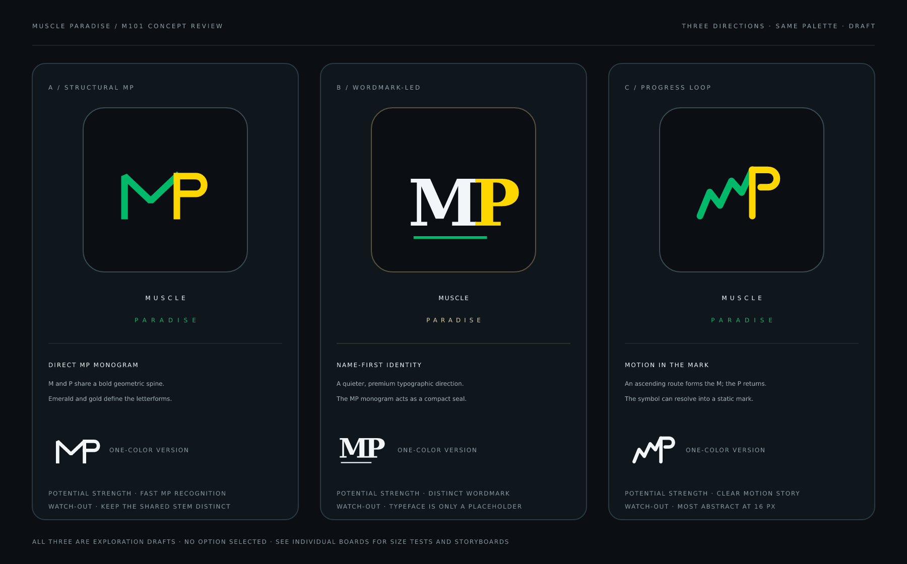
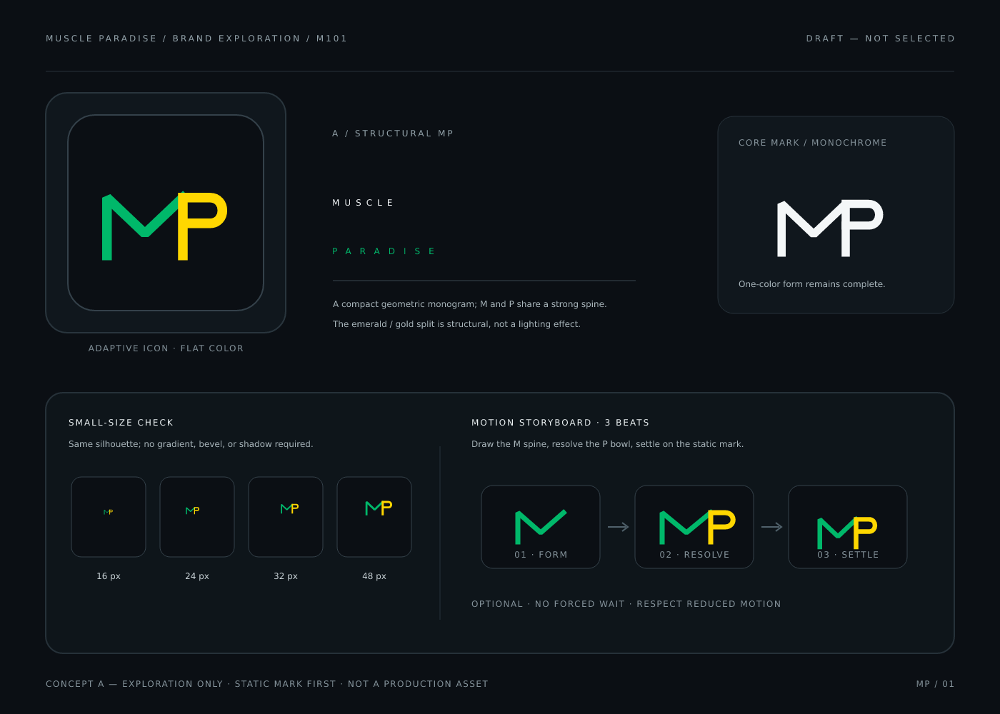
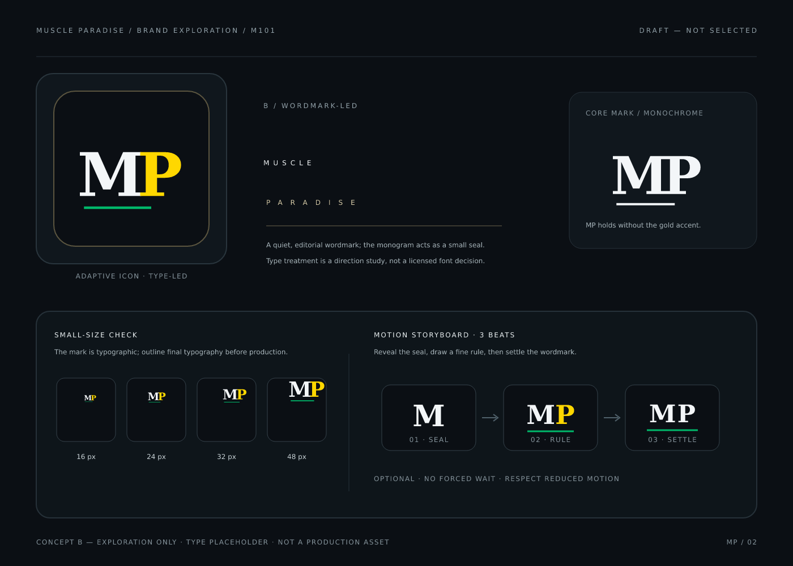
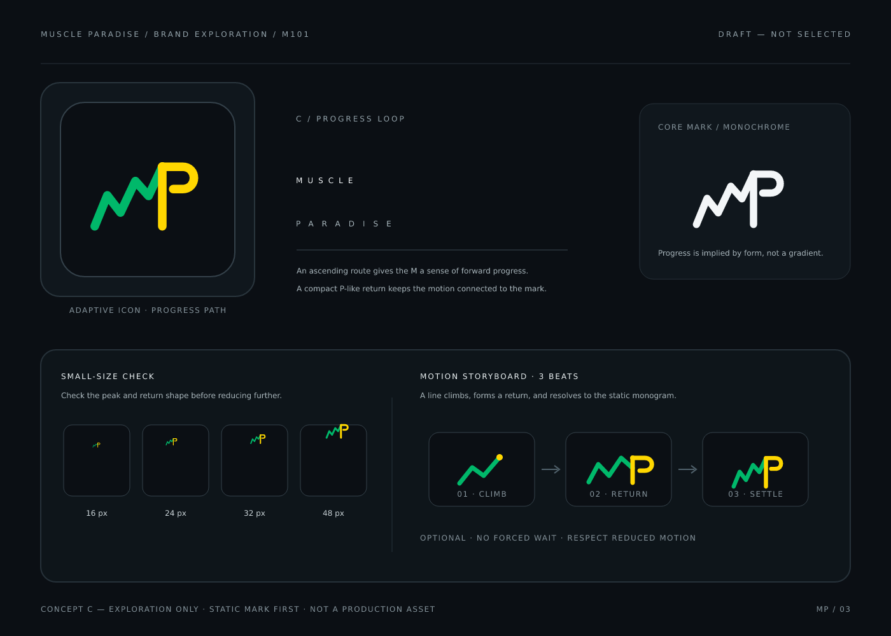

# M101 — سه گزینهٔ اولیهٔ هویت MP

> **پیش‌نویس برای ارزیابی، نه لوگوی نهایی.** هر گزینه SVG قابل‌ویرایش و PNG preview مستقل دارد. هیچ‌کدام به اپ وصل نشده‌اند و `app_icon.png` فعلی محفوظ است.

## مقایسهٔ یک‌تصویری

این تصویر از همان سه concept زیر ساخته شده تا مقایسهٔ هم‌زمان آسان باشد؛ گزینهٔ چهارم یا انتخاب نهایی نیست. [منبع SVG مقایسه](m101-three-options-comparison.svg).

## گزینه A — Structural MP

- **فرم:** M و P یک ستون مشترک دارند؛ سبز و طلایی نقش ساختاری دارند، نه بافت/گرادیان.
- **فرضیهٔ قوت:** از سه گزینه مستقیم‌ترین اشاره به MP را دارد و می‌تواند در app icon و lockup مشترک استفاده شود.
- **ریسک برای بازبینی:** ممکن است ترکیب «M هندسی + P» به یک مونوگرام نسبتاً عمومی تبدیل شود؛ باید در اندازهٔ کوچک و کنار نام کامل تمایز کافی نشان دهد.
- منبع برداری: [SVG](m101-a-geometric-mp.svg)

## گزینه B — Wordmark-led

- **فرم:** wordmark دوخطی و serif با monogram سادهٔ MP؛ تاکید روی نام Muscle Paradise است نه نماد وزنه.
- **فرضیهٔ قوت:** کم‌جزئیات و متمایز از آیکن‌های کلیشه‌ای بدنسازی؛ برای header و صفحهٔ ورود مناسب است.
- **ریسک برای بازبینی:** حس پریمیوم/ادیتوریال شاید از قدرت و انرژی باشگاه فاصله بگیرد؛ فونت نمایش صرفاً placeholder است و انتخاب فونت/مجوز انجام نشده.
- منبع برداری: [SVG](m101-b-wordmark-led.svg)

## گزینه C — Progress Loop

- **فرم:** مسیر رو به بالا، قله‌های تمرینی و بازگشت P‌مانند را در یک نماد پیوسته ترکیب می‌کند.
- **فرضیهٔ قوت:** از نظر حرکت، روایت «پیشرفت → تکمیل → تثبیت» را می‌شود با همان نشان ایستا ساخت.
- **ریسک برای بازبینی:** از سه گزینه انتزاعی‌ترین است؛ به‌خصوص در ۱۶px باید بررسی شود که به خط‌خطی یا نمودار عمومی تبدیل نشود.
- منبع برداری: [SVG](m101-c-progress-loop.svg)

## مقایسهٔ heuristic — نه user research و نه تأیید نهایی

| معیار | A · Structural MP | B · Wordmark-led | C · Progress Loop |
|---|---|---|---|
| شناسایی MP | مستقیم‌ترین فرضیه؛ تست کاربر نشده | خوانایی تایپوگرافیک؛ وابسته به فونت نهایی | P‌مانند + حرکت؛ ریسک انتزاع بیشتر |
| حس برند | هندسی/ورزشی | پریمیوم/آرام | پویا/پیش‌رونده |
| app icon کوچک | فرم تمیز؛ اعداد board فقط preview هستند | حروف واضح‌تر، اما serif در ۱۶px نیازمند تست | بیشترین ریسک جزئیات در ۱۶px |
| Motion story | شکل‌گیری M و حل‌شدن P | آشکارشدن seal و خط، سپس wordmark | صعود مسیر و بازگشت P‌مانند |
| تصمیم | مسیر انتخاب نشده | مسیر انتخاب نشده | **جهت منتخب کاربر؛ artwork نهایی باز است** |

این جدول **ارزیابی اولیهٔ طراحانه** است، نه نتیجهٔ user research یا تست بازار. امتیاز heuristic زیر برای M102 بر اساس همین boardها ثبت شده است؛ خوانایی در اندازهٔ واقعی هنوز نیازمند تست است. اگر مفهوم در ۱۶px ضعیف است، optical variant ساده‌تر از کوچک‌کردن کورکورانه ساخته می‌شود.

## M102 — تصمیم مسیر

کاربر پس از مقایسهٔ یک‌تصویری، **C — Progress Loop** را بهترین مسیر انتخاب کرد. این انتخاب مسیر طراحی را تأیید می‌کند، نه هر جزئیات artwork و نه جایگزینی فوری آیکن اپ.

| گزینه | خوانایی ۲۵ | تشخیص MP ۲۰ | تناسب برند ۲۰ | چندزمینه‌ای ۲۰ | Motion/accessibility ۱۵ | جمع heuristic / ۱۰۰ |
|---|---:|---:|---:|---:|---:|---:|
| A · Structural MP | ۴/۵ | ۵/۵ | ۴/۵ | ۴/۵ | ۳/۵ | ۸۱ |
| B · Wordmark-led | ۳/۵ | ۵/۵ | ۳/۵ | ۳/۵ | ۲/۵ | ۶۵ |
| **C · Progress Loop** | ۳/۵ | ۴/۵ | ۵/۵ | ۴/۵ | ۵/۵ | **۸۲ — مسیر انتخاب‌شده** |

فرمول: `Σ(score ÷ 5 × weight)`. این امتیازها **نظر طراحی/ارزیابی اکتشافی** هستند، نه user research، تست A/B یا سنجش واقعی Android launcher. مزیت C تناسب حرکتی و روایت پیشرفت است؛ ریسک ثبت‌شده‌اش خوانایی در ۱۶px و انتزاع بیشتر از A است. M103 باید با optical simplification این ریسک را کم کند، بدون حذف معنای پیشرفت.

## وجه مشترک و محدودیت

- هر سه در زمینهٔ `#0B0F14`، با emerald `#00B86A` و gold `#FFD700` ساخته شده‌اند تا فرم‌ها با شرایط یکسان مقایسه شوند؛ انتخاب پالت هنوز نهایی نیست.
- روی هر برد icon tile، نسخهٔ تک‌رنگ، نمایش ۱۶/۲۴/۳۲/۴۸px و storyboard سه‌مرحله‌ای وجود دارد. این preview به‌تنهایی گواه خوانایی روی دستگاه واقعی نیست.
- متن‌های نمونه و فونت‌های سیستم فقط برای ارزیابی layout هستند. هیچ فونت نهایی، tagline فارسی، مجوز asset یا انطباق با launcher mask تأیید نشده.
- حرکت اختیاری و غیرمسدودکننده است؛ static mark باید مستقل و کامل بماند.
- فایل‌ها صرفاً در `docs/MuscleParadise/brand/concepts/` هستند؛ نه launcher، Studio، README و نه dependencyهای محصول تغییر نکرده‌اند.

## وضعیت loop

- **M101: `PASS`** — سه board مستقل، SVG vector source، PNG preview، monochrome mark و storyboard ساخته و مرور شدند.
- **M102: `PASS`** — کاربر C را انتخاب کرد؛ انتخاب و امتیازهای اکتشافی بالا ثبت شدند. این تأیید، artwork یا تعویض آیکن محصول را نهایی نمی‌کند.
- **M103: `PASS` (static identity only)** — بستهٔ `../selected-c/M103-C-PACKAGE.md` شامل mark/lockup، cut 16px، نسخه‌های روشن/تیره/تک‌رنگ و adaptive layers است؛ Vazirmatn با مجوز موجود انتخاب شد. هیچ asset محصولی جایگزین یا ادغام نشده؛ آزمون launcher واقعی در M106 باقی است.
- گام مستقل M104 سنجش startup هنوز لازم است پیش از هر reveal؛ پیاده‌سازی M105 تا بستهٔ دارایی و شواهد startup انجام نشود.
