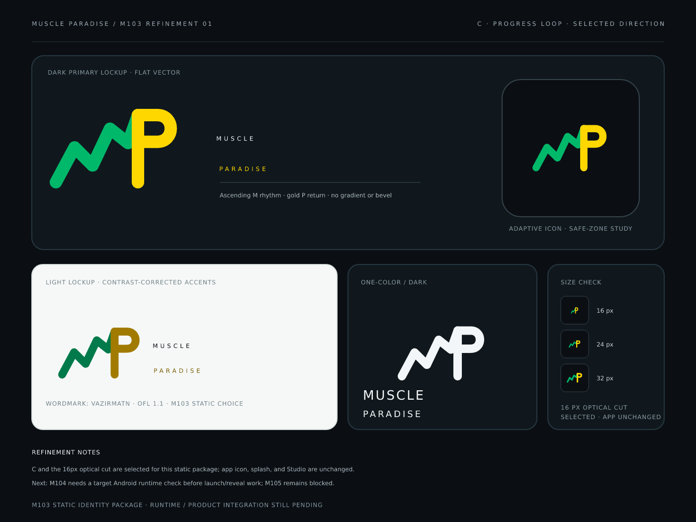

# M103 — Progress Loop / بستهٔ بازبینی C

> کاربر در **۲۰۲۶-۱۱-۱۶** مسیر C و برش optical شانزده‌پیکسلی را برای ادامه انتخاب کرد و سپس پیشبرد همهٔ micro-loopها را بدون توقف خواست. در M103، Vazirmatn موجود به‌عنوان فونت lockup انتخاب شد؛ بستهٔ هویت ثابت اکنون آماده است (`PASS`). این **اتصال به Client/Android launcher/Studio، تغییر آیکن اپ یا انتشار** نیست؛ آن‌ها گیت‌های جدا هستند.

## برد بازبینی

این برد از همان هندسهٔ SVG mark و palette فایل‌های مستقل استفاده می‌کند. [آزمون رستری ۱۶/۲۴/۳۲px](m103-mark-size-check.png) خروجی‌های دقیق‌پیکسلی را فقط برای بازبینی بزرگ‌نمایی می‌کند؛ تست کاربر یا دستگاه نیست.

منبع قابل‌ویرایش برد: [SVG](m103-c-progress-loop-refinement.svg).

## فایل‌های هویت

| فایل | کاربرد | وضعیت |
|---|---|---|
| [mp-progress-mark.svg](mp-progress-mark.svg) · [PNG](mp-progress-mark.png) | master رنگیِ مستقل، زمینه شفاف | M103 master vector |
| [mp-progress-mark-mono.svg](mp-progress-mark-mono.svg) · [PNG](mp-progress-mark-mono.png) | نشان سفید تک‌رنگ، زمینه شفاف برای سطوح تیره | M103 mono variant |
| [mp-progress-mark-mono-dark.svg](mp-progress-mark-mono-dark.svg) · [preview روی روشن](mp-progress-mark-mono-dark.png) | نشان تک‌رنگ جوهری `#0B0F14`؛ SVG شفاف برای سطوح روشن | M103 mono variant |
| [mp-progress-mark-16px.svg](mp-progress-mark-16px.svg) · [PNG 16×16](mp-progress-mark-16px.png) | برش optical اختصاصی؛ P counter بازتر و stroke کمی سنگین‌تر است | M103 small-size master برای ۱۶–۲۳px؛ زیر ۱۶px پشتیبانی نمی‌شود |
| [mp-progress-lockup-dark.svg](mp-progress-lockup-dark.svg) · [PNG](mp-progress-lockup-dark.png) | lockup اصلی روی زمینهٔ تاریک | M103 master؛ Vazirmatn Bold/Regular |
| [mp-progress-lockup-light.svg](mp-progress-lockup-light.svg) · [PNG](mp-progress-lockup-light.png) | lockup رنگی برای زمینهٔ روشن؛ accents تیره‌تر شده‌اند | M103 master؛ Vazirmatn Bold/Regular |
| [mp-progress-lockup-mono-dark.svg](mp-progress-lockup-mono-dark.svg) · [PNG](mp-progress-lockup-mono-dark.png) | lockup تک‌رنگ سفید برای زمینهٔ تیره | M103 master؛ Vazirmatn Bold/Regular |
| [mp-progress-lockup-mono-light.svg](mp-progress-lockup-mono-light.svg) · [PNG](mp-progress-lockup-mono-light.png) | lockup تک‌رنگ `#0B0F14` برای زمینهٔ روشن | M103 master؛ Vazirmatn Bold/Regular |
| [mp-progress-foreground.svg](mp-progress-foreground.svg) · [PNG](mp-progress-foreground.png) | foreground شفاف با حاشیهٔ محافظه‌کارانه برای adaptive icon | لایهٔ جدا؛ هنوز زیر mask واقعی Android تست نشده |
| [mp-progress-background.svg](mp-progress-background.svg) · [PNG](mp-progress-background.png) | background جدا با `#0B0F14` | لایهٔ جدا |
| [mp-progress-icon-preview.svg](mp-progress-icon-preview.svg) · [PNG](mp-progress-icon-preview.png) | پیش‌نمایش تخت‌شدهٔ mark + background | فقط preview؛ برای adaptive launcher همین فایل به‌تنهایی مصرف نشود |

## تایپوگرافی انتخاب‌شده برای M103

`MUSCLE` از Vazirmatn Bold و `PARADISE` از Vazirmatn Regular استفاده می‌کند. این انتخاب طراحی برای بستهٔ ثابت M103 است: Vazirmatn از قبل در اپ موجود است، برای متن لاتین هم preview شده و مجوز آن OFL 1.1 است ([license](../../../../mp-app/client/assets/fonts/OFL-Vazirmatn.txt)). SVGهای lockup متن قابل‌ویرایش با `font-family="Vazirmatn"` دارند؛ PNGها با TTFهای موجود رندر شده‌اند. فایل فونت یا dependency جدیدی اضافه نشده است.

## مشخصات بستهٔ M103

- **معنا:** مسیر سبز با ریتم صعودیِ M، به P بازمی‌گردد؛ نقطهٔ طلایی نقطهٔ اوج/تکمیل را مشخص می‌کند. نشان در حالت ثابت کامل است؛ حرکت لازم نیست تا حروف فهمیده شوند.
- **رنگ dark:** background `#0B0F14`، سبز `#00B86A`، طلایی `#FFD700`، wordmark `#F3F6F8`. همهٔ exportهای رنگی dark باید همین palette را دنبال کنند.
- **رنگ light:** زمینه `#F6F8F7`، سبزِ تیره‌تر `#007A4A`، طلاییِ تیره‌تر `#A17B00`، متن `#0B0F14`/`#795C00`.
- **بررسی contrast اولیه:** نسبت‌های محاسبه‌شده از رنگ‌های sRGB این‌اند: green/dark `7.38:1`، gold/dark `13.70:1`، light green/light `5.07:1`، light graphic gold/light `3.68:1` و متن gold `5.89:1`. طلایی `#A17B00` فقط برای نشان گرافیکی است، نه متن ریز؛ این محاسبه جایگزین تست دسترس‌پذیری یا بررسی روی دستگاه نیست.
- **Clear space:** حداقل ۱× ضخامت stroke دور mark حفظ شود؛ در lockup افقی فاصلهٔ دیداری mark تا wordmark نیز دست‌کم برابر ضخامت stroke است. اجزای دیگر، متن و لبهٔ ظرف وارد این فضا نشوند.
- **Minimum size و optical rule:** برای mark در ۱۶–۲۳px از `mp-progress-mark-16px.svg` استفاده شود؛ master اصلی از ۲۴px به بالا است؛ زیر ۱۶px پشتیبانی نمی‌شود. رسترهای دقیقِ ۱۶/۲۴/۳۲px مرور شدند؛ اندازه‌های میانی از همان بردار مقیاس می‌گیرند و هنوز روی launcher واقعی تست نشده‌اند. Lockup کامل از عرض ۲۴۰px به بالا استفاده شود.
- **فونت:** همهٔ lockupهای M103 از Vazirmatn Bold/Regular استفاده می‌کنند. فونت از قبل در اپ موجود است و `OFL 1.1` دارد ([license](../../../../mp-app/client/assets/fonts/OFL-Vazirmatn.txt)); فایل TTF و dependency جدیدی اضافه نشده است. SVGها text قابل‌ویرایش دارند و به font-family موجود ارجاع می‌دهند.
- **منشأ:** هندسهٔ نشان برای این concept از نو به‌صورت SVG ساخته شده؛ تصویر stock یا کد کتابخانهٔ وب وارد نشده است. مجوز فونت محلی است و پیش‌نمایش‌ها با TTF همان پروژه رندر شده‌اند.

## گیت‌های جدا از M103

بستهٔ هویت ثابت و راهنمای بازتولید static تکمیل شده‌اند. تست واقعی adaptive mask، cold/warm startup، reduced-motion و ادغام احتمالی در Client/Studio باید در M104–M106 و پس از دسترس‌بودن SDK/device انجام شود. تا آن زمان:

- `mp-app/client/assets/logo/app_icon.png` حفظ می‌شود؛
- `pubspec.yaml`، `flutter_launcher_icons` و XMLهای launch دست‌نخورده می‌مانند؛
- هیچ Splash/Reveal یا dependency جدیدی اضافه نمی‌شود.

**وضعیت:** `PASS` برای بستهٔ static هویت M103 فقط؛ هیچ تغییر محصولی، release یا جایگزینی آیکن انجام نشده است.
