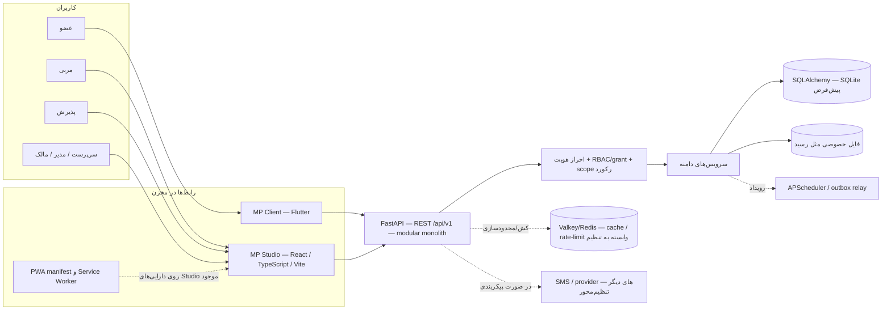

# ۱. نقشهٔ پروژه و معماری

[بازگشت به فهرست راهنما](README.md)

## ۱.۱ Muscle Paradise چیست؟

Muscle Paradise یک سامانهٔ نرم‌افزاری برای کارهای یک باشگاه ورزشی است: اعضا حساب و اشتراک خود، تمرین، ارزیابی، تغذیه، حضور، ارتباط و بعضی اطلاعات مالی شخصی را می‌بینند؛ کارکنان باشگاه اعضا و عملیات روزانه را مدیریت می‌کنند. سرویس‌های مشترک مثل احراز هویت، قواعد دامنه، مجوز، گزارش و ذخیره‌سازی در API مرکزی قرار دارند.

این توصیف **دامنهٔ محصول** است، نه ادعای این‌که همهٔ جریان‌ها کامل یا آنلاین‌اند. برای نمونه، کد کاتالوگ فروشگاه و checkout هر دو وجود دارند، اما تصمیم محصول فعلی خرید اینترنتی عضو را نمی‌خواهد و مسیر باید fail-closed بماند؛ endpoint کارت‌به‌کارت هم به‌تنهایی تأیید واریز نیست.

## ۱.۲ کاربران و واژه‌های دامنه

| نقش فعلی در کد | معنی رابط | خلاصهٔ مرز |
|---|---|---|
| `member` | عضو | دیدن و انجام کارهای مجاز مربوط به خود؛ مالکیت رکورد در API کنترل می‌شود. |
| `coach` | مربی | بخش‌های مربی‌گری و دادهٔ اعضا در حدود مجوزهای server-side. |
| `reception` | پذیرش | ثبت‌نام، پرداخت/رسیدگی پذیرش و حضور، با محدودیت روی گزارش مالی خالص. |
| `manager` | سرپرست | عملیات مدیریت در حدود سیاست‌های مسیر، grant و deny صریح. |
| `admin` | مدیر سیستم | نقش مجزا از `super_admin`؛ نباید صرف نام «مدیر» آن را مالک کامل دانست. |
| `super_admin` | مالک سیستم | نقش ممتاز؛ عملیات تغییر نقش/تنظیم‌های مالک در مسیرهای محدودشده. |

شش نقش بالا، نقش‌های جاری و تصمیم ثبت‌شدهٔ مالک‌اند. برخی اسناد معماری قدیمی‌تر از نقش هدف سه‌تایی حرف می‌زنند؛ آن را کد یا سیاست جاری تلقی نکنید. نقش به‌تنهایی نیز مجوز کافی نیست: Casbin، `Depends`, grantهای زمان‌دار، مالکیت عضو و قواعد خود سرویس ممکن است دسترسی را بیشتر محدود کنند.

مفاهیم مهم:

- **عضو (`Member`)**: پروفایل و ویژگی‌های باشگاهیِ متصل به یک کاربر (`User`).
- **اشتراک (`Membership`)**: دوره/وضعیت استفادهٔ عضو از خدمات باشگاه؛ زمان انقضا و فعال‌بودن جدا از پرداخت هستند.
- **پرداخت (`Payment`)**: رویداد مالی با وضعیت و روش پرداخت. بارگذاری فیش معادل وصول وجه نیست.
- **برنامه (`WorkoutProgram`)**: خروجی تمرین، شامل هفته و حرکت؛ وضعیت draft/نیازمند بازبینی/تأیید را با انتشار به عضو یکی نگیرید.
- **ارزیابی (`Assessment`)**: اندازه‌گیری‌های بدن/توانایی؛ عدد اندازه‌گیری‌شده به‌خودی‌خود تشخیص پزشکی نیست.
- **چک‌این (`CheckIn`)**: ثبت رویداد حضور؛ ورود و خروج دو زمان جدا هستند. QR یک‌بارمصرف با تشخیص چهره یکی نیست.
- **دفتر مالی (`LedgerEntry`)**: رویدادهای مالی و ردیف‌های اصلاحی؛ با ماندهٔ کیف‌پول و با گزارش درآمد/سود مفهومی جدا دارد.
- **رویداد outbox/inbox**: سازوکار تحویل رویداد و جلوگیری از گم‌شدن/تکرار اثر؛ اعلان داخلی را با push تحویل‌شده اشتباه نگیرید.

## ۱.۳ نمای کلی سامانه



خط چین نشان‌دهندهٔ وابستگی یا مرز مشروط است؛ نمودار جای آزمون runtime نیست. Backend در کد یک **مونولیت ماژولار** FastAPI است، نه چندین سرویس مستقل. منطق HTTP در routerها، قواعد کاربردی عمدتاً در serviceها و ذخیره‌سازی در مدل‌های SQLAlchemy است. ماژول‌های دامنه یک فرایند برنامه و یک قرارداد REST مشترک را به‌کار می‌برند.

### چرخهٔ معمول درخواست

1. کاربر در صفحه intent خود را وارد می‌کند؛ ورودی و وضعیت pending در رابط مدیریت می‌شوند.
2. Client/Studio درخواست JSON را به `/api/v1` می‌فرستد؛ Studio در توسعه از proxy نسبی Vite استفاده می‌کند.
3. FastAPI درخواست را با شناسهٔ درخواست، rate limit، validation و handler خطا پردازش می‌کند.
4. مسیر محافظت‌شده نشست JWT را می‌خواند؛ سیاست نقش/مسیر و سپس مالکیت رکورد یا grant بررسی می‌شود.
5. Router دادهٔ معتبر را به سرویس دامنه می‌دهد؛ سرویس قانون تجاری را اعمال و در صورت اجازه DB/فایل/provider را تغییر می‌دهد.
6. پاسخ ساختاریافته برمی‌گردد؛ کلاینت دادهٔ متعلق به خود را به‌روز می‌کند یا خطا/تعارض/Retry را نشان می‌دهد.

فهرست عملیات واقعی در [کاتالوگ API](../architecture/session-decisions-2026-11-23/API-ROUTE-CATALOG.md) و ماتریس صفحه‌به‌endpoint در [نقشهٔ تعامل](../architecture/interaction-map.json) است. این دو inventory ایستا هستند؛ هیچ‌کدام صحت هر مسیر یا اجرای همهٔ صفحه‌ها را ثابت نمی‌کنند.

## ۱.۴ نقشهٔ واقعی مخزن

```text
MP/
├── mp-app/
│   ├── backend/       FastAPI، مدل/مهاجرت، امنیت، job، تست و اسکریپت
│   ├── client/        اپ عضو Flutter و هدف Android/Flutter Web
│   ├── studio/        پنل React/TypeScript، PWA assets و Electron
│   ├── deploy/        Compose/Nginx/backup برای یک توپولوژی استقرار
│   ├── infra/         Compose/Caddy/Valkey/monitoring/Ansible و image backend
│   └── shared/        دارایی‌های مشترک مثل design tokens
├── docs/              مستندات مخزن و MuscleParadise
├── scripts/           گیت‌ها و ابزارهای اسناد/نقشه/بهداشت مخزن
├── .github/workflows/ CI، وب Flutter، image و deploy دستی
├── finn/              گزارش‌ها و خروجی‌های handoff/بازبینی
├── evidence/          شواهد و inventory آزمایشی؛ هر مورد historical/synthetic را با وضعیتش بخوان
└── artifacts/         خروجی‌های جانبی/مرجع؛ لزوماً جزء runtime یا release نیستند
```

این درخت خلاصه است؛ [`docs/MuscleParadise/MASTER_MAP.md`](../MASTER_MAP.md) صریحاً تاریخی/آرشیوی است و درخت پیشنهادی آن را ساختار واقعی امروز ندانید. به‌طور خاص پوشه‌های قدیمیِ مورد اشارهٔ آن، مانند kiosk مستقل یا ORM drift، نباید بدون `find` در checkout فرض شوند. ساختار اجرای واقعی از فایل‌های همین checkout خوانده شود.

### مهم‌ترین پوشه‌های Backend

- `app/`: ساخت اپ، تنظیمات، خطاها، middleware، dependency و سیاست امنیتی HTTP.
- `api/v1/`: تجمیع routerها و monitoring؛ URL عمومی API با پیشوند `/api/v1` نصب می‌شود.
- `modules/<domain>/`: router، schema، service و گاه adapterهای هر دامنه.
- `db/models/`: مدل‌های SQLAlchemy؛ import در `db.models` آن‌ها را برای metadata ثبت می‌کند.
- `db/migrations/versions/`: تغییرات نسخه‌دار Alembic؛ `Base.metadata.create_all` جایگزین migration تولیدی نیست.
- `security/`: Casbin/RBAC، رمزنگاری و توابع امضای token/مالکیت.
- `jobs/`, `cache/`: پردازش دوره‌ای و کش؛ تعریف کد با راه‌اندازی worker یکی نیست.
- `tests/{unit,integration,regression,e2e,load,evaluation}/`: آزمون‌ها برحسب نوع؛ نام پوشه به‌تنهایی تضمین اجرای همهٔ آن‌ها نیست.

### مهم‌ترین پوشه‌های Client

- `lib/core/`: API client، نشست، router، state مشترک، theme/motion و قابلیت‌های محدود آفلاین.
- `lib/features/`: صفحات عضو به تفکیک auth، خانه، today، assessment، progress، profile، nutrition، check-in، کلاس، chat، notification، shop و wallet.
- `android/`: میزبان native Android؛ Kotlin `MainActivity` بخشی از outbox اختیاری را پیاده می‌کند.
- `test/`: unit/widget و تست‌های API/session/outbox؛ `integration_test/` را فقط اگر در checkout باشد بررسی کنید.

### مهم‌ترین پوشه‌های Studio

- `src/App.tsx`: gate نشست و map صفحهٔ انتخابی.
- `src/pages/`: دوازده سطح staff: Dashboard, Members, Programs, Nutrition, Assessment, Chat, CheckIn, Finance, Expenses, Analytics, Settings, Shop.
- `src/components/`: navigation، feedback، فرم‌ها و بخش‌های مشترک.
- `src/lib/`: API/session/role/motion/design tokens.
- `src/stores/`: وضعیت رابط، از جمله صفحهٔ انتخابی و فیلتر؛ store رابط را با منبع حقیقت دادهٔ سمت سرور یکی نگیرید.
- `public/`: manifest، icons و service worker؛ وجود آن‌ها به معنی تکمیل تجربة عضو در PWA نیست.
- `electron/`: بسته‌بندی/پوستهٔ دسکتاپیِ حفظ‌شده، نه هدف انتشار تازهٔ تأییدشده.

## ۱.۵ پایگاه داده و مرز multi-tenancy

تنظیم پیش‌فرض در [`app/config.py`](../../../mp-app/backend/app/config.py) مقدار `sqlite:///./mp.db` است. URL از تنظیمات خوانده می‌شود و SQLAlchemy/Alembic راه تغییر backend دیتابیس را باز می‌گذارند، اما این امر سازگاری production با PostgreSQL یا مهاجرت آزموده‌شده را ثابت نمی‌کند. مالک SQLite را فعلاً انتخاب کرده است.

مدل پایه `Base` و mixinهای `TimestampMixin` و `BranchMixin` در [`db/base.py`](../../../mp-app/backend/db/base.py) هستند. `branch_id` در بعضی مدل‌های اصلی پیش‌بینی شده، اما تصمیم محصول فعلی تک‌باشگاه است؛ وجود ستون branch را با اجرای چندباشگاهی/tenant isolation کامل برابر ندانید. جدول واقعی و روابط هر model را در فایل همان مدل ببینید؛ فهرست دامنه‌ای در [Backend و داده](02-backend-and-data.md) آمده است.

## ۱.۶ تصمیم‌های محصول در برابر کد فعلی

| موضوع | تصمیم/سیاست ثبت‌شده | آنچه وجود کد ثابت می‌کند | آنچه هنوز ثابت نمی‌کند |
|---|---|---|---|
| کلاینت انتشار اول | ADR-007: یک PWA مشترک React برای عضو و کادر بر پایهٔ Studio؛ Flutter/Android حفظ شود. | Studio، manifest و SW موجودند؛ Flutter Client نیز فعال است. | تکمیل PWA عضو/کادر، installability، parity، device QA یا مجوز Go/No-Go. |
| پرداخت | کارت‌به‌کارت با رسید خصوصی و تطبیق انسانی؛ عکس رسید، وصول وجه نیست. | مدل/route/service پرداخت و receipt وجود دارد. | تطبیق بانکی مستقل، بانک live، تسویه، تجربهٔ انتشار یا تنظیم عملیاتی. |
| فروشگاه | برای عضو نمایش‌محور؛ خرید حضوری. | `shop_online_purchase_enabled` به‌طور پیش‌فرض false و سرویس در این وضعیت fail-closed است. | تمام مسیرهای legacy حذف شده‌اند یا checkout عضو برای انتشار مجاز است. |
| حضور | QR یک‌بارمصرف؛ تشخیص چهرهٔ سروری فعال فرض نشود. | token QR و digest یک‌بارمصرف در مسیر check-in دیده می‌شود؛ `method=face` رد می‌شود. | آزمون کیوسک/گوشی فیزیکی، نصب عملی، پذیرش کاربر و تشخیص زندهٔ چهره. |
| مدل AI | موتور قواعد برای عددهای تمرین؛ inference/API بیرونی ممنوع؛ مدل تا تأیید مجاز محلی در وضعیت BLOCKED. | موتور قواعد و adapterهای اختیاری در source هستند. | کیفیت پزشکی، provider محلی تأییدشده، مدل/وزن دارای مجوز یا اتصال production. |
| میزبانی | سرور محلی باشگاه + ورودی HTTPS؛ جزئیات اپراتوری باز. | دو Compose، Caddy/Nginx، backup و health code وجود دارند. | DNS/TLS واقعی، حساب میزبان، secret manager، deploy یا recovery drill محیط واقعی. |

### وضعیت PWA: تصمیم پذیرفته‌شده ≠ قابلیت کامل

[ADR-007](../adr/007-pwa-primary-release.md) baseline انتشار اول را PWA مشترک انتخاب می‌کند و صریحاً `NO-GO` می‌گذارد تا جریان‌های اصلی و گیت‌های امنیت، حریم، عملیات و دستگاه با شواهد همان artifact پذیرفته شوند. در snapshot کد فعلی، `studio/src/App.tsx` هنوز UI دوازده صفحهٔ کارکنان را تعریف می‌کند؛ صفحات عضو در Flutter هستند. پس تصمیم PWA را به‌عنوان **تصمیم محصول** ثبت کنید، ولی PWA مشترک عضو/کادر را **پیاده‌شده یا آمادهٔ انتشار** ننویسید.

## ۱.۷ منابعی که نباید با هم اشتباه شوند

- **Source:** کد و تست جاری در `mp-app/`.
- **Contract inventory:** `api/routes.json` و کاتالوگ API؛ شرح عملیات اعلام‌شده، نه اثبات اجرا.
- **Decision:** ADR و پاسخ مستقیم مالک؛ می‌گوید چه می‌خواهیم، نه چه چیزی اکنون کار می‌کند.
- **Historical handoff/report:** شرح یک snapshot گذشته؛ شمارش/CI آن را به HEAD فعلی تعمیم ندهید.
- **Target/design:** diagram، mockup و plan؛ هر جهت آینده باید صریحاً برچسب `هدف`, `OPEN`, `NOT_RUN` یا `BLOCKED` داشته باشد.

## ۱.۸ مطالعهٔ پیشنهادی برای فرد تازه‌وارد

1. شروع از همین راهنما، سپس [README ریشه](../../../README.md) و [AGENTS.md](../../../AGENTS.md) برای قواعد و quickstart.
2. برای تصویر اجزا: [Architecture Atlas](../architecture/README.md) و [System Atlas](../architecture/system-atlas.md)؛ در کنار آن برچسب‌ها و محدودیت نقشه را بخوانید.
3. برای یک مسیر end-to-end انتخابی، [دفتر wiring](../architecture/session-decisions-2026-11-23/WIRING-LEDGER.md) را از UI تا route/service/model دنبال کنید؛ بعد فایل تست همان سناریو را باز کنید.
4. برای همهٔ endpointها [کاتالوگ API](../architecture/session-decisions-2026-11-23/API-ROUTE-CATALOG.md) را بخوانید و سپس `security/rbac.py`، ownership helper و router/service را بررسی کنید.
5. پیش از هر عملیات اجرایی، [TODO canonical](../TODO-2026-11-16.md)، [چک‌لیست انتشار](../RELEASE-CHECKLIST.md) و [راهنمای استقرار](../DEPLOYMENT.md) را با source جاری تطبیق دهید؛ در این checkout حداقل یک تعارض مستند-کد دربارهٔ درگاه وجود دارد که در [بخش وضعیت/امنیت](05-security-status-glossary.md#اختلاف-و-کهنگی-مستندات) مشخص شده است.
