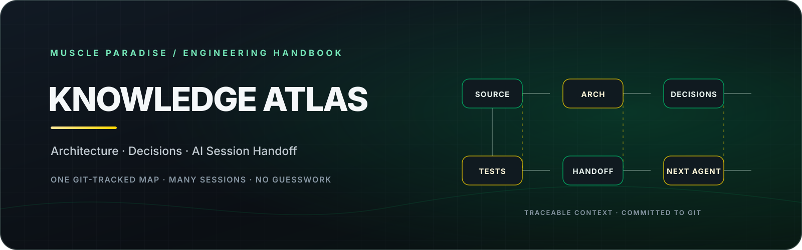

  
  
<strong>یک نقشهٔ خوانا برای آدم‌ها و ایجنت‌ها؛ متصل به کد، تصمیم‌ها و وضعیت واقعی پروژه.</strong>

  

    <a href="../AGENTS.md">راهنمای ایجنت</a> ·
    <a href="MuscleParadise/SESSION_HANDOFF.md">handoff جاری</a> ·
    <a href="../README.md">صفحهٔ پروژه</a>
  

> **اصل راهنما:** نشست تازه لازم نیست کل مخزن را دوباره بخواند؛ باید handoff را بگیرد، سند مرتبط را پیدا کند و ادعا را در کد و تست تأیید کند. این صفحه فهرست مسیرهاست، نه جایگزین منبع اصلی.

## 🧭 شروع یک نشست تازه

**گام‌های شروع:**

1. وضعیت شاخه و فایل‌های محلی را ببین؛ تغییرهای موجود را حفظ کن.
2. [راهنمای ایجنت](../AGENTS.md) و [handoff جاری](MuscleParadise/SESSION_HANDOFF.md) را بخوان.
3. در سربرگ TODO مشخص کن کدام فهرست/نقشه واقعاً جاری است؛ فقط بخش مربوط به کار را بخوان.
4. به C4، نقشهٔ ماژول‌ها و ADR مرتبط سر بزن؛ بعد کد و تست همان مسیر را بررسی کن.
5. هم‌زمان با تغییر، شواهد را اجرا و مستندات لازم را به‌روز کن؛ قبل از پایان handoff را تحویل بده.

## 🗂️ دروازه‌های مستندات

| اگر می‌خواهی… | از اینجا شروع کن | مرجع تکمیلی |
|---|---|---|
| سریع بفهمی نشست قبل چه کرد و بعد چه باید کرد | [SESSION_HANDOFF](MuscleParadise/SESSION_HANDOFF.md) | [صف و وضعیت جاری](MuscleParadise/TODO-2026-11-16.md) |
| ساختار سیستم یا مرز بک‌اند را بفهمی | [Architecture Atlas](MuscleParadise/architecture/README.md) | [C4](MuscleParadise/architecture/c4.md) · [نقشهٔ ماژول‌ها](MuscleParadise/architecture/module-map.md) |
| چرایی یک انتخاب را پیدا کنی | [فهرست ADRها](MuscleParadise/adr/README.md) | [قالب ADR](MuscleParadise/adr/TEMPLATE.md) |
| اجرای loop و وضعیت ECC/REA را بفهمی | [پروتکل FINN](MuscleParadise/FINN_LOOP.md) | [نقشهٔ M63–M99](MuscleParadise/LOOP-PLAN-M63-M99.md) · [نقشهٔ M100–M106](MuscleParadise/LOOP-PLAN-M100-M106.md) |
| محدودهٔ محصول/رفتار موردانتظار را بفهمی | [PRD](MuscleParadise/PRD.md) | [User stories](MuscleParadise/user-stories/) · [صف ساخت](MuscleParadise/BUILD-QUEUE.md) |
| قواعد طراحی و هویت بصری را رعایت کنی | [Design system](MuscleParadise/design/design-system.md) | [بریف هویت برند](MuscleParadise/BRAND-IDENTITY-BRIEF-2026-11-16.md) |
| حریم خصوصی و ریسک‌های داده را بررسی کنی | [سیاست بیومتریک](MuscleParadise/security/biometric-policy.md) | [نگهداری داده](MuscleParadise/DATA-RETENTION.md) · [چک‌لیست OWASP](MuscleParadise/security/owasp-checklist.md) |
| تست، انتشار یا عملیات را اجرا کنی | [README اصلی](../README.md) | [Deployment](MuscleParadise/DEPLOYMENT.md) · [Ops runbook](MuscleParadise/OPS-RUNBOOK.md) · [Tooling](MuscleParadise/TOOLING-RUNBOOK.md) |

## 🏋️ محصول در دو سطر

Muscle Paradise یک پلتفرم فارسی‌محور برای عملیات باشگاه است: **MP Client** برای عضو، **MP Studio** برای مربی/پذیرش/مدیر، و **FastAPI** برای قرارداد و منطق مشترک. جزئیات و وضعیت اجرایی هر پیکان در [نقشهٔ C4](MuscleParadise/architecture/c4.md) و source/tests مربوطه بررسی می‌شود.

| سطح | مسیر کد | فناوری/مسئولیت |
|---|---|---|
| اپ عضو | [`mp-app/client/`](../mp-app/client/README.md) | Flutter · مسیرهای عضو، تمرین، تغذیه و check-in |
| پنل تیم باشگاه | [`mp-app/studio/`](../mp-app/studio/README.md) | React · TypeScript · Vite · Electron |
| API و دامنه | [`mp-app/backend/`](../mp-app/backend/README.md) | FastAPI · مونولیت ماژولار · REST نسخه‌دار |
| CI | [`.github/workflows/ci.yml`](../.github/workflows/ci.yml) | lint، تست، build و security gates |

## 🏗️ معماری و قراردادهای تصمیم

- [C4 architecture](MuscleParadise/architecture/c4.md) چهار سطح دارد: context، container، component و الگوی code/module.
- [Module map](MuscleParadise/architecture/module-map.md) مسئولیت ماژول‌ها و جریان‌های مهم را خلاصه می‌کند.
- [ADR registry](MuscleParadise/adr/README.md) فهرست تصمیم‌های پذیرفته‌شده است؛ وضعیت و دلیل کامل در خود هر ADR قرار دارد.
- نمودار باید بگوید چه چیزی واقعاً پیاده/آزموده شده و چه چیزی صرفاً هدف یا فرض است. برای هر ادعای اجرایی، مسیر کد یا تست کنار آن لازم است.

## 🧱 تقدم منابع در صورت تعارض

| موضوع | از کجا حقیقت را بگیر | چه چیزی را بالاتر فرض نکن |
|---|---|---|
| دامنه و اجازهٔ این کار | دستور صریح کاربر در نشست جاری | پیشنهاد یا یادداشت قدیمی |
| رفتار پیاده‌شده | کد + تست/CI همان مسیر | دیاگرام یا README به‌تنهایی |
| صف و وضعیت محصول | TODO/loop plan که خودش صریحاً جاری است | snapshotهای قدیمی و `READY`های تاریخ‌گذشته |
| چرایی معماری | ADR پذیرفته‌شده، با بررسی ناسازگاری با کد جاری | حدس ایجنت |
| وضعیت نشست | SESSION_HANDOFF؛ فقط راهنما و خلاصه | منبع نهایی وضعیت محصول |

`MASTER_MAP.md` و `FINN_LOOP.md` و فایل‌های `READY-TO-RESUME-*` تاریخ‌دار می‌توانند آرشیوی باشند؛ سربرگ هر فایل و TODO جاری را بررسی کن و صف قدیمی را خودکار فعال نکن.

## 🎨 قرارداد دیاگرام و مستندات

- دیاگرام‌ها در Markdown به شکل Mermaid نگهداری شوند؛ GitHub آن‌ها را کنار توضیح و پیوند به منبع نشان می‌دهد.
- هر نقشه وضعیت داشته باشد: **تأییدشده با شاهد**، **هدف/پیشنهادی**، **نامعلوم/آزموده‌نشده** یا **تاریخی/آرشیوی**.
- تغییر ماژول، قرارداد API، مدل داده، جریان حیاتی، امنیت یا عملیات باید مستند متناظر را همان‌جا به‌روز کند.
- ADR پذیرفته‌شده را بازنویسی نکن؛ تصمیم تازه را با شمارهٔ بعدی و پیوند به تصمیم قبلی ثبت کن.
- دستاوردها، محدودیت محیط، تست‌های اجراشده/نشده و قدم بعدی را در handoff ثبت کن؛ رازها و دادهٔ واقعی هرگز وارد مستند نمی‌شوند.
- گیت مستندات را محلی اجرا کن: `python3 scripts/docs_gate.py`. همین گیت در CI هم پیوندهای شکسته و handoff ناقص را می‌گیرد.

> 🧩 **Repowise:** index محلی ابزار کمکی است، نه حافظهٔ قابل‌انتقال. پوشهٔ `.repowise/` Git-ignored است و در clone تازه تضمین نمی‌شود؛ برای انتقال بین نشست‌ها به این مستندات Git-tracked تکیه کن و Repowise را فقط در صورت نصب/اتصال MCP به‌عنوان شتاب‌دهنده به کار ببر.

---

  کد منبع حقیقت رفتار است · Mermaid منبع حقیقت دیاگرام است · handoff پل بین نشست‌هاست

